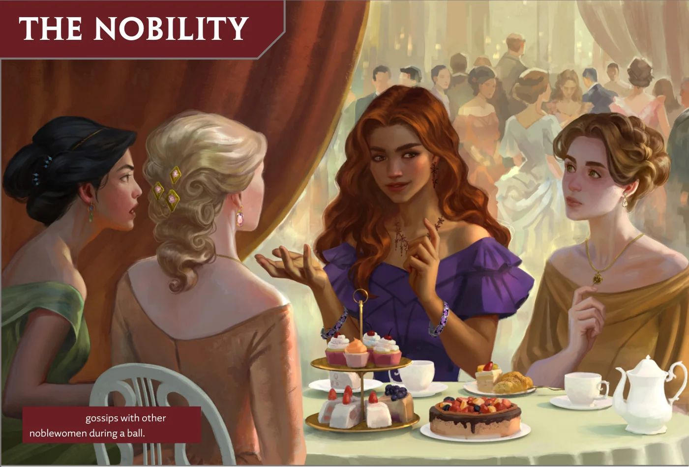
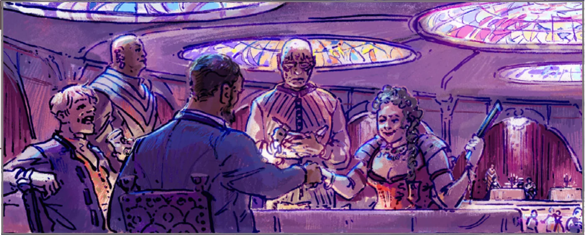
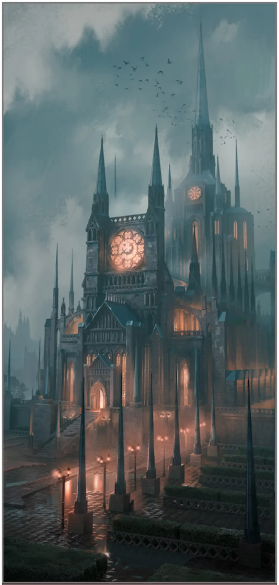
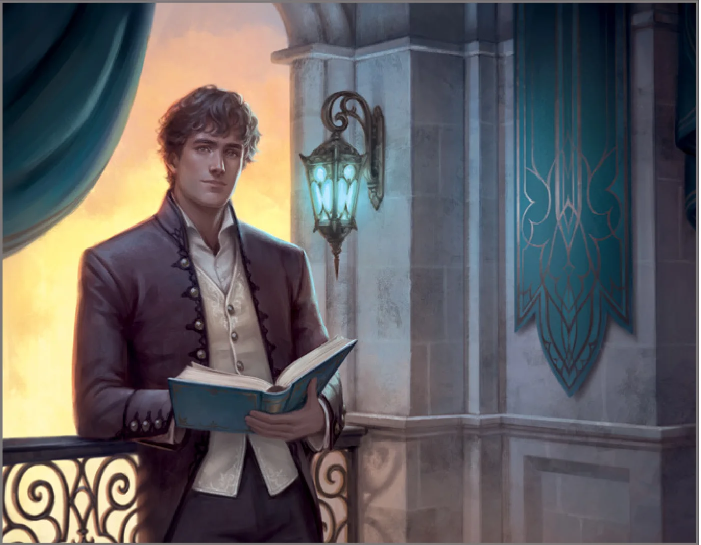
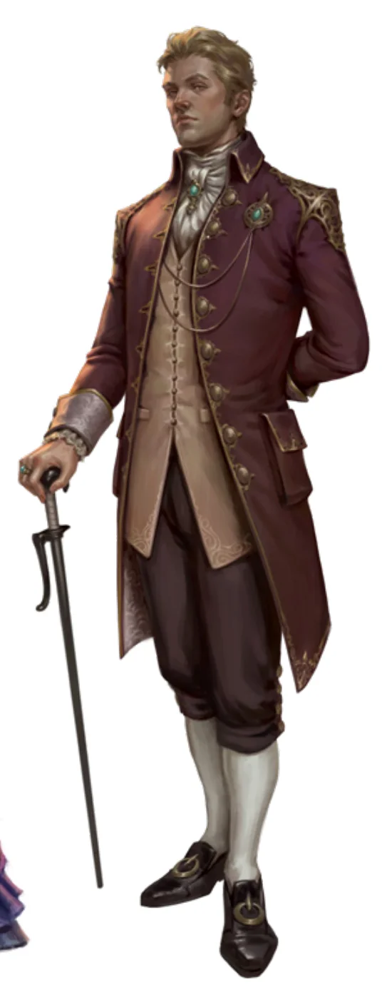
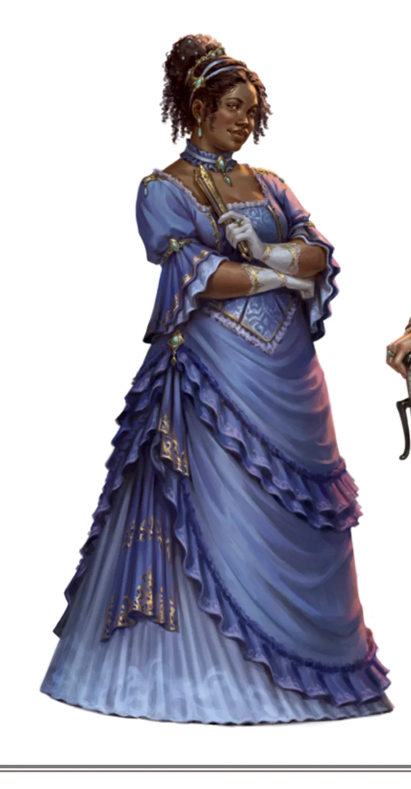

舞會門道

貴族舞會也是簽訂契約和談判的場合。鋼鐵教廷的聖務官

會在場監督並記錄。

珊．埃拉瑞爾（Shan Elariel）在舞會上和其他貴族女子聊著流言。

貴族是最後帝國的統治階級，靠剝削占人口多數的司卡過著奢華生活。雖然統御主限制了貴族的權力，他們仍掌控龐大的商業資源與私人軍隊。除了物質資源，貴族還擁有一項足以壓倒司卡的戰略優勢。鎔金術（Allomancy）經由貴族血統傳承，讓鎔金術師能做出超乎常人的壯舉。這些能力讓貴族在商業、戰爭和政治鬥爭中占有獨特優勢。

十大家族

十個大家族主宰貴族社會，並在陸沙德擁有宏偉的堡邸。依勢力排序，十大家族分別是泛圖爾家族（House Venture）、海斯丁家族（House Hasting）、埃拉瑞爾家族（House Elariel）、太齊爾家族（House Tekiel）、雷卡家族（House Lekal）、艾瑞凱勒家族（House Erikeller）、艾瑞凱家族（House Erikell）、浩特家族（House Haught）、兀爾班家族（House Urbain）及布維達家族（House Buvidas）。

10

### 泛圖爾家族

論政治與財力，沒有任何貴族家族能與泛圖爾家族相比，也沒有哪一家握有更多稀有的天金。史特拉夫．泛圖爾（Straff Venture）大人以鐵腕治理家族，他的兒子依藍戴（Elend）卻更熱衷於書籍與哲學。

### 血統

貴族自認血統比司卡優越，主要是因為他們繼承了鎔金能力。膚色並非社會階級的標誌。中央統御區以粉色和棕褐色膚色最常見，部分外圍統御區居民的膚色則是暖棕色，東方居民較常有白皙皮膚和金髮。

泛圖爾堡（Keep Venture）是陸沙德最氣派的貴族宅邸。森然的尖塔、宏偉的拱門和精美的彩繪玻璃窗，都彰顯了這個居首大家族的財富。

11

