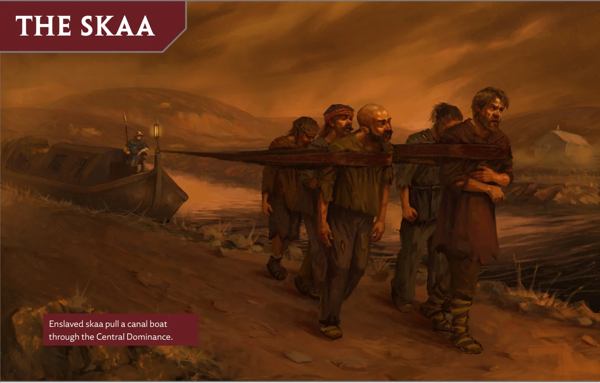
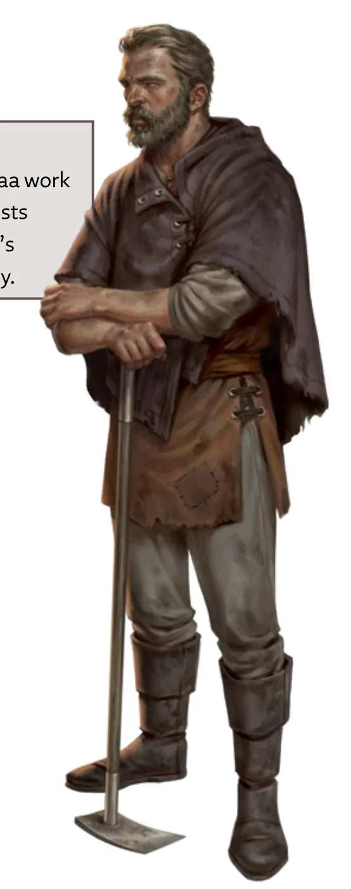
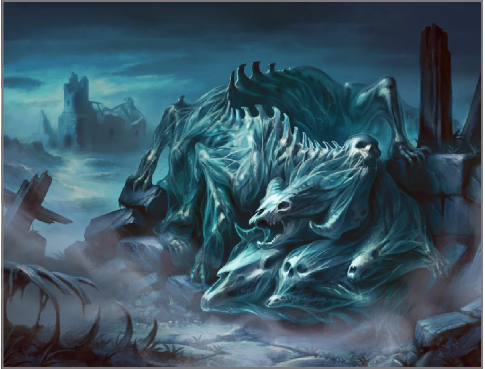
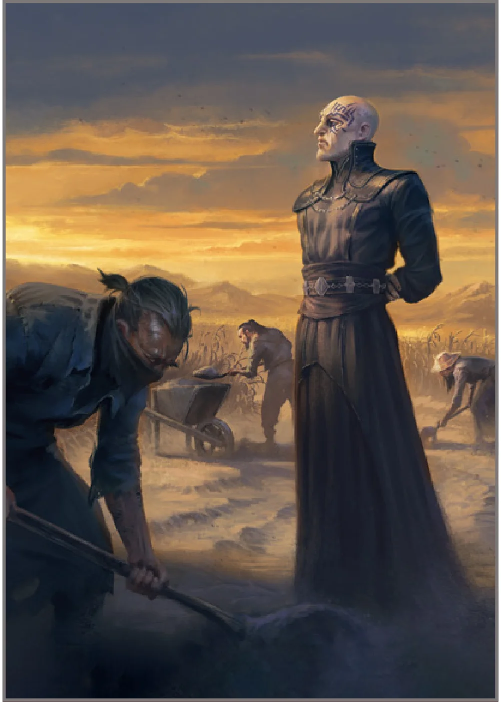
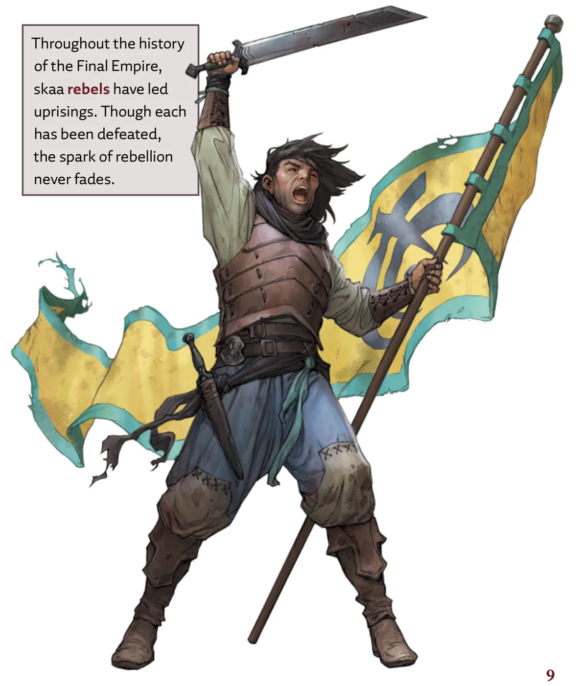
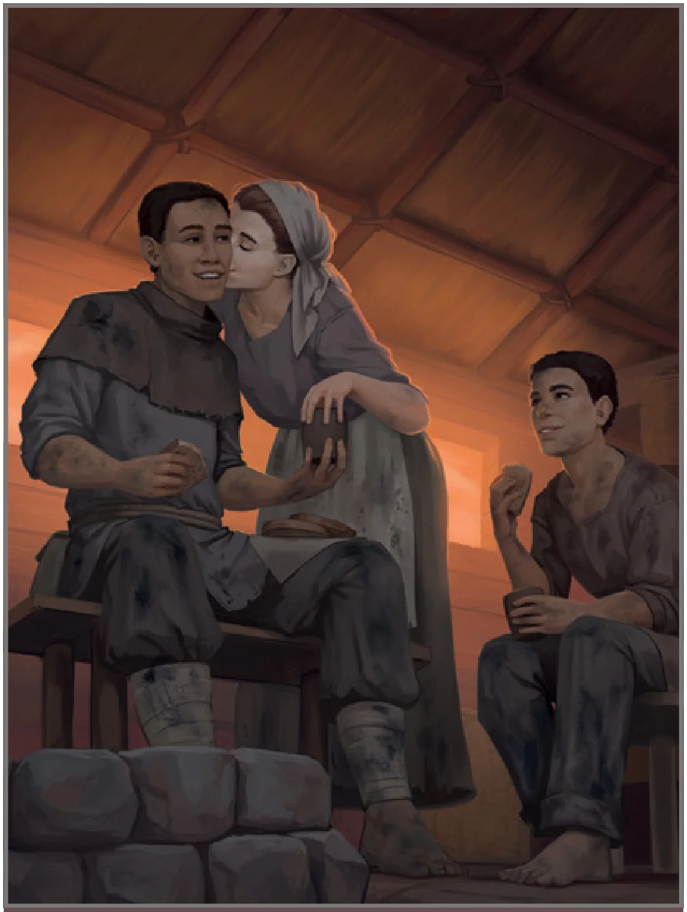

種植園裡備受壓迫的司卡辛勤耕作，設法從司卡德利亞脆弱的生態環境中求得收成。

遭奴役的司卡在中央統御區的運河上拉船。

最後帝國絕大多數人口都屬於受壓迫的底層，也就是司卡（skaa）。司卡被視為不同的族群，長期受到奴役與支配。大多數人在田地或運河上苦幹，也有人在礦場或工廠做工。種植園的司卡受到最嚴苛的虐待，得竭力達成鋼鐵教廷規定的配額。城市裡的司卡通常有較多選擇，有些人靠經商或熟練的手藝維生。在陸沙德等城市，司卡在擁擠的公寓、工作場所和店鋪之間形成緊密的社群。

### 司卡文化

司卡有口述「長故事」（longtales）的傳統，透過民間故事傳承價值觀與智慧。有些故事令人畏懼，告誡人們迷霧裡有危險的怪物出沒。有些則傳授實用知識，例如多少火山灰能滋養田地，又有多少會傷害作物。鋼鐵教廷的教義要求司卡溫順服從，這些故事卻暗藏著不服與反抗的意味。逃離種植園的司卡仰賴秘密網絡，沿運河逃亡。在城市裡，地下反抗小組與盜賊團隊則把私下流傳的長故事化為抵抗最後帝國的方略。

8

縱觀最後帝國的歷史，

司卡反抗者曾多次領導起義。每次起義都遭到鎮壓，但反抗的火種從未熄滅。

### 霧魅（Mistwraiths）

司卡傳講駭人的霧魅故事，說這些令人不安的怪物會偷走人的臉。牠們半透明的身體裡，還看得見曾吞下的人和動物的遺骸。

在教廷的監視下

資源廷監管外圍統御區的種植園，強迫勞累過度的司卡農民服從。

家庭與社群

司卡的生活雖然艱苦，彼此卻能給予慰藉。大多數司卡入夜後都不出門，家人之間通常關係緊密，互相安慰與扶持。

9

