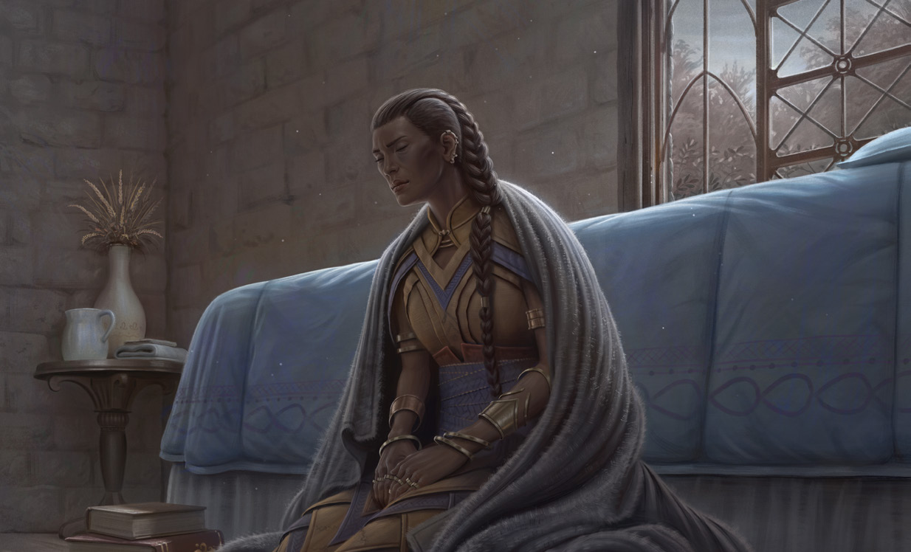
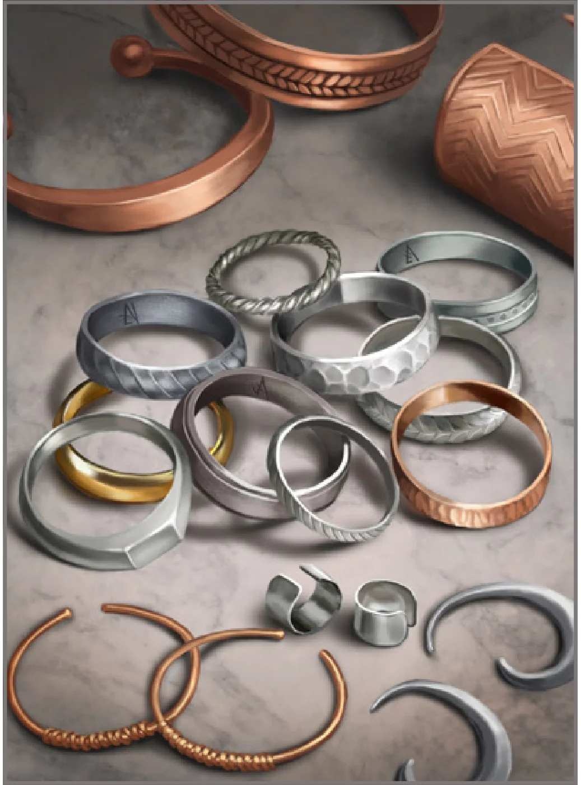
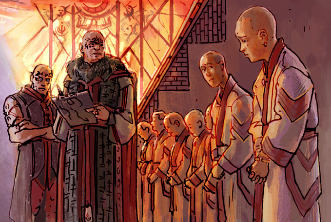
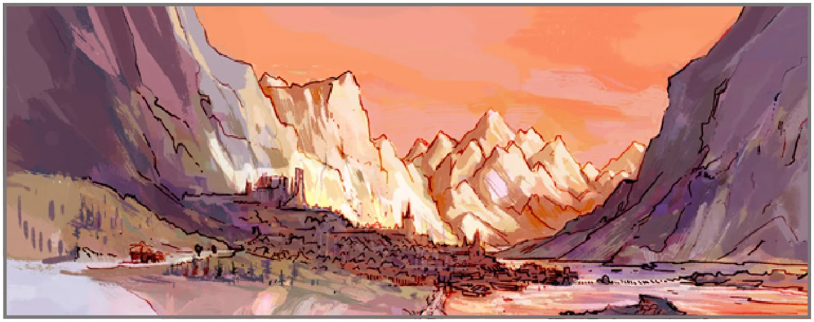
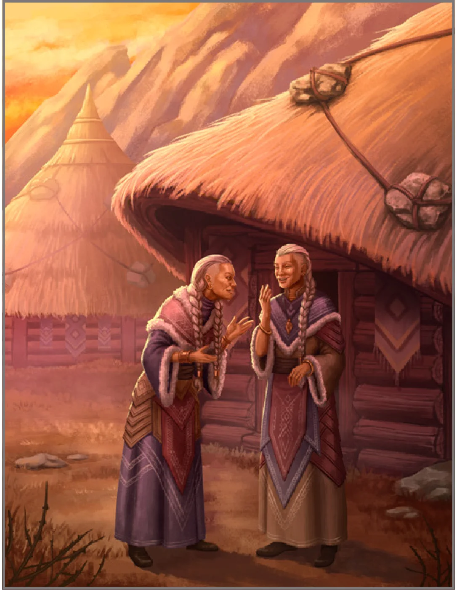
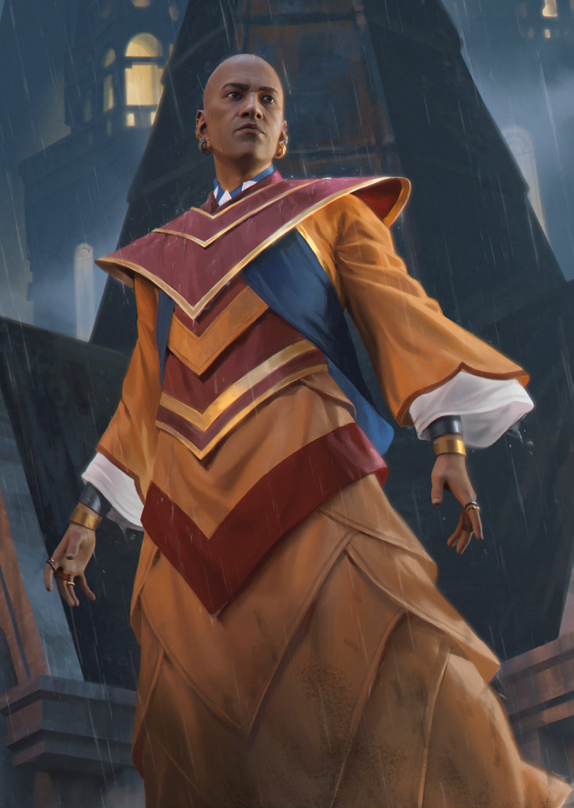

金屬飾品在泰瑞司（Terris）文化中占有重要地位。男女經常配戴用不同金屬製成的耳環、手鐲與戒指，上頭刻著簡單的圖案與銘文。

一名泰瑞司母親回想再也見不到的孩子。

一名審判者與一名聖務官監督年輕的泰瑞司侍從官（Terris Steward）受訓。

在最後帝國，泰瑞司人受到最徹底的迫害，卻也最竭力在重重逆境中保存自己的文化。鋼鐵教廷對他們施行殘酷的性別隔離、奴役與優生政策。儘管教廷有系統地抹除泰瑞司文化，泰瑞司人仍堅持維繫自身的傳統與身分認同。

12

在育種計畫中倖存的女性不得離開泰瑞司統御區（Terris Dominance）。她們在塔辛文（Tathingdwen）城外的牧業聚落定居，例如 Myrshek村（Myrshek Village）。她們靠放牧、採礦和自給農耕維生，彼此扶持，維繫社群。

沙賽德身穿泰瑞司傳統長袍，由層層交疊的 V 形構成。

### 塔辛文

泰瑞司統御區位於最後帝國北端，是一片多山的凍原。首府塔辛文嚴格隔離泰瑞司男女。被鋼鐵教廷選入育種計畫的泰瑞司女性，會遭囚禁在守衛森嚴的設施中。泰瑞司男性在侍從官學院接受思想灌輸與家僕訓練，之後受契約約束，到其他統御區的貴族家中服役。

### 血統

泰瑞司人長年居住在與世隔絕的山區，又受到統御主的優生計畫影響，形成了獨特的族群。和司卡德利亞北部其他居民一樣，他們的膚色從淡粉色到棕褐色、棕色都有。頭髮通常是黑色或赤褐色，身形大多高挑瘦削。

### 沙賽德（Sazed）

沙賽德是經驗豐富的泰瑞司侍從官，依契約為 Teven Renoux 大人服役。這名極遠統御區的貴族正設法在中央統御區建立同盟。沙賽德思慮周密、性情平和，熱愛歷史與宗教。

13

