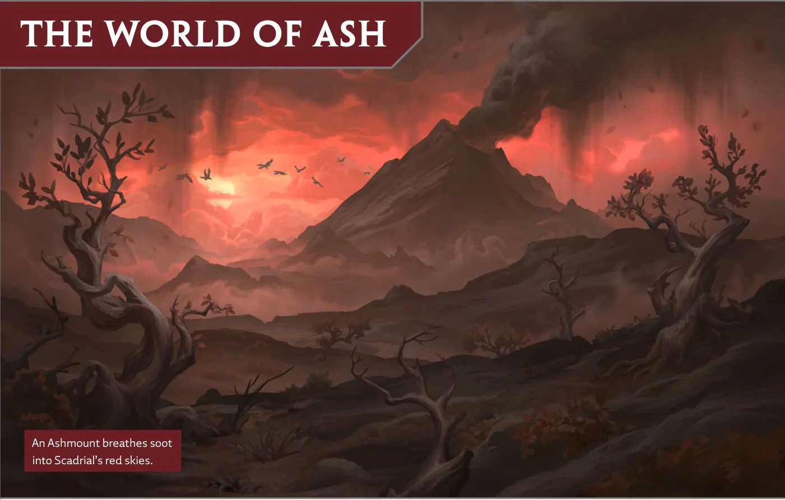
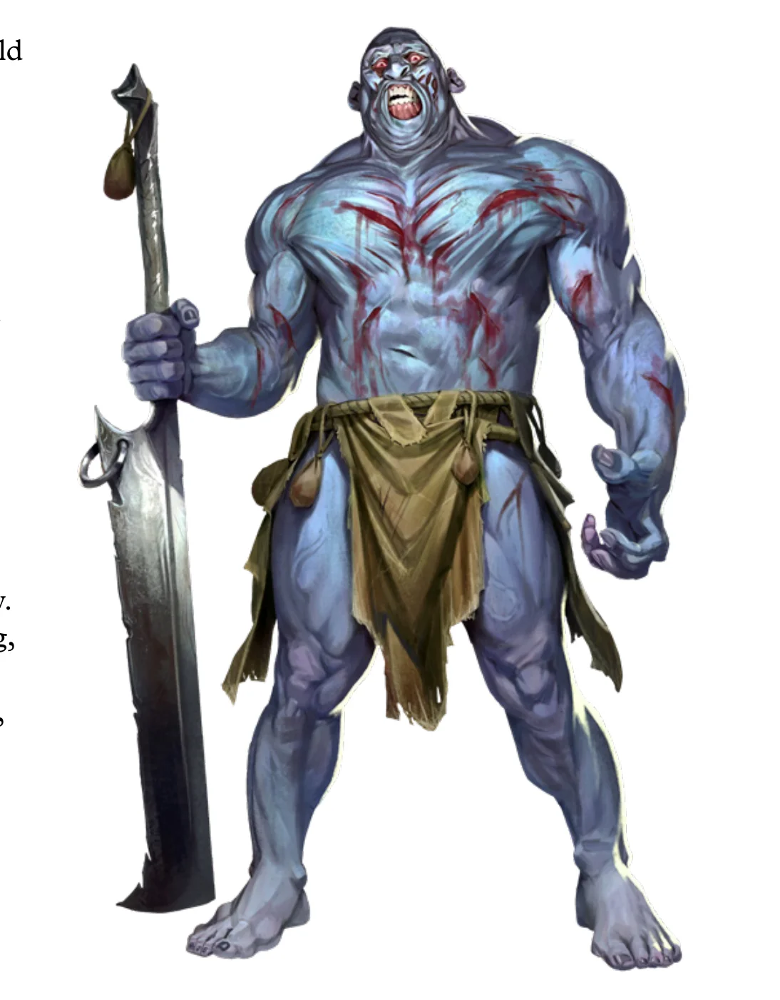
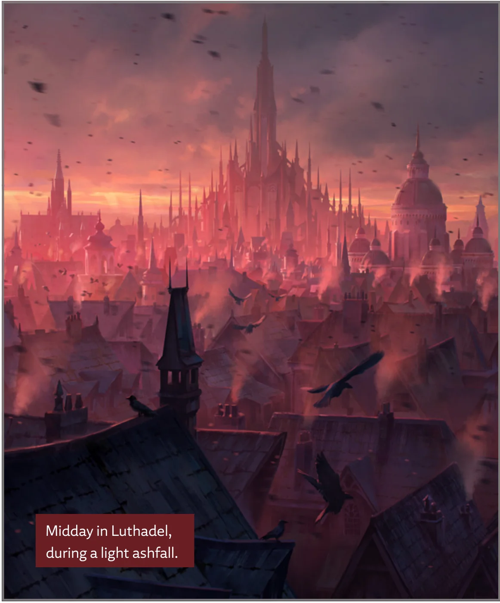
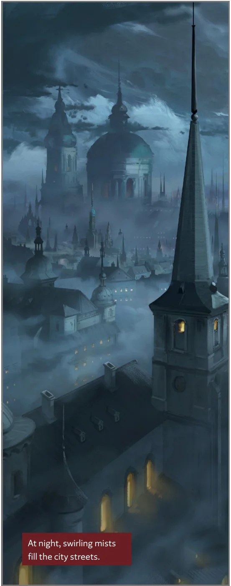
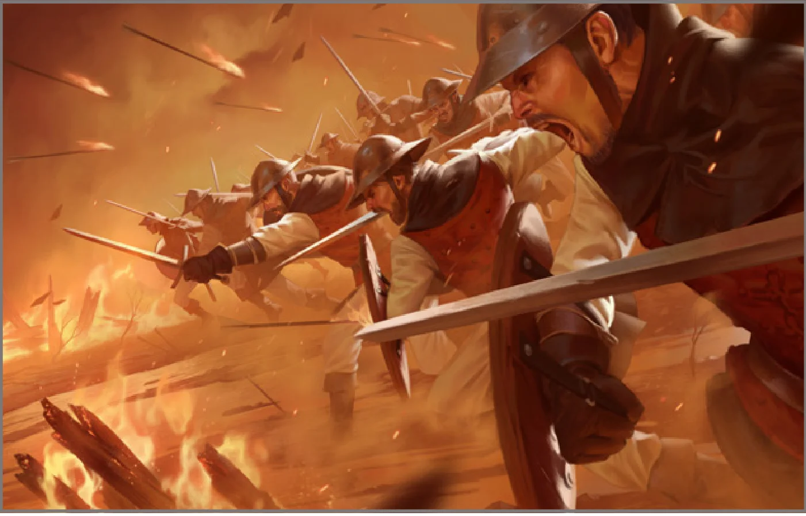

司卡德利亞（Scadrial）的世界瀕臨浩劫，靠著微妙的平衡維持現狀。七座巨型火山噴出的黑灰使行星大氣降溫。在這些灰山（Ashmount）噴出的灰燼遮蔽下，太陽看起來是紅色的，灑下深紅或金色的光。司卡德利亞上找不到花朵或綠色植物。大多數植物呈褐色或黃色，已適應被灰燼遮蔽的日光。最後帝國是已知世界唯一的國家，疆界之外大多不宜居住。

### 克羅司（Koloss）

最後帝國各地的人類都畏懼克羅司。這些體型巨大的類人生物有藍皮膚和紅眼睛。克羅司軍隊駐紮在帝國腹地，隨時準備擊潰反抗者或遊牧劫掠者。沒有人知道克羅司從何而來。最年幼的克羅司看起來像成年人，卻披著過於寬大、鬆垂的皮膚。隨著牠們長大，皮膚逐漸繃緊。等到牠們身高超過十呎，肌肉也長得極為粗壯，皮膚便開始裂開。

一座灰山將煙灰噴入司卡德利亞的紅色天空。

4

司卡德利亞的士兵

雖然沒有其他國家與最後帝國為敵，每座城市仍駐有職業士兵。這些傭兵隨時準備在稱為「鎮壓行動」（Suppression Campaigns）的軍事行動中，撲滅任何有組織抵抗的苗頭。

### 灰燼與迷霧

司卡德利亞各地不斷飄落漆黑的灰燼。灰落得密集時，往往塞滿排水溝，在地上堆成一丘一丘。無所不在的落灰也影響了當地的建築和衣著。

每到夜晚，濃密的灰白迷霧就會升起。霧氣流動翻捲，彷彿有生命般漫無目的地遊走，卻從不進入建築物。司卡德利亞沒有月亮，但迷霧本身微微發亮，為夜色添上一層淡光。

正午的陸沙德，天空飄著薄薄的灰燼。

入夜後，翻湧的迷霧充滿市街。

5

