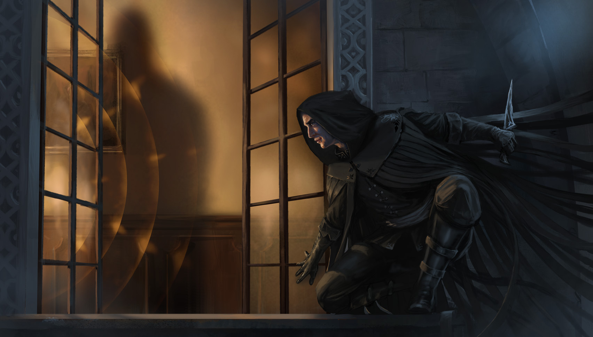
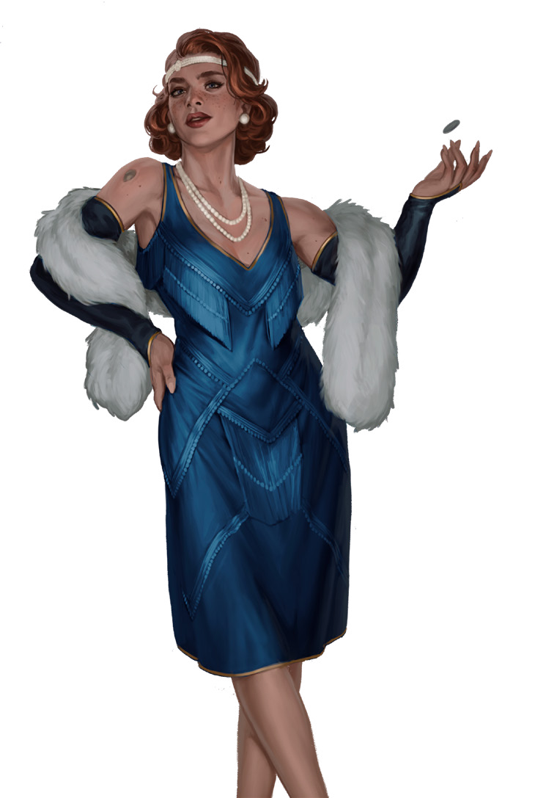

在司卡德利亞，任何 NPC 都可能擁有非凡而出人意料的力量。這些力量通常源自非人類血統、遺傳而來的鎔金術或藏金術，或能賦予竊來能力的血金術尖刺。

本節的敵手模組提供可套用於任何資料區塊的特殊特徵及行動，幫助你為場景與故事建立各式各樣的 NPC。

### 使用敵手模組

將模組套用至資料區塊時，可能包含三個步驟：

1. 依該類模組的指示修改資料區塊。例如，「使用鎔金術模組」一節要求你賦予敵手授予數值及鎔金術技能，並讓敵手可以使用飲用金屬液行動。這些變更都在所選模組的變更之外另行套用。

2. 依所選模組的指示修改資料區塊。例如，坎得拉模組要求你賦予欺騙技能和偏轉值。

3. 將模組所列特徵及行動加入資料區塊。例如，黃銅鎔金術模組賦予燃燒黃銅行動。若資料區塊已有該數值或能力，無須再加入一次。這些模組將代表性能力調整並簡化供敵手使用。你也可以讓個別敵手使用 PC 版本的血統和金屬技藝，甚至加入 PC 的天賦。關於司卡德利亞的血統及金屬技藝，分別見《迷霧之子玩家手冊》第 2 章及第 6 章。

#### 模組威脅

模組賦予的強大能力會讓敵手更加危險。為戰鬥挑選敵手時，請把這點納入考量，詳見《迷霧之子玩家手冊》第 13 章的「建立戰鬥場景」。

若敵手原本沒有任何模組，為其加入一個或多個模組時，將威脅值提高一半。例如，與隊伍同階層的首領通常有 4 點威脅值，套用鋼鎔金術模組後就變為 6。若又為同一名首領套用克羅司混血模組，威脅值仍為 6，因為額外模組不會再提高威脅。

##### 既有能力

有些資料區塊本來就具有鎔金術、藏金術或其他授予之術的能力。任何能施展授予之術的敵手，都視為已套用模組。例如，「組織」密探已具備鎔金能力和藏金能力，即使套用任何類型的模組，威脅值也不變。

#### 敵手階層

有些模組包含僅適用於特定階層敵手的能力。標示方式與時代限制相似，會在能力名稱後加上符號。例如，克羅司混血模組只會在資料區塊為階層 3 或以上時賦予反應式恢復反應，以階層 3+ 符號表示。

有些模組包含適用於所有階層、但在較高階層會變強的能力。當效果提及金屬技藝骰或金屬技藝距離時，依照「金屬技藝成長」表選用該敵手階層的骰子或距離。

##### 金屬技藝成長

| 階層 | 距離 | 骰子 |
| --- | --- | --- |
| 1 | 40 呎 | 1d6 |
| 2 | 80 呎 | 1d8 |
| 3 | 160 呎 | 1d10 |
| 4+ | 320 呎 | 1d12 |

#### 疊加模組

你可以將多個模組套用於同一份資料區塊，但同一模組只能套用一次。

若要將資料區塊改為迷霧人或單藏金術師，選擇一項金屬技藝模組。罕見的雙生師可藉由同時加入鎔金術與藏金術模組呈現。敵手也能藉由血金術尖刺取得額外力量。像迷霧之子及能使用完整藏金術的藏金術師這類少數例外，可以擁有其金屬技藝的任意數量模組。

第 8 章：敵手 264

### 血統模組

人類是司卡德利亞最常見的有心智生物，但 PC 也可能遇見其他族群，尤其是坎得拉與克羅司混血。你可以用本章的坎得拉守衛、坎得拉間諜及克羅司混血軍官資料區塊來呈現這些角色。將血統模組套用於其他資料區塊，例如建立一名克羅司混血法外之徒，則有更多彈性。

#### 使用血統模組

每名敵手只能擁有一個血統模組。

#### 坎得拉

坎得拉敵手可運用變形能力，毫無破綻地扮演幾乎任何角色。

特殊規則。除了賦予坎得拉抗性、可塑形體及祕密身分特徵，也對所選資料區塊作以下變更：

- 賦予欺騙技能，並將其修正值提高至 1 + 敵手階層 + 其風采屬性。

- 賦予 5 點偏轉值，僅對銳利傷害有效。有鎔金能力、藏金能力或血金術尖刺的資料區塊不能套用此模組，坎得拉祝福除外。此模組也不能和鎔金術或藏金術模組一同套用。關於在坎得拉角色體內植入血金術尖刺的指引，見《迷霧之子玩家手冊》第 2 章的「坎得拉血統」。

##### 特徵

坎得拉抗性。坎得拉受到銳利傷害時，無視穿刺武器特性。此外，鎔金術師必須花費至少 6 授予來燃燒黃銅或燃燒鋅，情緒鎔金術才會影響坎得拉。一旦受到影響，坎得拉便無法自行結束這些效果。

可塑形體。坎得拉可以吞下中型或更小的角色的骨骼。在移除這副骨骼或換上另一副骨骼之前，坎得拉可以完美模仿該角色的外貌。

祕密身分。若 PC 開始懷疑身邊有坎得拉，建立一項有 3 格的正面事件「揭露坎得拉」。在事件進度軌以機遇填滿前，誰也不能信任，所有需要花費專注點的能力都要額外花費 1 專注點。事件進度軌填滿時，角色會揭露坎得拉的身分、找出重要線索，或發現根本沒有人是坎得拉。

#### 克羅司混血

克羅司混血敵手特別堅韌。

##### 行動

[1行動] 克羅司恢復。克羅司混血恢復等同於兩顆恢復骰擲骰結果的生命值，見《迷霧之子玩家手冊》第 3 章的「意志」。每個場景中，他們可使用此行動的次數等於其階層。

[反應] 反應式恢復。[階層 3+]。克羅司混血受到傷害前，以 [反應] 使用克羅司恢復。

一名和諧的坎得拉密探。

GUILHERME CASTRO

第 8 章：敵手 265

### 鎔金術模組

鎔金術讓角色能吞下並燃燒特定金屬，取得對應的力量。見第 1 章的「鎔金術」，也可參閱《迷霧之子玩家手冊》第 5–6 章。

#### 使用鎔金術模組

下列規則適用於所有鎔金術模組：

- 將敵手的授予數值提高至 2 + 察覺與風采屬性中的較高值。

- 賦予鎔金術技能，將技能等級提高至 1 + 敵手階層，並將技能修正值提高至 1 + 敵手階層 + 其意志屬性。

- 除模組內的行動外，敵手也能使用飲用金屬液行動（[1行動]）。本章未列出鋁鎔金術或金鎔金術的模組，因為第一時代與第二時代的大多數司卡德利亞人都認為這兩種能力沒有用處。

#### 天金鎔金術 [第一時代]

天金迷霧人稱為先知，能看見可能未來的「天金影子」，預先對周遭情況作出反應。直到第一時代接近尾聲，鋼鐵教廷以外的人才知道天金迷霧人的存在。

特殊規則。加入這個模組可能嚴重破壞平衡，一般模組威脅規則在此並不總是適用，請自行斟酌使用。若想讓遊戲體驗更穩定，建議使用迷霧之子或鋼鐵審判者的資料區塊，兩者都能燃燒天金。

##### 行動

[2行動] 燃燒天金（每顆天金珠可用 1 次）。在接下來等同於先知鎔金術技能等級的回合數內，當先知進行與其他角色實體互動的檢定時，包括對抗實體防禦的檢定，都不擲任何 d20。所有 d20 的值均設為 15，包括優勢及劣勢的骰子。同樣地，當敵人進行與先知實體互動的檢定時，包括對抗實體防禦的檢定，其所有 d20 的值均設為 5。效果結束前，先知可用 [自由行動] 花費 1 次燃燒天金的使用次數以維持效果。

##### 機遇與變故

機遇。敵人可花費 [機遇]，終止先知燃燒天金的效果。

變故。GM 可花費敵人檢定擲出的 [變故]，讓先知額外獲得一次燃燒天金的使用次數。

#### 彎管合金鎔金術 [第二時代]

彎管合金迷霧人稱為滑行，能創造加快時間流速的速度圈。

建議敵手。準備好與人決鬥的敵手能成為強大的滑行，例如打手與克羅司混血軍官。

##### 行動

[2行動] 燃燒彎管合金（花費 1+ 授予，上限為 1 + 階層）。滑行在以自己目前位置為中心的巨型（15 呎）區域創造速度圈。這個速度圈有下列效果：

- 每個回合結束時接一個額外回合。只有圈內角色能在這個額外回合行動，每人各採取一個輪次。在自己的輪次中，他們獲得等同於 1 + 所花授予數量的行動。

- 戰鬥中，每個回合最後一個慢速輪次結束後，開始這個額外回合。PC 先行動，NPC 隨後行動。

- 對話或試煉中，該回合最後一次貢獻結束後，開始這個額外回合。在額外回合中，圈內每名角色能作出的貢獻次數，等於獲得的行動數除以 [2行動]，無條件進位。

- 效果的持續時間在圈內消逝得更快。速度圈每賦予 [2行動]，持續效果就視為經過一個回合，剩餘不足兩個行動也算一個回合。

- 自願穿過速度圈表面的角色會失去等同於所花授予數量的專注點。若因此使專注點降至 0，或其專注點原已為 0，該角色陷入震懾，直到其下一個輪次結束。

- 圈外角色無法以一般手段和圈內角色溝通或影響他們，圈內角色也同樣無法對圈外角色這麼做。

- 角色穿過速度圈表面進行攻擊時，獲得等同於燃燒彎管合金所花授予數量的劣勢。該攻擊獲得危險武器特性，且攻擊者除非另花費 [機遇]，否則無法命中或擦傷目標。

額外回合結束時速度圈消失，除非滑行在圈內以 [自由行動] 花費與先前相同的授予來維持。

> 韋恩最喜歡的戰術，就是先靠近，再把一個人困進速度圈，單獨和對方交手。

第 8 章：敵手 266

#### 黃銅鎔金術

黃銅迷霧人稱為安撫者，能削弱他人的情緒，讓對方較不會依那些情緒採取行動。

建議敵手。仰賴操弄的敵手，例如騙術高手、偵探、商人及社交名流，都能善用此模組。

##### 行動

[2行動] 燃燒黃銅（花費 1+ 授予，上限為 1 + 階層）。安撫者選擇一種情緒，在其金屬技藝距離內一處大型（10 呎）區域中選擇一個或多個目標，並對抗每個目標的靈性防禦進行鎔金術檢定。成功時，該目標的選定情緒受到安撫，促使其採取符合該情緒的行動，直到目標下一個輪次結束。效果結束前，安撫者可花費 1 或更多授予，以 [自由行動] 維持區域內所有受影響目標的效果。

受影響的目標可用 [自由行動] 抵抗，花費等同於燃燒黃銅所花授予數量的專注點，取代通常抵抗影響的費用。抵抗後，目標無視自己被改變的情緒，直到其下一個輪次開始。

#### 青銅鎔金術

青銅迷霧人稱為搜尋者，能偵測鎔金脈動，藉此監視並追蹤其他鎔金術師。

建議敵手。警員、偵探、執法者及聖務官等敵手能藉此模組更有效地追捕和辨識目標。

特殊規則。套用此模組時，不提高威脅值。

##### 行動

[1行動] 燃燒青銅（花費 1+ 授予，上限為 1 + 階層）。直到場景結束，搜尋者能在自己的金屬技藝距離內偵測下列情況：

- 每次有授予被花費。

- 每個由授予維持的持續效果，例如鎔金術師的燃燒行動。即使授予是在搜尋者使用此行動前花費的，也能偵測。

搜尋者能感知這些效果來源的大致方向。只要仍能偵測這些效果，也能選擇追蹤等同於所花授予數量的效果，得知它們的確切位置與來源。搜尋者可以花費 [1行動] 進行 DC 15 的鎔金術檢定，判斷正在追蹤的效果是由哪種力量產生。

#### 鎘鎔金術 [第二時代]

鎘迷霧人稱為脈動，能創造減慢時間流速的速度圈。

建議敵手。擅長團隊合作的敵手，例如鬼血、執法者或警員，都是難以對付的脈動。

##### 行動

[2行動] 燃燒鎘（花費 1+ 授予，上限為 1 + 階層）。脈動在以自己目前位置為中心的巨型（15 呎）區域創造速度圈。圈內時間流速大幅降低。圈內每名角色獲得等同於 1 + 所花授予數量的延遲點。只要角色有至少 1 延遲點，就必須把所有可用的行動和貢獻用於以下列任一方式移除延遲點。在移除完畢前，不能使用其他行動或反應：

- 可以花費 [1行動] 移除自己身上的 1 延遲點。角色可以在同一輪次使用此行動不只一次。

- 可以使用自由行動。若這類效果賦予一次或多次 [1行動]，便可用這些行動移除延遲點。

- 在對話或試煉中，可以用自己的貢獻移除自身 2 延遲點。

速度圈另有下列效果：

- 效果的持續時間在圈內消逝得更慢。只要角色有至少 1 延遲點，持續效果的計時就暫停，效果本身仍然生效，經過的回合和輪次不計入持續時間。

- 自願穿過速度圈表面的角色會失去等同於所花授予數量的專注點。若因此使專注點降至 0，或其專注點原已為 0，該角色陷入震懾，直到其下一個輪次結束。

- 圈外角色無法以一般手段和圈內角色溝通或影響他們，圈內角色也同樣無法對圈外角色這麼做。

- 角色穿過速度圈表面進行攻擊時，獲得等同於燃燒鎘所花授予數量的劣勢。該攻擊獲得危險武器特性，且攻擊者除非另花費 [機遇]，否則無法命中或擦傷目標。

脈動移除自己最後一個延遲點的那個回合結束時，速度圈消失。速度圈消失時，移除受影響角色身上剩餘的所有延遲點。

速度圈消失前，脈動可以在圈內花費與先前相同的授予，以 [自由行動] 維持速度圈，使圈內每名角色額外獲得等同於 1 + 所花授予數量的延遲點。

第 8 章：敵手 267

#### 鉻鎔金術 [第二時代]

鉻迷霧人稱為水蛭，能吸取對手的授予。

建議敵手。此模組特別適合預期隨隊與鎔金術師交戰的敵手，例如「組織」密探。

##### 行動

[1行動] 燃燒鉻（花費 1 授予）。水蛭在觸及範圍內選擇一名受授予的角色或一件受授予的物體。此行動的效果取決於目標類型：

灌注了授予的物體或角色。目標或灌注在目標身上的效果，失去等同於水蛭的金屬技藝骰擲骰結果的授予。

帶有充能的物體。帶有充能的物體失去等同於水蛭的金屬技藝骰擲骰結果一半的充能。若要影響藏金術金屬意識庫，必須有授予為 0 的角色正在其中儲存或從中汲取。

若要影響不情願的角色，或其穿戴或持有的物體，水蛭必須先成功通過對抗目標實體防禦的鎔金術檢定。失敗時，目標不受影響，水蛭也不花費授予。

#### 紅銅鎔金術

紅銅迷霧人稱為煙陣或紅銅雲，能產生掩蓋內部授予的紅銅雲。

建議敵手。偵探和社交名流等講求不露痕跡的敵手，可以用此模組掩蓋自己及盟友的鎔金術。

##### 特徵

情緒不受影響。[階層 3+]。煙陣的紅銅雲內，每名角色都免疫會影響其心智或情緒的受授予效果，除非該效果花費至少 6 授予，或至少 6 點金屬意識庫充能等類似資源。

##### 行動

[1行動] 燃燒紅銅（花費 1 授予）。煙陣以自己為中心創造一片紅銅雲，涵蓋半徑最多 10 呎的區域。紅銅雲有下列效果：

- 受授予的能力與感官無法偵測紅銅雲，也無法穿過紅銅雲偵測角色或授予的使用。

- 受授予的效果無法影響煙陣的心智與情緒。

- 花費至少 6 授予的受授予效果可以無視前兩項效果。

- 紅銅雲隨煙陣移動，持續到場景結束，或直到煙陣在之後的輪次用 [自由行動] 終止效果。

一名迷霧之子刺客正衡量同時對付一名煙陣及其同行者的風險。

ARTUR MÓSCA

#### 硬鋁鎔金術

硬鋁鎔金術師能猛燃其他受授予能力，在一次爆發中用盡全部儲備。硬鋁迷霧人稱為硬鋁蟲，因為若無法使用另一種力量，這項能力就沒有用處。直到第一時代接近尾聲，人們才發現硬鋁的鎔金特性。

建議敵手。這個模組能為使用其他鎔金術模組的敵手增強威力。

##### 特徵

硬鋁爆發。鎔金術師在使用或維持需要花費授予的能力前，可以把所有剩餘的授予都花在該能力上，使其爆發。這無須花費行動，並無視通常的上限或費用。爆發有下列效果：

- 能力效果隨額外花費的授予增加，即使該效果通常不會隨花費改變。鎔金術師必須選擇能力允許的最大尺寸、最遠距離及最多目標。

- 鎔金術師擲劇情骰。擲出 [機遇] 時，可照常花費。擲出 [變故] 時，鎔金術師失去控制。實際效果取決於觸發爆發的能力，可能包括破壞周遭環境，或使鎔金術師、盟友或旁觀者受到傷害、失去專注點或受到傷勢。

#### 電金鎔金術

電金迷霧人稱為預言師，能看見代表自己即將面臨的各種可能未來的「電金影子」。直到第一時代接近尾聲，人們才發現電金的鎔金特性。

建議敵手。這個模組適合善於把風險化為收穫的大膽敵手，例如策劃者、聖務官與法外之徒首領。

##### 特徵

預知反應。預言師使用閃避或反擊機會反應時，可以花費一個電金影子來使用該反應，無須花費行動，也無須花費 [反應]。即使預言師本回合已無可用的反應，仍可這麼做。

##### 行動

[1行動] 燃燒電金（花費 1+ 授予，上限為 1 + 階層）。預言師擲出與所花授予數量相等的 d20，記錄每顆骰子的結果。這些結果各對應一個電金影子，持續到預言師下一個輪次結束。在此期間，敵人對預言師進行檢定時，預言師可消耗一個電金影子，用記錄的結果取代該檢定的 d20 擲骰，無須花費行動。可以在擲骰並套用任何優勢後取代數值，但必須在結算檢定效果之前進行。

> 一股突如其來的力道猛然撞上她。這股力量實在太強，她確信若不是白鑞也在那一瞬間爆發出同樣強大的力量，自己的身體早就散架了。她被轟得飛離堡壘，在天空中疾射而出，彷彿遭某位看不見的巨神拋了出去。空氣呼嘯而過，快得發出轟鳴。驟然加速的壓力讓她難以思考。

一名迷霧人伸手去拿自己的金屬瓶。

GUILHERME CASTRO

第 8 章：敵手 269

#### 鐵鎔金術

鐵迷霧人稱為扯手，能偵測附近的金屬來源並對其使用鐵拉。他們多半攜帶可用來架防的木盾。

建議敵手。保鑣、打手及克羅司混血軍官等希望吸引敵人注意的強悍敵手，最適合成為扯手。

##### 行動

[1行動] 燃燒鐵。直到場景結束，扯手能感知金屬技藝距離內所有非鋁且未受授予的金屬來源。

[1行動] 鐵拉（花費 1+ 授予，上限為 1 + 階層）。扯手選擇一件自己藉燃燒鐵感知到的金屬物體，讓自己或該物體沿直線朝另一方移動。每花費一單位授予，最多移動 20 呎。體型比扯手小的物體會移向扯手，體型相同或更大的物體則會讓扯手移向它。若物體固定在其他東西上，該東西也計入物體的體型。這項能力可靈活運用，例如繳械敵人，或打擊物體飛行路徑上的敵人。若要以這種方式影響不情願的角色，扯手必須成功通過對抗目標實體防禦的鎔金術檢定。若效果會造成傷害，扯手則須進行鎔金術攻擊，擲出等同於其金屬技藝骰 + 鎔金術修正值的衝擊傷害。

[反應] 投射物拉引（花費 1 授予）。在扯手金屬技藝距離內的盟友即將受到金屬投射物攻擊時，若扯手能藉燃燒鐵感知該投射物，扯手取代盟友成為攻擊目標。

#### 鎳鉻鎔金術 [第二時代]

鎳鉻迷霧人稱為鎳爆，能使另一名角色正在使用的能力猛燃，在一次爆發中用盡該角色的所有儲備。

建議敵手。支援另一名鎔金術師的敵手最能善用此模組，例如許多執法者、策劃者及反抗者。

##### 行動

[反應] 燃燒鎳鉻（花費 1 授予）。鎳爆觸及範圍內的另一名角色即將使用或維持受授予能力前，鎳爆使該能力爆發，產生下列效果：

- 該角色必須把所有剩餘的授予或其他受授予資源花在該能力上，無視通常的上限或費用。

- 能力效果隨額外花費的授予增加，即使該效果通常不會隨花費改變。該角色必須選擇能力允許的最大尺寸、最遠距離及最多目標。

- 該角色擲劇情骰。擲出 [機遇] 時，可照常花費。擲出 [變故] 時，該角色失去控制。實際效果取決於觸發爆發的能力，可能包括破壞周遭環境，或使該角色、盟友或旁觀者失去專注點或受到傷勢。

若要影響不情願的目標，鎳爆必須先成功通過對抗目標實體防禦的鎔金術檢定。失敗時，這次嘗試不會花費授予。

#### 白鑞鎔金術

白鑞迷霧人稱為白鑞臂或打手，能強化自己的力量與耐久力。

建議敵手。白鑞鎔金術對近身作戰的敵手特別有利，例如保鑣、打手和法外之徒。

##### 行動

[1行動] 燃燒白鑞（花費 1+ 授予，上限為 1 + 階層）。直到自己的下一個輪次結束，白鑞臂獲得下列好處：

- 獲得增益［速度］及增益［力量］。這兩項屬性的加值等於所花授予的一半，無條件進位。

- 若處於精疲力竭，在燃燒結束前，不將該減值套用到檢定結果。

燃燒白鑞結束前，可以花費 1 或更多授予，以 [自由行動] 維持效果。

[自由行動] 再生（花費 1 授予）。白鑞臂恢復等同於 1d6 + 其階層的生命值。

> 鐵拉的力道讓那名士兵雙腳離地，朝卡西爾疾飛過去。

第 8 章：敵手 270

#### 鋼鎔金術

鋼迷霧人稱為射幣，能偵測附近的金屬來源並對其使用鋼推。他們多半帶著錢幣，第二時代也可能改帶彈殼，可以將其射向敵人，或用來將自己推離地面。

建議敵手。策劃者、反抗者等喜歡遠距作戰的敵手，能成為強大的射幣。保鑣及打手等敵手也能用鋼推將自己送入戰場。

##### 行動

[1行動] 射出錢幣（花費 1+ 授予，上限為 1 + 階層）。攻擊 + 射幣的鎔金術修正值，距離為每花費一單位授予 20 呎，造成等同於射幣的金屬技藝骰 + 其鎔金術修正值的衝擊傷害。

[1行動] 燃燒鋼。直到場景結束，射幣能感知金屬技藝距離內所有非鋁且未受授予的金屬來源。

[1行動] 鋼推（花費 1+ 授予，上限為 1 + 階層）。射幣選擇一件自己藉燃燒鋼感知到的金屬物體，讓自己或該物體沿直線遠離另一方。每花費一單位授予，最多移動 20 呎。體型比射幣小的物體會遠離射幣，體型相同或更大的物體則會讓射幣遠離它。若物體固定在其他東西上，該東西也計入物體的體型。這項能力可靈活運用，例如繳械敵人，或讓射幣短距離「飛行」。若要以這種方式影響不情願的角色，射幣必須成功通過對抗目標實體防禦的鎔金術檢定。

#### 錫鎔金術

錫迷霧人稱為錫眼，能提高所有感官的靈敏度。

建議敵手。擅長謀略、會主動尋找優勢的敵手，例如偵探、騙術高手、聖務官及社交名流，都能善用此模組。

##### 行動

[1行動] 燃燒錫（花費 1+ 授予，上限為 1 + 階層）。錫眼強化自己的感官，獲得下列效果，直到場景結束，或直到錫眼在之後的輪次以 [自由行動] 終止效果：

- 獲得增益［察覺］。該屬性的加值等於燃燒錫所花授予的一半，無條件進位。

- 所有感官都成為超自然感官。每回合第一次接收到加劇的感官刺激時，錫眼必須成功通過紀律檢定，DC 等於 12 + 增益［察覺］狀態的數值，否則陷入迷惑，直到其下一個輪次結束。

- 當錫眼以推理或一項察覺技能成功使用獲取優勢時，其下次對該目標的攻擊額外造成等同於金屬技藝骰擲骰結果的傷害。

#### 鋅鎔金術

鋅迷霧人稱為煽動者，能激起他人的情緒，讓對方更可能依那些情緒採取行動。

建議敵手。仰賴群體調控的敵手，例如騙術高手、偵探、商人和社交名流，都能善用此模組。

##### 行動

[2行動] 燃燒鋅（花費 1+ 授予，上限為 1 + 階層）。煽動者選擇一種情緒，在其金屬技藝距離內一處大型（10 呎）區域中選擇一個或多個目標，並對抗每個目標的靈性防禦進行鎔金術檢定。成功時，該目標的選定情緒受到煽動，促使其採取符合該情緒的行動，直到目標下一個輪次結束。效果結束前，煽動者可花費 1 或更多授予，以 [自由行動] 維持區域內所有受影響目標的效果。

受影響的目標可用 [自由行動] 抵抗，花費等同於燃燒鋅所花授予數量的專注點，取代通常抵抗影響的費用。抵抗後，目標無視自己被改變的情緒，直到其下一個輪次開始。

> 拜託。奧瑞安妮心想，翻了個白眼。她煽動那群士兵的情緒，讓他們更加冷靜。她可不想出什麼意外。

第 8 章：敵手 271

### 藏金術模組

藏金術讓角色能將自身某個面向「儲存」在只有自己能使用的特定金屬意識庫中，之後再「汲取」，暫時強化該面向。見第 1 章的「藏金術」，也可參閱《迷霧之子玩家手冊》第 5–6 章。

#### 使用藏金術模組

下列規則適用於所有藏金術模組：

- 賦予藏金術技能，將技能等級提高至 1 + 敵手階層，並將技能修正值提高至 1 + 敵手階層 + 其智力屬性。

- 考慮是否讓敵手持有下文所述的藏金術徽章。本章沒有天金藏金術模組，因為這項能力對個別場景的規則影響很小。關於該能力的詳情，見《迷霧之子玩家手冊》第 6 章。

##### 藏金術徽章

這些神祕的藏金術徽章來自司卡德利亞的南方大陸，能讓配戴者有限度地使用其中的藏金能力。如《迷霧之子玩家手冊》第 8 章所述，最稀有的徽章最多可容納三項能力。

你可以在敵手的資料區塊加入對應數量的藏金術模組來呈現徽章。不過，決定如何使用這些能力時，請留意配戴者用徽章儲存特質時，通常不會為徽章補充充能。

也可以考慮將下列可拾取的徽章特徵套用到敵手的資料區塊。不過，徽章對 PC 而言用途十分靈活，建議只讓階層 2 或以上的敵手持有。

##### 特徵

可拾取的徽章。敵手配戴一枚能賦予［金屬、金屬及金屬］藏金能力的藏金術徽章。敵手被擊敗時，擲劇情骰。擲出 [機遇] 時，徽章仍可使用，PC 可以配戴。否則，徽章損毀。

#### 鋁藏金術

鋁單藏金術師稱為真我，可以將靈魂身分儲存在鋁意識中。

建議敵手。狂信徒、反抗者等敵手可以運用此模組，保持對自己理念的忠誠。

##### 特徵

鋁意識（儲存身分）。真我有一個鋁意識，儲存的充能數等於 3 + 真我的階層。

##### 行動

[1行動] 汲取身分（花費 1 鋁意識充能）。真我獲得下列好處，直到場景結束：

- 真我的靈性防禦增加 4。

- 抵抗影響所需的專注點減少 2。

#### 彎管合金藏金術 [第二時代]

彎管合金單藏金術師稱為吞蝕，可以將養分與水分儲存在彎管合金意識中。

建議敵手。偵探、社交名流等仰賴關鍵時刻取勝的敵手，吃飽了更能把握機會。

##### 特徵

彎管合金意識（儲存養分）。吞蝕有一個彎管合金意識，儲存的充能數等於 3 + 吞蝕的階層。

##### 行動

[1行動] 汲取養分（花費 1 彎管合金意識充能）。若吞蝕處於精疲力竭，該狀態的減值減少 2。此外，吞蝕在本場景下次進行檢定時，可以重擲一顆結果低於 1 + 其階層的骰子。

> 「藏金術師和鎔金術師不一樣，我們不會把金屬『燒』掉。我們用金屬來儲存屬性。每一塊金屬依其大小和合金成分，可以儲存某種身體特質。藏金術師先存下一項屬性，之後再從這些儲備中汲取。」

第 8 章：敵手 272

#### 黃銅藏金術

黃銅單藏金術師稱為火靈，可以將體溫儲存在黃銅意識中。

建議敵手。保鑣、打手與執法者等近戰角色最能善用此模組。

##### 特徵

黃銅意識（儲存溫暖）。火靈有一個黃銅意識，儲存的充能數等於 3 + 火靈的階層。

##### 行動

[1行動] 儲存溫暖。火靈儲存溫暖，直到場景結束，或直到使用汲取溫暖。在此期間，火靈受到能量傷害前，將該傷害減少等同於其階層的數值。

[1行動] 汲取溫暖（花費 1 黃銅意識充能）。火靈汲取溫暖，直到場景結束，或直到使用儲存溫暖。在此期間，火靈受到的能量傷害增加等同於其階層的數值。此外，火靈每個輪次結束時，若已接觸另一名角色超過幾秒，可以使用 [自由行動]，對該角色造成等同於火靈藏金術修正值的能量傷害。

[2行動] 灼熱掌擊。火靈在汲取溫暖時，可用此行動進行擒抱、推撞，或發動通常花費 [1行動] 的近戰攻擊。成功、命中或造成擦傷時，目標額外受到等同於火靈金屬技藝骰擲骰結果的能量傷害。

#### 青銅藏金術

青銅單藏金術師稱為哨兵，可以將清醒儲存在青銅意識中。

建議敵手。騙術高手、執法者等需要維持專注的敵手，可以成為強大的哨兵。

##### 特徵

青銅意識（儲存清醒）。哨兵有一個青銅意識，儲存的充能數等於 3 + 哨兵的階層。

##### 行動

[1行動] 清醒警覺（花費 1 青銅意識充能）。哨兵獲得增益［智力 +1］及增益［察覺 +1］，直到場景結束。

[1行動] 汲取清醒（花費 1 青銅意識充能）。哨兵擲金屬技藝骰，恢復等同於擲骰結果的生命值、專注點，或將恢復量分配給兩者。

#### 鎘藏金術 [第二時代]

鎘單藏金術師稱為喘息，可以將呼吸儲存在鎘意識中。

建議敵手。保鑣、偵探與打手可以善用汲取呼吸，降低反應的花費。

##### 特徵

鎘意識（儲存呼吸）。喘息有一個鎘意識，儲存的充能數等於 3 + 喘息的階層。

##### 行動

[1行動] 汲取呼吸（花費 1 鎘意識充能）。直到場景結束，喘息無須呼吸。使用 [反應] 或 [自由行動] 時，該能力的專注點花費減少 1。

#### 鉻藏金術 [第二時代]

鉻單藏金術師稱為旋轉，可以將運氣儲存在鉻意識中。在寰宇中，運氣有別於碰巧走運，指的是對命運重要交會點的模糊宇宙感知。

建議敵手。策劃者與反抗者若能在正確時機出現在正確地點，就能大為受益。

##### 特徵

鉻意識（儲存運氣）。旋轉有一個鉻意識，儲存的充能數等於 3 + 旋轉的階層。

正確地點。每個場景開始時，旋轉可以花費最多 1 + 其階層的鉻意識充能。每花費一份充能，就能立即移動最多等同於其移動速率的距離，且不觸發反擊機會。

##### 行動

[1行動] 汲取運氣（花費 1 鉻意識充能）。旋轉的機遇範圍與變故範圍均擴大 2，直到場景結束。

第 8 章：敵手 273

#### 紅銅藏金術

紅銅單藏金術師稱為庫藏，可以將記憶儲存在紅銅意識中。

建議敵手。偵探、策劃者及社交名流等仰賴專門知識的敵手，可以從此模組受益。

##### 特徵

紅銅意識（儲存記憶）。庫藏有一個紅銅意識，儲存的充能數等於 3 + 庫藏的階層。

紅銅意識索引（花費 1 紅銅意識充能）。庫藏進行檢定以回想自己曾研讀或親身經歷的資訊前，可以花費 1 紅銅意識充能，自動通過該檢定，無須花費行動。

##### 行動

[1行動] 汲取記憶（花費 1 紅銅意識充能）。庫藏選擇一項專長並取得該專長，直到場景結束。在此期間，進行與該專長有關的檢定時獲得優勢。

#### 硬鋁藏金術

硬鋁單藏金術師稱為聯絡，可以將靈魂牽繫儲存在硬鋁意識中。

建議敵手。騙術高手、商人及社交名流等著重社交的敵手，可以大幅受益於此模組。

##### 特徵

硬鋁意識（儲存牽繫）。聯絡有一個硬鋁意識，儲存的充能數等於 3 + 聯絡的階層。

##### 行動

[1行動] 汲取牽繫（花費 1 硬鋁意識充能）。聯絡獲得下列好處，直到場景結束：

- 獲得增益［風采 +2］。

- 懂得金屬技藝距離內的角色所懂的每種語言。

- 角色試圖抵抗聯絡的影響時，該角色必須額外花費 2 專注點。

#### 電金藏金術

電金單藏金術師稱為頂峰，可以將決心儲存在電金意識中。

建議敵手。保鑣、法外之徒首領等準備背水一戰的敵手，能成為優秀的頂峰。

##### 特徵

電金意識（儲存決心）。頂峰有一個電金意識，儲存的充能數等於 3 + 頂峰的階層。

##### 行動

[1行動] 汲取決心（花費 1 電金意識充能）。直到場景結束，頂峰獲得堅定及增益［意志 +2］。頂峰抵抗另一名角色的影響後，該角色失去 1 專注點。

[反應] 不屈本質（花費所有剩餘的電金意識充能）。階層 2+。在頂峰的生命值降至 0 前，改為降至 1。接著，每花費一份充能，就擲一次恢復骰，並恢復等同於擲骰總量的生命值、專注點，或將恢復量分配給兩者。

#### 金藏金術

金單藏金術師稱為制血者，可以將健康儲存在金意識中。

建議敵手。幾乎所有敵手都能從此模組受益。可以考慮用於策劃者與法外之徒首領等敵手，讓他們能再次登場。

##### 特徵

金意識（儲存健康）。制血者有一個金意識，儲存的充能數等於 3 + 制血者的階層。

##### 行動

[1行動] 汲取健康（花費 1 金意識充能）。制血者終止自己身上一種疾病、藥物或毒藥的效果。此外，制血者立即恢復等同於其金屬技藝骰擲骰結果的生命值，並在場景結束前的每個自身輪次開始時，依此方式恢復生命值。

[反應] 反射式造血。制血者在生命值降至 0 或受到傷勢前，可以用 [反應] 使用汲取健康。這麼做時，制血者改為降至 1 生命值、免受該傷勢，或同時獲得這兩項結果，接著獲得汲取健康的效果。若制血者已經在汲取健康，每個輪次只恢復通常的生命值數量。

第 8 章：敵手 274

#### 鐵藏金術

鐵單藏金術師稱為掠影，可以將自身重量儲存在鐵意識中。

建議敵手。保鑣、克羅司混血軍官等需要堅守原位的敵手，最能善用此模組。

##### 特徵

鐵意識（儲存重量）。掠影有一個鐵意識，儲存的充能數等於 3 + 掠影的階層。

##### 行動

[1行動] 儲存重量。直到掠影使用汲取重量或以 [自由行動] 結束此效果，掠影受到下列效果：

- 除了自身占據及控制的空間以外，在判定所有效果時，其體型視為小一級。

- 不會受到墜落傷害。

- 對其進行的近戰攻擊獲得優勢。

- 任何以物理力量使其非自願移動的效果，所造成的移動距離加倍。

- 階層 2+。使用速度屬性進行非攻擊檢定時獲得優勢。

[1行動] 汲取重量（花費 1 鐵意識充能）。直到掠影使用儲存重量或場景結束，掠影受到下列效果：

- 除了自身占據及控制的空間以外，在判定所有效果時，其體型視為大一級。

- 自己的近戰攻擊獲得優勢。

- 效果使其非自願移動前，掠影可任意縮短該效果造成的移動距離。

#### 鎳鉻藏金術 [第二時代]

鎳鉻單藏金術師稱為承魂，可以將授予之術的潛能儲存在鎳鉻意識中。

建議敵手。無法使用其他能力時，這項力量實際上沒有作用，但可以為能施展鎔金術或藏金術的敵手增強威力。

##### 特徵

鎳鉻意識（儲存授予潛能）。Soulmind 有一個鎳鉻意識，儲存的充能數等於 3 + Soulmind 的階層。

##### 行動

[1行動] 汲取授予（花費 1 鎳鉻意識充能）。承魂選擇自己的一個受授予模組，例如鎔金術或藏金術模組。直到場景結束，或直到承魂再次使用此行動，判定該模組的效果時，其階層視為高一階。

#### 白鑞藏金術

白鑞單藏金術師稱為蠻力，可以將肌肉量及力量儲存在白鑞意識中。

建議敵手。保鑣、打手與執法者等著重近戰的敵手，都能善用此模組。

##### 特徵

白鑞意識（儲存力量）。蠻力有一個白鑞意識，儲存的充能數等於 3 + 蠻力的階層。

##### 行動

[1行動] 汲取力量（花費 1 白鑞意識充能）。蠻力獲得下列好處，直到場景結束：

- 獲得增益［力量 +2］。

- 使用力量屬性進行非攻擊檢定時獲得優勢。

- 進行近戰武器攻擊時，可以擲金屬技藝骰取代通常的傷害骰。

#### 鋼藏金術

鋼單藏金術師稱為鋼奔，可以將身體的速度儲存在鋼意識中。

建議敵手。鬼血及 Malwish飛行員等身手輕巧的敵手，都能善用此模組。

##### 特徵

鋼意識（儲存速度）。鋼奔有一個鋼意識，儲存的充能數等於 3 + 鋼奔的階層。

迅捷反應。階層 2+。每回合一次，鋼奔可以花費 1 鋼意識充能，取得 [反應]，無須花費行動。這個反應只能用於閃避或反擊機會。

##### 行動

[1行動] 汲取速度（花費 1 鋼意識充能）。鋼奔獲得下列好處，直到場景結束：

- 獲得增益［速度 +2］。

- 每個輪次一次，可以用 [自由行動] 使用移動行動。

第 8 章：敵手 275

#### 錫藏金術

錫單藏金術師稱為風語，可以將感官儲存在錫意識中。

建議敵手。像擅長觀察的錫眼一樣，偵探、騙術高手及社交名流等觀察敏銳的敵手都能善用此模組。

##### 特徵

錫意識（儲存感官）。風語有一個錫意識，儲存的充能數等於 3 + 風語的階層。

##### 行動

[1行動] 汲取感官（花費 1 錫意識充能）。風語汲取一項感官。直到場景結束，或直到使用儲存感官，風語受到下列效果：

- 獲得增益［察覺 +2］。

- 進行仰賴所汲取感官的非攻擊檢定時獲得優勢。

- 所汲取的感官成為超自然感官。每回合該感官第一次接收到加劇的刺激時，風語必須成功通過 DC 14 的紀律檢定，否則陷入迷惑，直到其下一個輪次結束。

[反應] 本能防護。風語即將受到主要仰賴其某項感官的效果影響前，結束汲取感官的效果，並受到下列效果：

- 暫時減弱與該效果相關的感官，進行抵抗觸發效果的檢定時獲得優勢，而該效果的來源對風語進行相關檢定時獲得劣勢。

#### 鋅藏金術

鋅單藏金術師稱為星火，可以將心智速度儲存在鋅意識中。

建議敵手。偵探、策劃者與商人等靠機智和策略較量的敵手，都能善用此模組。

##### 特徵

鋅意識（儲存心智速度）。星火有一個鋅意識，儲存的充能數等於 3 + 星火的階層。

迅捷反應。階層 2+。每回合一次，星火可以花費 1 鋅意識充能，取得 [反應]，無須花費行動。這個反應只能用於閃避或反擊機會。

##### 行動

[1行動] 汲取心智速度（花費 1 鋅意識充能）。星火獲得下列各項效果，直到場景結束：

- 獲得增益［智力 +2］。

- 每個輪次一次，可以用 [自由行動] 使用以下其中一個行動：預備、使用智力屬性獲取優勢，或以智力屬性使用技能。

> 他視野的邊緣模糊起來，正前方的事物卻像突然拉近了許多。他又多汲取了一點視力，強忍複合這麼多視力所引起的噁心感。

一名配戴藏金術徽章的 Malwish 冒險者取下了面具。

GUILHERME CASTRO

第 8 章：敵手 276

### 血金術尖刺模組

血金術尖刺是藉由殺死一個人，竊取其一項金屬技藝能力或其他能力而製成的。隨後可將尖刺植入另一名角色體內，賦予該角色被竊取的能力。見第 1 章的「血金術」，也可參閱《迷霧之子玩家手冊》第 5 章與第 8 章。

#### 使用血金術尖刺模組

下列規則適用於所有血金術尖刺模組：

- 若尖刺改變了資料區塊的屬性，除非模組另有說明，否則無須調整相關數值。

- 多數角色一次最多能從三根血金術尖刺獲益，見《迷霧之子玩家手冊》第 8 章的「血金術尖刺」。

- 血金術尖刺會傷害被植入角色的靈網。敵手每有一個血金術尖刺模組，其靈性防禦便降低 2。

- 可考慮加入下文所述的可搜取特徵。

- 建議只加入等於或低於敵手階層的血金術尖刺模組，依各模組標題所示，尤其是在加入可搜取特徵時。PC 使用血金術尖刺的規則，見《迷霧之子玩家手冊》第 8 章。

##### 可搜取

帶有血金術尖刺的敵人被擊敗時，PC 可能可以搜取其尖刺。可考慮將下列可搜取特徵加入敵手的資料區塊：

##### 特徵

可搜取的尖刺。這名角色體內植有一根［金屬］血金術尖刺。角色被擊敗時，擲劇情骰。擲出 [機遇] 時，會找到一根尖刺，具備血金術師專長的 PC 可以植入它。若 PC 原本就知道尖刺的存在，則自動找到它，無須擲骰。

##### 提高敵手階級

若血金術尖刺模組賦予敵手已擁有的金屬技藝能力，該模組的特徵會要求你在使用所選能力時，視同敵手的階層高一階。這可能影響下列數值：

- 敵手的鎔金術或藏金術修正值與技能等級。

- 敵手能花在一項能力上的授予上限。

- 敵手的金屬意識庫充能數量。

- 敵手的金屬技藝骰及金屬技藝距離。

- 任何受階層限制的能力。

- 該模組中其他取決於階層的計算。

#### 彎管合金尖刺 階層 3+

彎管合金尖刺竊取一項靈魂藏金能力。

##### 特徵

彎管合金尖刺。加入以下其中一項藏金術模組：鋁、鉻、硬鋁或鎳鉻。若敵手已有該模組，則在判定該模組時將敵手視為高一階。

#### 黃銅尖刺 階層 3+

黃銅尖刺竊取一項意識藏金能力。

##### 特徵

黃銅尖刺。加入以下其中一項藏金術模組：黃銅、青銅、紅銅或鋅。若敵手已有該模組，則在判定該模組時將敵手視為高一階。

#### 青銅尖刺 階層 3+

青銅尖刺竊取一項意識鎔金能力。

##### 特徵

青銅尖刺。加入以下其中一項鎔金術模組：黃銅、青銅、紅銅或鋅。若敵手已有該模組，則在判定該模組時將敵手視為高一階。

#### 鎘尖刺 階層 3+

鎘尖刺竊取一項時序鎔金能力。

##### 特徵

鎘尖刺。加入以下其中一項鎔金術模組：彎管合金、鎘或電金。若敵手已有該模組，則在判定該模組時將敵手視為高一階。

#### 紅銅尖刺 階層 2+

紅銅尖刺竊取知識與智力。

##### 特徵

紅銅尖刺。敵手獲得下列好處：

- 智力屬性與認知防禦都增加 1。（這也會提高下列數值。）

- 工藝、推理、學識、醫學及藏金術檢定獲得 +1 加值。

- 可選：敵手從尖刺的受害者取得特定知識，例如核心記憶或一項專長。

第 8 章：敵手 277

#### 電金尖刺 階層 3+

電金尖刺竊取一項增強鎔金能力。

##### 特徵

電金尖刺。加入以下其中一項鎔金術模組：鉻、硬鋁或鎳鉻。若敵手已有該模組，則在判定該模組時將敵手視為高一階。

#### 金尖刺 階層 3+

金尖刺竊取一項混合藏金能力。

##### 特徵

金尖刺。加入以下其中一項藏金術模組：彎管合金、鎘、電金或金。若敵手已有該模組，則在判定該模組時將敵手視為高一階。

#### 鐵尖刺 階層 2+

鐵尖刺竊取身體力量。若角色持有四根或更多這類尖刺，就會觸發變形，使其成為克羅司。

##### 特徵

鐵尖刺。敵手獲得下列好處：

- 力量屬性及實體防禦都增加 1。（這也會提高下列數值。）

- 生命值增加等同於其階層的數值。

- 運動檢定獲得 +1 加值。

- 打擊行動的攻擊擲骰，以及命中時的傷害擲骰，均獲得 +1 加值。

#### 白鑞尖刺 階層 3+

白鑞尖刺竊取一項實體藏金能力。

##### 特徵

白鑞尖刺。加入以下其中一項藏金術模組：鐵、白鑞、鋼或錫。若敵手已有該模組，則在判定該模組時將敵手視為高一階。

#### 鋼尖刺 階層 3+

鋼尖刺竊取一項實體鎔金能力。

##### 特徵

鋼尖刺。加入以下其中一項鎔金術模組：鐵、白鑞、鋼或錫。若敵手已有該模組，則在判定該模組時將敵手視為高一階。

#### 錫尖刺 階層 2+

錫尖刺竊取一項感官，例如視覺或觸覺。

##### 特徵

錫尖刺。敵手獲得下列好處：

- 察覺及靈性防禦都增加 1。（這也會提高下列數值。）

- 洞察、感知及求生檢定獲得 +1 加值。

#### 鋅尖刺 階層 2+

鋅尖刺竊取情緒韌性。

##### 特徵

鋅尖刺。敵手獲得下列好處：

- 意志及認知防禦都增加 1。（這也會提高下列數值。）

- 專注點增加 1。

- 紀律、威嚇及鎔金術檢定獲得 +1 加值。

一名帶有血金術尖刺的「組織」密探。

GUILHERME CASTRO

第 8 章：敵手 278

