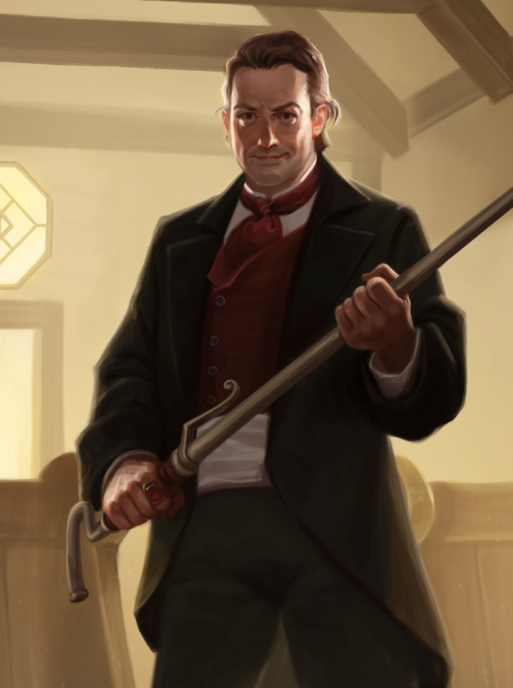
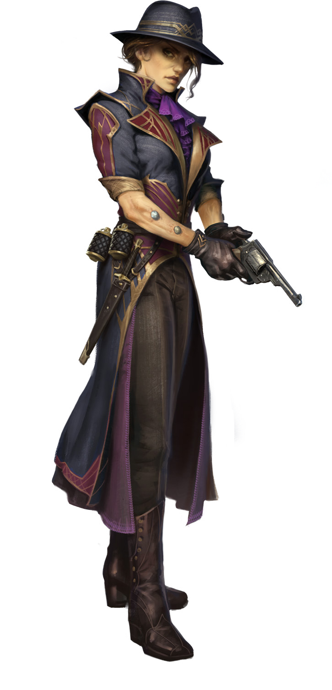

### 顧問（Advisor）

從宗教和產業，到犯罪和政治，社會各界都需要高明的建議。無論是初來乍到的人需要前輩指點，還是根深柢固的正統觀念需要新的觀點，身邊有位精明的顧問，都可能讓結果從慘敗變成大獲全勝。

顧問可以在任何領域提供經驗，從戰鬥架式到策略辯論都不例外。許多顧問會恪守專業分寸，尊重服務對象。不過，少數野心勃勃的人其實已經是檯面人物背後真正掌權的人，或正想坐上這個位置。

### 歷經各個時代

在最後帝國（Final Empire），顧問經常為貴族效力，教導年輕貴族如何運用政治手段，或傳授禮儀的細節。泰瑞司侍從官（Terris Steward）擔任顧問時尤其受到器重。

落灰之終（Catacendre）數百年後，領導者對智慧與建言的需求絲毫未減。顧問可能是政治幕僚、演講稿撰稿人，甚至是精明的律師。

#### 顧問

*階層 2 嘍囉 — 中型類人生物*

| 實體 |  |  | 意識 |  |  | 靈魂 |  |  |
| --- | --- | --- | --- | --- | --- | --- | --- | --- |
| 力量 | 防禦 | 速度 | 智力 | 防禦 | 意志 | 察覺 | 防禦 | 風采 |
| 1 | 13 | 2 | 4 | 16 | 2 | 3 | 15 | 2 |

生命值（Health）：20（16–24）

專注點（Focus）：5

授予（Investiture）：0

移動：25 呎

感知（Senses）：20 呎（視覺）

實體技能：隱匿（Stealth）+5

意識技能：推理（Deduction）+7、學識（Lore）+7

靈魂技能：洞察（Insight）+6、說服（Persuasion）+5

##### 特徵

嘍囉（Minion）。顧問的攻擊無法造成重擊，且在受到傷勢時立即被擊敗。

##### 行動

[1行動] **打擊（Strike）：決鬥杖（Dueling Cane）。** 攻擊 +2，觸及範圍 5 呎，造成 1d8 + 2 衝擊傷害（impact damage）。

[1行動] **為您效勞（At Your Service，花費 1 專注點）。** 顧問選擇距自己 5 呎內、自己能感知的一名角色。該角色在自己的下一個輪次獲得 [1行動]，只能用於架防（Brace）、飲用金屬液（Drink Vial）、獲取優勢（Gain Advantage）或互動（Interact）。

[反應] **及時建言（Timely Advice）。** 在一名顧問能影響的角色花費專注點以造成擦傷（graze）或抵抗影響之前，顧問可以代替該角色支付這筆專注點。

##### 顧問戰術

顧問會用自己的能力支援客戶，避免直接捲入衝突。及時建言特徵讓顧問在對話（Conversation）中成為可靠的夥伴，為您效勞則能先一步照應客戶在戰鬥中的需求。顧問特別適合與金屬之子（Metalborn）客戶並肩作戰，讓金屬之子以飲用金屬液補充授予時能省下行動。除此之外，顧問會用剩餘的專注點提供及時建言，再用恢復（Recover）取回專注點。

DARKO STOJANOVICH

第 8 章：敵手 217

#### 「組織」密探（Agent of the Set）　第二紀元

「組織」（the Set）是個在暗處活動的祕密組織，現在企圖先動搖並推翻依藍戴盆地（Elendel Basin）的政府，再由自己接管盆地。「組織」的最終目的是向碎力（Shard）自主（Autonomy）證明，司卡德利亞（Scadrial）的生命能繼續存在，而不妨礙自主達成自己的目標。為了實現這些目的，「組織」訂下了野心勃勃的計畫，從控制城市到打造 Trellium-Harmonium 炸彈都有。關於「組織」征服世界的計畫，見第 4 章〈武器化的 Harmonium〉。若想在冒險中運用這個祕密組織，見第 5 章〈「組織」〉。

「組織」勢力強大，往往能耐心籌畫長達百年才見成果。無論執行什麼任務，「組織」密探都裝備精良、補給充足，而且忠心耿耿，十分危險。

### 階級

「組織」有六個領導階級：Cycle、Array、Suit、Sequence、Series 和 Key。Key 是組織的領袖。各階級的詳情見第 5 章〈「組織」〉。這裡的敵手資料區塊（Stat Block）最適合高階密探。你可以用本章末尾的模組，讓隊伍遭遇不同類型的密探。

較低階的密探可以使用能力較平常的敵手資料區塊，例如鬼血（Ghostblood）或社交名流。「組織」除了自己的核心人員，也經常雇用當地打手。打手與保鑣的敵手資料都適合用來代表這些受雇人員。

##### 「組織」密探戰術

「組織」密探一心想讓自主刮目相看，在戰鬥中大膽無畏。他們不介意用投射物拉引（Projectile Lurch）替盟友擋下攻擊，也不怕生命值降到一半以下，好讓自力更生（Self-Reliance）生效，因為他們知道自己可以用汲取健康（Tap Health）保命。他們能用鐵拉（Ironpull）掌控戰場，並視站位使用長刃刀（Long-Bladed Knife）或左輪手槍（Revolver）。敵人恰好聚在一起時，一枚手榴彈（Grenade）就能迅速收拾他們。

一名「組織」密探打量著她的對手。

JORDAN KERBOW

第 8 章：敵手 218

#### 「組織」密探

*階層 3 勁敵（Rival）— 中型類人生物*

| 實體 |  |  | 意識 |  |  | 靈魂 |  |  |
| --- | --- | --- | --- | --- | --- | --- | --- | --- |
| 力量 | 防禦 | 速度 | 智力 | 防禦 | 意志 | 察覺 | 防禦 | 風采 |
| 2 | 17 | 5 | 2 | 16 | 4 | 6 | 16 | 2 |

生命值：58（46–70）

專注點：6

授予：8

偏轉值（Deflect）：1（皮革）

移動：40 呎

感知：50 呎（視覺）

實體技能：敏捷（Agility）+9、輕型武器（Light Weaponry）+9、隱匿 +8

意識技能：紀律（Discipline）+8、威嚇（Intimidation）+7

靈魂技能：欺騙（Deception）+6、洞察 +10、感知（Perception）+10

金屬技藝技能：鎔金術（Allomancy）+8（4 技能等級，鐵）、藏金術（Feruchemy）+6（4 技能等級，金）

##### 特徵

金意識（Goldmind，儲存生命值）。密探有一個儲存了 6 點充能（Charge）的金意識。

可搜取的尖刺（Lootable Spike）。密探體內植有一根金製血金術尖刺（Hemalurgic Spike），可賦予金藏金術（Gold Feruchemy）。密探被擊敗時，擲一顆劇情骰（Plot Die）。擲出[機遇]時，會找到一根尖刺，具備血金術師專長（Hemalurgist expertise）的 PC 可以植入它。（如果 PC 原本就知道這根尖刺的存在，他們會自動找到它，無須擲骰。）

自力更生。密探的生命值低於一半時，若攻擊命中，便獲得傷害加成，數值等於距自己 30 呎內的敵人數量。

##### 行動

[1行動] **打擊：長刃刀。** 攻擊 +9，觸及範圍 5 呎，造成 1d4 + 12 銳利傷害（keen damage）。命中時，目標也會受到折磨（Afflicted）[1d8 銳利]，直到目標恢復至少 1 點生命值。

[1行動] **打擊：左輪手槍。** 攻擊 +9，距離 20/80 呎，造成 1d6 + 12 銳利傷害。穿刺（Pierce）：這次傷害無法以目標的偏轉值減少。裝填（Loaded）[6]：花費[1行動]將這把武器的彈藥補滿。

[2行動] **手榴彈（可用 2 次）。** 攻擊 +9，距離 20/60 呎，造成 2d4 + 9 衝擊傷害。爆破（Blast）[5]：命中時，這次攻擊會擦傷距目標 5 呎內的其他每名角色。密探可花費 2 專注點，改為命中他們每一人。

[1行動] **汲取健康（花費 1 金意識充能）。** 密探終止自己身上一種疾病、藥物或毒藥的效果。此外，密探立即恢復 1d10 點生命值。直到場景結束，密探在自己的每個輪次開始時也會照此擲骰恢復生命值。

[1行動] **燃燒鐵（Burn Iron）。** 直到場景結束，密探能感知距自己 160 呎內所有非鋁的金屬來源。

[1行動] **鐵拉（花費 1–4 授予）。** 密探選擇一件自己藉燃燒鐵感知到的金屬物品，讓自己或該物品沿直線朝另一方移動。每花費 1 授予，最多移動 20 呎。體型比密探小的物品會移向密探，體型相同或更大的物品則會讓密探移向它。若物品固定在其他東西上，該東西也計入物品的體型。

這項能力可靈活運用，例如繳械敵人，或打擊物品飛行路徑上的敵人。若要以這種方式影響不情願的角色，密探必須對目標的實體防禦（Physical Defense）進行鎔金術檢定並成功。若效果會造成傷害，密探則必須進行鎔金術攻擊，擲出 1d10 + 8 衝擊傷害。

[反應] **投射物拉引（花費 1 授予）。** 距密探 160 呎內的一名盟友即將受到金屬投射物攻擊時，若密探能藉燃燒鐵感知該投射物，密探可以取代盟友，成為這次攻擊的目標。

[反應] **反射式造血（Reflexive Bloodmaking）。** 在生命值降到 0 或受到傷勢之前，密探可將汲取健康作為[反應]使用。這麼做時，密探改為降至 1 生命值、免受該傷勢，或同時得到這兩種結果，然後獲得汲取健康的效果。（如果密探已經在汲取健康，在自己的每個輪次只恢復通常的生命值數量。）

> 「在『組織』成員當中，我算保守。我出聲反對魯莽，也反對暴力。可是你逼得越緊，我的影響力就越弱，那些嚷著要變革的人就越大聲。他們願意付出任何代價。」

第 8 章：敵手 219

#### Trell化身（Avatar of Trell）　第二紀元

Trell化身是自主選中、代表她在司卡德利亞行事的人類，因此成為受授予的（Invested）人類。化身必須展現出非凡的潛力，自主也會以最高標準要求他們。

### 理念

自主鼓勵人們成為「最好的自己」，要求他們在逆境中或面對社會時證明自己。她看重個人主義和適者生存，認為每個人都得憑本事取得生存的權利。自主的追隨者努力證明自己配在宇宙中占有一席之地，追求自我實現的道路，卻往往走向極端，例如製造戰爭武器。成為 Trell化身，意味著拋開社會的束縛，不惜代價走自己的路。

**戰役中的 Trell化身**

自主與司卡德利亞的衝突在全球展開，影響遍及整個寰宇（cosmere）。因此，自主選中在司卡德利亞接受她授予的人，會以無人能及的方式體現她的理念。化身很可能是「組織」的成員，目標是推翻依藍戴盆地政府並統治司卡德利亞，見第 5 章〈「組織」〉。

Trell化身無須直接阻撓 PC 的每一項行動。但如果角色妨礙化身，化身會不擇手段完成自己的計畫。

##### Trell化身戰術

Trell化身原本就難以對付，自主的力量又讓其更加強大。Trell眷顧（Favored by Trell）正體現了這股力量，讓化身能在戰鬥中支撐更久。化身可用燃燒鉻（Burn Chromium）和獨立計策（Independent Stratagem）削弱來犯的敵人，主要以左輪手槍或射出錢幣（Shoot Coin）造成大量傷害。戰況不利時，化身可用鋼推（Steelpush）移動自己或他人，掌控戰場，也能投擲鎔金手榴彈（Allomantic Grenade）製造混亂。

自主可以將自己的一部分力量授予忠心的信徒。

WILSON NUGRAHA & GAL OR

第 8 章：敵手 220

#### Trell化身

*階層 4 首領（Boss）— 中型類人生物*

| 實體 |  |  | 意識 |  |  | 靈魂 |  |  |
| --- | --- | --- | --- | --- | --- | --- | --- | --- |
| 力量 | 防禦 | 速度 | 智力 | 防禦 | 意志 | 察覺 | 防禦 | 風采 |
| 4 | 18 | 4 | 6 | 22 | 6 | 6 | 16 | 6 |

生命值：210（168–252）

專注點：10

授予：10

移動：30 呎

感知：50 呎（視覺）

實體技能：輕型武器 +9、隱匿 +9

意識技能：推理 +11、紀律 +11、威嚇 +11

靈魂技能：欺騙 +11、洞察 +11、領導（Leadership）+11、說服 +11

金屬技藝技能：鎔金術 +11（5 技能等級，鉻、鋼）

##### 特徵

首領。化身每回合可以進行一個快速輪次（fast turn）和一個慢速輪次（slow turn）。一名敵人結束其輪次後，化身可花費 1 專注點，立刻額外使用 [1行動] 或 [自由行動]。此外，化身可在自己的輪次花費 1 專注點，解除自己身上的一個狀態（condition）。

Trell眷顧。化身的生命值降到 0 時，可花費任意數量的授予，恢復等於 10 × 所花費授予的生命值。

可搜取的尖刺。化身體內植有三根血金術尖刺：一根增強感官的錫尖刺、一根賦予鋼鎔金術（Steel Allomancy）的鋼尖刺，以及一根賦予鉻鎔金術（Chromium Allomancy）的電金尖刺。化身被擊敗時，擲一顆劇情骰。擲出[機遇]時，會找到其中一根尖刺，具備血金術師專長的 PC 可以植入它。（如果 PC 原本就知道某根尖刺的存在，他們會自動找到它，無須擲骰。只有尋找未知的尖刺才擲骰。）

自給自足（Self-Sufficiency）。化身的生命值低於一半時，若攻擊命中，便獲得傷害加成，數值等於其意志（Willpower）。

##### 行動

[1行動] **打擊：鋁刀（Aluminum Knife）。** 攻擊 +9，觸及範圍 5 呎或距離 20/60 呎，造成 1d4 + 9 銳利傷害。

[1行動] **打擊：左輪手槍。** 攻擊 +9，距離 20/80 呎，造成 1d6 + 9 銳利傷害。命中時，化身可花費 1 授予，額外造成 10 銳利傷害。穿刺：這次傷害無法以目標的偏轉值減少。裝填[6]：花費[1行動]將這把武器的彈藥補滿。

[1行動] **射出錢幣（花費 1–5 授予）。** 攻擊 +11，距離為每花費 1 授予 20 呎，造成 1d12 + 11 衝擊傷害。

[2行動] **鎔金手榴彈（可用 2 次）。** 攻擊 +11，距離 20/60 呎，造成 1d12 + 11 衝擊傷害。無論命中或未命中，距目標 10 呎內每名穿戴或攜帶非鋁且未受授予（non-Invested）金屬的角色，都會被朝目標拉近 10 呎。爆破[10]：命中時，這次攻擊會擦傷距目標 10 呎內的其他每名角色。化身可花費 2 專注點，改為命中他們每一人。

[1行動] **燃燒鉻（花費 1 授予）。** 化身選擇觸及範圍內一名受授予的角色或一件受授予的物品。此行動的效果取決於目標類型：

- 灌注了授予的物品或角色。目標或灌注在目標身上的效果失去 1d12 授予。

- 有充能的物品。物品失去 1d6 充能。若要以這種方式影響藏金術金屬意識庫（metalmind），必須有一名授予為 0 的角色正在其中儲存，或正從中汲取。

若要影響不情願的角色，或其穿戴、持有的物品，化身必須先對目標的實體防禦進行鎔金術檢定並成功。若失敗，目標不受影響，化身也不花費授予。

[1行動] **燃燒鋼（Burn Steel）。** 直到自己的下一個輪次開始，化身能感知距自己 320 呎內所有非鋁且未受授予的金屬來源。

[1行動] **獨立計策。** 化身對一個自己能影響的目標進行推理檢定，對抗目標的意識防禦（Cognitive Defense）。成功時，目標失去 1d4 專注點。

[1行動] **鋼推（花費 1–5 授予）。** 化身選擇一件自己藉燃燒鋼感知到的金屬物品，讓自己或該物品沿直線遠離另一方。每花費 1 授予，最多移動 20 呎。體型比化身小的物品會遠離化身，體型相同或更大的物品則會讓化身遠離它。若物品固定在其他東西上，該東西也計入物品的體型。

這項能力可靈活運用，例如繳械敵人，或讓化身短距離「飛行」。若要以這種方式影響不情願的角色，化身必須對目標的實體防禦進行鎔金術檢定並成功。

##### 機遇與變故

機遇。敵人可花費[機遇]，使化身無法獲得 Trell眷顧與自給自足特徵的好處，直到該敵人的下一個輪次結束。

變故。GM 可花費敵人檢定擲出的[變故]，讓化身將獨立計策行動作為[反應]使用。

第 8 章：敵手 221
