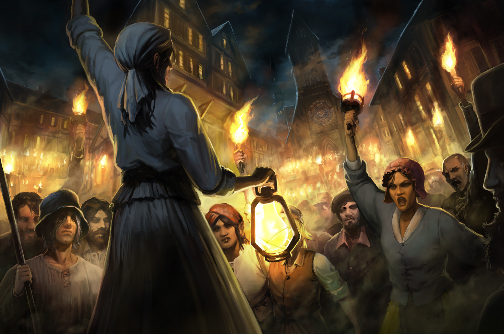

### 平民（Commoner）

司卡德利亞的文化停滯了很長一段時間。此後，當地人民歷經艱困、革命與變革。即使一次次改變世界的劇變迫使他們承受苦難、適應環境並重建生活，每個司卡德利亞人仍有自己的希望、夢想與本領。

平民是司卡德利亞各座城市裡常見的一般居民。第一紀元稱他們為司卡，第二紀元稱他們為公民。多數平民只求過好自己的日子，盡可能避開暴力、保護所愛的人，並把握任何能讓生活富足的機會。農夫、麵包師、織工、歷史學者，或任何過著簡單生活的普通人，都可能是平民。

##### 平民（Commoner）戰術

在戰鬥中，除非所愛的人面臨迫在眉睫的危險，平民通常會逃離現場、尋找安全的地方。

被迫戰鬥時，平民通常會拿起臨時武器，也可能使用分散注意來協助更有本事的盟友。在對話中，平民通常會讓步給自己認為更有能力的人。

#### 平民（Commoner）

*階層 1 嘍囉 — 中型類人生物*

| 實體 |  |  | 意識 |  |  | 靈魂 |  |  |
| --- | --- | --- | --- | --- | --- | --- | --- | --- |
| 力量 | 防禦 | 速度 | 智力 | 防禦 | 意志 | 察覺 | 防禦 | 風采 |
| 0 | 11 | 1 | 1 | 12 | 0 | 1 | 11 | 0 |

生命值：10（8–12）

專注點：2

授予：0

移動：25 呎

感知：10 呎（視覺）

實體技能：運動 +1

意識技能：工藝 +2

靈魂技能：洞察 +2、感知 +2

##### 特徵

嘍囉。平民的攻擊無法造成重擊，且在受到傷勢時立即遭到擊敗。

能幹（Capable）。平民具有一項職業的實用專長，進行與該職業相關的檢定時獲得一個優勢。

##### 行動

[1行動] **打擊：臨時武器。** 攻擊 +1，觸及範圍 5 呎，造成 1d4 + 1 衝擊傷害。

[反應] **分散注意（Distract，花費 1 專注點）。** 當一名盟友對平民觸及範圍內的一名敵人進行檢定時，平民讓該盟友在這次檢定中獲得一個優勢。

KEVIN O’NEILL

