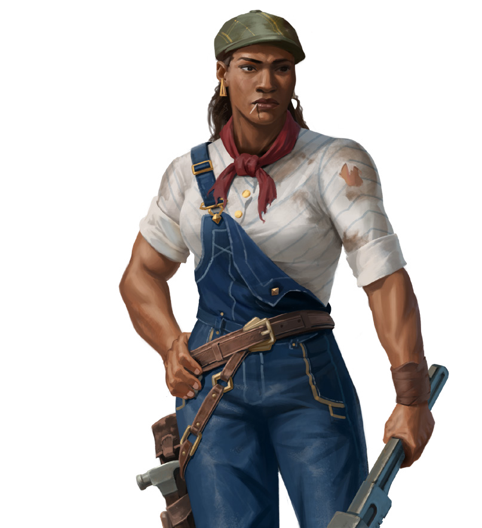

### 打手（Enforcer）

有時一支好隊伍需要的只是一個擅長揍人的傢伙。領袖、扒竊高手或擅長出面交涉的人，在這時都派不上用場。這就是打手登場的時候了。這些受雇的打手動輒把人打得頭破血流，還常把整間屋子砸得一片狼藉。

打手通常對隊伍首領很忠心，首領指哪裡，他們就打哪裡。執行任務時，打手會保護較弱的同伴，確保那些更靈活、更擅長說服或更會潛行的盟友能活著離開。打手的本領雖然多半靠體力，卻也是隊伍裡最擅長隨機應變的人之一。他們會拿別人當盾牌、打碎物品取得戰術優勢，或抄起手邊任何東西當武器。

##### 打手（Enforcer）戰術

打手行動迅速、莽撞卻有效，打起來絕不退縮。他們會保護隊伍裡較弱的成員，並用猛衝特徵快速穿越戰場。若無法靠近，第二紀元的打手可以使用霰彈槍，但所有打手都優先設法貼近敵人，以徒手打擊束縛對方。

一旦束縛敵人，打手就會以折斷骨頭重創單一目標，或用臨場發揮一次重創數名敵人。打手若難以束縛某個目標，可以先用擊倒，替下一次徒手打擊創造機會。

#### 打手（Enforcer）

*階層 2 勁敵 — 中型類人生物*

| 實體 |  |  | 意識 |  |  | 靈魂 |  |  |
| --- | --- | --- | --- | --- | --- | --- | --- | --- |
| 力量 | 防禦 | 速度 | 智力 | 防禦 | 意志 | 察覺 | 防禦 | 風采 |
| 5 | 18 | 3 | 1 | 14 | 3 | 3 | 16 | 3 |

生命值：45（36–54）

專注點：5

授予：0

移動：40 呎

感知：20 呎（視覺）

實體技能：運動 +7、重型武器 +6

意識技能：威嚇 +6

靈魂技能：感知 +6、求生 +5

##### 特徵

猛衝（Bull Rush）。打手能穿過敵人占據的區域，也不會因中型或更小的物體造成的困難地形而減速。

##### 行動

[1行動] **徒手打擊。** 攻擊 +7，觸及範圍 5 呎，造成 1d8 + 7 衝擊傷害。命中時，若目標為中型或更小，打手可選擇使目標陷入束縛，但在該狀態解除前，打手無法攻擊其他目標。被束縛的目標可花費 [2行動] 進行 DC 15 的敏捷或運動檢定，成功時解除束縛。

[1行動] **打擊：霰彈槍。** [第二時代] 攻擊 +6，距離 20/60 呎，造成 1d10 + 6 銳利傷害。命中時，這次攻擊也會擦傷距目標 5 呎內的每名角色。穿刺：這次傷害無法以目標的偏轉值減少。裝填 [2]：花費 [1行動] 將這把武器的彈藥補滿。

[2行動] **折斷骨頭（Breaking Bones）。** 打手對一名被自己束縛的目標進行運動檢定，對抗其實體防禦。成功時，目標受到下列其中一項狀態，持續至打手下一個輪次結束：迷惑、精疲力竭 [−1] 或減速。打手可花費 3 專注點，改為造成一項傷勢。

[2行動] **臨場發揮（Improvising）。** 打手將一名被自己束縛的敵人扔向距自己 20 呎內的另一名敵人。打手進行近戰運動攻擊，對抗兩名目標的實體防禦，擲出 3d8 + 7 衝擊傷害。無論命中與否，被扔出的敵人還會在另一名目標身旁最近的未占據空間倒地。

[反應] **擊倒（花費 1 專注點）。** 一名大型或更小的敵人在距打手 5 呎內以近戰攻擊命中打手後，打手使該攻擊者倒地。

FLORIAN HAECKH

