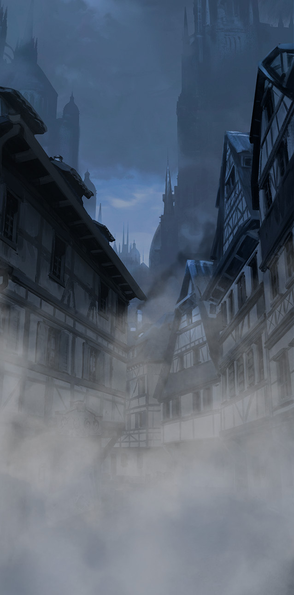
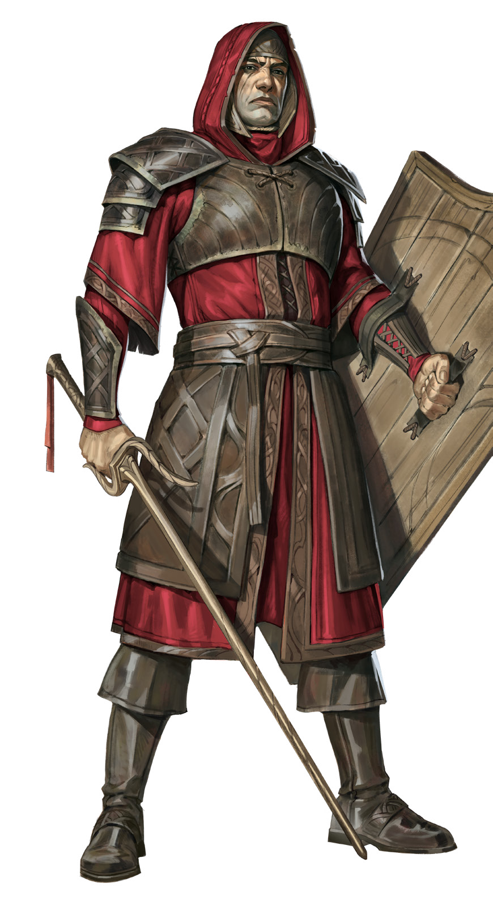

## 殺霧者

殺霧者（Hazekiller）是專門獵殺鎔金術師（Allomancer）的戰士。這些老練的戰士身上完全不帶金屬，靠的是能有效對付金屬技藝（Metallic Arts）使用者的武器、護甲與戰術。

落灰之終（Catacendre）以前，富裕的貴族家族除了原有的守衛，也會雇用殺霧者來對付鎔金術師和一般的司卡（skaa）反抗者。落灰之終後，殺霧者組成獵殺小隊，受雇擔任傭兵，或與一般保鑣一起保護受人矚目的雇主。

小隊的裝備取決於出資者付得起什麼。「組織」（the Set）等富裕團體能為旗下小隊配備昂貴的鋁製武器與子彈，使殺霧者更難對付。

### 技術

你可以調整殺霧者能力的敘事呈現，展現他們如何用各種手段反制鎔金術（Allomancy）。例如，子彈擊中玩家角色後，可以在戲劇性的時刻揭曉那是一枚殺霧彈（Hazekiller Round）。「斷絕授予的佯攻（Devitalizing Feint）」成功時，也可以描述成殺霧者使用專門對付某種鎔金術師的裝備，例如用閃光手榴彈擾亂錫眼（Tineye）的感官。

##### 殺霧者戰術

殺霧者以小隊行動，謹慎配合，通常由殺霧者精銳（Hazekiller Elite）帶隊。他們會用迎戰鎔金術師（Engage Allomancer）反應一起衝向鎔金術師，接著維持隊形。

他們藉由獵殺小隊（Kill Squad）發揮團隊優勢。殺霧者若以盾擊（Shield Bash）擊倒敵人，隊友就會接著使用挫志（Break Spirit）。

殺霧者精銳靠敏銳感官（Heightened Senses）察覺鎔金術，也能抵抗鎔金術的操弄，因此特別擅長對付鎔金術師。近身交戰時，精銳會用斷絕授予的佯攻阻止對手恢復授予（Investiture），再試著用盾擊使目標倒地（Prone），好用決鬥杖（Dueling Cane）造成更多傷害。

#### 殺霧者

*階層 1 勁敵（Rival）– 中型類人生物（Humanoid）*

| 實體 |  |  | 意識 |  |  | 靈魂 |  |  |
| --- | --- | --- | --- | --- | --- | --- | --- | --- |
| 力量 | 防禦 | 速度 | 智力 | 防禦 | 意志 | 察覺 | 防禦 | 風采 |
| 2 | 15 | 3 | 1 | 13 | 2 | 3 | 14 | 1 |

生命值（Health）26（21–31）

專注點（Focus）4

授予 0

移動速率 30 呎

感知：20 呎（視覺）

實體技能：敏捷（Agility）+4、運動（Athletics）+5、輕型武器（Light Weaponry）+5

意識技能：推理（Deduction）+3、紀律（Discipline）+3

靈魂技能：洞察（Insight）+4、感知（Perception）+4、求生（Survival）+4

##### 特徵

**防禦戰術（Defensive Tactics）。** 殺霧者帶著木盾，可以使用架防（Brace）行動。

**獵殺小隊。** 殺霧者的攻擊擲骰與傷害擲骰獲得加值，等同於自身 20 呎內的友方殺霧者人數，最高 +5。

##### 行動

[1行動] **打擊：決鬥杖。** 攻擊 +5，觸及 5 呎，造成 1d8 + 5 衝擊傷害。命中時，若殺霧者在這次攻擊中至少有一個優勢，可以花費 1 專注點來額外造成 1d8 衝擊傷害。

[1行動] **打擊：左輪手槍（鋁彈）。** [第二時代] 攻擊 +5，距離 20/80 呎，造成 1d6 + 5 銳利傷害。**穿刺（Pierce）。** 目標的偏轉值（Deflect）無法減少這把武器造成的傷害。**裝填（Loaded）[6]。** 以 [1行動] 將彈藥補滿。

[1行動] **盾擊。** 殺霧者對自身 5 呎內一名中型或更小角色的實體防禦進行運動檢定。成功時，目標倒地。

[2行動] **挫志（花費 1 專注點）。** 殺霧者攻擊一名倒地的角色。命中時，目標失去 1d4 專注點，取代這次攻擊通常造成的傷害。

[反應] **迎戰鎔金術師（花費 2 專注點）。** 在殺霧者能感知到的角色使用飲用金屬液（Drink Vial）或花費授予的行動後，若殺霧者察覺該行動，就能朝那名角色移動最多相當於自身移動速率一半的距離。

第 8 章：敵手 232

#### 殺霧者精銳

*階層 2 勁敵 – 中型類人生物*

| 實體 |  |  | 意識 |  |  | 靈魂 |  |  |
| --- | --- | --- | --- | --- | --- | --- | --- | --- |
| 力量 | 防禦 | 速度 | 智力 | 防禦 | 意志 | 察覺 | 防禦 | 風采 |
| 3 | 17 | 4 | 3 | 16 | 3 | 3 | 15 | 2 |

生命值 47（38–56）

專注點 5

授予 0

移動速率 30 呎

感知：20 呎（視覺）

實體技能：敏捷 +5、運動 +5、輕型武器 +6

意識技能：推理 +5、紀律 +6

靈魂技能：洞察 +5、感知 +6、求生 +5

##### 特徵

**防禦戰術。** 殺霧者精銳帶著木盾，可以使用架防行動。

**敏銳感官。** 殺霧者精銳在辨認有人使用鎔金術，或辨認某人是否為鎔金術師的檢定上獲得一個優勢。此外，若精銳知道自己受情緒鎔金術（Emotional Allomancy）影響，可以花費 1 專注點，以 [自由行動] 結束該效果。

**獵殺小隊。** 殺霧者精銳的攻擊擲骰與傷害擲骰獲得加值，等同於自身 20 呎內的友方殺霧者人數，最高 +5。

##### 行動

[1行動] **打擊：決鬥杖。** 攻擊 +6，觸及 5 呎，造成 1d8 + 6 衝擊傷害。命中時，若殺霧者精銳在這次攻擊中至少有一個優勢，可以花費 1 專注點來額外造成 2d8 衝擊傷害。

[1行動] **打擊：左輪手槍（鋁彈）。** [第二時代] 攻擊 +6，距離 20/80 呎，造成 1d6 + 6 銳利傷害。**穿刺。** 目標的偏轉值無法減少此傷害。**裝填 [6]。** 以 [1行動] 將彈藥補滿。

[1行動] **盾擊。** 殺霧者精銳對自身 5 呎內一名中型或更小角色的實體防禦進行運動檢定。成功時，目標倒地。

[2行動] **斷絕授予的佯攻（花費 1 專注點）。** 殺霧者精銳進行一次打擊（Strike），使一名鎔金術師分心。命中時，目標直到其下一個輪次結束前都無法恢復授予，取代這次打擊通常造成的傷害。

[自由行動] **磨練直覺（Honed Instincts）。** 殺霧者精銳下次攻擊自己認得的鎔金術師時，該次攻擊獲得一個優勢。

[反應] **格擋（花費 1 專注點）。** 當殺霧者精銳即將被自身 60 呎內能感知到的敵人以遠程武器攻擊命中時，可以舉盾，使該次命中變成未命中。

PEDRO DUTRA & LOGAN FELICIANO

第 8 章：敵手 233

