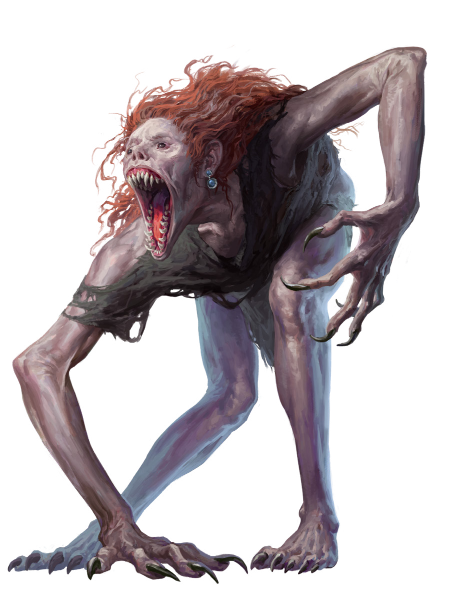

## 血金嵌合獸　[第二時代]

血金嵌合獸（Hemalurgic Chimera）原本是人，遭植入 Trellium尖刺（trellium spike），才成了可怕的血金造物。最早的血金嵌合獸由坎得拉（kandra）索血者（Bleeder）創造。她侍奉統御主（Lord Ruler）多年，又與自主（Autonomy）有所往來，因而學會了血金術（Hemalurgy）。她把這門知識傳給「組織」（the Set）。「組織」便用這些生物在機密程度最高的設施周圍設下危害。

### 生理與能力

血金嵌合獸的確切製造方法鮮為人知。人們只知道，牠們體內被植入了儲有某種未知屬性的 Trellium尖刺。尖刺使牠們的身體扭曲，長出拉長而關節錯位的四肢、粗大的骨骼、漆黑的眼睛和像犬類的頭。嵌合獸以四肢快速行進，用尖牙咬、用利爪抓。「組織」使用的嵌合獸還能像獵犬一樣追蹤。每隻嵌合獸的智性與感知程度各不相同。

### 戰役中的血金嵌合獸

血金嵌合獸是下場悽慘的受害者。「組織」為了控制他們，違背他們的意願在人身上施行血金術。想到他們曾是怎樣的人、失去了什麼，又被迫變成什麼模樣，就讓人不寒而慄。嵌合獸本性並不邪惡，該為其行為負責的是那些用血金術傷害、控制他們的人。

#### 血金嵌合獸

*階層 3 嘍囉（Minion）– 中型類人生物（Humanoid）*

| 實體 |  |  | 意識 |  |  | 靈魂 |  |  |
| --- | --- | --- | --- | --- | --- | --- | --- | --- |
| 力量 | 防禦 | 速度 | 智力 | 防禦 | 意志 | 察覺 | 防禦 | 風采 |
| 3 | 16 | 3 | 1 | 14 | 3 | 3 | 14 | 1 |

生命值（Health）32（26–38）

專注點（Focus）5

授予（Investiture）0

偏轉值（Deflect）3（堅韌的外皮）

移動速率 30 呎

感知：20 呎（視覺）

實體技能：敏捷（Agility）+7、運動（Athletics）+7

意識技能：威嚇（Intimidation）+7

靈魂技能：感知（Perception）+7、求生（Survival）+7

##### 特徵

**嘍囉。** 嵌合獸的攻擊無法造成重擊，且一旦受到傷勢（Injury）就立刻被擊敗。

##### 行動

[1行動] **打擊：尖牙與利爪（Strike: Tooth and Claw）。** 攻擊 +7，觸及 5 呎，造成 1d6 + 7 銳利傷害。命中時，若目標已倒地（Prone），嵌合獸額外造成 1d6 銳利傷害。

[2行動] **令人作嘔的尖嚎（Sickening Scream，花費 2 專注點）。** 嵌合獸對自身 5 呎內一名能受其影響的角色的意識防禦進行威嚇檢定。成功時，目標倒地。目標 5 呎內每有一隻血金嵌合獸，目標就失去 1 專注點。

[自由行動] **群獵本能（Pack Instincts）。** 這隻嵌合獸在一隻友方血金嵌合獸 5 呎內時，可以用 [自由行動] 執行獲取優勢（Gain Advantage）行動。

[自由行動] **痛苦狂亂（Painful Frenzy）。** 嵌合獸可以選擇失去 5 點生命值，換取額外的 [1行動]。

> 走廊上響起尖銳的嚎叫，寒意逼得瓦（Wax）停下腳步。他拔出問證（Vindication），另一手高舉提燈。更多嚎叫聲隨即加入，聲聲相互衝撞，刺耳得可怕。

PEDRO DUTRA & LOGAN FELICIANO

第 8 章：敵手 234

#### 血金嵌合獸群首領

*階層 3 勁敵（Rival）– 大型類人生物*

| 實體 |  |  | 意識 |  |  | 靈魂 |  |  |
| --- | --- | --- | --- | --- | --- | --- | --- | --- |
| 力量 | 防禦 | 速度 | 智力 | 防禦 | 意志 | 察覺 | 防禦 | 風采 |
| 5 | 20 | 5 | 1 | 15 | 4 | 4 | 16 | 2 |

生命值 60（48–72）

專注點 6

授予 0

偏轉值 3（堅韌的外皮，另見厚實頭骨）

移動速率 40 呎

感知：20 呎（視覺）

實體技能：敏捷 +9、運動 +9

意識技能：威嚇 +8

靈魂技能：感知 +8、求生 +8

##### 特徵

**狂亂（Frenzy）。** 嵌合獸的生命值降到一半以下時，會陷入狂亂。每回合一次，牠可以花費 1 專注點，在自己的輪次獲得額外的 [1行動]。

**厚實頭骨（Thickened Skull）。** 嵌合獸的偏轉值也適用於具穿刺（Pierce）特性的武器造成的傷害，除非該次攻擊獲得機遇（Opportunity）。

**精準獵手（Unerring Hunter）。** 每個場景一次，嵌合獸或能指揮牠的馴導者，可以指定一名角色為牠的獵物。嵌合獸追蹤或攻擊獵物的檢定獲得一個優勢。嵌合獸同一時間只能有一名獵物。

##### 行動

[1行動] **打擊：利爪（Strike: Nails）。** 攻擊 +9，觸及 5 呎，造成 2d8 + 9 銳利傷害。命中時，若目標為大型或更小，嵌合獸還可以花費 1 專注點使其倒地。

[2行動] **尖牙（Teeth）。** 攻擊 +9，觸及 5 呎，造成 2d6 + 9 銳利傷害。命中時，若目標已倒地，嵌合獸額外造成 1d10 銳利傷害。

[2行動] **駭人本性（Harrowing Nature）。** 嵌合獸對自身 30 呎內一名能受其影響的角色的意識防禦進行威嚇檢定。成功時，目標失去 1d4 專注點。

[自由行動] **群獵本能。** 這隻嵌合獸在一隻友方血金嵌合獸 5 呎內時，可以用 [自由行動] 執行獲取優勢行動。

[反應] **追獵（On the Hunt）。** 當嵌合獸 60 呎內的一名敵人倒地後，牠朝該敵人移動，最多移動相當於自身移動速率的距離。

##### 血金嵌合獸戰術

群獵本能和令人作嘔的尖嚎讓血金嵌合獸成群時最危險。少了獸群首領，牠們的行動就會狂躁而混亂。扭曲的身體帶來劇痛，驅使牠們以近乎瘋狂的速度戰鬥，盡可能頻繁地使出痛苦狂亂，以便推撞（Shove）、擒抱（Grapple），或與同伴一起發出令人作嘔的尖嚎。

血金嵌合獸群首領用精準獵手特徵追蹤獵物。首領迅速靠近到近戰距離，用利爪讓目標倒地，再用尖牙撕咬倒地的目標。首領不怕挨打，因為受傷時，狂亂特徵會使牠變得更強。牠會用額外的行動施展利爪，造成更多傷害，再把更多敵人拖倒在地，讓獸群追獵。

血金嵌合獸

ANASTASSIA GRIGORIEVA

第 8 章：敵手 235

