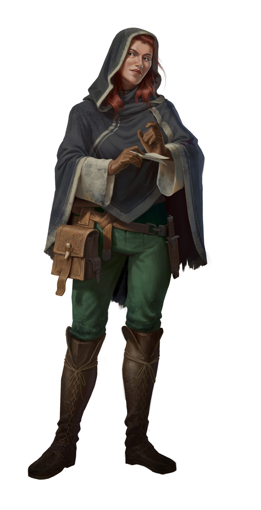
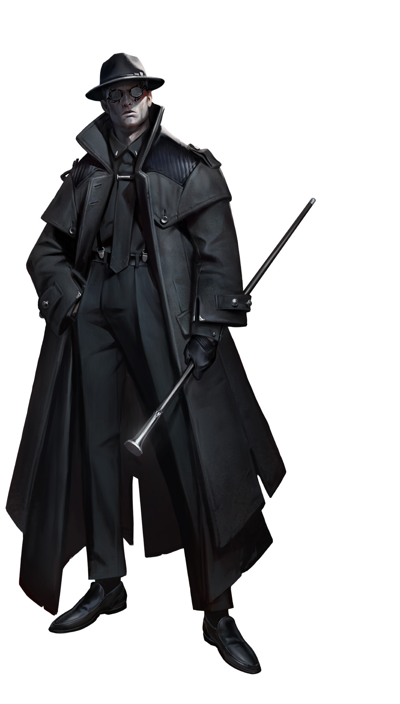

### 線人

線人通常身居低位，靠人脈、見聞與手中的籌碼取得影響力。他們精於算計，擅長從別人嘴裡套出所需的情報，有時是為了暗中相助，有時則是要徹底毀了對方。線人行事謹慎而狡猾，留著太有用，沒人想殺他們。他們知道得太多，也很難受人威嚇。

### 情報交易

每個線人都得人脈廣、消息靈通。線人可能為了推進所屬組織的目標、維持生計，或出於更私人的理由分享消息。無論消息從哪裡來、為什麼要說出去，熟練的線人總會提供可靠情報，直到他刻意放出假消息為止。

線人可能依雇主的立場，故意說謊來操弄 PC。通常，他會耐心等待，仔細挑選時機，一面持續向隊伍提供關鍵情報以建立信任，一面等到適當時刻，再突然讓他們失去倚仗。

有些線人則較為中立，只為自己和自己的錢袋效力。如果 PC 多給些錢、提供保護，或用其他方式贏得他的忠心，中立的線人也可能逐漸偏向隊伍。

##### 線人戰術

線人偏好用情報當籌碼，避免衝突演變成動武。在對話中，線人很少居於下風，因為消息靈通特徵能確保他每次談話一開始就握有籌碼。線人會以情報交換等值的情報或足夠的報酬。要逼他多說出一點他不願透露的事，出了名地困難。事實上，線人通常會設法在對話結束時付出得比得到的少，必要時也會用討價還價行動壓制 PC。

在戰鬥中，線人通常以自保為先，設法躲到安全的地方。若被迫交手，他會用小刀攻擊自衛。

#### 線人

*階層 1 勁敵 — 中型類人生物*

| 實體 |  |  | 意識 |  |  | 靈魂 |  |  |
| --- | --- | --- | --- | --- | --- | --- | --- | --- |
| 力量 | 防禦 | 速度 | 智力 | 防禦 | 意志 | 察覺 | 防禦 | 風采 |
| 0 | 11 | 1 | 2 | 14 | 2 | 2 | 13 | 1 |

生命值：22（17–26）

專注點：4

授予：0

移動：25 呎

感知：10 呎（視覺）

實體技能：輕型武器 +2、隱匿 +2

意識技能：推理 +4、學識 +4

靈魂技能：欺騙 +2、洞察 +4、感知 +4、說服 +3

##### 特徵

消息靈通（Informed）。每個場景開始前，擲劇情骰。擲出 [機遇] 時，線人知道對 PC 有用的情報。擲出 [變故] 時，線人知道其中一名 PC 不願曝光的事。

人脈廣闊（Well-Connected）。線人進行與其蒐集情報的地點和組織有關的檢定時獲得優勢，例如涉及上流社會或犯罪地下社會的檢定。

##### 行動

[1行動] **打擊：小刀。** 攻擊 +2，觸及範圍 5 呎或距離 20/60 呎，造成 1d4 + 2 銳利傷害。命中時，線人可花費 1 專注點，額外造成 2d4 銳利傷害。

[1行動] **討價還價（Barter）。** 在對話中，線人對自己能影響且靈性防禦最高的角色進行說服檢定，對抗該角色的靈性防禦。成功時，由線人選定的每名對話參與者失去 1 專注點。

> 「他的貨會多到賣不完，大人。」霍德連忙說，「知道 Renoux 正在虧本出貨，您就可以趁機巧妙地賺上一筆。」

第 8 章：敵手 236

##### 線人遭遇的機遇與變故

| 結果 | 範例 |
| --- | --- |
| [機遇] | 線人免費提供額外情報。下一個對話或試煉場景的第一回合中，兩名 PC 在各自的檢定中獲得一個優勢。 |
| [機遇] | 線人無意間透露自己隸屬某個組織，或洩漏其中一名消息來源的身分。 |
| [機遇] | 開始一項有三格的正面事件「親密無間」。PC 以機遇填滿事件進度軌時，立即推進一項與這名線人有關的短期目標。 |
| [變故] | 線人進入集中狀態，直到場景結束。 |
| [變故] | 線人可在本場景第二次從消息靈通特徵獲益。這麼做時，擲出 [機遇]，線人恢復 1d4 專注點。擲出 [變故]，一名打手前來支援線人。 |
| [變故] | 開始一項有三格的負面事件「高風險談判」。若 GM 以變故填滿事件進度軌，PC 必須付出高得離譜的報酬，或完成一項重要任務，線人才會給他們想要的東西。 |

一名線人在司卡德利亞的暗巷兜售祕密。

FLORIAN HAECKH & LOGAN FELICIANO

### 鐵眼

沼澤曾是司卡反抗軍的領袖，後來成了令人畏懼的鋼鐵審判者。落灰之終後，有關他的傳說仍日益流傳。隨著他成為傳說中的人物與死亡的化身，「鐵眼」這個綽號也一直跟著他。他常替和諧辦事，卻仍走自己的路。關於沼澤的傳奇經歷，詳見第 5 章的「沼澤」。

### 戰役中的鐵眼

鐵眼是少數從統御主的時代活下來的人之一，可以講述司卡德利亞的歷史，也能對自主的計畫提出警告。鐵眼曾受滅絕控制，對碎力造成的威脅或許比任何人都清楚。

鐵眼的實力會隨天金存量起伏，因此很容易讓他退居不主動介入的線人角色，確保這名傳奇人物不會搶了英雄的風采。

### 金屬技藝

鐵眼的資料區塊只列出少數金屬技藝，足以構成一場令人滿意的遭遇。不過，你也可以讓他擁有第一紀元迷霧之子可用的所有鎔金術模組，以及金、白鑞與鋼的藏金術，詳見本章末尾的「敵手模組」。

##### 鐵眼的戰術

鐵眼很難擊敗，尤其是燃燒青銅與無法逃脫的追蹤讓他難以措手不及。別忘了，他若花費 6 授予來燃燒青銅，甚至能偵測並穿透紅銅雲，詳見《迷霧之子玩家手冊》第 6 章的「紅銅鎔金術」。

在戰鬥中，他用扼喉與黑曜石斧行動在近戰中壓制敵人。他能以鐵拉／鋼推迅速應對戰場變化，危急時則用燃燒天金取得上風。這份資料區塊沒有規定鐵眼能燃燒天金多少次，但 GM 可以依他目前能取得多少天金來限制次數。

VLAD OVOY

### 鐵眼

*階層 4 首領 — 中型類人生物*

| 實體 |  |  | 意識 |  |  | 靈魂 |  |  |
| --- | --- | --- | --- | --- | --- | --- | --- | --- |
| 力量 | 防禦 | 速度 | 智力 | 防禦 | 意志 | 察覺 | 防禦 | 風采 |
| 6 | 21 | 5 | 5 | 21 | 6 | 5 | 21 | 6 |

生命值：250（200–300）　專注點：10

授予：10

偏轉值：4（鋼鐵審判者）

移動：40 呎

感知：50 呎（視覺）

實體技能：運動 +11、重型武器 +11

意識技能：推理 +10、紀律 +11、威嚇 +11

靈魂技能：欺騙 +11、洞察 +10、感知 +10、說服 +10

金屬技藝技能：鎔金術 +11（5 技能等級，第一紀元的所有金屬）、藏金術 +10（5 技能等級，金、白鑞、鋼）

##### 特徵

首領。鐵眼每回合能同時採取一個快速輪次和一個慢速輪次。一名敵人結束輪次後，鐵眼可花費 1 專注點，立刻額外使用 [1行動] 或 [自由行動]。此外，他可在自己的輪次花費 1 專注點，解除自己身上的一項狀態。

死神就在我們身邊（Death Is Among Us）。對抗用來感知鐵眼的檢定時，他的靈性防禦獲得等同於其洞察修正值的加值。

事實如此（It Is a Fact）。鐵眼選定距自己 120 呎內的任意角色，這些角色的傷勢擲骰各受到 −10 減值。

沉著不迫（Unflappable）。鐵眼可以抵抗影響，無須花費專注點。

##### 行動

[1行動] **打擊：黑曜石斧。** 攻擊 +11，觸及範圍 5 呎，造成 2d6 + 11 銳利傷害。命中時，鐵眼可花費 1 專注點，額外造成 2d6 銳利傷害。

[1行動] **扼喉（Choke）。** 攻擊 +11，觸及範圍 5 呎，造成 1d8 + 11 衝擊傷害。若鐵眼已在這個輪次對目標成功使用鐵拉／鋼推，這次攻擊獲得優勢。命中時，目標還必須通過 DC 19 的紀律檢定，否則陷入震懾，直到其下一個輪次結束。

[1行動] **射出錢幣（花費 1–5 授予）。** 攻擊 +11，距離為每花費 1 授予 20 呎，造成 1d12 + 11 衝擊傷害。

[1行動] **燃燒青銅（花費 1–6 授予）。** 直到場景結束，鐵眼可以在距自己 320 呎內偵測下列情況。

- 每次有授予被花費。

- 每個以授予維持的持續效果，例如鎔金術師的燃燒行動。即使授予在鐵眼使用本行動前就已花費，也能偵測。

鐵眼能感知這些效果來源的大致方向。只要仍能偵測這些效果，他也能選擇追蹤特定效果的確切位置和來源，可追蹤的效果數量等於花費的授予。鐵眼可以花費 [1行動] 進行 DC 15 的鎔金術檢定，判斷他正在追蹤的效果是由何種力量產生。

[1行動] **燃燒鐵／鋼。** 直到場景結束，鐵眼能感知距自己 320 呎內所有非鋁且未受授予的金屬來源。

[1行動] **鐵拉／鋼推（花費 1–5 授予）。** 鐵眼選擇一件自己藉燃燒鐵／鋼感知到的金屬物品，讓自己或該物品沿直線朝另一方移動或遠離。每花費 1 授予，最多移動 20 呎。比鐵眼小的物品會移向或遠離鐵眼。若物品和鐵眼一樣大或更大，則由鐵眼移向或遠離物品。若物品固定在其他東西上，該東西也計入物品的體型。

這項能力可靈活運用，例如繳械敵人，或打擊物品飛行路徑上的敵人。若要以這種方式影響不情願的角色，鐵眼必須對抗目標的實體防禦進行鎔金術檢定並成功。若效果會造成傷害，鐵眼則須進行鎔金術攻擊，擲出 1d12 + 11 衝擊傷害。

[1行動] **無法逃脫的追蹤（Inescapable Tracking）。** 鐵眼選擇一項已藉燃燒青銅得知其目前位置的受授予效果，朝該效果移動最多等同於其移動速率的距離。若效果與一名角色相關，鐵眼進行鎔金術檢定，對抗該角色的靈性防禦。成功時，鐵眼對該角色進行的檢定獲得優勢，並可繼續追蹤其效果最多一小時，無須再花費授予來燃燒青銅。

[2行動] **燃燒天金。** 接下來 5 回合，鐵眼進行與其他角色實體互動的檢定時，包括對抗實體防禦的檢定，都不擲任何 d20。所有 d20 的值均設為 15，包括因優勢或劣勢而使用的骰子。同樣地，敵人進行與鐵眼實體互動的檢定時，包括對抗實體防禦的檢定，其所有 d20 的值均設為 5。效果結束前，鐵眼可用 [自由行動] 維持效果。

##### 機遇與變故

機遇。敵人可花費 [機遇]，結束鐵眼燃燒天金、燃燒青銅及燃燒鐵／鋼的效果。

變故。GM 可花費敵人檢定擲出的 [變故]，讓鐵眼把鐵拉／鋼推行動當作 [反應] 使用。

第 8 章：敵手 239
