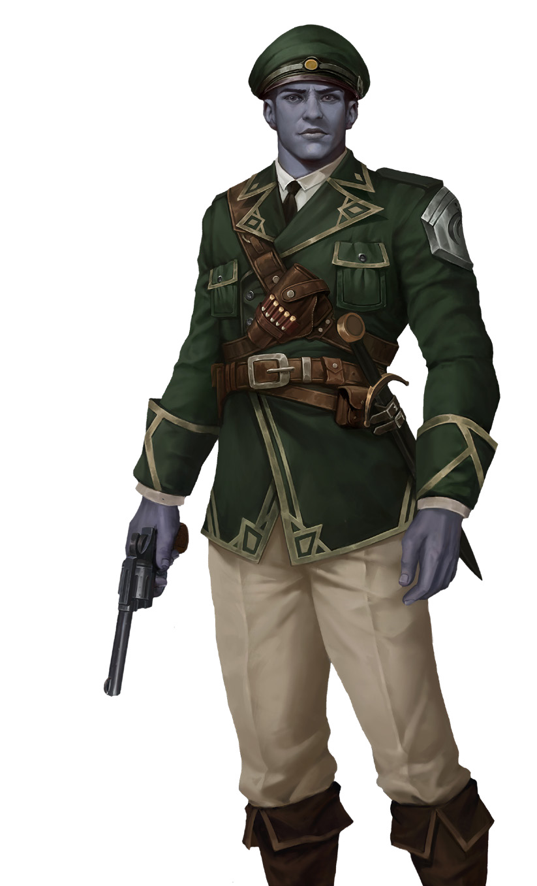

## 克羅司混血軍官（Koloss-Blooded Officer）　[第二時代]

落灰之終後，克羅司獲得繁衍後代的能力，他們的後代被稱為「克羅司混血」。克羅司混血與人類外表相近，但皮膚仍帶有藍色或灰色調。除此之外，他們的身體和人類沒有差別，卻素以力氣較大、耐力較強聞名。因此，許多克羅司混血透過訓練練就非凡本領，當上打手或保鑣。不過，盆地各行各業都能見到克羅司混血。

本節提供一份資料區塊，代表專門領兵的克羅司混血軍官。這名軍官可能是陸軍的士官、白鑞戰艦上的水手長，或是一名警長。這些只是克羅司混血敵手能擔任的眾多角色中的幾種。若要建立新的克羅司混血敵手，請見本章末尾的「血統模組」。

#### 克羅司混血軍官

*階層 1 勁敵 — 中型類人生物*

| 實體 |  |  | 意識 |  |  | 靈魂 |  |  |
| --- | --- | --- | --- | --- | --- | --- | --- | --- |
| 力量 | 防禦 | 速度 | 智力 | 防禦 | 意志 | 察覺 | 防禦 | 風采 |
| 3 | 15 | 2 | 1 | 13 | 2 | 2 | 13 | 1 |

生命值：22（18–26）

專注點：4

授予：0

移動：25 呎

感知：10 呎（視覺）

實體技能：運動 +5、重型武器 +5

意識技能：威嚇 +4

靈魂技能：領導 +3、感知 +3、求生 +3

##### 特徵

不屈。克羅司混血軍官進行抵抗被移動或被擊倒而陷入倒地的檢定時獲得一個優勢。

##### 行動

[1行動] **打擊：戰鎚。** 攻擊 +5，觸及範圍 5 呎，造成 1d10 + 5 衝擊傷害。命中時，目標減速，直到其下一個輪次結束。

[1行動] **打擊：霰彈槍。** 攻擊 +5，距離 20/60 呎，造成 1d10 + 5 銳利傷害。命中時，這次攻擊也會擦傷距目標 5 呎內的其他每名角色，軍官除外。穿刺：這次傷害無法以目標的偏轉值減少。裝填 [2]：花費 [1行動] 將這把武器的彈藥補滿。

[1行動] **克羅司恢復。** 每場景一次，克羅司混血軍官恢復 2d6 生命值。

[2行動] 衝進去！克羅司混血軍官對距自己 5 呎內一名大型或更小的角色進行運動檢定，對抗其實體防禦。成功時，軍官將該角色推開最多 10 呎。接著，距軍官 10 呎內的一名盟友可以立即移動最多 10 呎，且不觸發反擊機會。

[反應] **替我擋一下（花費 1 專注點）。** 克羅司混血軍官受到攻擊之前，可以對距自己 5 呎內另一名大型或更小的敵人進行運動檢定，對抗其實體防禦。成功時，軍官與該敵人互換位置，該敵人取代軍官成為這次攻擊的目標。

##### 克羅司混血軍官戰術

克羅司混血軍官的蠻力可能比不上身上插有尖刺的同族，卻仍能掌控戰場。「衝進去！」行動能推開敵人，騰出空隙讓盟友趁機穿過。克羅司恢復行動與替我擋一下反應，讓軍官敢於身先士卒。必要時，也能用霰彈槍遠距作戰。

ALIEF RUSDIATAMA

246

