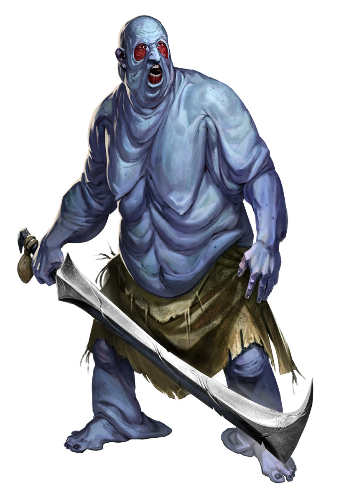
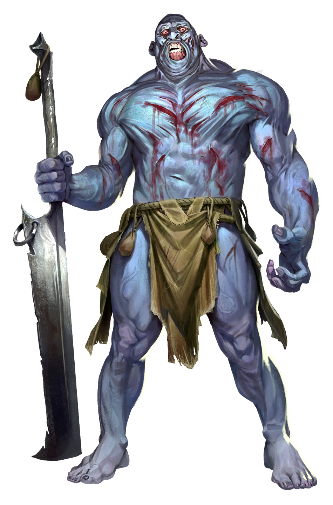
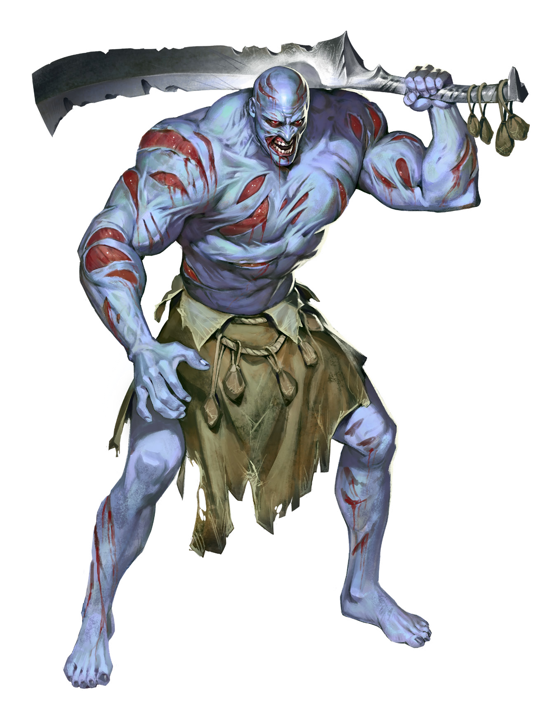

克羅司（koloss）是統御主（Lord Ruler）為了建立自己的軍隊，在司卡德利亞創造的族群。要創造一名克羅司，血金術師（Hemalurgist）會在人類體內植入四根血金術尖刺（Hemalurgic Spike）。每根尖刺都必須殺死另一名人類才能製成，並各自帶有一名受害者的部分靈網（spiritweb），賦予受植入者驚人的體力。經過這個過程，克羅司變得高大強壯，有些能長到十二呎高。他們也會長出所有克羅司共有的醒目藍皮膚與紅眼。這場轉變大幅改變了他們在實體界（Physical Realm）的形體。但如果死後在意識界（Cognitive Realm）見到他們，每名克羅司看起來都是原本的人類模樣。

### 歷經各時代的克羅司

統御主在位時，克羅司被迫充當他的軍隊。這也是 PC 最可能遇到他們的情境。

統御主死後，和諧（Harmony）昇華（Ascension），克羅司也獲得了自由。如今，他們以氏族為單位，散居在蠻橫區（the Roughs）各處。他們的克羅司混血（koloss-blooded）後代在依藍戴盆地（Elendel Basin）也愈來愈常見。

第 8 章：敵手 242

> 那些身影都是深藍色的，體型卻相差懸殊。有的只有五呎高，有的高達十呎以上，身軀龐大，走起路來十分笨重。沙賽德知道，這些身影都屬於同一物種。克羅司。這些生物的基本體態和人類相仿，卻永遠不會停止生長。年紀愈大，身軀就愈龐大，直到心臟再也無法負荷。到了那時，牠們就會死於自身無止境的生長。

PEDRO DUTRA

第 8 章：敵手 243

#### 克羅司新兵（Koloss Neophyte）

*階層（Tier）2 勁敵（Rival）— 中型類人生物*

| 實體 |  |  | 意識 |  |  | 靈魂 |  |  |
| --- | --- | --- | --- | --- | --- | --- | --- | --- |
| 力量 | 防禦 | 速度 | 智力 | 防禦 | 意志 | 察覺 | 防禦 | 風采 |
| 6 | 19 | 3 | 1 | 14 | 3 | 1 | 14 | 3 |

生命值（Health）：50（40–60）

專注點（Focus）：5

授予（Investiture）：0

偏轉值（Deflect）：2（克羅司血統）

移動：30 呎

感知（Senses）：10 呎（視覺）

實體技能：運動（Athletics）+8、重型武器（Heavy Weaponry）+8

意識技能：威嚇（Intimidation）+6

靈魂技能：感知（Perception）+4

##### 特徵

易受影響的意志（Malleable Will）。鎔金術師必須花費至少 6 授予使用燃燒黃銅（Burn Brass）或燃燒鋅（Burn Zinc），情緒鎔金術（Emotional Allomancy）才會影響克羅司。一旦受到影響，克羅司無法自行終止這些效果。

不屈（Unyielding）。克羅司在抵抗被移動或被擊倒（Prone）的檢定中獲得一個優勢（Advantage）。

##### 行動

[1行動] **打擊（Strike）：克羅司巨劍（Koloss Blade）。** 攻擊 +8，觸及範圍 10 呎，造成 1d12 + 8 衝擊傷害（impact damage）。這次攻擊無法造成擦傷（graze）。命中時，若目標為大型（Large）或更小，克羅司也可以花費 1 專注點，使其倒地。

[2行動] **粉碎（Pulverize）。** 攻擊 +8，觸及範圍 5 呎，造成 2d8 + 8 衝擊傷害。這次攻擊對倒地的目標額外造成 1d8 衝擊傷害。命中時，距目標 5 呎內、實體防禦（Physical defense）等於或低於攻擊結果的每名角色，也會被這次攻擊擦傷。

[1行動] **打擊士氣（Demoralize）。** 克羅司對距自己 30 呎內一名自己能影響的角色進行威嚇檢定，對抗該角色的意識防禦（Cognitive defense）。成功時，目標失去 1 專注點，且偏轉值降為 0，直到目標的下一個輪次結束。

#### 克羅司老兵（Koloss Veteran）

*階層 3 勁敵 — 大型類人生物*

| 實體 |  |  | 意識 |  |  | 靈魂 |  |  |
| --- | --- | --- | --- | --- | --- | --- | --- | --- |
| 力量 | 防禦 | 速度 | 智力 | 防禦 | 意志 | 察覺 | 防禦 | 風采 |
| 7 | 21 | 4 | 2 | 16 | 4 | 2 | 16 | 4 |

生命值：72（58–86）

專注點：6

授予：0

偏轉值：2（克羅司血統）

移動：30 呎

感知：10 呎（視覺）

實體技能：運動 +10、重型武器 +10

意識技能：威嚇 +8

靈魂技能：感知 +6

##### 特徵

易受影響的意志。鎔金術師必須花費至少 6 授予使用燃燒黃銅或燃燒鋅，情緒鎔金術才會影響克羅司。一旦受到影響，克羅司無法自行終止這些效果。

不屈。克羅司在抵抗被移動或被擊倒的檢定中獲得一個優勢。

##### 行動

[1行動] **打擊：克羅司巨劍。** 攻擊 +10，觸及範圍 10 呎，造成 1d20 + 10 衝擊傷害。這次攻擊無法造成擦傷。命中時，若目標為巨型（Huge）或更小，克羅司也可以花費 1 專注點，使其倒地。

[2行動] **粉碎。** 攻擊 +10，觸及範圍 5 呎，造成 2d10 + 10 衝擊傷害。這次攻擊對倒地的目標額外造成 1d10 衝擊傷害。命中時，距目標 5 呎內、實體防禦等於或低於攻擊結果的每名角色，也會被這次攻擊擦傷。

[1行動] **打擊士氣。** 克羅司對距自己 30 呎內一名自己能影響的角色進行威嚇檢定，對抗該角色的意識防禦。成功時，目標失去 1 專注點，且偏轉值降為 0，直到目標的下一個輪次結束。

[3行動] **橫掃（Decimate）。** 克羅司狂亂地揮舞巨劍。距克羅司 10 呎內的每名角色都必須進行 DC 18 的敏捷（Agility）檢定。失敗時，該角色受到 4d10 衝擊傷害，並陷入迷惑（Disoriented），直到自己的下一個輪次結束。成功時，該角色受到 2d10 衝擊傷害。

[自由行動] **狂怒攻心（Consuming Rage）。** 克羅司的下一次攻擊獲得一個優勢，但下一次對該克羅司發動的攻擊也獲得一個優勢。

第 8 章：敵手 244

#### 高齡克羅司（Koloss Ancient）

*階層 4 勁敵 — 大型類人生物*

| 實體 |  |  | 意識 |  |  | 靈魂 |  |  |
| --- | --- | --- | --- | --- | --- | --- | --- | --- |
| 力量 | 防禦 | 速度 | 智力 | 防禦 | 意志 | 察覺 | 防禦 | 風采 |
| 8 | 23 | 5 | 3 | 18 | 5 | 3 | 18 | 5 |

生命值：94（75–113）

專注點：7

授予：0

偏轉值：3（克羅司血統）

移動：40 呎

感知：20 呎（視覺）

實體技能：運動 +12、重型武器 +12

意識技能：威嚇 +10

靈魂技能：感知 +8

##### 特徵

易受影響的意志。鎔金術師必須花費至少 6 授予使用燃燒黃銅或燃燒鋅，情緒鎔金術才會影響克羅司。一旦受到影響，克羅司無法自行終止這些效果。

不屈。克羅司在抵抗被移動或被擊倒的檢定中獲得一個優勢。

##### 行動

[1行動] **打擊：克羅司巨劍。** 攻擊 +12，觸及範圍 15 呎，造成 1d20 + 12 衝擊傷害。這次攻擊無法造成擦傷。命中時，若目標為巨型或更小，克羅司也可以花費 1 專注點，使其倒地。

[2行動] **粉碎。** 攻擊 +12，觸及範圍 10 呎，造成 2d12 + 12 衝擊傷害。這次攻擊對倒地的目標額外造成 1d12 衝擊傷害。命中時，距目標 5 呎內、實體防禦等於或低於攻擊結果的每名角色，也會被這次攻擊擦傷。

[1行動] **打擊士氣。** 克羅司對距自己 30 呎內一名自己能影響的角色進行威嚇檢定，對抗該角色的意識防禦。成功時，目標失去 1 專注點，且偏轉值降為 0，直到目標的下一個輪次結束。

[3行動] **橫掃。** 克羅司狂亂地揮舞巨劍。距克羅司 15 呎內的每名角色都必須進行 DC 20 的敏捷檢定。失敗時，該角色受到 4d12 衝擊傷害、倒地，並陷入迷惑直到該角色下一個輪次結束。成功時，該角色受到 2d12 衝擊傷害。

[自由行動] **狂怒攻心。** 克羅司的下一次攻擊獲得一個優勢，但下一次對該克羅司發動的攻擊也獲得一個優勢。

[反應] **狂怒衝鋒（Frenzied Charge）。** 克羅司遭攻擊命中或擦傷時，可以朝攻擊者衝鋒至多 50 呎，並對其進行一次打擊。

##### 克羅司戰術

無論在哪個遊戲階層，克羅司都是致命的敵人。即使是克羅司新兵，也能用克羅司巨劍擊倒對手，再用粉碎重創倒地的目標。若目標正受打擊士氣影響，效果更好。經驗更豐富的克羅司老兵會在遭到包圍時用橫掃，並靠狂怒攻心提高克羅司巨劍和粉碎命中的把握。高齡克羅司更能掌控戰場。他們能用狂怒衝鋒反應，以驚人的氣勢迅速逼近另一群敵人。

##### 克羅司遭遇的機遇與變故

| 結果 | 範例 |
| --- | --- |
| [機遇] | 一名克羅司鬆垮的皮膚被鉤住，開始撕裂。下次 PC 命中這名克羅司時，該次攻擊造成最大傷害，且克羅司陷入折磨（Afflicted）[每個 PC 階層 1d4 命力]。 |
| [機遇] | 直到場景結束，只要一名克羅司受到自身的狂怒攻心影響，對其發動的攻擊就額外造成 1d8 傷害。 |
| [機遇] | 開始一項有三格的正面事件「扭轉戰局（Turn the Tide）」。PC 用機遇填滿事件進度軌（Event Track）時，一名克羅司老兵或四名克羅司新兵倒戈，與 PC 並肩作戰，直到場景結束。 |
| [變故] | 開始一項有三格的負面事件「咆哮援軍（Howling Reinforcements）」。GM 用變故填滿事件進度軌時，再有兩名克羅司新兵抵達。 |
| [變故] | 一名克羅司朝一名 PC 移動，最多移動相當於自身移動速率兩倍的距離，並對該 PC 進行一次打擊。 |
| [變故] | 一名克羅司恢復 1d4 專注點，然後朝一名 PC 移動，最多移動相當於自身移動速率的距離。 |

第 8 章：敵手 245
