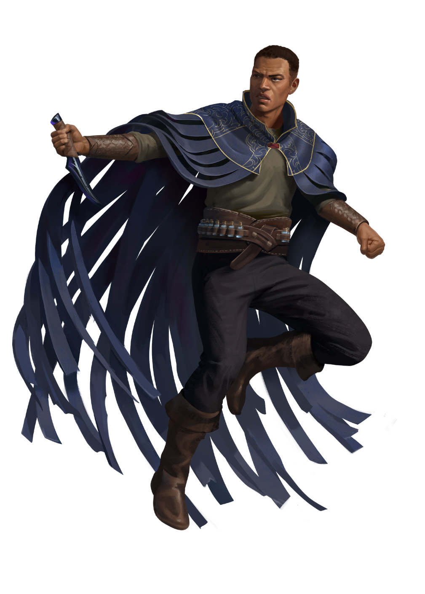
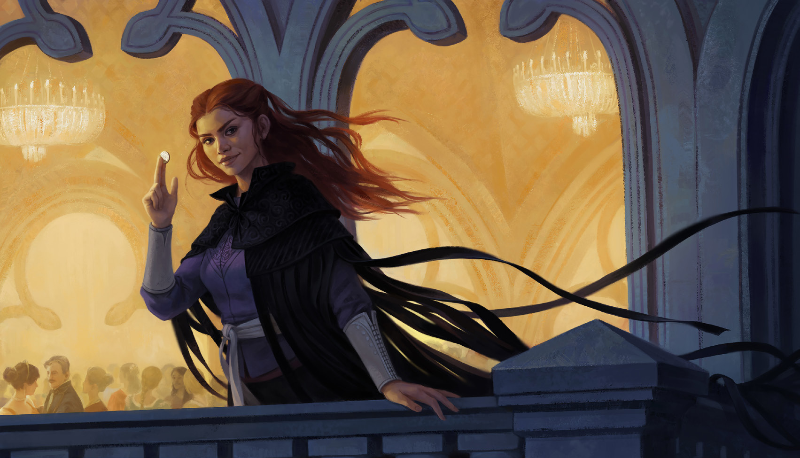

## 迷霧之子（Mistborn）　第一紀元

鎔金術（Allomancy）是司卡德利亞（Scadrial）的金屬技藝（Metallic Arts）之一。使用者能燃燒吞下的金屬，取得該種金屬對應的能力。鎔金術蘊含直接而強大的力量，使用者通常果斷又大膽。迷霧之子是其中最出色的一群。這些強大的鎔金術師（Allomancer）能燃燒全部十六種金屬，通常為某個大家族（Great House）效力。

### 戰役中的迷霧之子

迷霧人（Misting）只能燃燒一種金屬，迷霧之子則比迷霧人罕見得多。迷霧之子在戰役（Campaign）中登場，往往能帶來引人入勝的劇情轉折。如果 PC 先前以為對手只是個迷霧人，等到對方展現完整實力時，尤其能讓這一刻扣人心弦。

迷霧之子通常負責保護大家族與最後帝國（Final Empire），因此更常成為敵人。若要讓這類敵手在戰役中擔任盟友，需要多加留意。一名能發揮完整實力的迷霧之子，很容易搶去鎔金能力有限或沒有鎔金能力的隊伍的風采。

### 金屬技藝

這裡提供兩份迷霧之子的資料區塊（Stat Block），分別是迷霧之子廷臣（Mistborn Courtier）與迷霧之子刺客（Mistborn Assassin）。兩份資料區塊適用於故事中的不同時刻，也可以用來呈現同一名 NPC 在不同時刻的表現。

每份迷霧之子資料區塊只列出少數金屬技藝，足以構成一場令人滿意的遭遇（Encounter）。你也可以讓這些敵手使用其他鎔金術模組（Allomancy module），見本章末尾〈敵手模組〉。

##### 迷霧之子戰術

迷霧之子刺客在戰鬥中行動敏捷、應變靈活，很難被困住。燃燒錫（Burn Tin）與燃燒鐵／鋼（Burn Iron/Steel）讓他們難以遭到突襲，鐵拉／鋼推（Ironpull/Steelpush）讓他們能迅速移動，而燃燒天金（Burn Atium）則讓他們能壓制敵人。

迷霧之子廷臣擅長掌控社交遭遇。懾人氣度（Influential Bearing）讓他們在對話（Conversation）中自然占得上風。他們也能用燃燒黃銅／鋅（Burn Brass/Zinc）影響人群，再以情緒失控（Overwhelming Emotion）對付敵人。這些迷霧之子會充分運用手上的能力，但情勢不利時就會試著逃走。如果談判破裂，場景可能轉為危險的戰鬥或追逐（Pursuit）試煉（Endeavor）場景。

> 據說迷霧之子是迷霧本身的使者，統御主（Lord Ruler）賦予了他們強大的力量。

FLORIAN HAECKH & LOGAN FELICIANO

#### 迷霧之子刺客

*階層（Tier）3 首領（Boss）— 中型類人生物*

| 實體 |  |  | 意識 |  |  | 靈魂 |  |  |
| --- | --- | --- | --- | --- | --- | --- | --- | --- |
| 力量 | 防禦 | 速度 | 智力 | 防禦 | 意志 | 察覺 | 防禦 | 風采 |
| 3 | 18 | 5 | 3 | 17 | 4 | 3 | 17 | 4 |

生命值（Health）：190（152–228）

專注點（Focus）：8

授予（Investiture）：8

移動：40 呎

感知（Senses）：20 呎（視覺）

實體技能：敏捷（Agility）+9、輕型武器（Light Weaponry）+9

意識技能：紀律（Discipline）+8、威嚇（Intimidation）+8

靈魂技能：洞察（Insight）+7、領導（Leadership）+8、感知（Perception）+7、求生（Survival）+7

金屬技藝技能：鎔金術 +8（4 技能等級，所有金屬）

##### 特徵

首領。迷霧之子每回合可以各採取一個快速輪次（fast turn）和一個慢速輪次（slow turn）。一名敵人結束輪次後，迷霧之子可以花費 1 專注點，立刻額外使用[1行動]或[自由行動]。此外，迷霧之子可以在自己的輪次花費 1 專注點，解除自己身上的一項狀態（Condition）。

迷霧披風（Mistcloak）。迷霧之子對非迷霧之子角色進行威嚇檢定時，獲得一個優勢（Advantage）。此外，迷霧之子身處遮蔽視線的區域時，若某些角色的主要感官（Primary Sense）被該區域遮蔽，迷霧之子對這些角色進行隱匿（Stealth）檢定時獲得一個優勢，而這些角色對迷霧之子進行感知檢定時獲得一個劣勢（Disadvantage）。

##### 行動

[1行動] **打擊：黑曜石刀（Strike: Obsidian Knife）。** 攻擊 +9，觸及範圍 5 呎或距離 20/60 呎，造成 1d4 + 9 銳利傷害（keen damage）。命中時，迷霧之子可以花費 1 專注點，額外造成 2d8 傷害。

[1行動] **射出錢幣（Shoot Coin，花費 1–4 授予）。** 攻擊 +8，每花費 1 授予，距離為 20 呎，造成 1d10 + 8 衝擊傷害（impact damage）。

[2行動] **刺客之舞（Assassin’s Dance）。** 迷霧之子移動最多等同於自己移動速率的距離，並進行一次打擊。命中時，目標還會陷入迷惑（Disoriented），直到目標的下一個輪次結束。

[1行動] **燃燒鐵／鋼。** 直到場景結束，迷霧之子能感知距自己 160 呎內所有非鋁且未受授予（non-Invested）的金屬來源。

[1行動] **燃燒錫（花費 1–4 授予）。** 迷霧之子強化自己的感官，獲得下列效果，直到場景結束，或直到迷霧之子在之後的輪次用[自由行動]終止效果：

- 獲得增益（Enhanced）［察覺］。該屬性的加值等於燃燒錫所花費授予的一半，無條件進位。

- 所有感官都成為超自然感官（supernatural senses）。每回合第一次接收到加劇的感官刺激時，迷霧之子必須通過紀律檢定，DC 等於 12 + 增益［察覺］狀態的數值。失敗時，迷霧之子陷入迷惑，直到自己的下一個輪次結束。

迷霧之子以推理（Deduction）或一項察覺技能成功使用獲取優勢（Gain Advantage）時，下次對該目標發動的攻擊額外造成 1d10 傷害。

[1行動] **鐵拉／鋼推（花費 1–4 授予）。** 迷霧之子選擇一件自己藉燃燒鐵／鋼感知到的金屬物品，讓自己或該物品沿直線朝另一方移動或遠離。每花費 1 授予，最多移動 20 呎。體型比迷霧之子小的物品會移向或遠離迷霧之子。若物品與迷霧之子體型相同或更大，則由迷霧之子移向或遠離該物品。若物品固定在其他東西上，該東西也計入物品的體型。

這項能力可靈活運用，例如繳械敵人，或打擊物品飛行路徑上的敵人。若要以這種方式影響不情願的角色，迷霧之子必須對抗目標的實體防禦（Physical defense）進行鎔金術檢定並成功。若效果會造成傷害，迷霧之子則須進行鎔金術攻擊，擲出 1d10 + 8 衝擊傷害。

[2行動] **燃燒天金（可用 1 次）。** 接下來 4 回合，迷霧之子進行與其他角色實體互動的檢定時，包括對抗實體防禦的檢定，都不擲任何 d20。所有 d20 的數值都設為 15，包括因優勢或劣勢而使用的骰子。同樣地，敵人進行與迷霧之子實體互動的檢定時，包括對抗實體防禦的檢定，其 d20 數值都設為 5。在效果結束前，迷霧之子可花費額外一次燃燒天金的使用次數，以[自由行動]維持效果。額外次數可透過變故取得，見下文。

[反應] **投射物拉引（Projectile Lurch，花費 1 授予）。** 距迷霧之子 160 呎內的一名盟友即將受到金屬投射物攻擊時，若迷霧之子能藉燃燒鐵／鋼感知該投射物，便改由迷霧之子成為這次攻擊的目標。

##### 機遇與變故

機遇。敵人可以花費[機遇]，終止迷霧之子的燃燒天金、燃燒錫及燃燒鐵／鋼的效果。

變故。GM 可以花費敵人檢定擲出的[變故]，讓迷霧之子把飲用金屬液（Drink Vial）行動當作[反應]使用，或讓迷霧之子額外獲得一次燃燒天金的使用次數。

第 8 章：敵手 252

#### 迷霧之子廷臣

*階層 3 勁敵（Rival）— 中型類人生物*

| 實體 |  |  | 意識 |  |  | 靈魂 |  |  |
| --- | --- | --- | --- | --- | --- | --- | --- | --- |
| 力量 | 防禦 | 速度 | 智力 | 防禦 | 意志 | 察覺 | 防禦 | 風采 |
| 3 | 18 | 5 | 3 | 17 | 4 | 3 | 17 | 4 |

生命值：70（56–84）

專注點：8

授予：8

移動：40 呎

感知：20 呎（視覺）

實體技能：敏捷 +9、輕型武器 +9

意識技能：紀律 +8、威嚇 +8

靈魂技能：洞察 +7、領導 +8、感知 +7、求生 +7

金屬技藝技能：鎔金術 +8（4 技能等級，所有金屬）

##### 特徵

懾人氣度。迷霧之子在一個場景中第一次原本要花費專注點抵抗影響時，無須花費專注點，且場景中的每名敵人都失去 1d4 專注點。

備戰（Ready for War）。場景開始時，GM 可以建立有 3 格的負面事件「談判破裂（Negotiations Breakdown）」。事件進度軌（Event Track）被變故填滿時，迷霧之子廷臣恢復全部生命值，並變成迷霧之子刺客。此後使用新的資料區塊，並保留目前的專注點與授予。

##### 行動

[1行動] **打擊：黑曜石刀。** 攻擊 +9，觸及範圍 5 呎或距離 20/60 呎，造成 1d4 + 9 銳利傷害。命中時，迷霧之子可以花費 1 專注點，額外造成 2d8 傷害。

[1行動] **燃燒紅銅（Burn Copper，花費 1 授予）。** 迷霧之子以自己為中心創造一片紅銅雲（coppercloud），涵蓋半徑最多 30 呎的區域。紅銅雲有下列效果：

- 受授予的能力與感官無法偵測紅銅雲，也無法穿過紅銅雲偵測角色或授予的使用。

- 受授予的效果無法影響迷霧之子的心智與情緒。

- 花費至少 6 授予的受授予效果可以無視前兩項效果。

紅銅雲隨迷霧之子移動，持續到場景結束，或直到迷霧之子在之後的輪次用[自由行動]終止效果。

[2行動] **燃燒黃銅／鋅（花費 1–4 授予）。** 迷霧之子選擇一種情緒，並在距自己 160 呎內一處大型（10 呎）區域選擇一個或多個目標，再對抗每個目標的靈性防禦（Spiritual defense）進行鎔金術檢定。成功時，目標的該項情緒受到安撫（Soothed）或煽動（Rioted），促使目標做出符合這種情緒的行為，直到目標的下一個輪次結束。效果結束前，迷霧之子可以花費 1 或更多授予，以[自由行動]維持區域內所有受影響目標的效果。

受影響的目標可用[自由行動]抵抗，花費等同於燃燒黃銅／鋅所花費授予的專注點，取代抵抗影響的通常花費。抵抗後，目標無視被改變的情緒，直到自己的下一個輪次開始。

[自由行動] **情緒失控（花費 2 授予）。** 迷霧之子選擇一名專注點為 0，且受到燃燒黃銅／鋅影響的角色。在該效果持續期間，該角色陷入震懾（Stunned）。

SVETLANA KOSTINA

