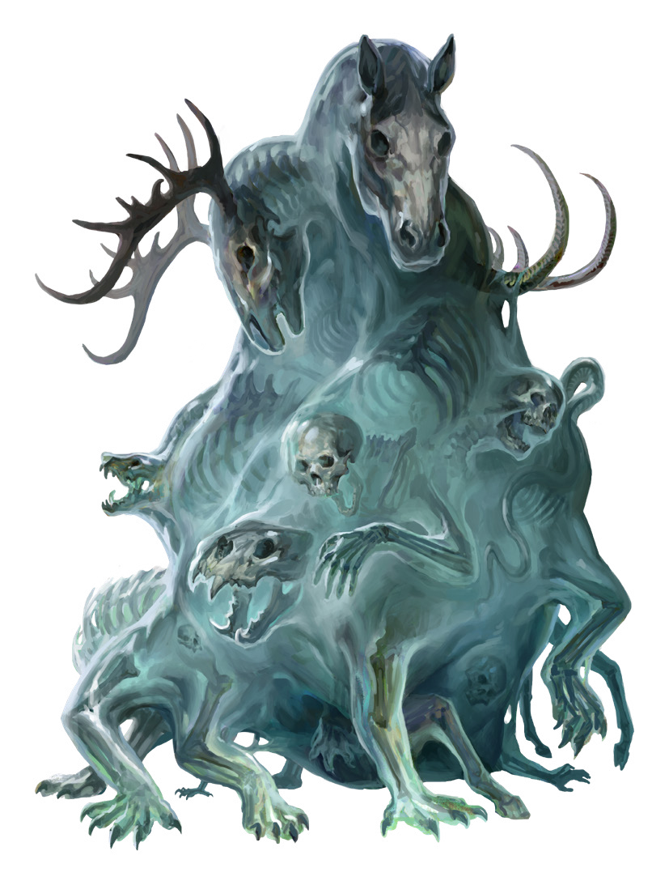

霧魅（Mistwraith）在夜裡蹣跚地爬行於迷霧中，吞食屍體，把屍體的各個部位納入自己臃腫拼合的身軀。每吞食一次，霧魅不斷長大的身體就會添上肌肉、頭顱與四肢。透過霧魅半透明的皮膚，依然看得見這堆東拼西湊的部位。

霧魅通常約十呎高、二十呎長。這些不具高等智慧的生物憑本能行動，一生大多在覓食和繁殖中度過。

霧魅外形雖然怪誕，卻是無害的食腐生物，一般民眾並不知道這一點。事實上，有關這種神祕生物的故事雖然很多，有些人卻連牠們是否存在都存疑。

許多民間迷信都與霧魅有關，尤其是在司卡傳統中。落灰之終後，有人把霧魅雕像放在墓園裡，想嚇跑據說會「守地盤」的霧魅，但這種做法很可能只是出於迷信。

#### 霧魅

*階層 2 嘍囉 — 巨型實體*

| 實體 |  |  | 意識 |  |  | 靈魂 |  |  |
| --- | --- | --- | --- | --- | --- | --- | --- | --- |
| 力量 | 防禦 | 速度 | 智力 | 防禦 | 意志 | 察覺 | 防禦 | 風采 |
| 2 | 12 | 0 | 1 | 13 | 2 | 5 | 18 | 3 |

生命值：26（21–31）

專注點：4

授予：0

移動：20 呎

感知：50 呎（嗅覺）

實體技能：運動 +4

靈魂技能：感知 +8、求生 +8

##### 特徵

陰魂跟隨。霧魅在自己的每個輪次，必須先花費行動使用移動，盡可能靠近牠能感知到的最近一具屍體。一旦來到屍體 5 呎內，就必須一有機會便使用吞食屍體。若感知不到屍體，牠便使用移動，改為跟隨活著的角色。

駭人外貌。專注點為 0 的角色感知到霧魅時，無法選擇朝牠移動。

詭異氣場。每當角色在自己能感知到的一隻或多隻霧魅 30 呎內開始輪次時，該角色必須抵抗影響，否則陷入精疲力竭 [−1]。

無害。角色若通過 DC 18 的學識檢定，或花費[機遇]，就會明白霧魅無害。該角色無視霧魅的駭人外貌與詭異氣場特徵。

食屍者。當角色在接觸霧魅的情況下結束輪次時，該角色受到 1d6 命力傷害。

##### 行動

[2行動] **吞食屍體。** 霧魅吞食距自己 5 呎內的一具屍體，並恢復 10 生命值。

[反應] **食腐者。** 霧魅能感知到的一名角色生命值降至 0 或受到傷勢後，霧魅會朝該角色移動最多等同於其移動速率的距離。

##### 霧魅戰術

在戰鬥遭遇中，霧魅比較像環境危害，而非真正的敵人。就像陰魂跟隨特徵所述，霧魅看見可吞食的屍體之前，只能跟隨活著的生物。霧魅通常很被動，遭到攻擊也少有反應，但詭異氣場與駭人外貌往往仍能讓潛在的敵人不敢太過靠近。

ANASTASSIA GRIGORIEVA

第 8 章：敵手 254

