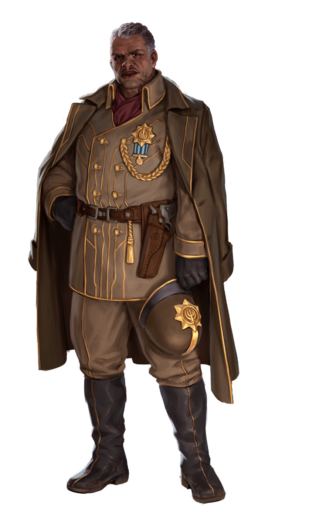

在依藍戴盆地（Elendel Basin）、蠻橫區（the Roughs）及更遠的地方，人們雇用執法者（Lawkeeper）和警員（constable）維持秩序，將罪犯繩之以法。這些執法人員（Officers of the Law）依法律與程序辨認並制伏罪犯。小至偷錢袋，大至大規模謀殺，都在他們的職責範圍內。

### 管轄與權限

依藍戴（Elendel）的警署按分區（Octant）劃分。每個分區由一名總隊長（constable-general）帶領，直接向總督（Governor）報告。依藍戴警署（Elendel Constabulary）也主張管轄權不限於市內，涵蓋整個盆地，甚至延伸至蠻橫區。如此廣泛的管轄權讓依藍戴警署與盆地其他城市的警署關係緊張，執法者在不受歡迎的地方也較難行使權威。不過，依藍戴及盆地其他城市掌握龐大的政治與經濟力量，所以連蠻橫區的人也多少會承認執法者的職權，至少大部分時候如此。

#### 警員

*階層（Tier）1 嘍囉（Minion）— 中型類人生物*

| 實體 |  |  | 意識 |  |  | 靈魂 |  |  |
| --- | --- | --- | --- | --- | --- | --- | --- | --- |
| 力量 | 防禦 | 速度 | 智力 | 防禦 | 意志 | 察覺 | 防禦 | 風采 |
| 2 | 14 | 2 | 0 | 11 | 1 | 2 | 13 | 1 |

生命值（Health）：17（14–20）

專注點（Focus）：4

授予（Investiture）：0

移動：25 呎

感知（Senses）：10 呎（視覺）

實體技能：敏捷（Agility）+4、運動（Athletics）+4、輕型武器（Light Weaponry）+4

意識技能：紀律（Discipline）+2、威嚇（Intimidation）+2

靈魂技能：洞察（Insight）+4、感知（Perception）+4

##### 特徵

嘍囉。警員的攻擊無法造成重擊，且一旦受到傷勢（Injury）就立即遭到擊敗。

合力壓制（Dogpile）。若一名角色距另一名警員 5 呎內，警員對該角色進行擒抱（Grapple）或推撞（Shove）的運動檢定時，獲得一個優勢（Advantage）。

##### 行動

[1行動] **打擊：警棍（Strike: Baton）。** 攻擊 +4，觸及範圍 5 呎，造成 1d6 + 4 衝擊傷害（impact damage）。

[1行動] **打擊：左輪手槍（Strike: Revolver）。** 攻擊 +4，距離 20/80 呎，造成 1d6 + 4 銳利傷害（keen damage）。穿刺（Pierce）：目標的偏轉值（Deflect）無法減少這次傷害。裝填（Loaded）[6]：花費[1行動]將這把武器的彈藥補滿。

[2行動] **押送（Escort，花費 1 專注點）。** 警員移動最多等同於自己移動速率的距離，同時拖著一名遭自己束縛（Restrained）的目標。這次移動觸發的每次反擊機會（Reactive Strike）都獲得一個變故（Complication）。GM 可以花費該變故，使被束縛的目標受到等同於該次攻擊擦傷（graze）的傷害。

##### 警員戰術

逮捕嫌犯時，警員會利用人數優勢，先以左輪手槍從遠處攻擊，讓其他警員趁機拉近距離。靠近後，他們會以合力壓制特徵協助擒抱目標。控制住目標後，警員會用押送把目標拖回警方的封鎖線後方，並設法將嫌犯分開，免得他們互相幫忙逃跑。

STEVE PRESCOTT & GAL OR

### 獨行與協作

城市警署靠團隊合作，有效率地完成任務。無論是突襲祕密營業場所，還是封鎖犯罪現場，警員受訓時都會學習善用人手，盡可能多派人留意群眾動向。

不過，離城市愈遠，獨行的執法者就愈可能得在沒有支援的情況下辦事，蠻橫區尤其如此。這些獨立行動的警員當中，有不少人特別容易逾越職權。

#### 執法者

*階層 1 勁敵（Rival）— 中型類人生物*

| 實體 |  |  | 意識 |  |  | 靈魂 |  |  |
| --- | --- | --- | --- | --- | --- | --- | --- | --- |
| 力量 | 防禦 | 速度 | 智力 | 防禦 | 意志 | 察覺 | 防禦 | 風采 |
| 3 | 15 | 2 | 2 | 14 | 2 | 3 | 14 | 1 |

生命值：22（18–26）

專注點：4

授予：0

移動：25 呎

感知：20 呎（視覺）

實體技能：運動 +4、重型武器（Heavy Weaponry）+5、輕型武器 +4

意識技能：推理（Deduction）+3、紀律 +3、威嚇 +3

靈魂技能：洞察 +4、感知 +4、說服（Persuasion）+3

##### 特徵

執法目光（Eye of the Law）。如果一名角色對執法者進行欺騙（Deception）檢定且失敗，該角色失去 1 專注點。

##### 行動

[1行動] **打擊：小刀（Strike: Knife）。** 攻擊 +4，觸及範圍 5 呎，造成 1d4 + 4 銳利傷害。

[1行動] **打擊：卡賓槍（Strike: Carbine）。** 攻擊 +5，距離 80/320 呎，造成 1d8 + 5 銳利傷害。命中時，執法者也可以花費 1 專注點，使目標倒地（Prone）。穿刺：目標的偏轉值無法減少這次傷害。裝填[8]：花費[1行動]將這把武器的彈藥補滿。

[2行動] **逮捕（Arrest）。** 執法者進行運動檢定，對抗一名倒地目標的實體防禦（Physical defense）。成功時，用一副手銬（handcuffs）銬住對方。成功通過 DC 30 的運動檢定，或直接對手銬造成 15 傷害，都能破壞手銬。成功通過 DC 18 的竊術（Thievery）檢定則能解開手銬。執法者隨身攜帶兩副手銬。

[反應] **緊追不放（In Pursuit，花費 1 專注點）。** 距執法者 30 呎內的一名敵人倒地後，執法者移動最多等同於自己移動速率的距離。

##### 執法者戰術

執法者聯手時，往往令人難以招架。他們可以用卡賓槍攻擊讓敵人倒地，其他執法者便能趁機以緊追不放反應靠近並包圍目標。執法者會在自己的下一個輪次使用逮捕行動拘留目標。

盤問嫌犯或遭拘留的人時，執法者的執法目光特徵會對任何試圖說謊的人施加壓力。

CLAUDE ARADEL

GUILHERME CASTRO

第 8 章：敵手 257

## 法外之徒（Outlaws）

在最後帝國（Final Empire）時期，法外之徒可能是司卡（skaa）反抗軍成員、逃離統御主（Lord Ruler）軍隊並在路上設伏的逃兵，或是在邊疆走投無路、專挑不幸路過的人下手的居民。

到了第二紀元，蠻橫區許多法外之徒愈來愈厭惡依藍戴，也厭惡它對待盆地之外居民的方式。他們認為城裡的貴族幾乎不肯幫助蠻橫區窮困潦倒的人。這類法外之徒可能自認是英雄，一心懲治腐敗貴族，替自己人壯大勢力。

#### 法外之徒

*階層 1 嘍囉 — 中型類人生物*

| 實體 |  |  | 意識 |  |  | 靈魂 |  |  |
| --- | --- | --- | --- | --- | --- | --- | --- | --- |
| 力量 | 防禦 | 速度 | 智力 | 防禦 | 意志 | 察覺 | 防禦 | 風采 |
| 0 | 12 | 2 | 0 | 11 | 1 | 2 | 13 | 1 |

生命值：11（9–13）

專注點：3

授予：0

移動：25 呎

感知：10 呎（視覺）

實體技能：敏捷 +4、輕型武器 +3、隱匿（Stealth）+3、竊術 +4

意識技能：紀律 +2、威嚇 +2

靈魂技能：感知 +3、求生（Survival）+3

##### 特徵

伏擊者（Ambusher）。每個場景開始時，若法外之徒未措手不及（Surprised），便對自己能感知且靈魂防禦（Spiritual defense）最高的敵人進行隱匿檢定，對抗該敵人的靈魂防禦。成功時，法外之徒可以在第一個回合前使用[1行動]。失敗時，或無法感知任何敵人時，法外之徒可以在自己的第一個輪次將獲取優勢（Gain Advantage）作為[自由行動]使用。

嘍囉。法外之徒的攻擊無法造成重擊，且一旦受到傷勢就立即遭到擊敗。

##### 行動

[1行動] **打擊：小刀。** 攻擊 +3，觸及範圍 5 呎或距離 20/60 呎，造成 1d4 + 3 銳利傷害。

[1行動] **打擊：短弓（Strike: Shortbow）。** 第一紀元。攻擊 +3，距離 80/320 呎，造成 1d6 + 3 銳利傷害。

[1行動] **打擊：短管手槍（Strike: Snub Nose Pistol）。** 第二紀元。攻擊 +3，距離 20/60 呎，造成 1d4 + 3 銳利傷害。穿刺：目標的偏轉值無法減少這次傷害。裝填[6]：花費[1行動]將這把武器的彈藥補滿。

[1行動] **粗暴滋事（Roughhousing，花費 2 專注點）。** 法外之徒進行威嚇檢定，對抗距自己 5 呎內一名目標的實體防禦。成功時，目標失去 1 專注點，並陷入迷惑（Disoriented），直到法外之徒的下一個輪次結束。

##### 法外之徒戰術

法外之徒很少堂堂正正地打鬥，偏好設伏、以多欺少。伏擊者特徵讓他們立刻占得上風，能在敵人反應過來前先行射擊。若打成近戰，他們會用粗暴滋事讓目標陷入迷惑。主動開打的法外之徒往往會死戰到底。若是自己猝不及防，他們可能會試著逃走，等到有利時再度出擊。

FLORIAN HAECKH & LOGAN FELICIANO

## 法外之徒首領（Outlaw Boss）

對法外之徒首領而言，名聲就是一切。這些目無法紀的罪犯會糾集志同道合的匪徒，對毫無防備的人下手。他們殺人、綁架、偷竊、走私，經常遭到追捕，卻很少被殺死，因此往往是懸賞重金的對象。

### 領導不法之徒

在第一時代，許多法外之徒團夥宣稱自己比最後帝國的臣民更有道德，但大多數首領其實只是利用外圍統御區（Outer Dominances）的機會擴張勢力。他們以殘酷的手段確立領袖地位，把走投無路的人拉進團夥，靠人多壯大聲勢。

在第二紀元的蠻橫區，勢力強大的法外之徒首領往往會和執法者長期玩貓捉老鼠的遊戲。許多執法者對付罪犯時，也會採取自己那套腐敗手段。

##### 法外之徒首領戰術

法外之徒首領會用弟兄們，上！（Get ’Em, Boys!）指揮手下。不把嘍囉放在心上的首領，敢用不顧後果的攻擊（Reckless Menace）朝混戰中的人群開火。戰鬥後段，首領會用鼓動大夥（Rile ’Em Up），讓友方的法外之徒恢復足夠的專注點，以便造成擦傷或使用粗暴滋事。

#### 法外之徒首領

*階層 1 首領（Boss）— 中型類人生物*

| 實體 |  |  | 意識 |  |  | 靈魂 |  |  |
| --- | --- | --- | --- | --- | --- | --- | --- | --- |
| 力量 | 防禦 | 速度 | 智力 | 防禦 | 意志 | 察覺 | 防禦 | 風采 |
| 3 | 15 | 2 | 2 | 16 | 4 | 4 | 17 | 3 |

生命值：55（44–66）

專注點：6

授予：0

偏轉值：1（皮革）

移動：25 呎

感知：20 呎（視覺）

實體技能：運動 +5、重型武器 +5、輕型武器 +4

意識技能：紀律 +6、威嚇 +6

靈魂技能：領導（Leadership）+5、求生 +6

##### 特徵

伏擊者。每個場景開始時，若法外之徒首領未措手不及，便對自己能感知且靈魂防禦最高的敵人進行隱匿檢定，對抗該敵人的靈魂防禦。成功時，首領可以在第一個回合前使用[1行動]。失敗時，或無法感知任何敵人時，首領可以在自己的第一個輪次將獲取優勢作為[自由行動]使用。

首領。法外之徒首領每回合可以各採取一個快速輪次（fast turn）和一個慢速輪次（slow turn）。一名敵人結束輪次後，首領可以花費 1 專注點，立刻額外使用[1行動]或[自由行動]。此外，首領可以在自己的輪次花費 1 專注點，解除自己身上的一項狀態（condition）。

##### 行動

[1行動] **打擊：小刀。** 攻擊 +4，觸及範圍 5 呎或距離 20/60 呎，造成 1d4 + 4 銳利傷害。命中時，法外之徒首領也可以花費 1 專注點，使目標陷入折磨（Afflicted）[1d8]，直到目標恢復至少 1 點生命值。

[1行動] **打擊：長弓（Strike: Longbow）。** 第一紀元。攻擊 +5，距離 150/600 呎，造成 1d6 + 5 銳利傷害。命中時，法外之徒首領可以花費 1 專注點，使目標減速（Slowed），直到目標的下一個輪次結束。

[1行動] **打擊：卡賓槍。** 第二紀元。攻擊 +5，距離 80/320 呎，造成 1d8 + 5 銳利傷害。命中時，若法外之徒首領在這次攻擊中至少有一個優勢，也可以使目標倒地。穿刺：目標的偏轉值無法減少這次傷害。裝填[4]：花費[1行動]將這把武器的彈藥補滿。

[1行動] **不顧後果的攻擊。** 法外之徒首領進行一次帶有一個劣勢（disadvantage）的攻擊。若使用具有裝填特性的武器，須額外消耗 1 發彈藥。這次攻擊命中或造成擦傷時，距目標 5 呎內除首領以外的所有角色，也受到等同於該次攻擊擦傷的傷害。

[2行動] **鼓動大夥。** 法外之徒首領對一名自己能影響的目標進行威嚇檢定，對抗目標的意識防禦（Cognitive defense）。成功時，距首領 60 呎內的所有盟友都恢復 1d4 專注點。

[2行動] **弟兄們，上！（花費 2 專注點）** 法外之徒首領命令距自己 30 呎內、自己能影響的每名盟友使用[反應]對一名敵人進行近戰攻擊，前提是該盟友能這麼做。

[反應] **別讓我失望（Don’t Disappoint Me，花費 1 專注點）。** 法外之徒首領能影響的一名盟友攻擊未命中時，首領讓該盟友重擲攻擊擲骰中的 d20，有可能把未命中變成命中。盟友必須採用新結果，並可在看到結果後決定是否造成擦傷。

##### 機遇與變故

機遇。敵人可以花費[機遇]，讓法外之徒首領無法使用鼓動大夥行動與別讓我失望反應，直到首領的下一個輪次結束。

變故。GM 可以花費敵人檢定擲出的[變故]，讓法外之徒首領把弟兄們，上！行動作為[反應]使用。

第 8 章：敵手 259
