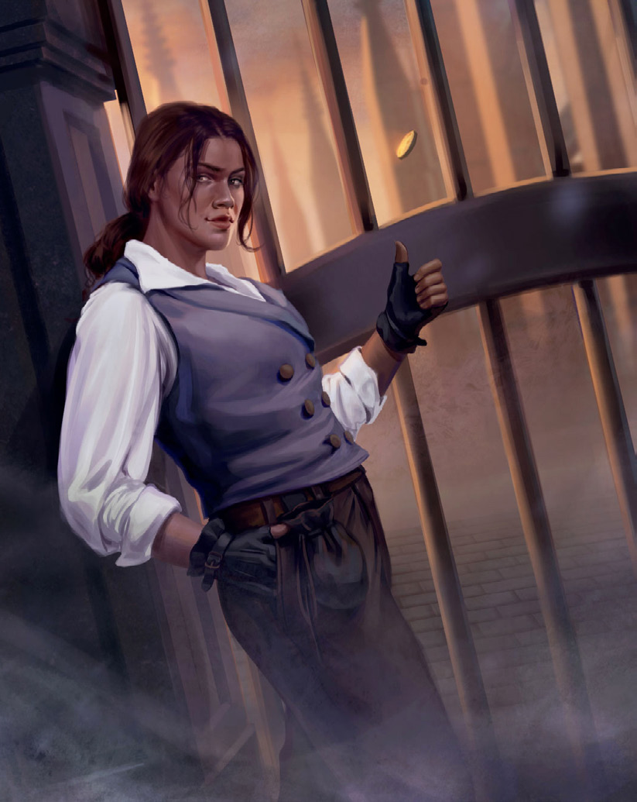

司卡德利亞（Scadrial）是英雄的舞臺。即使周遭世界正分崩離析，他們仍能挺身對抗權貴，推翻既有體制，建立更好的制度。

本章提供 GM 所需的工具，讓司卡德利亞各股明爭暗鬥的勢力都有可用的角色。你會在這裡找到企圖毀滅世界的反派，也會找到為了自己與摯愛的性命而戰的英雄。司卡德利亞的角色類型包羅萬象，從在街頭鬥智鬥勇的竊賊與偵探，到能施展非凡授予之術的迷霧之子與血金術師。

### 使用敵手（Using Adversaries）

本章的每種敵手都代表一種可加入冒險的角色。敵手簡介先說明其身分或本質，讓你從中取得靈感，將其融入逐步展開的故事。每份簡介末尾都有敵手資料區塊，列出其遊戲數值與能力。

此外，本章末尾提供可選用的敵手模組，能用於自訂任何資料區塊，讓敵手取得與其血統（ancestry）或金屬技藝（Metallic Arts）相關的特殊能力。

後面的「閱讀資料區塊」一節會概述各敵手資料區塊的用法。《迷霧之子玩家手冊》第 13 章有完整敵手規則，第 10 章則有一般戰鬥規則。

### 選擇資料區塊

使用預寫冒險時，若某個場景需要引入敵手，冒險通常會指明該用哪些敵手。名稱以粗體顯示，表示有對應的資料區塊。例如，若冒險寫著「兩名亡命之徒走近」，就用兩次亡命之徒的資料區塊。

如果要自行設計場景，請見《迷霧之子玩家手冊》第 13 章的「建立戰鬥場景」，其中說明如何搭配各種有意思的敵手，讓場景保持平衡。

本書末尾的附錄 B 依英文字母順序列出本章所有資料區塊。其他寰宇 RPG 產品中也能找到更多敵手，例如已出版冒險的 NPC、《迷霧之子玩家手冊》附錄中的 PC 動物夥伴，以及寰宇 RPG 其他世界指南所介紹的異界角色。

### 盟友還是對手？

「敵手」一詞雖然暗示對立，本章所列的 NPC 和其他生物也可以在友善或中立的情境中登場。玩家角色或許會和朋友鬥智、與導師切磋以磨練能力，或與盟友並肩作戰。

然而，司卡德利亞充斥錯綜複雜的權謀，資源匱乏與專制勢力也不斷考驗著這個世界。盟友彼此提防，背叛令人猝不及防，角色各有隱藏身分。這一場聚會中堅定支持你的盟友，下一場就可能成為你的死敵。

對頁為紋在一支攻勢不歇的克羅司戰士大軍中奮戰。

WAYNE REYNOLDS

第 8 章：敵手 213

### 在哪裡遇見敵手

本章許多簡介都會建議可在哪裡及何時遇見這些敵手。此外，本書第 6 章與第 7 章也為各自介紹的特色地點提供場景構想。

接下來各節會提供兩個紀元的更多都市與鄉間場景構想。

#### 統御區城市場景  第一紀元

聖務官與貴族牢牢控制最後帝國的城市，司卡反抗者與罪犯則潛伏在暗處。

##### 統御區城市場景

| d6 | 統御區城市場景 |
| --- | --- |
| 1 | PC 目睹一名迷霧之子貴族廷臣殺死一位對手。這名迷霧之子隨即追趕隊伍，企圖滅口。 |
| 2 | 一隊殺霧者認定 PC 窩藏一名迷霧人逃犯，要求隊伍交出所有金屬。 |
| 3 | 一名鋼鐵審判者搜尋獵物，人群紛紛讓開。他的目光落在 PC 身上。 |
| 4 | 一名策劃者聽聞隊伍的本事，堵住眾人，要他們選擇加入計畫，或一併遭殃。 |
| 5 | 一名上流社交人士及其保鑣懇求 PC 提供重要情報。 |
| 6 | 一名蒙面的迷霧之子刺客發動攻擊，拒絕透露受誰差遣。 |

#### 帝國鄉間場景  第一紀元

從華美的貴族莊園到荒涼的司卡種植園，沿著帝國的運河走，總會有新的發現。

##### 帝國鄉間場景

| d6 | 帝國鄉間場景 |
| --- | --- |
| 1 | PC 迎面遇上一隊怒氣沖沖的克羅司巡邏隊，他們已準備拔刀。 |
| 2 | 一名逃跑的司卡人大聲求救，聲稱有一隻霧魅在追趕自己。 |
| 3 | PC 撞見反抗者搬運武器，反抗者要求他們保證守口如瓶。 |
| 4 | 一隊駐軍士兵要求盤問 PC，查明有關司卡逃兵的傳聞。 |
| 5 | 一名泰瑞司侍從官在返城途中請求護送。他暗中是一名藏金術師。 |
| 6 | 一名孤身的貴族上前打探消息，其實是正要去履行新契約的坎得拉間諜。 |

#### 盆地城市場景  第二紀元

在和諧的世界裡，依藍戴盆地的各座城市因居民與產業的忙碌而充滿活力。

##### 盆地城市場景

| d6 | 盆地城市場景 |
| --- | --- |
| 1 | 一名「組織」密探聽說了隊伍的事蹟，企圖綁架一名 PC。 |
| 2 | 一頭逃脫的血金嵌合獸闖進房間，嗜血地尋找獵物。 |
| 3 | 一名警署偵探攔下 PC，就一樁正在調查的案件向他們問話。 |
| 4 | 一名鬼血成員與 PC 接觸，提出交換情報。 |
| 5 | 一名騙術高手試圖騙走 PC 的財富。 |
| 6 | 一名上流社交人士提議邀請 PC 參加上流派對，前提是隊伍能讓對方覺得值得這麼做。 |

#### 蠻橫區場景  第二紀元

離開盆地的安全地帶後，蠻橫區是一片人煙稀少、相對缺乏法治的邊疆。

##### 蠻橫區場景

| d6 | 蠻橫區場景 |
| --- | --- |
| 1 | 一名狂奔的執法者停下來，詢問嫌犯往哪個方向逃了。 |
| 2 | 一名迷路的 Malwish 飛行員想找個願意保密的人幫忙。 |
| 3 | 一名想撈些盒金的亡命之徒首領找上 PC 的麻煩。 |
| 4 | 一名克羅司混血軍官請人幫忙扶正指揮官翻倒的馬車。 |
| 5 | 一名打手與幾名亡命之徒包圍 PC，聲稱他們在保衛自己的地盤。 |
| 6 | 一名不肯罷休的商人想說服 PC 買下城裡最新的商品。 |

> 珊旋舞著匕首，閃電般發動攻擊，逼得紋再次向後跳開。

第 8 章：敵手 214

### 閱讀資料區塊

本節概述敵手資料區塊中最重要的內容。《迷霧之子玩家手冊》第 13 章的「使用敵手」一節，提供使用敵手資料區塊與自行建立戰鬥場景的完整規則。每個敵手資料區塊都包含以下部分或全部資訊。

頭銜。敵手的頭銜包含有用資訊，例如其物種、職能或其他描述。

階層。敵手的階層能幫助你為每個場景選出有挑戰性的敵手。

角色定位。敵手分為嘍囉、勁敵與首領三種定位。嘍囉和首領的資料區塊各有一項同名特殊特徵。勁敵沒有額外規則。

體型。和 PC 一樣，敵手的體型反映其在戰鬥中控制的空間。小型為 2.5 呎、中型 5 呎、大型 10 呎、巨型 15 呎、超巨型 20 呎以上，由 GM 裁定。

類型。敵手的類型沒有相關規則，但能描述其基本性質，例如類人生物或動物。如何與故事互動由 GM 決定。

基本數值。敵手和 PC 使用同樣的基本數值，包括六項屬性（力量、速度、智力、意志、察覺與風采）、三項防禦（實體防禦、認知防禦與靈性防禦）、生命值、專注點，以及部分敵手的授予。

偏轉值。和 PC 一樣，敵手受到的所有衝擊傷害、銳利傷害及能量傷害，都會減去其列出的偏轉值。敵手未列偏轉值時，偏轉值為 0。

移動。和 PC 一樣，敵手的移動速率決定其在移動行動中能移動多遠。若敵手有游泳之類的特殊移動方式，即使 PC 通常會因此減速，敵手使用該方式時也不會減速。

感知（Senses）。和 PC 一樣，敵手的感知範圍決定其主要感官受阻時仍能感知多遠。每個資料區塊都建議一項主要感官，你可以更改成最符合故事的感官。

免疫。有些敵手會在符合故事的情況下，免疫某些效果，例如狀態。

技能。敵手能使用《迷霧之子玩家手冊》第 3 章的任何技能。資料區塊只列出其具有技能等級的技能。

金屬技藝技能。如果敵手能使用鎔金術或藏金術，其資料區塊會列出該技能、技能修正值、技能等級，以及可用該技能施展的力量。

特徵。敵手的特徵會提供影響其本身的特殊規則，使用這些規則無須直接採取行動、自由行動或反應。

行動（Actions）。和 PC 一樣，敵手能使用《迷霧之子玩家手冊》第 10 章的任何行動、自由行動或反應。敵手也能使用自己資料區塊列出的任何行動、自由行動或反應，這些遵循與 PC 行動相同的規則，每項在每個輪次只能使用一次。詳見後面的「使用行動」。

機遇與變故。少數資料區塊會列出在 PC 獲得機遇或變故時可觸發的特殊效果。敵手雖然不擲劇情骰，偶爾也能從自己的 d20 擲骰獲得機遇或變故。若發生這種情況，請參考「敵手的機遇與變故」側欄中可能產生的效果。

##### 敵手的機遇與變故

敵手擲出機遇（[機遇]）時，你可以使用任何允許其消耗機遇的特徵或行動，也可以選擇其他符合故事的效果。可考慮下列構想。

- 敵手或其盟友在下一次檢定中獲得優勢。

- 敵手獲得 1 點專注點，最多到其上限。

- 敵手的下一個行動若通常需要花費專注點或授予，這次可以免除該項花費。

- 敵手對其目標施加一項狀態，持續到敵手下一個輪次開始。

- 故事發展稍微偏向有利於敵手的一方。

敵手擲出變故（[變故]）時，讓玩家建議事情如何發展。可考慮下列構想。

- 敵手或其盟友在下一次檢定中獲得劣勢。

- 敵手失去 1 點專注點。

- 敵手受到一項狀態，持續到其下一個輪次結束。

- 故事發展稍微偏向有利於隊伍的一方。

第 8 章：敵手 215

### 敵手的適用紀元

本章介紹司卡德利亞各式各樣的生物。有些只會在第一紀元遇見，那是個灰燼漫天、罪犯與壓迫人民的貴族角力的世界。另一些出現在第二紀元，那是個走向現代化、革命與發現層出不窮的世界。其他敵手在兩個紀元都能找到，但某些行動或特徵僅限特定紀元。例如，敵手可能在第一紀元使用短弓，到了第二紀元則使用槍械。

能力附有第一紀元符號時，只能在第一紀元使用。附有第二紀元符號時，只能在第二紀元使用。

### 使用行動

每個資料區塊都會列出該敵手特有的行動、自由行動或反應，或同時列出其中幾類。敵手也能使用《迷霧之子玩家手冊》第 10 章列出的行動、自由行動與反應。例如，任何敵手都能使用移動及獲取優勢行動，也能使用反擊機會反應，而且通常應該善加利用。

有授予池的司卡德利亞敵手也能使用《迷霧之子玩家手冊》第 5 章的飲用金屬液行動。

敵手的行動遵循與 PC 行動相同的規則，每個輪次不能使用同名行動超過一次。

### 攻擊與武器

多數敵手至少有一項攻擊，會列出攻擊修正值、距離或觸及範圍，以及命中結果。除非另有說明，敵手的所有攻擊都以目標的實體防禦為準。

有些攻擊會使用帶有穿刺、裝填或爆破等特性的武器。這些特性的效果會列在該攻擊的命中結果之後。

如果敵手擁有鋁製武器或彈藥，這些鋁製武器或彈藥，以及使用它們進行的攻擊都不受授予能力影響。

### 傷害

造成傷害的行動會告訴你要擲哪些傷害骰、擲骰結果要加上哪些修正值，以及該行動造成哪種類型的傷害。例如，若攻擊造成 1d4 + 6 銳利傷害，就擲一顆 d4，再將結果加 6。

如果攻擊沒有命中，你照常可以為每個目標花費 1 點專注點來造成擦傷，傷害等於傷害骰擲出的總和。

### 反擊機會

敵手可以像 PC 一樣使用反擊機會反應。敵人自願離開其觸及範圍時，敵手可花費 1 專注點攻擊。敵手可以使用任何花費[1行動]且列有觸及範圍的攻擊行動來進行這次攻擊。只列距離的攻擊不適用。

### 花費資源

若一項行動或特徵要求敵手花費專注點或授予，每次使用都要花費的成本會列在行動名稱後的括號中。若是否花費資源取決於其他條件，成本則會寫在行動內文中。

### 擊敗敵手

敵手的生命值降至 0 時，便遭到擊敗。

在戰鬥中，多數敵手在生命值降至 0 後會被視為死亡。不過，GM 可以讓重要 NPC 改為陷入昏迷（Unconscious），並像 PC 一樣進行傷勢擲骰。

如果 PC 想以非致命手段擊敗敵手，給予最後一擊的 PC 可以選擇讓該 NPC 受一項傷勢並陷入昏迷。遭擊敗的 NPC 會持續昏迷，直到從其他來源恢復至少 1 點生命值。他們無法像 PC 一樣自行恢復意識。

敵手會在你最意想不到時出手。

ELIZABETH PEIRO

