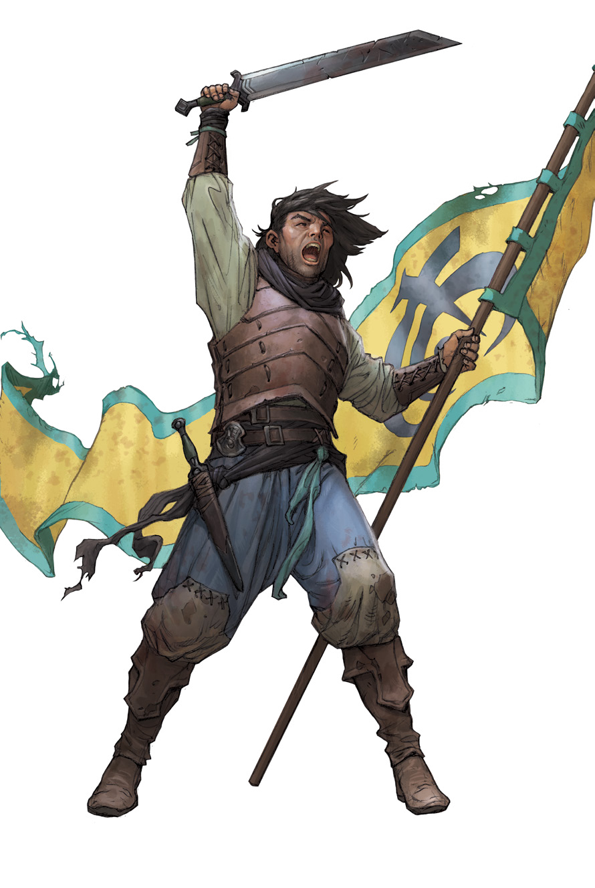

## 反抗者（Rebel）

當制度失靈，反抗者便挺身而出，力求帶來真正而長久的改變。他們善於擾亂對手，忠於共同理念，尤其在成群行動時更難對付。即便只有破舊的護甲和粗陋的武器，他們仍能憑意志與人數推翻不公的領袖，連自以為能永遠掌權的人也無法倖免。

### 擾亂戰術

反抗組織會用各種手段擾亂對手、向對手施壓，例如行竊、發動突襲、綁架地位較低的貴族，以及藏匿逃亡者。他們祕密走私並分配武器等物資，訓練自願加入的人如何戰鬥與求生。

#### 反抗者

*階層 1 勁敵 — 中型類人生物*

| 實體 |  |  | 意識 |  |  | 靈魂 |  |  |
| --- | --- | --- | --- | --- | --- | --- | --- | --- |
| 力量 | 防禦 | 速度 | 智力 | 防禦 | 意志 | 察覺 | 防禦 | 風采 |
| 2 | 14 | 2 | 1 | 14 | 3 | 3 | 15 | 2 |

生命值：20（15–25）

專注點：5

授予：0

移動：25 呎

感知：20 呎（視覺）

實體技能：運動 +4、輕型武器 +4

意識技能：紀律 +5、威嚇 +5

靈魂技能：領導 +4、說服 +4、求生 +5

##### 特徵

為了理念（For the Cause）。反抗者遭擊敗時，距其 30 呎內每名能感知到反抗者的盟友各恢復 1 專注點。

##### 行動

[1行動] **打擊：佩劍。** 攻擊 +4，觸及範圍 5 呎，造成 1d6 + 4 銳利傷害。命中時，反抗者也可以花費 2 專注點，讓一名盟友在距反抗者 5 呎內發動的下一次攻擊獲得一個優勢。

[1行動] **打擊：臨時武器。** 攻擊 +4，觸及範圍 5 呎或距離 15/30 呎，造成 1d4 + 4 衝擊傷害。如果這次攻擊也命中目標的意識防禦，目標陷入迷惑狀態，直到其下一個輪次結束。

[1行動] **打擊：短管手槍。** [第二時代] 攻擊 +4，距離 20/60 呎，造成 1d4 + 4 銳利傷害。穿刺：目標的偏轉值無法減少此傷害。裝填 [6]：可用 [1行動] 將此武器的彈藥補滿。

[2行動] **化為灰燼（To Ashes）。** 反抗者選擇距自己 10 呎內一處大型（10 呎）空間，點燃該區域的地面與無人看管的物品。燃燒期間，該區域成為危險地形，造成 1d8 能量傷害。角色可用 [1行動] 熄滅一處 5 呎區域的火焰。

[反應] **團結更強（花費 1 專注點）。** 距反抗者 5 呎內的一名盟友以攻擊造成擦傷時，反抗者可以將這次擦傷改為命中，並讓該盟友立即脫離，無須花費行動。

##### 反抗者戰術

反抗者在戰鬥中互相支援，藉由團結更強反應和佩劍攻擊激勵同伴奮戰。情勢緊迫時，他們用臨時武器攻擊擾亂敵人，趁機用化為灰燼行動放火製造混亂。即使有反抗者倒下，他們的犧牲仍能透過為了理念特徵鼓舞盟友奮戰到底。

STEVE PRESCOTT

第 8 章：敵手 260

