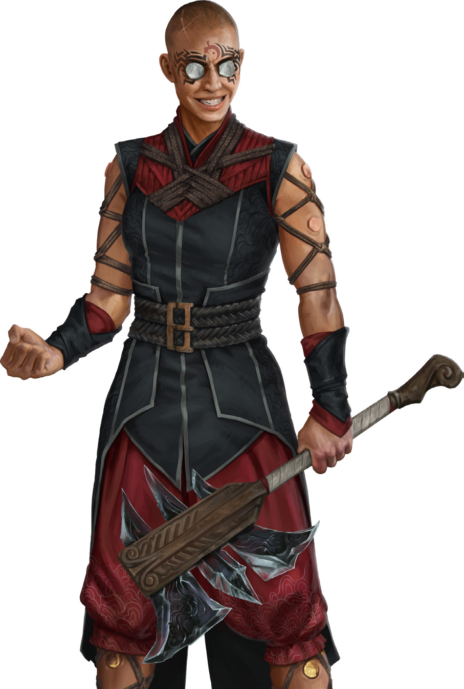

鋼鐵審判者原是聖務官，藉由植入多根血金術尖刺獲得鎔金術能力，其中有一對尖刺插在原本雙眼的位置。審判者令人聞風喪膽。他們掌管鋼鐵教廷的審判廷，既負責執法，也專門調查鎔金術的使用情形。貴族家族、司卡反抗者與陸沙德的情報，都由鋼鐵審判者帶回去向統御主稟報。

除了在金屬技藝上最有造詣或最不顧後果的金屬之子，人人都認為與鋼鐵審判者交戰是愚蠢之舉。不過，每一名鋼鐵審判者都有一個不為人知的弱點。維繫全身尖刺網絡的血金術關鍵尖刺一旦被拔除，審判者就會死亡。

落灰之終後，只有一名鋼鐵審判者活著進入新世界，那就是沼澤。他更為人熟知的身分是傳說中的鐵眼，詳見本章前面的「鐵眼」。儘管如此，創造審判者所用的血金術祕法仍透過迷霧之子大人的筆記流傳下來。

### 金屬技藝

鋼鐵審判者往往獲賦一整套金屬技藝，其能力足以匹敵甚至超越迷霧之子和藏金術師。統御主死後，部分鋼鐵審判者還從泰瑞司席諾德奪取了藏金術能力。

鋼鐵審判者的敵手資料卡只列出幾種金屬技藝，已足以安排一場精彩的遭遇。你也可以調整這張資料卡，反映種類不同或數量更多的血金術尖刺，並按需要授予其他鎔金術模組，詳見本章末尾的「敵手模組」。

##### 鋼鐵審判者戰術

鋼鐵審判者極難擊敗，再生與燃燒天金兩項能力便體現了這一點。他們擅長用黑曜石斧壓制敵人，也能用鐵拉／鋼推行動迅速應對威脅，維持對戰場的掌控。

審判者用燃燒青銅和燃燒鐵／鋼極為精準地偵測迷霧人和迷霧之子。如果審判者花費 6 授予燃燒青銅，甚至能偵測並穿透紅銅雲，詳見《迷霧之子玩家手冊》第 6 章的「紅銅鎔金術」。

MATT DEMINO

262

#### 鋼鐵審判者

*階層 3 勁敵 — 中型類人生物*

| 實體 |  |  | 意識 |  |  | 靈魂 |  |  |
| --- | --- | --- | --- | --- | --- | --- | --- | --- |
| 力量 | 防禦 | 速度 | 智力 | 防禦 | 意志 | 察覺 | 防禦 | 風采 |
| 5 | 19 | 4 | 3 | 18 | 5 | 3 | 18 | 5 |

生命值：75（60–90）

專注點：7

授予：7

偏轉值：2（鋼鐵審判者）

移動：30 呎

感知：20 呎（鎔金術）

實體技能：運動 +9、重型武器 +9

意識技能：推理 +7、紀律 +9、威嚇 +9

靈魂技能：洞察 +6、感知 +7

金屬技藝技能：鎔金術 +9（技能等級 4；天金、青銅、鐵、白鑞、鋼）

##### 特徵

威嚴氣勢。鋼鐵審判者抵抗影響時，只需花費通常所需專注點的一半，施加影響的角色則失去 1d4 專注點。

血金術關鍵尖刺。鋼鐵審判者的生命值降到一半以下時，如果 PC 知道審判者的關鍵尖刺，就建立「拔除關鍵尖刺」正面事件，共有 5 格。事件進度軌填滿後，審判者露出破綻。能觸及審判者的角色可用 [1行動] 進行運動檢定，對抗審判者的實體防禦。成功時，該角色拔除關鍵尖刺，擊敗審判者。失敗時，事件進度軌重設為 0 個機遇。

##### 行動

[1行動] **打擊：黑曜石斧。** 攻擊 +9，觸及範圍 5 呎，造成 1d6 + 9 銳利傷害。命中時，鋼鐵審判者可以花費 1 專注點，額外造成 2d6 銳利傷害。

[1行動] **射出錢幣（花費 1–4 授予）。** 攻擊 +9，每花費 1 授予，距離為 20 呎，造成 1d10 + 9 衝擊傷害。

[1行動] **燃燒青銅（花費 1–6 授予）。** 直到場景結束，鋼鐵審判者可偵測距自己 320 呎內的下列情形：

- 每一次授予的花費。

- 每一項由授予驅動且仍在持續的效果，例如鎔金術師的燃燒行動，即使相關授予早在審判者使用此行動之前就已花費。

審判者能感知這些效果來源的大致方向。只要還能偵測這些效果，審判者也可以選擇追蹤其中若干項效果的確切位置和來源，項數等於花費的授予。審判者可以用 [1行動] 進行 DC 15 鎔金術檢定，判斷正在追蹤的一項效果由哪種能力產生。

[1行動] **燃燒鐵／鋼。** 直到場景結束，鋼鐵審判者能感知距自己 160 呎內所有非鋁且未受授予的金屬來源。

[1行動] **鐵拉／鋼推（花費 1–4 授予）。** 鋼鐵審判者選擇一件用燃燒鐵／鋼感知到的金屬物體，使自己或該物體沿直線向另一方靠近或遠離。每花費 1 授予，最多移動 20 呎。比審判者小的物體會向審判者靠近或遠離。若物體與審判者同樣大或更大，則是審判者向物體靠近或遠離。若物體連接在其他東西上，計算體型時也一併計入。

審判者可以靈活運用這項能力，例如繳械敵人，或打擊金屬物體飛行路徑上的敵人。要以這種方式影響不願配合的角色，審判者必須成功通過對抗目標實體防禦的鎔金術檢定。若效果會造成傷害，審判者則必須進行一次鎔金術攻擊，擲出 1d10 + 9 衝擊傷害。

[2行動] **燃燒天金（可用 2 次）。** 接下來 4 回合內，鋼鐵審判者為了與另一名角色進行實體互動而檢定時，包括對抗實體防禦的檢定，不擲任何 d20，直接將所有 d20 的結果設為 15，連優勢與劣勢的骰子也一樣。敵人為了與審判者進行實體互動而檢定時，包括對抗實體防禦的檢定，同樣直接將其 d20 的結果設為 5。效果結束前，審判者可以用 [自由行動] 再消耗一次燃燒天金的使用次數，以維持效果。

[自由行動] **再生（花費 1 授予）。** 鋼鐵審判者燃燒白鑞，恢復 1d6 + 3 生命值。

第 8 章：敵手 263
