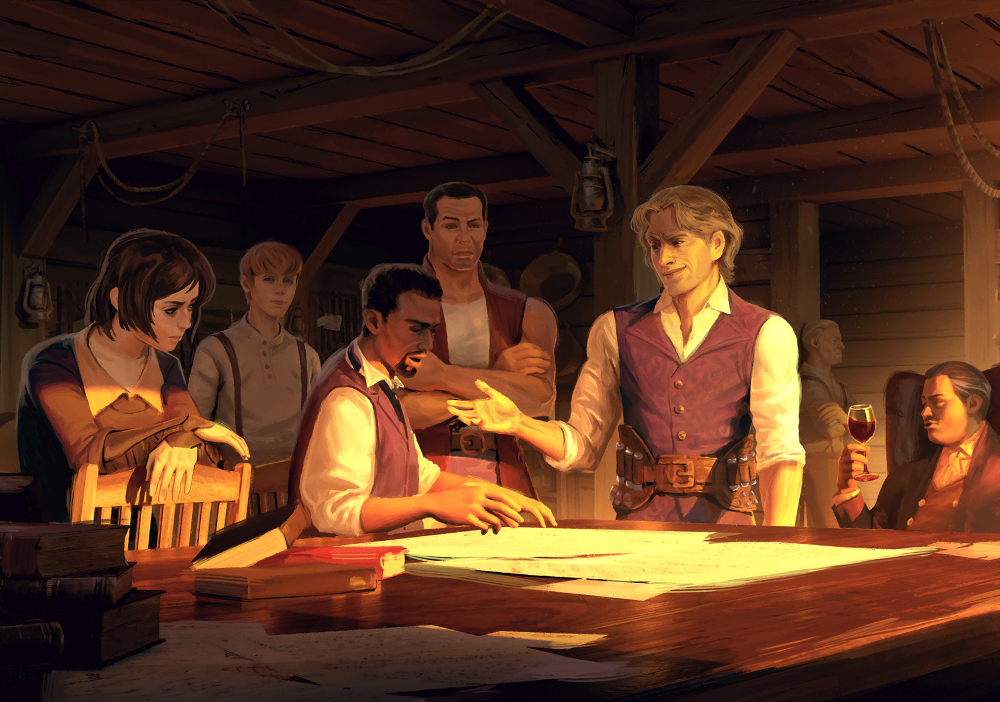
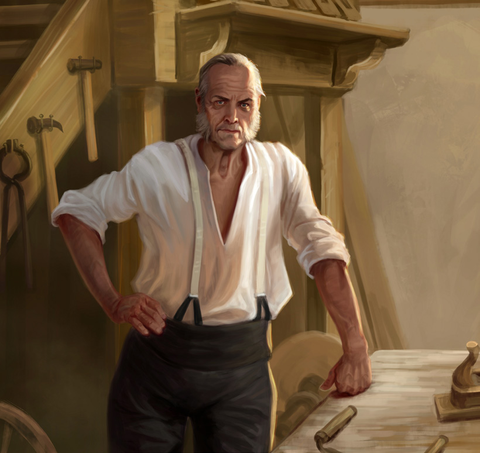

卡西爾（Kelsier）是個魅力十足、手段暴烈又精力旺盛的迷霧之子（Mistborn），也是一名膽識過人的團隊領袖。他曾是陸沙德（Luthadel）公認最厲害的竊賊，除了自己的享受，其他事幾乎都不放在心上。海司辛深坑（Pits of Hathsin）的監獄營摧毀了他，也讓他重生。逃出深坑後，他成了傳奇的海司辛倖存者（Survivor of Hathsin），掀起一連串事件，徹底改變了司卡德利亞（Scadrial）。

落灰之終（Catacendre）後的幾個世紀裡，卡西爾透過名為鬼血（Ghostbloods）的秘密組織在幕後行動。（關於第二時代的卡西爾，請見本章稍後的「鬼血」。）

### 成為傳奇之前

卡西爾兼有貴族與司卡（skaa）的血統，在貴族之中長大。他本來過著優渥的生活，直到母親的司卡身分曝光，她也因此被殺。這件事使卡西爾恨上了貴族，也是他與哥哥沼澤（Marsh）之間最早的幾道裂痕之一（見本章稍後的「沼澤」一節）。

遭貴族排斥後，卡西爾長成一個熱愛行騙的年輕人。他聰明又善於觀察，從小就擅長紙牌把戲與各種騙術。他剛開始行竊的那幾年，認識了日後成為他妻子的司卡反抗軍成員梅兒（Mare），以及從種植園逃出來、後來成為他摯友的司卡多克森（Dockson）。梅兒與卡西爾大膽把主意打到統御主（Lord Ruler）本人頭上，卻在行竊時被捕，雙雙送進深坑。梅兒在坑裡慘死後，卡西爾發生綻裂（Snapped），覺醒了迷霧之子的力量。他是第一個活著逃出這座監獄礦坑的人。海司辛倖存者的故事就此開始，人們認得這名反抗者手臂上一道道向上延伸的疤痕。

求生與復仇的渴望推著卡西爾向前。他一心只想摧毀統御主和最後帝國（Final Empire），為此不惜任何代價。

### 不可能的差事

卡西爾召集了他認識的司卡竊賊與鎔金術師（Allomancers）中的頂尖好手，準備達成一個不可能的目標，推翻最後帝國。司卡反抗軍領袖葉登（Yeden）雇用了他。卡西爾打算訓練一支司卡軍隊，把陸沙德交到他們手上，並偷走統御主的財富。這件差事大得幾乎讓人無從想像，但卡西爾和他的團隊最擅長把大難題拆成一件件能處理的小事。

卡西爾雇用坎得拉（kandra）歐瑟（OreSeur）替團隊掩護，也讓他預先做好準備，好在卡西爾萬一身亡時製造一場奇蹟。起義前的幾個月，卡西爾夜夜出動，殺戮選定的貴族，在司卡之間播下希望的種子，並四處製造混亂。

最後，卡西爾在對抗統御主時喪命。他成了殉道者，為起義補上了得以壯大所缺的最後幾項要素之一，那就是希望。

### 倖存者的兩副面孔

卡西爾舉手投足間既自信又自負，輕易就能冒充血統純正的貴族。入夜後，他披上迷霧披風（mistcloak），在屋頂間悄悄穿行。身在迷霧裡，他比在任何地方都自在。

卡西爾有兩副面孔。表面上，他無所畏懼、重感情，也有遠見。他以自我為中心，卻也真誠而關心他人。他樂觀又有衝勁，讓朋友明白，彼此的情誼與連結是統御主永遠奪不走的。

這副面孔底下，還有另一個卡西爾。他傲慢，會利用別人達成自己的目的。他和多克森等團員的交情讓他少了幾分冷酷，對紋（Vin）如父親般的情感也讓他有所成長。然而，驅使他行動的主要還是證明自己、成為最出色的人，以及成就大事的渴望。

#### 信仰的象徵

卡西爾被殺後，留下了延續數百年的傳承。人們以他的名義建立倖存者教會（Church of the Survivor）。在世界走向終結、隨後重生的過程中，教會帶給人們希望，也讓他們找到意義。卡西爾在司卡德利亞其他地方的作為，也讓他成為其他族群傳說中的人物（見第 4 章「冰殲時代（The Ice Death）」）。

#### 牢獄與迷霧

卡西爾死後說服存留（Preservation），讓他在意識界（Cognitive Realm）多留一段時間。他進入囚禁滅絕（Ruin）的昇華之井（Well of Ascension），在那裡觀察世事的發展，自己卻也受困其中，直到滅絕獲釋。接下來幾年，卡西爾只要能幫上忙就會出手。他藉助一群名為 Ire 的躍界者（worldhoppers）製作的器物，使自己與存留的力量調和，甚至一度掌握存留的碎力（Shard），直到紋成為它的持有者（Vessel）。這些經歷加深了卡西爾對寰宇（cosmere）的理解，也奠定了鬼血的基礎（見本章稍後的「鬼血」）。

第 5 章：盟友與組織 122

### 卡西爾的團隊

為了策劃推翻最後帝國，卡西爾和多克森召集了一隊迷霧人（Mistings）。團員起初以為這次的工作是竊取財富、動搖政權。其實，卡西爾一直在招募和訓練他看重的好人，讓他們日後能成為新政府的領袖。（其他重要團員，如沼澤、沙賽德（Sazed）與紋，會在本章稍後的各節詳述。）

#### 微風（Breeze）

微風是個有魅力、衣著講究的黃銅（brass）迷霧人，俗稱安撫者（Soother）。他能細膩地燃燒（burn）黃銅，熟練地讓周遭的人放鬆下來。微風的真實身分是 Edgard Ladrian。他是血統純正的貴族，為了在竊賊團隊裡做事，才假扮成司卡。最後帝國覆滅後，微風成了外交官，也與奧瑞安妮．塞特（Allrianne Cett）發展出一段戀情。

#### 德穆（Demoux）

德穆是反抗軍的一名上尉，並非原先的團隊成員。葉登率領大部分兵力出擊，突襲以慘敗告終。德穆對卡西爾的忠誠與敬仰，讓他得以保住一小部分兵力。最後帝國覆滅後，德穆成為團隊的重要助力，最終進入核心圈。他成了將軍，也是天金（atium）迷霧人，並娶了一名叫 Aslydin 的泰瑞司（Terris）女子。後來，德穆與 Aslydin 加入名為 Seventeenth Shard 的組織，成了躍界者。

#### 多克森

多克森是卡西爾的老朋友，也是擅長掌握細節的戰術家。他曾是種植園裡的司卡，和卡西爾一樣痛恨貴族。他把團員聚在一起，也接手反抗軍的行政事務。最後帝國覆滅後，他負責新王國的行政工作，後來死於陸沙德圍城（Siege of Luthadel）。

JOSHUA CHIA

紋、鬼影（Spook）、多克森、哈姆德（Hammond）、卡西爾和微風正在擬定計策，歪腳（Clubs）則用紅銅雲（coppercloud）掩護大家。

#### 哈姆（Ham）

哈姆德通常被稱為哈姆。他重視家人、善於思考，喜歡辯論和解邏輯謎題。他是白鑞（pewter）迷霧人，俗稱打手（Thug）或白鑞臂（Pewterarm）。哈姆為了賺錢加入竊賊團隊，好讓妻兒過上好日子。他在陸沙德駐軍（Luthadel Garrison）裡有人脈，也在反抗軍中擔任教官與將軍。最後帝國覆滅後，哈姆繼續領兵，卻對自己身為將軍的角色感到不自在。

#### 歐瑟

歐瑟是三代（Third Generation）坎得拉，已經活了 700 多年。他冒充雷弩大人（Lord Renoux）替團隊掩護。雷弩大人是個地方貴族，正設法提高自己在陸沙德的地位。歐瑟也和卡西爾訂有契約（Contract），要在卡西爾死後冒充他，以鼓舞人們的信念。最後帝國覆滅後，歐瑟的契約從卡西爾名下轉到紋名下。但歐瑟的同族坦迅（TenSoon）殺了他，並冒充他的身分。

#### 歪腳

歪腳的真名是克萊登（Cladent）。他是紅銅（copper）迷霧人，俗稱煙陣（Smoker）。他的木工店是竊賊團隊的藏身處（hideout），店裡還雇了幾名煙陣當學徒。歪腳是個年長而疲憊的木匠。他曾在統御主的軍隊裡當兵，當時受了傷，從此走路一跛一跛的。最後帝國覆滅後，歪腳成了將軍，後來死於陸沙德圍城。

#### 鬼影

這個來自東方統御區（Eastern Dominance）的年輕人因為是錫眼（Tineye），被父母斷絕了關係。叔叔歪腳帶他離開家鄉、前往陸沙德時，他給自己取名 Lestibournes，意思是「一出世就給丟了」（Lefting I’m born），也就是「我被拋棄了」（I’ve been abandoned）。這名年輕的迷霧人加入團隊後，卡西爾給他取了「鬼影」這個綽號。鬼影說的是東方街頭俚語，一種很難聽懂的方言。他在團隊裡擔任斥候、哨兵和間諜。

最後帝國覆滅後，鬼影一度懷疑自己的價值，成了錫能者（tin savant），並以火焰倖存者（Survivor of the Flames）的身分，在北方城市鎢都（Urteau）領導第二場革命。落灰之終時，和諧（Harmony）讓他成為迷霧之子。後來，他成了依藍戴盆地（Elendel Basin）的首任統治者。

### 短期目標與獎勵

如果你在戰役（campaign）中安排卡西爾和他的團隊登場，每名替他們完成短期目標（goals）的 PC 都有機會讓卡西爾與團隊成為自己的贊助者（patron），進而取得贊助者的好處（patron benefit）。

#### 贊助者的短期目標

卡西爾與他的團隊可能會提出下列短期目標：

- **援助反抗軍。** 找出能幫助弱勢群體推動其訴求的情報或祕密。

- **鼓舞司卡。** 前往一座種植園或司卡居住的街區，鼓舞當地司卡加入反抗軍、尋求受教育的機會，或逃往最後帝國境內壓迫較輕的地方。

#### 贊助者的好處：卡西爾與他的團隊

團隊在遍布中央統御區（Central Dominance）和內統御區（Inner Dominances）的團隊藏身處及反抗軍掩體提供贊助者待遇（amenities）。他們也致力於訓練一支熟悉軍事戰略（military strategy）、專門技巧與鎔金術（Allomancy）的軍隊。他們可以安排專家在休整期（downtime）指導你訓練（見《迷霧之子玩家手冊》（Mistborn Handbook）第 9 章「休整期」），讓你取得任一種武器或護甲專長（expertise），包括特殊武器與護甲的專長。他們也能提供專攻任何一種鎔金術的導師（mentor）（見本章開頭的「贊助者與導師」）。

如果你的角色是迷霧之子，而且親自跟卡西爾訓練，他可以指導你選擇的任一種實體鎔金術（Physical Allomancy）。在你第一次跟他訓練後，他還會送你一件 **_迷霧披風_**，並讓你取得迷霧披風專長（Mistcloak expertise）。

DARKO STOJANOVIC

歪腳經營一間木工店，作為團隊的藏身處。

第 5 章：盟友與組織 124

