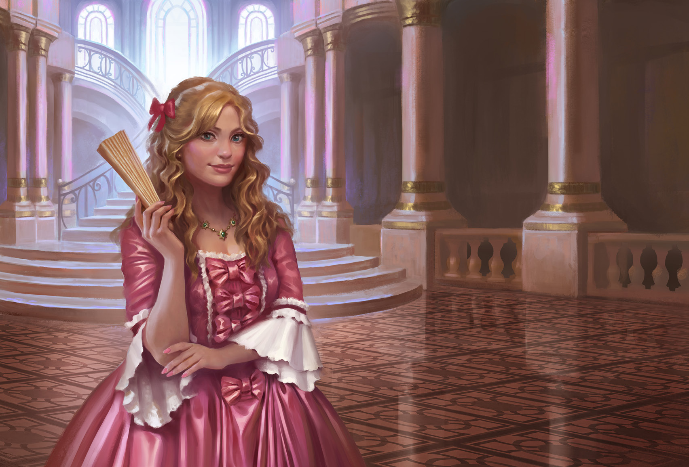
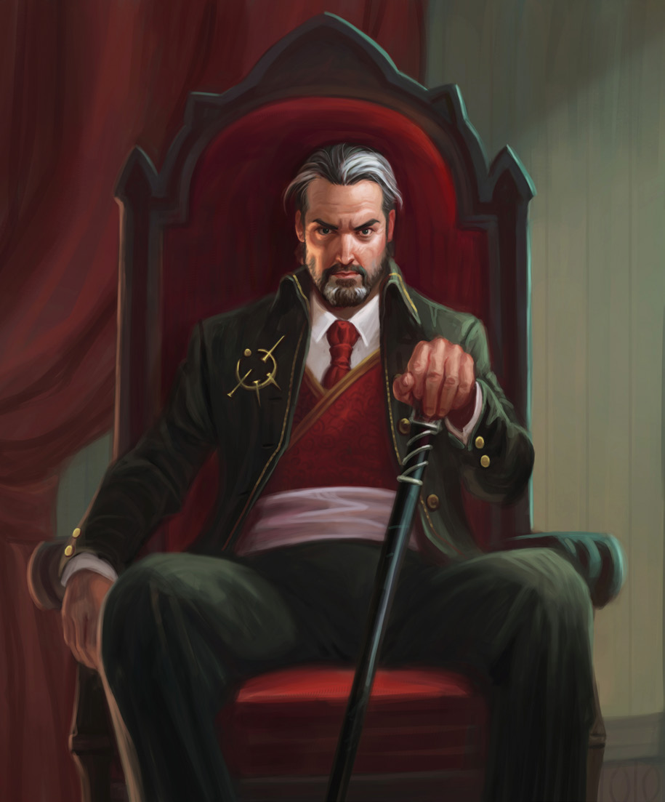
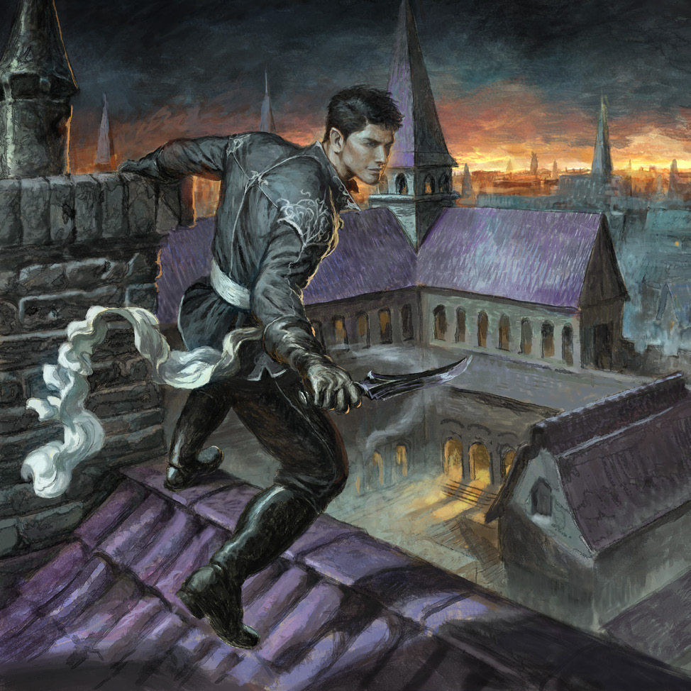

# 第 5 章

# 盟友與組織

存留（Preservation）與滅絕（Ruin）的碎旨（Intents）彼此對立，難免會左右司卡德利亞（Scadrial）的故事，讓壓迫與控制、革命與變革成為反覆出現的主題。司卡德利亞的英雄，以及你遊戲中的玩家角色（player characters），都必須在發展自身能力的同時，在這個紛爭不斷、動盪不安的世界裡找到自己的位置。他們勢必要在有權勢的人物與有影響力的組織之間周旋。

本章介紹《迷霧之子》系列描寫的司卡德利亞各方要角，著重於如何在自己的戰役（campaigns）中運用他們。本章提到的許多人物和組織能在玩家角色冒險或追求目標時提供協助，也有些可能與他們為敵。

### 如何使用本章

司卡德利亞有許多祕密同盟和不為人知的政治活動。無論你的戰役採用什麼樣的盟友與組織，只要讓他們參與其中，司卡德利亞就會像個活生生、處處相連的世界。玩家角色（PC）在這個不斷變動的世界結交盟友、樹立敵人時，也可能成為各方關係的核心。

司卡德利亞各個時代可建立的人脈不同。本章先介紹第一時代可運用的正典人物與組織，再介紹第二時代。各條目說明其歷史、成就、專長和管轄範圍，讓你能把他們融入自己的故事。

### 贊助者與導師

遊戲主持人（game master，GM）可以讓本章任何人物以友善或敵對的非玩家角色（non-player character，NPC）登場。他們也都能擔任任何玩家角色的贊助者（patron）。

隊伍（party）能以許多方式和這些人物或團體建立關係。玩家角色可以向個人或組織尋求贊助或指導、找盟友解決問題或對抗威脅、在困境中與朋友建立情誼，也可以讓這些人物成為自己過去經歷或未來志向的一部分。

較不熟悉《迷霧之子》系列的玩家，可以只和一位贊助者或一個組織建立關係。有把握的玩家也可以交織出一張複雜的人脈網。

本章各條目都在「短期目標與獎勵」一節列出具體的贊助者待遇（patron amenities）。任何贊助者也能幫隊伍取得其他有價值的獎勵，例如藏身處（hideout）或一定數量的稀有鎔金金屬（Allomantic metal）。贊助者的好處（patron benefits）及其他獎勵，詳見《迷霧之子玩家手冊》（Mistborn Handbook）第 8 章。

此外，若非玩家角色特別擅長某種鎔金術（Allomancy）或藏金能力（Feruchemical power），如其贊助者的好處所述，就可能直接擔任金屬之子（Metalborn）玩家角色的導師（mentor）。這樣的導師能加速金屬之子短期目標的達成（見《迷霧之子玩家手冊》第 5 章「金屬之子短期目標與獎勵」），或在休整期（downtime）指導玩家角色，讓角色在相關檢定（test）中獲得一個優勢（advantage）（見同書第 9 章「休整期活動構想」）。

對頁為沼澤（Marsh），他曾為反抗勢力、滅絕與和諧（Harmony）效力。

KIERAN YANNER

第 5 章：盟友與組織 115

### 尋找盟友

你可以安排本章的人物與組織登場，幫隊伍解決眼前的問題。例如，玩家角色可以向廷朵（Tindwyl）請教某位歷史人物的生平，也可以委託拉奈特（Ranette）製作一把新火器（firearm）或一發殺霧彈（hazekiller round）。如果玩家有意，這些初次接觸日後可能發展成長久的關係。

### 受到招募

足以改變世界的事件讓司卡德利亞陷入動盪，各地組織紛紛招攬人才，試圖讓局勢朝有利於自己的方向發展。隊伍可能捲入下列事件。

- **司卡反抗運動。** 隊伍可能捲入歷史上的司卡（skaa）抵抗運動，或加入推翻統御主（Lord Ruler）的革命。卡西爾（Kelsier）的團隊可能找有專長的玩家角色幫忙，隊伍也可能被葉登（Yeden）召集的軍隊招募。

- **在崩解時期求生。** 統御主死後，少數心懷希望或野心的人試圖在新世界做出一番成就。隊伍可能加入攻打或防守陸沙德（Luthadel）的其中一支軍隊，也可能出發，把不可或缺的補給送往極遠統御區（Farmost Dominance）與外界隔絕的聚落。

- **自主入侵。** 自主（Autonomy）的勢力集結之際，警署（Constabulary）可能派隊伍調查「組織」（The Set）的活動。鬼血（Ghostbloods）也可能找他們協助執行自己的祕密任務。

## 預設時局

除另有說明外，本章的盟友和組織大致以本書其他章節採用的歷史時點為準。第一時代約為統御主死前一年。第二時代則是「組織」曝光之後、南司卡德利亞（Southern Scadrial）統一之前。

你也可以參考這裡的資訊，推想人物與組織在不同時間，甚至不同時代的情況。你可能需要調整他們提供給玩家角色的資源、短期目標與獎勵，以反映這些變化。

## 依藍德．泛圖爾（Elend Venture） 第一時代

依藍德．泛圖爾是最後帝國（Final Empire）最有權勢的貴族家族繼承人。他涉獵廣泛，是個業餘學者、哲學家，也是個夢想家。最後帝國覆亡後，依藍德從膽怯的學者成長為前途可期的政治家，最後成了一位心懷善意的皇帝。在敵人眼中，他成了另一個暴君。在朋友眼中，他是無所畏懼的希望象徵，也是為人民而戰的戰士。

### 理想主義的學者

依藍德是史特拉夫．泛圖爾（Straff Venture）與 Sabrienne Venture 的兒子，自幼享有特權和權勢。Sabrienne 在依藍德年幼時去世，史特拉夫多年來一直試圖把自己崇尚力量與權勢的理念灌輸給繼承人。依藍德是史特拉夫．泛圖爾唯一公開承認的孩子，並不知道自己有許多同父異母的兄弟姊妹，其中包括危險的迷霧之子（Mistborn）詹（Zane）（見後文「泛圖爾家族：史特拉夫與詹」）。

年輕時，依藍德不是耍叛逆、惹父親惱火，就是跟最親近的朋友加斯提．雷卡（Jastes Lekal）和泰爾登．海斯丁（Telden Hasting）辯論學術問題。在陸沙德的盛大舞會上，依藍德愛上了一位以法蕾特．雷弩（Valette Renoux）之名與他相識的女子（見本章後文「紋」），從此踏上一段蛻變之旅。

SAEED RAMEZ

皇帝依藍德．泛圖爾手持克羅司巨劍（koloss blade）。

第 5 章：盟友與組織 116

### 中央統御區之王

最後帝國覆亡、史特拉夫逃離陸沙德後，依藍德取得泛圖爾堡（Keep Venture）與王位，自立為中央統御區（Central Dominance）之王。他依照自己的政治理想制定了一套新法律，建立代議制議會。議會（Assembly）有一段時間運作順利，讓城市安定下來。依藍德因此有了寶貴的時間，向泰瑞司（Terris）守護者（Keeper）廷朵學習歷代君王的治國之道（見本章後文「廷朵」）。

依藍德起初不太情願，但很快便明白，要讓自己的原則在政壇和戰場上都能站得住腳，就得學會發號施令、帶領他人。可惜他還來不及付諸行動，議會就依照他親手制定的法律廢黜了他。

### 新帝國的皇帝

陸沙德之戰（Battle of Luthadel）後，依藍德在昇華之井（Well of Ascension）差點喪命。他活了下來，獲得迷霧之子的能力，也成為更強硬的領導者。比起以往，他更願意以武力或脅迫取代外交手段。然而，當他努力將更多聚落和倖存者納入統治時，也開始擔心自己愈來愈像統御主。

在紋（Vin）的指導下，他很快就學會運用新得的迷霧之子能力。依藍德展現了驚人的實體鎔金術（physical Allomancy），甚至能讓一支支克羅司（koloss）大軍全數聽命於他。

滅絕一步步將世界推向末日。紋和依藍德走遍各統御區，試圖讓人民在兩人的統治下團結起來，並找出統御主藏起的儲備物資。兩人離開期間，依藍德把帝國政務交給臣服於他的君主費爾森．潘洛德（Ferson Penrod）、灰侯．塞特（Ashweather Cett）和加那爾（Janarle）處理。在與滅絕決戰時，依藍德率領麾下的鎔金術師（Allomancers），在海司辛深坑（Pits of Hathsin）外背水一戰。他犧牲了性命，讓紋得以徹底消滅滅絕。

### 身後影響

落灰之終（Catacendre）過後，倖存者尊依藍德為末代皇帝（Last Emperor）。依藍戴（Elendel）城和依藍戴盆地（Elendel Basin）都以他命名，以示紀念。新政府也依照他的理論建立。在重生之野（Field of Rebirth）（見第 7 章「依藍戴」），他的雕像與昇華戰士（Ascendant Warrior）紋的雕像並肩而立。

### 短期目標與獎勵

如果你在戰役中採用依藍德，個別玩家角色為他完成短期目標後，就有機會得到他的贊助，並獲得他身為贊助者所提供的好處。

#### 贊助者的短期目標

依藍德可能提出以下短期目標。

- **研讀理想。** 帶一本稀有書籍或禁書給依藍德，尤其是探討哲學、不同政體或國家運作實務的書。

- **外地探查。** 離開陸沙德，前往中央統御區以外的一座城鎮，調查當地司卡與貴族的現況，再把結果報告給依藍德。

#### 贊助者的好處：依藍德．泛圖爾

依藍德除了能在泛圖爾家族（House Venture）的各處產業提供贊助者待遇，也和陸沙德其他貴族家族的子弟頗有交情。最後帝國覆亡後，他的影響力更進一步擴及政界與軍界。如果他認為你的目的與他的目標一致，就能安排你和身居要職或享有特權的人會面。

此外，你與這樣的人互動時，可以藉助依藍德的贊助，依你的階層（tier）在不同檢定中獲得優勢，詳見「依藍德．泛圖爾的贊助優勢」表。不過，司卡德利亞的權謀錯綜複雜，也並非人人都對依藍德有好感，因此 GM 可以花費這些檢定產生的[變故]引入各種挑戰。

## 依藍德．泛圖爾的贊助優勢

| 階層 | 檢定 | 加成 |
| --- | --- | --- |
| 1 | 說服（Persuasion） | 一個優勢 |
| 2 | 推理（Deduction）、說服 | 一個優勢 |
| 3 | 推理、領導（Leadership）、說服 | 兩個優勢 |
| 4+ | 推理、洞察（Insight）、領導、說服 | 兩個優勢 |

> 有人把一疊書放到她桌上，發出一聲悶響。紋嚇了一跳，轉身一看，只見依藍德．泛圖爾拉了張椅子過來，輕鬆地坐下。

第 5 章：盟友與組織 117

## 塞特家族（House Cett）：灰侯與奧瑞安妮 第一時代

塞特家族是西方統御區（Western Dominance）的貴族家族，財富來自小麥粉、乳酪和加工保存的水果製品等農產品。他們選擇盟友時講求實際，手握大權，朋友卻寥寥無幾。這個家族最大的祕密，就是族中沒有鎔金術師。

### 灰侯．塞特

灰侯（Ashweather）是塞特家族現任家主，也是奧瑞安妮（Allrianne）和奈容汀（Gneorndin）的父親。他粗魯而冷酷，卻深諳政治。灰侯幼時因不明疾病而雙腿失去行動能力。塞特家族一位叔祖父對這孩子和他富有洞見的詩特別感興趣，便教導灰侯從政之道。

#### 精明的君主

最後帝國覆亡後，灰侯成了西方統御區之王。他沒有把首府設在 Tremredare，而是選在易守難攻、更適合軍事行動的哈佛富雷克斯市（Fadrex City）統治。灰侯在外征戰奔走時，統御區內的貴族轉而求助於聖務官（obligator）Aradan Yomen，以求安定。塞特家族的政治勢力逐漸衰退，灰侯聽從微風（Breeze）的建議（見本章後文「卡西爾與他的團隊」），動身前往中央統御區，打算奪取統御主暗藏的天金（atium）。

灰侯大膽進入遭到圍困的陸沙德，對疲於應付危機的議會又是賄賂、又是威脅，要他們考慮改立他為王。他的計畫失敗了，卻沒有撤退。後來，他的女兒奧瑞安妮逼他協助陸沙德攻打史特拉夫．泛圖爾的軍隊。灰侯向新皇帝依藍德宣誓效忠，成為新帝國（New Empire）的將軍。

### 奧瑞安妮．塞特（Allrianne Cett）

奧瑞安妮機敏又狡黠，是個能幹的外交官、強大的鋅（zinc）迷霧人（Misting），也是個富有洞見的策士。鋅迷霧人通常稱為煽動者（Rioter）。她那飽受折騰的父親為她感到自豪，卻也常被她氣得無可奈何。奧瑞安妮是塞特家族幾百年來首位鎔金術師。她自幼備受寵愛，也受到嚴格教養。家人讓她保有俏皮活潑的本性，也教她貴族宮廷的規矩，以及塞特家族擅長的言談技巧。

年幼時，奧瑞安妮常為自己的鎔金術如何影響周遭的人而苦惱。她很難分辨別人究竟是真心喜歡她，還是只因她燃燒了一點鋅才聽她的話。這些經歷讓奧瑞安妮更願意坦率表達自己的感受，不論是想過得舒服、愛吃糕點，還是偏愛粉紅色。

#### 新帝國的廷臣

奧瑞安妮發現微風對自己的情緒極為敏銳，從此為他著迷。微風對自身情緒瞭若指掌，很難操弄，這正是奧瑞安妮樂於接受的挑戰。年紀比她大得多的微風試圖和她保持距離，她卻把兩人之間的來往當成一場較量。兩人對彼此的好感最終逐漸加深，成了欣賞與愛意。

奧瑞安妮運用煽動者的能力，協助新帝國推動外交與維持和平。

#### 落灰之終後的影響

落灰之終過後，奧瑞安妮獲認定為存留者（Preservers）之一（見第 1 章「存留者」側欄）。她探討女性特質與自我實現的演說，成了一代又一代司卡德利亞人的指引。

### 短期目標與獎勵

如果你在戰役中採用灰侯大人或奧瑞安妮，個別玩家角色為其中一人完成短期目標後，就有機會得到對方的贊助，並獲得其贊助者的好處。

> 「父親，你要保護我的話，」她大喊，「就趕快衝鋒！」

第 5 章：盟友與組織 118

#### 贊助者的短期目標

塞特大人可能提出以下短期目標。

- **取得有利地位。** 查出關於塞特大人某位對手的情報，讓他有可乘之機，或為他的一項軍事計畫預作準備。

奧瑞安妮可能提出以下短期目標。

- **生活享受。** 為奧瑞安妮找來華服或少見的甜點。最後帝國覆亡後，也可以協助她分發保暖毛毯之類的簡單用品給士兵，以提振士氣。

#### 贊助者的好處：灰侯．塞特

除了能在西方統御區各地提供贊助者待遇外，最後帝國覆亡後，塞特大人還掌握司卡德利亞數一數二的私人軍隊。當你向他求助時，灰侯能派守衛或其他軍事人員支援符合他利益的任務。這些人員依照你目前階層的夥伴（companions）規則行動（見《迷霧之子玩家手冊》第 8 章「夥伴」），並會留下來，直到指定任務完成。

#### 贊助者的好處：奧瑞安妮．塞特

奧瑞安妮能提供優渥的贊助者待遇，通常包括富裕等級的住宿。她也是一位有謀略、手腕高明的外交官，把盟友關係放在優先地位。如果你的任務符合她的利益，她可以替你取得一封介紹信或一份上流社交活動的邀請。信件或邀請要多久才會送到，由 GM 裁定。你能請她提供介紹信或邀請的頻率取決於你的階層，詳見「奧瑞安妮．塞特的贊助頻率」表。

此外，奧瑞安妮能擔任鋅鎔金術（Zinc Allomancy）導師（見本章開頭「贊助者與導師」）。

## 奧瑞安妮．塞特的贊助頻率

| 階層 | 頻率 |
| --- | --- |
| 1 | 每月一次 |
| 2 | 每週一次 |
| 3+ | 不限 |

VALERIA CASALE

奧瑞安妮．塞特，才華出眾的煽動者。

## 泛圖爾家族：史特拉夫與詹 第一時代

泛圖爾家族是陸沙德最有權勢的貴族家族之一，以在泛圖爾堡舉辦奢華舞會聞名。地位最高的貴族在此處理宮廷事務。泛圖爾家族統治北方統御區（Northern Dominance）的鎢都（Urteau）及其周邊土地。

統御主在位期間，泛圖爾家族祕密監管他在海司辛深坑的天金開採作業，但不知道鋼鐵教廷（Ministry）隱瞞天金產運事務的真正原因。

### 史特拉夫．泛圖爾

史特拉夫是泛圖爾家族的家主，以陸沙德為主要據點。他是錫（tin）迷霧人，通常稱為錫眼（Tineye）。他舉手投足間流露權勢，也處處瞧不起旁人。依藍德是他唯一的繼承人（見本章前文「依藍德．泛圖爾」），但史特拉夫與幾十位情婦生下子女，期盼其中能出一位迷霧之子。在他眾多具備鎔金術的子女中，只有詹是迷霧之子。

史特拉夫像個殘酷的暴君，掌管整個家族和府邸。最後帝國的其他貴族也會對子女施以身體虐待，藉此激發潛在的鎔金術能力，即使在這些人當中，史特拉夫依舊格外殘忍。他會拋棄任何未能綻裂（Snap）的孩子。

最後帝國覆亡後，史特拉夫自立為北方統御區之王，率軍圍攻陸沙德。他的情婦愛瑪蘭塔（Amaranta）和兒子詹最終背叛了他。陸沙德圍城（Siege of Luthadel）結束時，他死於紋之手。

### 詹．泛圖爾（Zane Venture）

詹是技藝高超的迷霧之子，也是史特拉夫．泛圖爾手中的工具。他自幼與父親分開，無法享受泛圖爾姓氏帶來的特權。雖然他如父親所願，證明了自己是個迷霧之子，卻依然被視為私生子，只能藏身於暗處。

詹將一根尖刺刺進自己體內，因此擁有強大的鋼鎔金術（Steel Allomancy），滅絕也開始對他說話。他相信那是神的聲音，即便那聲音逼他殺掉所有遇到的人。唯一顯著的例外是紋（見本章後文「紋」）。

詹常穿一身簡單的深色衣服，不披迷霧披風（mistcloak）。他雙臂布滿自己弄出的疤痕，有人誤以為那些是他在海司辛深坑活下來的證據。他真正熬過的是長年遭受的虐待與忽視，先是來自史特拉夫，後來則來自滅絕。詹性情暴烈，情緒起伏不定，喜歡讓人痛苦，也樂於讓殺戮持續下去。

陸沙德遭到圍困期間，詹與紋切磋，試圖贏得她的好感。紋拒絕和他一起離開陸沙德後，他盛怒之下襲擊了她，也暴露出自己的真正意圖。他相信紋是自己獲救的唯一希望。

> 「只要權力照你承諾的那樣移交，就不必死人。誰知道呢，說不定我還會讓你保住那頂王冠。」
>
> ——史特拉夫．泛圖爾

史特拉夫．泛圖爾，泛圖爾家族的大領主。

DARKO STOJANOVIC

第 5 章：盟友與組織 120

### 短期目標與獎勵

如果你在戰役中採用史特拉夫或詹，個別玩家角色為其中一人完成短期目標後，就有機會得到對方的贊助，並獲得其贊助者的好處。不過，這些非玩家角色的動機未必和隊伍裡每個人的動機一致。

#### 贊助者的短期目標

如果有玩家角色願意冒險與史特拉夫打交道，他可能會提出以下短期目標。

- **助他占上風。** 找出史特拉夫某位敵手的弱點，讓他能在軍事、政治或個人層面上給對手毀滅性的一擊。

如果有玩家角色願意冒險與詹打交道，他可能會提出以下短期目標。

- **致命情報。** 向詹提供他某位暗殺目標的出行時間與日常作息。

#### 贊助者的好處：史特拉夫．泛圖爾

史特拉夫除了提供贊助者待遇，也能派有特定專長的迷霧人支援符合他利益的任務。這些迷霧人使用非金屬之子的資料區塊（stat block），另加一項第 8 章「敵手模組」的鎔金術模組。他們依照你目前階層的夥伴規則行動（見《迷霧之子玩家手冊》第 8 章「夥伴」），並會留下來，直到指定任務完成。

此外，史特拉夫也可能給你一顆來自海司辛深坑的天金珠。天金珠要多久才會送到，由 GM 裁定。你能向他請求天金珠的頻率取決於你的階層，詳見「史特拉夫．泛圖爾提供天金的頻率」表。

## 史特拉夫．泛圖爾提供天金的頻率

| 階層 | 頻率 |
| --- | --- |
| 1 | 每月一次 |
| 2 | 每週一次 |
| 3+ | 不限 |

#### 贊助者的好處：詹．泛圖爾

詹無法提供一般的贊助者待遇。不過，只要除掉你指定的目標符合他的利益，或對他沒有利害關係，他就會替你除掉對方。暗殺要多久才會發生，由 GM 裁定。你能請他出手暗殺的頻率取決於你的階層，詳見「詹．泛圖爾執行暗殺的頻率」表。不過，如果你的請求有損詹的利益，他的錢幣很快就可能朝你飛來。

此外，如果符合自身利益，詹也可能同意擔任鋼鎔金術導師（見本章開頭「贊助者與導師」）。

## 詹．泛圖爾執行暗殺的頻率

| 階層 | 頻率 |
| --- | --- |
| 1 | 每月一次 |
| 2 | 每週一次 |
| 3+ | 不限 |

詹在夜色中穿行於陸沙德。

ANTTI HAKOSAARI

第 5 章：盟友與組織 121

