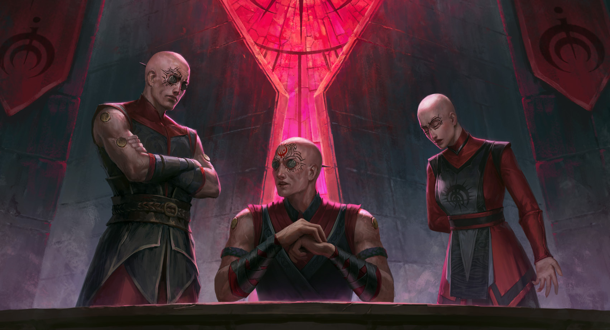
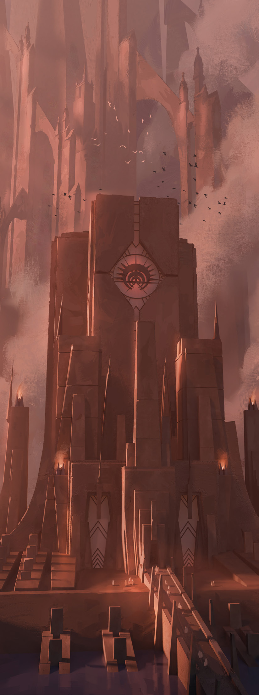

鎢都（Urteau）位於北方統御區（Northern Dominance），是泛圖爾家族（House Venture）的祖居地。魁利恩（Quellion）與妹妹貝爾黛（Beldre）都出生在那裡，這輩子大半時間都以為自己有純正的貴族血統。最後帝國（Final Empire）覆滅前不久，聖務官（obligators）發現兩人的貴族父親因妻子無法懷孕，便找了一名司卡（skaa）女僕替他生孩子。這一家人差點被處決，魁利恩與貝爾黛直到政權瓦解才逃過一劫。

統御主（Lord Ruler）死後，北方統御區的國王史特拉夫．泛圖爾（Straff Venture）離開鎢都，前去圍攻陸沙德（Luthadel）。魁利恩趁權力出現空缺時奪權，自稱「公民」（Citizen）。他是倖存者教會（Church of the Survivor）的虔誠信徒，隱瞞自己的貴族出身，借卡西爾（Kelsier）的話建立一個由司卡主導、敵視貴族的新社會。這段期間，魁利恩在滅絕（Ruin）的引導下，把一根血金術尖刺（Hemalurgic spike）刺進自己體內，取得青銅迷霧人（bronze Misting）的能力，俗稱搜尋者（Seeker）。這讓他能找出鎔金術師（Allomancers），也能聽見滅絕假扮倖存者（Survivor）對他說話。

#### 「公民」

鎢都的司卡一度在魁利恩治理下過得很好。但幾個月過去，魁利恩受到滅絕影響，把倖存者教會的教義扭曲到了極端。他以鐵腕統治鎢都，處決貴族，也處決任何帶有貴族血統的司卡，即使那血緣已相當疏遠。

身為「公民」，魁利恩卻讓自己和妹妹成為例外，而貝爾黛暗地裡還是個射幣（Coinshot）。一方面，他相信自己能伸張正義、保護人民，另一方面，滅絕也在扭曲他的心智。魁利恩最虛偽的行徑，是暗中招攬和脅迫鎔金術師。他透過處決孤立他們，再拿家人的安危要脅，逼他們效力。

最後，火焰倖存者（Survivor of the Flames）鬼影（Spook）推翻了魁利恩。他拔掉魁利恩身上的尖刺，讓魁利恩的心智擺脫滅絕的控制。

### 短期目標與獎勵

如果你在戰役（campaign）中安排魁利恩登場，每名替他完成短期目標（goals）的 PC 都有機會讓他成為自己的贊助者（patron），進而取得贊助者的好處（patron benefit）。但魁利恩受到滅絕影響，行事暴烈、固守教條，他的動機未必與隊伍中每個人一致。

#### 贊助者的短期目標

對願意冒險與他往來的 PC，魁利恩可能會提出下列短期目標。

- **追隨倖存者。** 懲罰不遵從倖存者教誨或帶有貴族血統的人，證明你奉行對教誨最嚴格的詮釋。

#### 贊助者的好處：魁利恩

魁利恩在鎢都各處提供贊助者待遇（amenities）。你在北方統御區時，也可以借助他的贊助，在不同檢定（tests）中獲得優勢（advantage），詳見「魁利恩贊助優勢」表。不過，北方統御區原有的既得勢力對他深惡痛絕。你搬出魁利恩的名號時，GM 可能會花費這次檢定產生的 [變故]，引入各種難題。

**魁利恩贊助優勢**

| 階層（Tier） | 檢定 | 加成 |
| --- | --- | --- |
| 1 | 領導（Leadership） | 一個優勢 |
| 2 | 威嚇（Intimidation）、領導 | 一個優勢 |
| 3 | 洞察（Insight）、威嚇、領導 | 兩個優勢 |
| 4+ | 欺騙（Deception）、洞察、威嚇、領導 | 兩個優勢 |

「公民」魁利恩。

JORDAN KERBOW

第 5 章：盟友與組織 127

## 沙賽德（第一時代）

沙賽德（Sazed）是泰瑞司守護者（Keeper），也是卡西爾團隊的一員。他待人溫厚，意志堅定。他說話輕聲細語，樂於助人，是個無可挑剔的泰瑞司侍從官（Terris steward），同時也是激進的反抗者。

沙賽德以蒐集和傳授司卡德利亞（Scadrial）歷代各種文化的宗教為傲，卻對族人自己的泰瑞司宗教一無所知。他在多起左右世界局勢的事件中扮演重要角色，憑藉知識、信仰與慷慨，為司卡德利亞帶來大大小小的改變。最後帝國覆滅和落灰之終（Catacendre）都少不了他的關鍵作用，世界也因此永遠改變。

### 早年

沙賽德出生於泰瑞司統御區（Terris Dominance）。在統御主的泰瑞司育種計畫（breeding program）下，沙賽德和大多數泰瑞司男性一樣，年紀還小就被閹割。他熬過這場殘害後，被送去接受侍從官訓練。所幸守護者很早就找到了他，並保護他。

沙賽德很快就投入學術研究，熱衷於探究世上已失傳的宗教。他在守護者當中逐步晉升，最後加入席諾德（Synod），卻經常反對席諾德保守的領導方式。後來，他與司卡反抗軍往來過於密切，被認為太過危險，因而遭席諾德除名。這段期間，他和藏金術師（Feruchemist）廷朵（Tindwyl）建立了深厚的感情。廷朵是席諾德安排進入育種計畫的人（見本章稍後的「廷朵」）。

沙賽德參與司卡反抗軍的活動時，與梅兒（Mare）共事。後來，梅兒把這位守護者介紹給自己的丈夫卡西爾。

### 團隊

卡西爾召集團隊時，沙賽德擔任雷弩家族（House Renoux）的泰瑞司侍從官，協助紋（Vin）喬裝成法蕾特（Valette）。

沙賽德抓住每個機會，向團隊成員傳授宗教知識。團員對過去的信仰興趣缺缺，常讓他失望。

他保護紋，而紋後來成了昇華戰士（Ascendant Warrior）。他也為紋與依藍德．泛圖爾（Elend Venture）提供建議，並主持兩人的婚禮。

### 最後帝國覆滅後

沙賽德重新過起四處行走的守護者生活，把耕作和灌溉的知識帶到帝國各地的村莊。人們對祖先的宗教依然沒什麼興趣，這讓他感到失望。

陸沙德圍城（Siege of Luthadel）期間，沙賽德和廷朵研究一份由泰瑞司世界引領者（Worldbringer）關（Kwaan）寫下的歷史文獻。兩人並不知道文獻已遭滅絕竄改，仍從中尋找有關永世英雄（Hero of Ages）和昇華之井（Well of Ascension）的線索，也在共同研究的過程中重拾感情。克羅司（koloss）來襲時，沙賽德率領士兵守住其中一座城門，事後卻得知摯愛廷朵已在戰鬥中身亡。

痛失廷朵，又發現滅絕操弄了兩人的研究，讓沙賽德對人生的看法就此改變。他開始懷疑自己的使命，取下金屬意識庫（metalminds），也不再談起失傳的宗教。他逐一研究這些宗教，希望找到能證明信仰有其價值的答案，最後卻一無所獲。

泰瑞司守護者沙賽德。

FERNANDA SUAREZ

第 5 章：盟友與組織 128

### 扶持新帝國

儘管還找不回自己的信仰，沙賽德仍擔任泛圖爾皇帝（Emperor Venture）的外交官和顧問，努力穩定帝國。他與南方統御區（Southern Dominance）協商條約，也陪同微風（Breeze）前往鎢都，協助平息叛亂。

最後，沙賽德前往坎得拉家園（kandra Homeland），探尋古老泰瑞司宗教的祕密。他把滅絕與世界即將終結的消息帶給初代（First Generation）坎得拉。

滅絕的部隊逐步逼近海司辛深坑（Pits of Hathsin）時，沙賽德再度燃起信仰，深信紋就是永世英雄。發現紋和依藍德都已死去時，他幾乎崩潰。遭逢這場重創後，他找到了存留（Preservation）和滅絕兩道碎力（Shards），兩者都已失去持有者（Vessels）。沙賽德接掌這兩股力量，昇華為神，成了和諧（Harmony）。有關第二時代沙賽德的更多資訊，見第 3 章的「和諧」。

### 短期目標與獎勵

如果你在戰役中安排沙賽德登場，每名替他完成短期目標的 PC 都有機會讓他成為自己的贊助者，進而取得贊助者的好處。

#### 贊助者的短期目標

沙賽德可能會提出下列短期目標。

- **尋訪信仰。** 把一個失傳或全新的宗教的資料帶給沙賽德，寰宇（cosmere）其他星球上的宗教也算在內。
- **保守機密。** 從泰瑞司席諾德（Terris Synod）或司卡反抗軍取得重要情報，交給沙賽德。途中可能需要穿越或進入管制區域。

#### 贊助者的好處：沙賽德

沙賽德無法提供一般的贊助者待遇，但他的紅銅意識（copperminds）儲存了大量知識，他也能聯絡其他守護者打聽消息。如果你在一次長休息（long rest）期間寫信給沙賽德，或讀了他寄來的信，休息結束後，你可以選擇一項你還沒有的文化專長（cultural expertise）或實用專長（utility expertise）。你會暫時取得那項專長，直到你再次使用這項贊助者的好處為止。（如果你取得學者（Scholar）路徑（path）的博學（Erudition）天賦（talent），這項專長視為由博學授予。）

此外，沙賽德可以擔任任何一種藏金能力（Feruchemical power）的導師（mentor）（見本章開頭的「贊助者與導師」）。每次跟他訓練時，你都可以選擇要請他指導哪一種藏金能力。

## 鋼鐵教廷（第一時代）

鋼鐵教廷（Steel Ministry）既是教會，也是政府。聖務官各自的性情和職責一樣多樣，卻有著共同的信仰與野心。

### 教廷教義

鋼鐵教廷宣稱，統御主是無限殘體（Sliver of Infinity），是從一位更偉大、全知且無所不在的神祇分出來的獨立部分。統御主將三種金屬技藝（Metallic Arts）結合，經過幾個世紀磨練，以此強化自己的神性。（詳見第 3 章的「統御主」。）

### 聖務廷

鋼鐵教廷下設聖務廷（Cantons），其中最重要的四個是教義廷、審判廷、財務廷和資源廷。

#### 教義廷

教義廷（Canton of Orthodoxy）是教廷的主要行政部門。教義廷的學者負責起草法律條文，神學家則制定教廷教義。教義廷的聖務官會舉行儀式、積極參與禮拜，以展現信仰。貴族家族聘用的聖務官大多出身教義廷。

#### 審判廷

審判廷（Canton of Inquisition）是規模最小、也最令人畏懼的聖務廷。審判廷的聖務官維持治安、就犯罪案件提起公訴，並以這些工作的成果證明自己的信仰。審判廷監管泰瑞司統御區的泰瑞司居民，也設置由鎔金術師駐守的據點，以控制民眾並找出司卡鎔金術師。審判廷的刺青中有一個鮮紅的鎔金字母，標示聖務官與生俱來的鎔金能力（Allomantic power），前提是他本來就有這種能力。

#### 財務廷

財務廷（Canton of Finance）是最後帝國的銀行，負責監管教廷的眾多契約。財務廷規範貴族家族的商業活動，也提供補助與貸款。財務廷的聖務官把審慎運用教廷資金視為敬拜的一種方式。

#### 資源廷

資源廷（Canton of Resource）負責分配帝國資源，包括供應民眾糧食、維護運河，以及為其他聖務廷提供物資。資源廷也負責將天金（atium）祕密運往統御主的天金藏庫。資源廷往往吸引擅長分析的人和哲學家，他們把建設可靠的基礎設施視為敬拜的一種方式。

第 5 章：盟友與組織 129

### 聖務官

聖務官受過訓練，能察覺有人試圖用情緒鎔金術（emotional Allomancy）影響自己的情緒。他們擔任立法者、法官、調查員、建築師、政治顧問、工程師和科學家。他們確保貴族依法納稅、遵守法律，也主持婚禮，正式將婚姻締結為政治聯盟，無論當事人性別為何、對彼此承諾有多深。此外，他們也見證並核准貴族之間的其他協議。

教廷依個人技能、人脈和鎔金術（Allomancy）招募聖務官。見習人員在中央統御區（Central Dominance）北部的 Erudean集所（Conventical of Erudean）開始受教時，必須剃頭。他們在陸沙德完成訓練後，眼睛周圍會刺上代表所屬聖務廷的圖樣。聖務官的位階越高，刺青就越精細。大多數聖務官穿著深灰色長袍。

#### 聖祭司與上聖祭司

聖祭司（prelans）是資深聖務官，主管特定辦公室或業務。例如，財務廷的聖祭司可能負責監管適用於不同家族的利率，教義廷的聖祭司則可能管理某座教廷設施，或規範特定行業的執照核發。上聖祭司（high prelans）督導其他聖祭司，可能統籌更廣泛的業務，或在更大的地區管理多個辦公室。

#### 至上聖祭司

至上聖祭司（lord prelan）領導教義廷，位居鋼鐵教廷最高職位。依職權來說，就連鋼鐵審判者也得聽命於至上聖祭司。

#### 鋼鐵審判者

鋼鐵審判者（Steel Inquisitors）不受教廷一般層級節制，對濫用鎔金術的案件及父母有貴族身分的司卡，享有特別的調查管轄權。詳見第 3 章的「鋼鐵審判者」。

### 知名聖務官

聖務官能力出眾，有些受個人野心驅使，有些出於真誠的信仰，也有人兩者兼具。以下是鋼鐵教廷具代表性的成員。（在哈佛富雷克斯市（Fadrex City）任職的聖祭司 Aradan Yomen，也會在本章稍後介紹。）

#### Arriev

財務廷的上聖祭司 Arriev 狡猾而自信，舉止像是在伺機捕獵。Arriev 尤其擅長察覺情緒鎔金術。

兩名鋼鐵教廷的審判者與一名聖務官。

HUU HA

第 5 章：盟友與組織 130

#### 諾丹

諾丹（Noorden）是教義廷一位深居簡出的學者，對法律、哲學和統計都有敏銳的見解。以聖務官來說，他格外開朗，對同僚的算計毫無察覺。

#### 泰維迪安

泰維迪安．太齊爾（Tevidian Tekiel）是最後帝國時期的最後一任至上聖祭司，出身鎔金能力強大的家系。鋼鐵審判者循著傳言追查，據說他有一名逃過處決且生下孩子的司卡情婦。他們最後成功讓泰維迪安下台。泰維迪安是個手腕高明的政治人物，態度嚴厲，對人總是居高臨下。

### 短期目標與獎勵

鋼鐵教廷在第一時代的戰役裡往往扮演重要角色，通常是敵手（adversary）。不過，有些 PC 可能想站到教廷一方。這些 PC 有機會替教廷完成短期目標，讓教廷成為自己的贊助者，進而取得贊助者的好處。

#### 贊助者的短期目標

對願意冒險與教廷往來的 PC，鋼鐵教廷可能會提出下列短期目標。

- **揭發腐敗。** 證實一個受懷疑的貴族家族曾褻瀆統御主，或隱瞞家族有司卡血統。

#### 贊助者的好處：鋼鐵教廷

除了在司卡德利亞各地提供贊助者待遇，鋼鐵教廷也讓你每週可以請聖務官暫緩一次刑事調查或起訴，無論對象是你自己還是別人。不過，聖務官的寬容維持不了多久，而且有些罪行無法寬赦。你能請求寬赦的罪行上限取決於你的階層，詳見「聖務官赦免」表。

**聖務官赦免**

| 階層 | 可赦免的罪行 |
| --- | --- |
| 1 | 1 項輕微罪行（例如竊取低於 1,000 bx 的財物，或持有禁書）。 |
| 2 | 1 項中等罪行（例如竊取 1,000–3,000 bx 的財物，或對聖務官說謊）。 |
| 3 | 多項輕微罪行（最多 3 項）或多項中等罪行（最多 2 項）。 |
| 4+ | 1 項重大罪行（例如竊取超過 3,000 bx 的財物，或身為司卡卻使用鎔金術）。 |

陸沙德的教義廷是最後帝國的政務中心。

VLADIMIR ISHELIN

