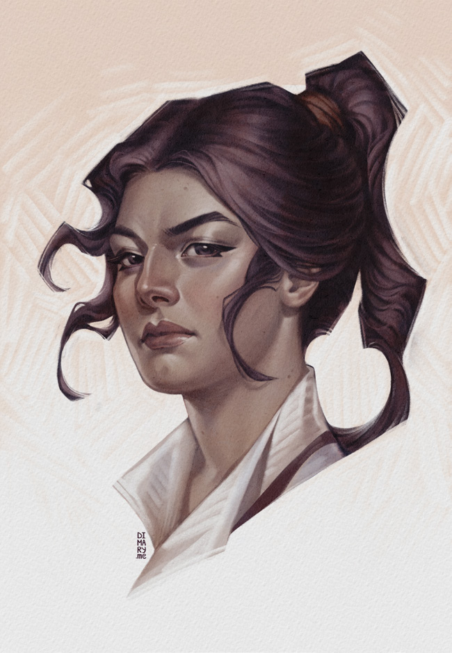
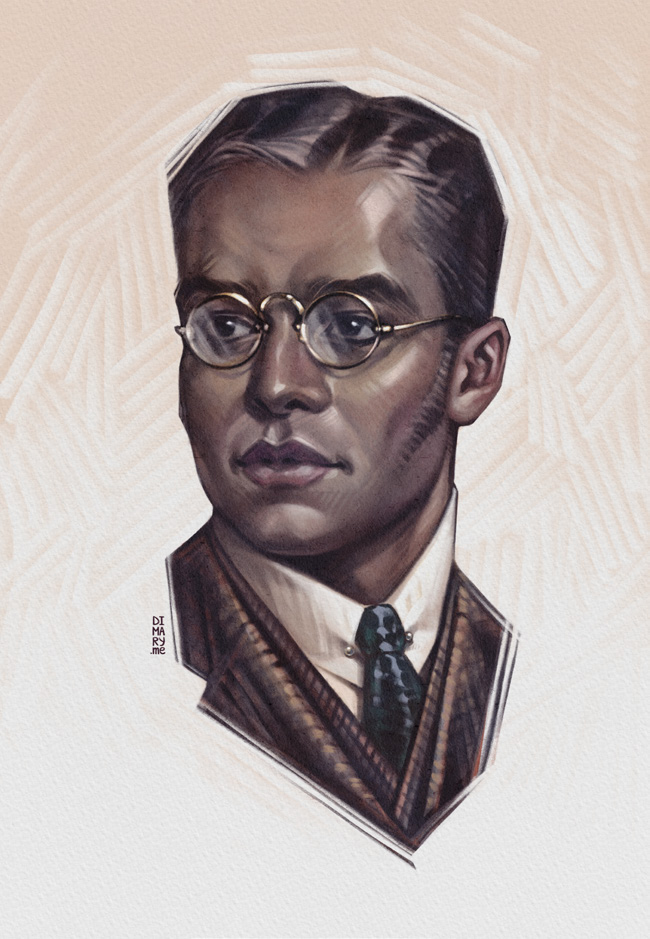
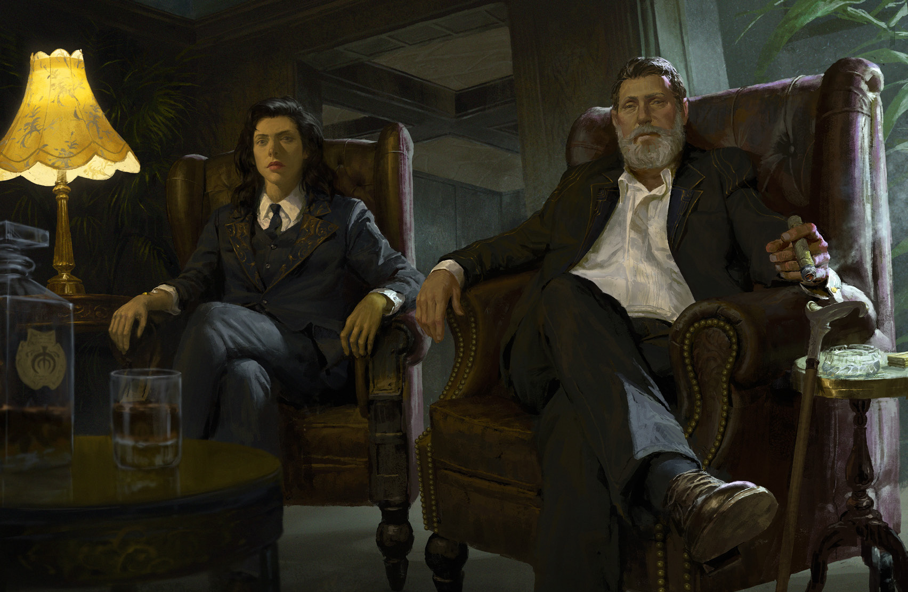

拉奈特（Ranette）是個性情剽悍、富有創意的槍械匠（Gunsmith）。她擅長打造精良的客製武器與量身訂做的小裝置，在客戶和同行之間頗有名氣。她的手藝吸引了一批忠實顧客，瓦希黎恩．拉德利安（Waxillium Ladrian）就是其中一位常客。只要是老實人，願意幫她測試新發明，或帶來有意思的武器讓她拆解研究，她甚至願意替對方下一次購買打折，甚至免收費用。

拉奈特來自蠻橫區（the Roughs），多年前為了讓工坊用上電力而搬到依藍戴（Elendel）。她在第三區（Third Octant）居住和工作。她對比較麻煩的熟人保密工坊的位置，韋恩（Wayne）就是其中之一。結果找上門請她協助調查消賊（Vanishers）一案的，偏偏就是韋恩（見本章後面的〈韋恩〉）。

拉奈特對依藍戴人抱持戒心，受到威脅時也毫不猶豫地動武。她尤其不想讓陌生人發現自己是鐵迷霧人（iron Misting），也就是俗稱的扯手（Lurcher）。為了保護住處的隱私，她甚至雇用煙陣（Smokers）全天遮蔽她家。儘管如此，她最近開始和 Jaxy 交往。拉奈特曾在 Coolerim 劇院（Coolerim Playhouse）外頭把她撞倒。

### 短期目標與獎勵

如果你的戰役（Campaign）有拉奈特登場，個別 PC 可以為她完成短期目標（goal），有機會讓她成為自己的贊助者（Patron），並獲得她提供的贊助者的好處（Patron Benefit）。

#### 贊助者目標（Patron Goals）

拉奈特可能提出下列目標。

**實地測試。** 試用拉奈特的一把原型槍或一件原型裝置，並回報測試結果。

**運送包裹。** 確保拉奈特的一件珍貴作品送到指定收件人手上，也就是她在蠻橫區的一位客戶。

#### 贊助者的好處：拉奈特

拉奈特在第三區自宅的工坊提供贊助者待遇（patron amenities）。工坊是她的藏身處（Hideout），備有軍械庫（Armory）和工作臺（Workbench），見《迷霧之子玩家手冊》（Mistborn Handbook）第 8 章〈藏身處〉。這處藏身處始終受到紅銅雲（Coppercloud）遮蔽，見《迷霧之子玩家手冊》第 6 章〈紅銅鎔金術（Copper Allomancy）〉。有人問起時，她通常會說自己什麼都不知道。

拉奈特也是一位手藝出眾的工匠和槍械匠，能幫隊伍熟悉盆地和蠻橫區的槍械匠圈子。每月一次，只要你能聯絡到她，她就會替你製作殺霧彈（hazekiller rounds），或盡可能按照你的規格設計一把火器（Firearm），見《迷霧之子玩家手冊》第 7 章〈工藝（Crafting）〉。她做出的任何物品都自動帶有兩項改良（Upgrade）或一項進階物品功能（Advanced Item Feature）。你也可以改和 GM 一起設計一項獨特的客製內容。物品何時送達由 GM 裁定。

> 「你早說有帶東西來賄賂我嘛。光憑這個，我說不定就能原諒你了！」

拉奈特有三樣最愛：Jaxy、工坊，還有新作品。

MARIA DIMOVA

第 5 章：盟友與組織 144

## ReLuur（第一時代、第二時代）

ReLuur 是個熱愛探索的三代（Third Generation）坎得拉（kandra）。他以才智和模仿人體的精湛技藝聞名。他一心想探究歷史上鮮為人知的部分，對失落的遺物尤其懷抱浪漫的想像。

ReLuur 的祝福（Blessing）以白鑞（pewter）製成，有別於坎得拉祝福常用的四種金屬。這種極為罕見的彈性的祝福（Blessing of Elasticity）讓 ReLuur 在塑造身體時格外靈活，能用等量材料塑出體積更大或更小的身體。他既能將質量較大的材料壓縮成較小的身體，也能比其他坎得拉用更少的材料塑出較大的身體。

### 契約間諜

第一時代，ReLuur 當了幾個世紀的契約（Contract）間諜，以此換取天金（atium）。他主要承接需要遠赴最後帝國（Final Empire）偏遠地區的委託。

### 追尋傳說

第二時代，ReLuur 迷上了傳說中的悼環（Bands of Mourning）。他花了兩百年追查它的下落，把發現記在素描本上，或用 evanotype 相機（evanotype camera）拍下來。他終於找到悼環所在的君王神殿（Sovereign’s Temple），見第 4 章〈尋找悼環〉。

ReLuur 遭到「組織」（The Set）伏擊，回到家時少了一整條手臂、半邊胸膛，還少了一根祝福尖刺。失去尖刺讓他的心智破碎，難以報告自己的發現。

### 短期目標與獎勵

如果你的戰役有 ReLuur 登場，個別 PC 可以為他完成短期目標，有機會讓他成為自己的贊助者，並獲得他提供的贊助者的好處。

#### 贊助者目標

ReLuur 可能提出下列目標。

**挖出一具屍體。** 在第一時代，取得一名已故行商的屍體，並將遺體帶給 ReLuur，讓他能及時冒充那名商人，搭上一艘開往某個外圍統御區（Outer Dominances）的駁船。

**取回筆記。** 在第二時代，取回 ReLuur 遺留在偏遠地點的筆記。接著幫他解讀他在失去尖刺又取回之後，已經想不起來的研究內容。

#### 贊助者的好處：ReLuur

ReLuur 只能為其他坎得拉提供贊助者待遇。不過，只要你能聯絡到他，事情也符合他的興趣，他就能告訴你怎麼前往一處由你選擇的祕密地點，實際情況由 GM 裁定。ReLuur 協助頻率（ReLuur Aid Frequency）表依你的階層（Tier）列出你能多久請他幫忙一次。

##### ReLuur 協助頻率

| 階層 | 頻率 |
| --- | --- |
| 1 | 每月一次 |
| 2 | 每週一次 |
| 3+ | 不限次數 |

如果你的階層是 2 或更高，ReLuur 也可能替你介紹嚮導，或親自帶路。此時，你可以選擇一項與目的地相關的文化專長（cultural expertise）。在 ReLuur 下次協助你旅行之前，你都視為具備這項專長。

ReLuur 心無旁騖，一頭栽進自己感興趣的事。

MARIA DIMOVA

第 5 章：盟友與組織 145

## 「組織」（第二時代）

「組織」是個透過代理企業和機構行事的祕密集團，負責執行 Trell 的計畫。Trell 是碎力（Shard）自主（Autonomy）的化身，見第 3 章〈司卡德利亞（Scadrial）的碎力〉。「組織」企圖掌控整個依藍戴盆地（Elendel Basin），甚至可能想挑戰和諧（Harmony）。

### 起源

「組織」由一群富裕的貴族創立。他們最初在依藍戴一處名叫 Cardinal 俱樂部（Cardinal Club）的場所聚會。他們注意到鬼血（Ghostbloods）的祕密活動，看出只要獲得超自然存在的支持，就有機會掌握權力。「組織」對更廣大的寰宇（cosmere）一無所知，於是開始尋找和諧以外的古老神祇。黛兒欣．拉德利安（Telsin Ladrian）就是在這段期間首度與自主接觸。

很久以前，自主就把「Trell」植入古典時期的司卡德利亞（Classical Scadrial）的 Nelazan 宗教 Trelagism。這個宗教後來重新興起，演變成「組織」現今的教派 Trellism，見第 3 章〈Trelagism 與 Trellism〉。自主以新教義取代原本的 Nelazan 神話，其中包括關於自主異界軍隊的預言。

### 組織架構

「組織」的領導階層分為六級，分別是 Cycle、Array、Suit、Sequence、Series 和 Key。Key 只有一人，Series 也只有少數幾人。團體內大部分的領導工作由 Sequence 和 Suit 負責，Cycle 則直接監督受雇人員。Array 位於主要指揮體系之外，具有一定的影響力，地位低於 Suit 和 Sequence。

許多「組織」領袖在盆地的權力體系中占有一席之地。他們對 New Seran 和 Bilming 等外圍城市（Outer Cities）握有相當大的控制權，也能影響依藍戴議會（Senate）內的各派勢力。

「組織」以消賊這類犯罪組織作掩護。這些掩護組織只會提供足以讓密探或合作團體完成特定任務的資訊，對「組織」的最終目的隻字不提。

#### Hidden Guard

Hidden Guard 是「組織」的軍事部門，成員穿著醒目的紅色制服。衛隊內有大批金屬之子（Metalborn），其中一些人獲配血金術尖刺（Hemalurgic Spike）。

黛兒欣與愛德溫．拉德利安（Edwarn Ladrian）是「組織」的支柱。

WHITE HORN

### 異界勢力

自主假扮成 Trell，是「組織」真正的幕後掌權者。自主想在司卡德利亞建立自己的勢力，與和諧身為這顆星球唯一碎力而享有的至高權威抗衡。近年來，自主的影響力已籠罩整顆星球，她也開始試探和諧的防禦。第 3 章有更多關於自主的資訊。

#### 最終金屬的持有者（Bearers of the Final Metal）

所謂的「金紅之人（men of gold and red）」是自主麾下的一支軍隊。Trellism信徒（Trellist）的預言稱他們為「最終金屬的持有者」和「毀滅者」，說他們終將統治司卡德利亞。

自主的異界軍隊中，士兵皮膚呈金色，雙眼發出紅光，帶著一股非人的氣質，彷彿活過來的雕像。他們手持先進火器，難以控制，放任他們出動相當危險。

### 黑暗陰謀

「組織」起初不清楚 Trell 的真實身分或意圖。成員只想重拾古代迷霧人與迷霧之子（Mistborn）的力量。「組織」的計畫延續了好幾代，遠超過任何個別成員的壽命。為達目的，他們採取了駭人的極端手段，包括人口販運、優生學，以及在未同意的受害者身上進行血金術（Hemalurgy）實驗。這些計畫如何發展，詳見第 4 章〈Trell 的崛起〉。

#### 消賊（The Vanishers）

「組織」熱衷於操控鎔金術（Allomancy）的血脈，目的就是培育出具有迷霧人能力的孩子。為此，他們綁架已知的鎔金術師（Allomancer），也綁架家族中曾出過許多鎔金術師的人。名為消賊的幫派在檯面上為這些罪行打掩護。消賊接連犯下多起引人注目的搶案，主要鎖定載著貴重貨物進出依藍戴的火車，以掩蓋「組織」真正的行動。

#### Community

消賊綁架的許多受害者都被帶到一處名叫 Wayfarer 的地下聚落，藏在 Bilming 市地底深處。「組織」讓囚犯相信，全球發生了一場浩劫，他們是僅存的倖存者。

#### 血金術實驗

在自主和叛離族群的坎得拉索血者（Bleeder）的指導下，「組織」開始對血金術這門金屬技藝（Metallic Arts）進行實驗。許多遭消賊綁架的無辜金屬之子成了這些實驗的受害者。

#### Harmonium 實驗

「組織」目前正在開發武器，以配合自主征服司卡德利亞的計畫。他們在 Bilming 市進行實驗，並以地下工程掩護武器測試，見第 4 章〈武器化的 Harmonium〉。

### 知名成員

「組織」成員的生活充斥著欺瞞、鬥爭和對金屬技藝的操弄。以下是幾位值得注意的現任及前任成員。

#### 黛兒欣．拉德利安

從有記憶以來，黛兒欣．拉德利安就把自己的目標擺在第一位。無論朋友、家人，還是對手段的任何顧慮，都得排在目標之後。她年輕時常在依藍戴的權貴之間周旋，野心自然讓她發現了當時剛起步的「組織」。黛兒欣加入後，拉攏叔叔愛德溫．拉德利安入夥，確保自己有足夠的資金施展抱負。與 Trell 接觸後，她迅速在「組織」內晉升。

黛兒欣的雙親死於一場馬車事故，她認為那是和諧的密探蓄意發動的攻擊，真正的目標是她。於是她和愛德溫假死後躲了起來。兄弟瓦希黎恩被指定為繼承人時，黛兒欣起初並不在意，見本章後面的〈瓦希黎恩．拉德利安〉。然而，他的歸來為「組織」帶來災難。他的介入最終讓「組織」失去了悼環，見第 4 章〈尋找悼環〉。

君王神殿的慘敗之後，黛兒欣重新集結支持者，把責任推給叔叔愛德溫，繼續追求自己的目標。最近，她升上新設立的 Key 階級，成為「組織」Series 委員會無可爭議的領袖。黛兒欣透過血金術並視需要更換尖刺，曾使用鋼鎔金術（Steel Allomancy）、鉻鎔金術（Chromium Allomancy）和鐵鎔金術（Iron Allomancy），以及金藏金術（Gold Feruchemy）和錫藏金術（Tin Feruchemy）。她如今致力於全面掌控司卡德利亞，自主對她的作為頗為賞識。

第 5 章：盟友與組織 147

#### 愛德溫．拉德利安

愛德溫是拉德利安家族（House Ladrian）的第十五任大領主，在上流社會（High Society）出了名的深居簡出。人們以為他對家族經營不善，其實他忠於「組織」，把自己的財富挹注到「組織」裡。兒子兼繼承人 Hinston 病逝後，愛德溫變得更加離群索居，表面上是因為傷心過度。

愛德溫與妻子 Hildred 和姪女黛兒欣在一場馬車事故中假死，也就此結束他領導拉德利安家族的日子。此後，他以 Suit 先生（Mr. Suit）為代號，全心投入「組織」的陰謀。愛德溫資助消賊和 Community，並透過血金術獲得鋼鎔金術、鉻鎔金術和金藏金術。

Hildred．拉德利安（Hildred Ladrian）不願捲入「組織」的陰謀，便退居 Bilming，過著平靜的日子，悼念亡子。愛德溫則在未能取得悼環後，最終死於依藍戴警署（Elendel Constabulary）的拘押期間。

#### Dumad 與 Getruda

Dumad 和 Getruda 是一對裝有血金術尖刺的密探。他們受過專門訓練，要對付瓦（Wax）和韋恩，見本章後面的〈瓦希黎恩．拉德利安〉和〈韋恩〉。Dumad 專注沉著，能運用鋼、硬鋁、白鑞、鉻和青銅的鎔金術能力。Getruda 和韋恩一樣，會使用彎管合金鎔金術和金藏金術。Getruda 好勝又短視，連韋恩的個性也想一併模仿。

#### 「百命」邁爾斯．達古特（Miles “Hundredlives” Dagouter）

邁爾斯曾任「組織」的 Cycle，是消賊的領導者之一，也是虔誠皈依 Trellism 的信徒。他是能用金施展複合術（Compounding）的雙生師（Twinborn）。他直接聽命於愛德溫，手下包括克羅司混血（koloss-blooded）的白鑞臂（Pewterarm）塔森（Tarson）。只要有足夠的金，邁爾斯的自癒能力幾乎沒有極限。

邁爾斯曾是個手段冷酷的執法者（Lawkeeper），逐漸對盆地及其冷漠對待蠻橫區的態度心生怨恨。最後，依藍戴警署因他犯下的罪行將他處決。

### 短期目標與獎勵

「組織」在第二時代的戰役中往往扮演重要角色，通常以敵對勢力登場。不過，個別 PC 可能想加入「組織」一方。這些 PC 可以為「組織」完成短期目標，有機會讓它成為自己的贊助者，並獲得它提供的贊助者的好處。

#### 贊助者目標

對於願意冒險與「組織」扯上關係的 PC，「組織」可能提出下列目標。

**破壞與支配。** 完成一項破壞或欺瞞任務，例如影響一名依藍戴議員的投票、在財務上摧毀「組織」的一名對手，或讓某座貴族莊園外的守衛無法阻撓行動。你多半無法完全明白自己為何得完成這項任務。

#### 贊助者的好處：「組織」

「組織」除了在依藍戴盆地各處提供贊助者待遇，有些公開合法，有些則私下提供，也在暗中握有相當大的影響力。身處依藍戴盆地時，你可以借助其贊助，在某些檢定（Test）中獲取優勢（Gain Advantage），如「組織」贊助者優勢（Set Patron Advantages）表所示。然而，每當你搬出「組織」的名號，GM 都可能花費 [變故] 來引入各種挑戰，因為和諧的密探可能發現你與「組織」的關係。

此外，若你的階層是 2 或更高，並為「組織」完成後續短期目標，「組織」也可能用血金術強化你。完成它的第二個贊助者目標後，你獲得血金術專長（Hemalurgy expertise），並由「組織」替你植入一根自選的血金術尖刺，見《迷霧之子玩家手冊》第 6 章〈血金術〉。為「組織」完成更多短期目標後，你最多可植入 3 根尖刺，前提是這些尖刺的階層總和不得超過你的階層。

下次與「組織」的接頭人見面時，你可以將任意數量由「組織」為你植入的尖刺換成自選的新尖刺，仍須遵守相同限制。

##### 「組織」贊助者優勢

| 階層 | 檢定 | 加成 |
| --- | --- | --- |
| 1 | 威嚇（Intimidation） | 一個優勢 |
| 2 | 欺騙（Deception）、威嚇 | 一個優勢 |
| 3 | 欺騙、威嚇、說服（Persuasion） | 兩個優勢 |
| 4+ | 欺騙、威嚇、領導（Leadership）、說服 | 兩個優勢 |

第 5 章：盟友與組織 148
