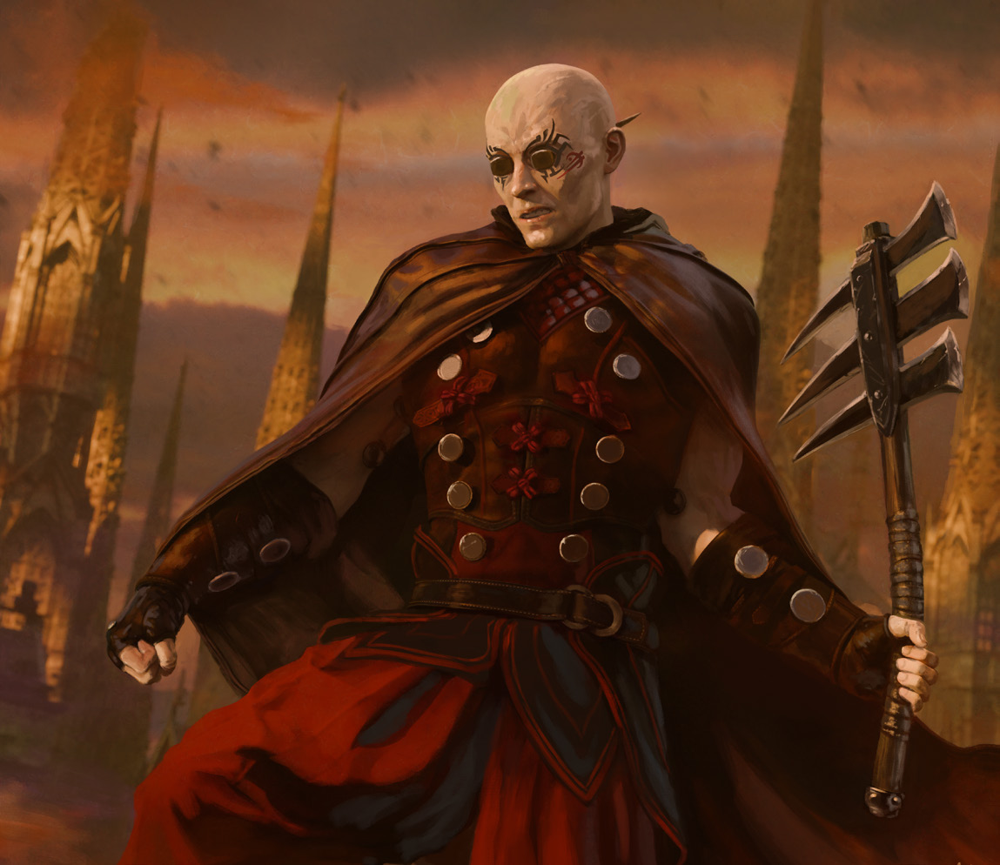

統御主（Lord Ruler）昇華後（見第 4 章〈統御主的昇華〉），先將自己的朋友變成霧魅（mistwraith），再用血金術（Hemalurgy）把他們變成不死的坎得拉（kandra，見第 2 章〈坎得拉〉）。他們成了坎得拉一族的初代（First Generation）。

### 家園的文化

坎得拉每隔一百年就會向統御主索取新的血金術尖刺（Hemalurgic Spike），以創造新一代。坎得拉一族與世隔絕，各個世代的區別很大程度上形塑了他們對自身身分的認同。

落灰之終（Catacendre）前，坎得拉的十一個世代全都住在坎得拉家園（Kandra Homeland）。只有與人類締結坎得拉契約（Contract）時，他們才獲准離開家園，憑精湛的模仿技巧以模仿者及間諜身分為人類效力，以換取天金（atium）。如需更多坎得拉家園的資訊，請見第 6 章〈海司辛深坑（Pits of Hathsin）〉。

落灰之終後，坎得拉契約依然是重要的傳統，但坎得拉已不再受契約條款約束。他們可以自由行動，不再受人類奴役，也不再被禁止傷害人類，不過這種行為並不受鼓勵。如需更多契約資訊，請見第 2 章〈坎得拉契約〉。

### 文化演變

第二時代（Era 2），坎得拉為和諧（Harmony）擔任間諜與密探。依藍戴盆地（Elendel Basin）的居民稱他們為無面不朽者（Faceless Immortals），許多人將他們視為神聖的使者而敬重。除了替和諧辦事，大多數坎得拉過著平凡的生活，追求自己的興趣，也與外界往來。

### 短期目標與獎勵

如果你在戰役（campaign）中使用坎得拉，替他們完成短期目標（goal）的個別玩家角色（PC）可能獲得他們的贊助，並因此取得贊助者的好處（Patron Benefit）。

#### 贊助者的短期目標

坎得拉可能提出下列短期目標：

- **遵守約定（Maintain the Deal）。** 證明你能履行協議或約定中自己應盡的義務，包括遵守對方要求的界線，即使履約有困難或得付出代價也一樣。

- **駭人的禮物（Ghastly Gift）。** 把某種有趣生物或重要歷史人物的骨骸交給他們，為他們增添收藏。

#### 贊助者的好處：坎得拉

坎得拉通常只能為其他坎得拉提供一般的贊助者待遇（patron amenities）。不過，這些古老的變形者還記得許多往事，知道最後帝國（Final Empire）的許多祕密。如果你能聯絡上坎得拉，他們可能會告訴你早已從歷史中抹去的消息，或透露特定人物的祕密。你也可以改給他們一顆天金珠，請他們在一場任務期間冒充你指定的人。你還必須提供你想讓他們模仿的那個人的骨骸。如果要讓冒充看起來可信，你還必須描述對方的性情與舉止。

你要等多久才能收到情報或等到冒充者，由 GM 裁定。你能請求協助的頻率取決於階層（Tier），詳見「坎得拉贊助頻率」表。

## 坎得拉贊助頻率

| 階層 | 頻率 |
| --- | --- |
| 1 | 每月一次 |
| 2 | 每週一次 |
| 3+ | 不限 |

> 「你以為我們是什麼？」坦迅（TenSoon）問。「那些搞叛亂、鬧動亂的人類嗎？我們是坎得拉。我們屬於存留（Preservation）。我們遵循秩序。」

第 5 章：盟友與組織 125

## 沼澤（Marsh）｜第一時代（Era 1）、第二時代

沼澤又稱鐵眼（Ironeyes），是青銅迷霧人（Misting，俗稱搜尋者〔Seeker〕）。他性情剛毅，對鋼鐵教廷（Steel Ministry）懷有強烈恨意，認為是教廷害他失去了母親。他和兄弟卡西爾（Kelsier）從小就被當作貴族養大（見本章前文〈卡西爾與他的團隊〉）。他和卡西爾一樣愛慕梅兒（Mare），卻從未表露心意。沼澤領導司卡（skaa）叛軍多年，但梅兒被送進海司辛深坑後，他便離開了叛軍。

卡西爾從深坑回來時，已經有了推翻帝國的計畫。沼澤埋怨卡西爾害他失去梅兒，也不滿他為達成自己的目的，毫不在乎地利用司卡叛軍。他記得卡西爾年輕時是個莽撞的竊賊，不相信卡西爾有所改變，但仍勉強加入了他的團隊。

沼澤潛入鋼鐵教廷，查出教廷在陸沙德（Luthadel）各處的行動與資源。有一陣子，團隊以為沼澤身分敗露，已受刑而死，後來才知道他被變成了鋼鐵審判者（Steel Inquisitor）。紋（Vin）攻擊統御主時，沼澤發揮了關鍵作用。

#### 最後帝國覆亡後

統御主死後，沼澤受到滅絕（Ruin）的影響，成了這股碎力（Shard）的工具，替它推進計畫。他一面努力抵抗絕望，一面耐心尋找破壞滅絕計畫的機會。這段期間，滅絕給了沼澤更多血金術尖刺，使他在原有的鎔金能力（Allomantic Powers）之外，也獲得了藏金能力（Feruchemical Power）。

沼澤身上的血金術尖刺雖然讓他在實體、意志和靈魂上都付出代價，卻也維繫了他的性命。他因此活過落灰之終，在第二時代仍活躍了很長一段時間，有時也擔任和諧的密探。盆地居民稱他為鐵眼，他最終成了死亡的化身。和諧偶爾會賦予他力量，讓他在靈魂前往彼瑞（Beyond）之前迎接他們。若想知道第二時代的碎刺教信徒（Sliverist）如何看待沼澤，請見第 3 章〈碎刺教（Sliverism）〉。

### 短期目標與獎勵

如果你在戰役中使用沼澤，替他完成短期目標的個別玩家角色可能獲得他的贊助，並因此取得贊助者的好處。

#### 贊助者的短期目標

沼澤可能提出下列短期目標：

- **證明你的用意（Prove Your Intentions）。** 幫助處境不利或受到壓迫的群體推動其訴求，過程中不為自己謀取任何好處。

#### 贊助者的好處：沼澤

沼澤無法提供一般的贊助者待遇，但可以提供有關鋼鐵教廷的各種情報。每週一次，只要你能聯絡上他，而且提供情報符合他的利益，他就會透露鋼鐵教廷或統御主正在策劃什麼，指點你如何在下一場任務中避開他們的注意，或提供守備鬆散的補給品情報。情報要多久才能送到，由 GM 裁定。

此外，沼澤也能擔任青銅鎔金術（Bronze Allomancy）導師（mentor，見本章開頭〈贊助者與導師〉）。

DAVID ASTRUGA

身為審判者的沼澤。

126

