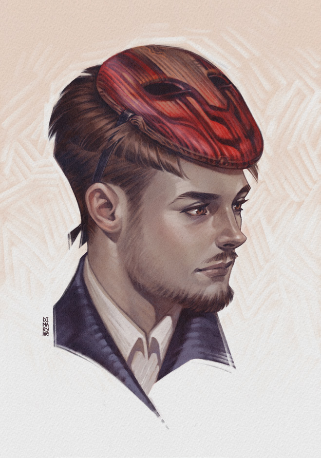
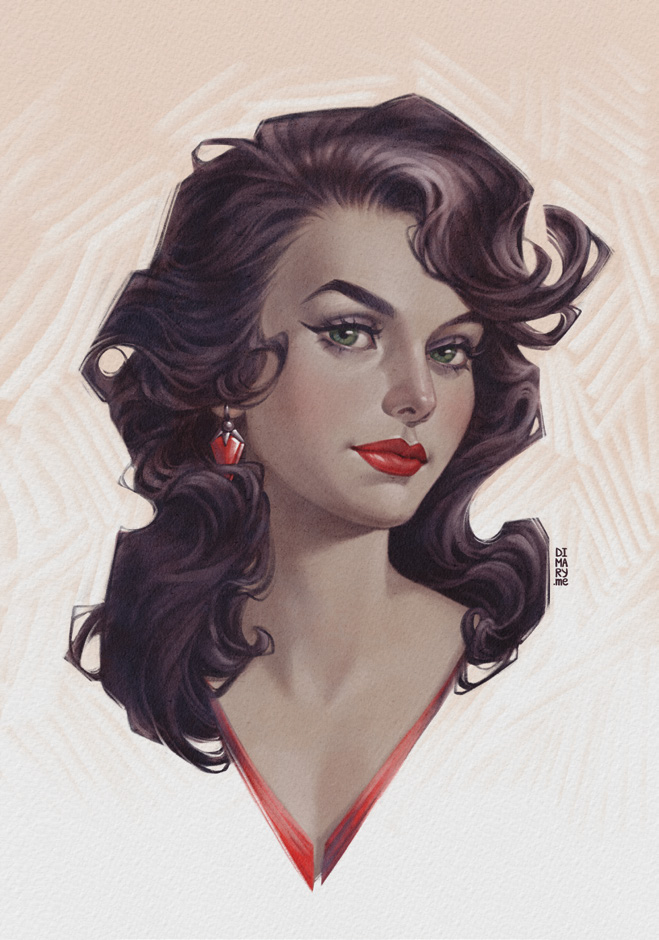

**第二時代**

君王神殿（Sovereign’s Temple）的事件過後（見第 4 章「尋找悼環」），Malwish 人在南方大陸（Southern Continent）的五個獨立國家之中崛起。南方各國愈來愈擔心北方可能發動侵略，Malwish 正藉此推動南方各國團結，平息過去激烈的對立。

### 金屬技藝與科技

Malwish 的金屬之子（Metalborn）相對較少，但他們發明了能讓更多人運用金屬技藝（Metallic Arts）的裝置，彌補了這項不足。為了維持技術優勢，他們嚴守製造未封存金屬意識庫（unsealed metalminds）的祕密，也管制 ettmetal 的交易。他們最了不起的成就，是造出了以鎔金術（Allomancy）驅動的浮空船（airships），帶來許多經濟和戰術上的優勢。更多 Malwish 科技的資訊，見第 1 章「科學與科技」。

### 知名公民

Malwish 社會對什麼舉止才算得體有嚴格的規範，但每個人遵循傳統的方式各不相同。以下兩位知名公民就是例子。

#### Allik Neverfar

Brunstell 號浮空船墜毀後，瑪拉席．科姆斯（Marasi Colms）救了 Allik Neverfar。這是南、北司卡德利亞（Scadrial）最早的幾次接觸之一。瑪拉席和 Allik 後來成了戀人。Allik 現在是派駐盆地的「初級親善大使」，這個職務主要是禮儀性的。他個性隨和，做得一手好糕點。

#### Daal the Primary

海軍上將 Daal the Primary 是廣受敬重的軍事領袖。Daal 為人嚴厲，遇到能推進自己或國家目標的機會，就會立即把握。他正準備在北方局勢需要更強硬的手腕時，接替現任駐依藍戴盆地（Elendel Basin）大使。

### 短期目標與獎勵

如果你在戰役中採用 Malwish，個別 PC 為他們完成短期目標（goals）後，就有機會獲得他們的贊助，並取得贊助者的好處（patron benefit）。

#### 贊助者目標

Malwish 可能會提出以下短期目標。

**保護商業機密。** 追查竊取 Malwish 技術的間諜，取回失竊的物品。

**救援浮空船船員。** 找到一艘失蹤浮空船的倖存者，並把他們救出來。

> 「所以啊……」Allik 說。「他動手的時候，我們最好都去隔壁，離得遠遠的，對吧？」
>
> 「對啊。」瑪拉席表示同意。

Allik Neverfar 習慣興高采烈地掀起面具。

MARIA DIMOVA

第 5 章：盟友與組織 140

#### 贊助者的好處：Malwish

除了在南司卡德利亞（Southern Scadrial）各地和北方的大使館提供贊助者待遇（patron amenities），Malwish 還可能用浮空船載你前往你選定的地點。只要你聯絡得到一位 Malwish 大使或指揮官，對方就能派一艘浮空船載你們橫越司卡德利亞。船方若知道要安全進入某處險境或敵方領地，必須進行敏捷（Agility）或隱匿（Stealth）檢定，就不會載你們進去。浮空船要多久才會抵達並提供協助，由 GM 決定。你能依自己的階層（tier），參照「飛船飛行頻率」表查看多久能請求一次這項協助。

##### 飛船飛行頻率

| 階層 | 頻率 |
| --- | --- |
| 1 | 每年一次 |
| 2 | 每月一次 |
| 3 | 每週一次 |
| 4+ | 不限次數 |

此外，經 GM 裁定，Malwish 可以贈送或出借司卡德利亞南方的科技造物給你，例如鎔金手榴彈（Allomantic grenades）或一枚藏金術徽章（Feruchemical medallion）（見《迷霧之子玩家手冊》第 8 章「稀有造物」）。下次見到 Malwish 代表時，你可以用這件物品換一件新的。Malwish 無法提供僅限更高階層角色取得的物品。

## 瑪拉席．科姆斯（第二時代）

瑪拉席．科姆斯是依藍戴第四分區警局（Fourth Octant Constabulary）的新秀，或許也是最積極追查「組織」（The Set）的警員（見本章後文「組織」）。瑪拉席受過良好的教育，對統計尤其感興趣。從執法到都市規劃，她都想運用統計加以改善。

瑪拉席是 Jackstom 哈姆司爵爺（Lord Jackstom Harms）的私生女。為了讓家人和她相處時自在些，她刻意表現得羞怯膽小。她嚮往瓦希黎恩．拉德利安（Waxillium Ladrian）等蠻橫區執法者（Roughs lawkeepers）的冒險經歷（見本章後文「瓦希黎恩．拉德利安」），也喜歡城市的奢華生活。她在一個男性占多數的行業工作，卻不覺得自己有必要因此犧牲女性氣質。

瑪拉席和瓦希黎恩、韋恩（Wayne）幾次合作都有成果（見本章後文「韋恩」），證明自己本身就是個有本事的調查員。她始終擔心「組織」威脅依藍戴，因此一直留心這個行蹤難測的團體。她希望一次關鍵的逮捕，藉此查出「組織」及其神祕靠山 Trell 對司卡德利亞有什麼計畫。

> 「為什麼那些心胸狹窄的人，偏要毀掉自己明知比他們更好、更偉大的事物？」
>
> ——瑪拉席．科姆斯

瑪拉席．科姆斯有本事、有抱負，也有決心為依藍戴盆地成就大事。

MARIA DIMOVA

第 5 章：盟友與組織 141

### 從大學到警局

瑪拉席在依藍戴大學（University of Elendel）受過完整的教育，從簡單的外科手術，到古泰瑞司語（Ancient Terris）和上皇族語（High Imperial）等古代語言，她都學過。她專攻司法和犯罪統計，原本是為了照母親的期望成為律師。她短暫當過事務律師，但真正讓她投入的是警員需要親自到現場處理事情的工作。

從大學到警局，瑪拉席能接觸到許多資訊來源，也很擅長彙整大量資料，找出有助於釐清案情的趨勢。她受過現代偵訊技巧的訓練，能激得對方滔滔不絕，直到自己露出說謊的破綻。她有時會和警局同僚起衝突，因為她不肯讓他們侵犯嫌疑人的權利。

### 正義的脈動

瑪拉席是鎘迷霧人（cadmium Misting），俗稱脈動（Pulser）。她能創造速度圈（speed bubble），讓自己和周圍的人經歷的時間變慢。她曾覺得自己的能力太受限，為此感到難為情，如今已經放下這種想法，懂得欣賞自己的天賦。

瑪拉席擅長使用警局配發的制式手槍，也喜歡鑽研步槍射靶。她在大學時加入射擊社，在和市內其他社團的射擊比賽中屢獲佳績。

### 珍貴的關係

瑪拉席雖是私生女，仍和同父異母的姊姊史特芮絲一起努力，慢慢建立起自在的相處關係（見後文「史特芮絲．拉德利安」一節）。瑪拉席曾迷戀瓦希黎恩．拉德利安，如今兩人彼此敬重，攜手對抗「組織」帶來的威脅。瓦忙於家庭和政治事務，瑪拉席便帶頭追查「組織」，經常和新任依藍戴外勤警員韋恩一起辦案。

瑪拉席在尋找悼環（Bands of Mourning）時遇見了 Malwish 飛行員 Allik Neverfar。Allik 在依藍戴安頓下來、打算長住之後，兩人就一直穩定交往。

### 短期目標與獎勵

如果你在戰役中採用瑪拉席，個別 PC 為她完成短期目標後，就有機會獲得她的贊助，並取得贊助者的好處。

#### 贊助者目標

瑪拉席可能會提出以下短期目標。

**調查 Trell。** 找出「組織」活動的頭緒（leads）並回報，協助布置誘捕行動。

**保護依藍戴。** 維護市內治安。追查一名難以捉摸的竊賊、揭發貪腐的政客，或協助瓦解一個犯罪集團。

#### 贊助者的好處：瑪拉席．科姆斯

除了在依藍戴盆地內有警力進駐的地區提供贊助者待遇，經 GM 裁定，瑪拉席也能贈送或出借警局配發的物品給你，例如：

- 非特殊的火器、其他武器和護甲。
- 警用裝備，包括可抵禦情緒鎔金術的鋁襯帽（aluminum-lined hats）、指虎（knucklebones）、放大鏡（magnifying lenses）或鐐銬（manacles）。
- 注入鎘鎔金術（Cadmium Allomancy）的鎔金手榴彈（見《迷霧之子玩家手冊》第 8 章「稀有造物」）。

你同時能持有的瑪拉席提供的物品件數，上限等於你的階層。你可以多次索取同一種物品，包括鎔金手榴彈。下次見到瑪拉席時，你可以把這些物品換成其他物品，也可以請她為用過的鎔金手榴彈重新充能。瑪拉席無法提供僅限更高階層角色取得的物品。

此外，瑪拉席也可以擔任你的鎘鎔金術導師（mentor）（見本章開頭「贊助者與導師」）。

第 5 章：盟友與組織 142

## MeLaan（第一時代、第二時代）

MeLaan 是七代（Seventh Generation）坎得拉（kandra），由三代（Third Generation）坎得拉坦迅（TenSoon）撫養並指導。MeLaan 個性獨立，喜歡逗弄同伴，有時還會和他們調情。她的幽默常帶點陰森，以人類的標準來看尤其如此。她擁有穩定的祝福（Blessing of Stability），因而更能承受情緒上的衝擊，也更清楚自己是誰。

MeLaan 會在陽剛、陰柔和中性的外貌之間切換。比起人類的骨骼，她更喜歡人造的真體（True Bodies），也就是特徵刻意誇張的人形骨架。她最喜歡的真體之一是鋁製的，還內藏武器。

### 叛逆的年少時光

第一時代時，年輕的 MeLaan 帶領一小群年輕的坎得拉。他們用古怪的真體挑戰坎得拉對得體舉止的界線。MeLaan 鼓勵導師坦迅反抗坎得拉領袖，後來還為了幫他而違反坎得拉的法律。

### 和諧的密探

到了第二時代，MeLaan 成了和諧（Harmony）的密探，目前與瓦希黎恩．拉德利安、瑪拉席．科姆斯和韋恩共事。MeLaan 原本常和韋恩調情，兩人最近發展出了戀情（見本章後文「韋恩」一節）。不過，MeLaan 不確定這段感情能維持多久，因為和諧可能很快就會派她去另一個世界執行新任務。

### 短期目標與獎勵

如果你在戰役中採用 MeLaan，個別 PC 為她完成短期目標後，就有機會獲得她的贊助，並取得贊助者的好處。

#### 贊助者目標

MeLaan 可能會提出以下短期目標。

**找出毒素。** 潛入一群隸屬「組織」的竊賊之中，取回一種遭竊、能使坎得拉失去行動能力的物質。

**取回遭竊的物品。** 追查向 MeLaan 借走一具真體的坎得拉，取回骨頭，最好別弄壞骨架。

#### 贊助者的好處：MeLaan

MeLaan 只能為其他坎得拉提供贊助者待遇，但她能為任何 PC 提供服務。例如，她可以潛入禁止進入的場所，像是貴族堡壘（第一時代）或警局辦公室（第二時代），取回特定物品或情報。如果她認為風險太高，或請求有違第一時代坎得拉的利益或第二時代和諧的利益，就可能拒絕。

如果你的階層為 3 或更高，且任務符合 MeLaan 的利益，她可能會以臨時夥伴（temporary companion）的身分加入 PC 的隊伍，直到任務結束。第二時代的 MeLaan 不遵循源自初約（First Contract）的傳統，也是少數擅長戰鬥的坎得拉之一。MeLaan 使用第 8 章的坎得拉間諜（kandra spy）資料區塊，但她的力量（Strength）和速度（Speed）各增加 1，每項實體技能各增加 2，生命值（health）增加 10。

MeLaan 對坎得拉和人類文化的社交規矩都不屑一顧。

MARIA DIMOVA

第 5 章：盟友與組織 143

