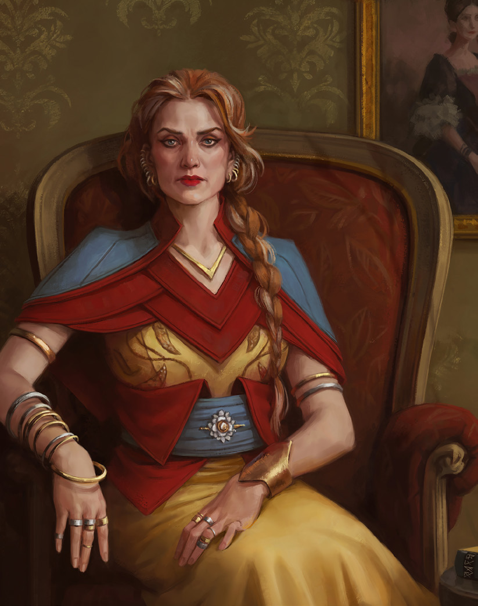
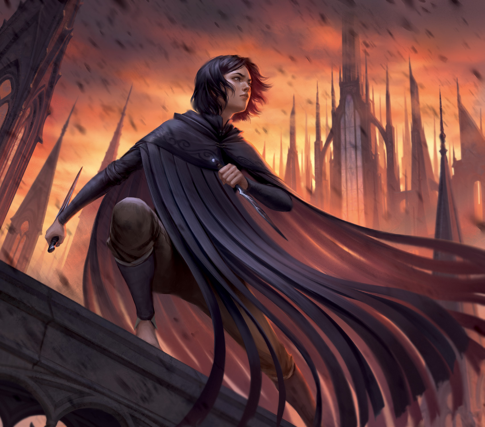
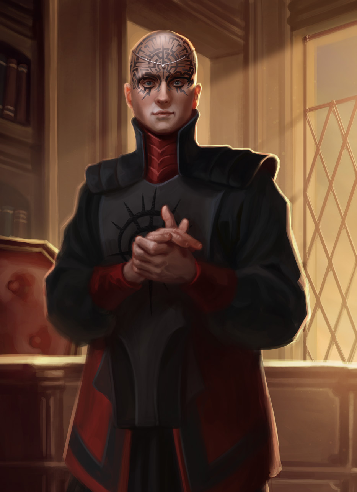

廷朵（Tindwyl）是學者、教師，也是泰瑞司（Terris）的守護者（Keeper）。她的學識來自嚴謹的研究。她自信、閱歷豐富，有話就直說，尤其談到自己熟悉的領域時更是如此。

廷朵在統御主（Lord Ruler）的育種計畫（Breeding Program）中被迫扮演泰瑞司母親的角色。那段期間，她研讀歷史人物的傳記，這些傳記存放在一組祕藏的紅銅意識（copperminds）裡。她決心讓這些人的故事在最後帝國（Final Empire）的壓迫下流傳下去。她在計畫中熬過三十年後，成了席諾德（Synod）的一員。外人常覺得她是個冷酷的現實主義者，其實她待人寬厚，也很會看人。她認為這是自己養育過許多孩子累積下來的經驗。

最後帝國覆滅後，廷朵前往陸沙德（Luthadel），和老朋友沙賽德（Sazed）重逢。兩人同為守護者，彼此敬重，也深愛著對方。她還成了國王依藍德．泛圖爾（Elend Venture）的導師，指導他如何領導，對他能否當好國王起了關鍵作用。（本章前面的「沙賽德」與「依藍德．泛圖爾」兩節有更多關於這兩位人物的介紹。）

陸沙德之戰（Battle of Luthadel）期間，廷朵為守城抵禦克羅司（koloss）的進攻而犧牲。

### 短期目標與獎勵

如果你的戰役（campaign）有廷朵登場，個別玩家角色（PC）完成她交付的短期目標（goals）後，就有機會讓她成為自己的贊助者（patron），並獲得她提供的贊助者的好處（patron benefit）。

#### 贊助者的短期目標

廷朵可能提出以下這類短期目標：

- **尋找失落的知識。** 找回因最後帝國而失傳、或遭帝國壓制的知識，尤其是與歷史上引人注目的統治者和領袖有關的資料。這些知識可以有實際用途，也可以純供學術研究。

#### 贊助者的好處：廷朵

最後帝國覆滅後，廷朵能在泰瑞司統御區（Terris Dominance）提供贊助者待遇（patron amenities）。她也能告訴你歷史人物的事蹟，或協助你研究文物和史料。此外，當你試圖影響一名身居領導地位的角色時，可以回想廷朵教過的內容，在各種檢定（test）中獲得優勢（advantage）。適用的檢定與優勢數量取決於你的階層（tier），詳見「廷朵提供的贊助者優勢」表。廷朵的課主要講歷史人物，內容未必完全適用於當代。因此，GM 可以花費這些檢定產生的[變故]來引入各種難題。

**廷朵提供的贊助者優勢**
| 階層 | 檢定 | 加成 |
| --- | --- | --- |
| 1 | 學識（Lore） | 一個優勢 |
| 2 | 領導（Leadership）、學識 | 一個優勢 |
| 3 | 推理（Deduction）、領導、學識 | 兩個優勢 |
| 4+ | 推理、領導、學識、說服（Persuasion） | 兩個優勢 |

此外，廷朵也可以擔任紅銅藏金術（Copper Feruchemy）或錫藏金術（Tin Feruchemy）的導師（mentor）。見本章開頭的「贊助者與導師」。

> 別問問題，想說什麼就直說。你要是反對，就明說你反對，別讓我來猜你話裡的意思。

廷朵，研究歷代領袖的學者。

SVETLANA KOSTINA

第 5 章：盟友與組織 132

## 第一時代的紋

紋（Vin）幾乎不記得自己的司卡（skaa）母親，也直到很久以後才知道父親是泰維迪安．太齊爾（Tevidian Tekiel）。她在最後帝國的盜賊團夥中長大，一無所有，也無力左右自己的命運。她看人總帶著幾分懷疑，務實又善於應變，很小就學會時刻保持警覺。她尤其擅長看透表象，抓住事情的核心。

紋混入貴族社交圈時，發現自己喜歡優雅的打扮和舞會禮服，也開始明白活著還可以追求別的事。她殺死統御主後，被眾人奉為宗教人物，這個身分讓她很不自在。成為新帝國（New Empire）的女皇後，紋學會珍視迷霧披風（mistcloak）和禮服，兩者都展現了她的一部分。滅絕（Ruin）操弄了她一輩子，但最後她親手掌握力量和選擇權，成為司卡德利亞（Scadrial）需要的英雄。

### 迷霧之子（Mistborn）

沼澤（Marsh）在司卡盜賊團夥中發現了紋，卡西爾（Kelsier）則招募了她。見本章前面的「卡西爾與他的團隊」。紋起初不知道自己會鎔金術（Allomancy）。雖然她對卡西爾的動機存疑，還是接受了他的指導和訓練。她逐漸認同卡西爾所看重的友誼、信任與群體歸屬，卻沒有承襲他對貴族的偏見。

紋全心扮演來自鄉間的貴族女子法蕾特．雷弩（Valette Renoux），用心學習，想證明自己能幫上團隊。她過去總是想方設法避人耳目，但在學著扮演法蕾特的過程中，她發現自己可以選擇要成為怎樣的人。她在舞會上結識依藍德．泛圖爾，開始主動追求他。見本章前面的「依藍德．泛圖爾」。

卡西爾遇害後，紋接受了她認為卡西爾真正要她擔任的角色：刺客。她在克雷迪克．霄（Kredik Shaw）與統御主正面交鋒，殺了他，結束暴君長達千年的統治。

### 燃燒殆盡

統御主死後，紋在依藍德的王位背後，以迷霧之子的身分威懾對手，但她總覺得自己做得不夠，也對自己缺乏信心。與此同時，依藍德那位身分成謎的同父異母兄弟詹．泛圖爾（Zane Venture），誘使紋去探索自己的暴力衝動。見本章前面的「泛圖爾家族：史特拉夫與詹」。受詹影響，紋最後看清了自己的心意。依藍德是她想要的人，也是她需要的人。

紋在巡邏以外的時間沉迷於艾蘭迪（Alendi）的日誌。見第 4 章「永世英雄艾蘭迪」。她不知道日誌已遭滅絕竄改，循著其中的預言來到昇華之井（Well of Ascension）。為了證明自己是真正的永世英雄（Hero of Ages），她取得了存留（Preservation）的力量，又放棄了這股力量。這個決定看似讓她付出了慘重的代價，卻在無意間放出了滅絕。見第 4 章「昇華之井」。

### 女皇與持有者

紋接受了自己在這個即將毀滅的世界中肩負的領導責任。她汲取司卡德利亞的迷霧，也就是存留的授予（Investiture）呈氣態時的樣貌，並昇華（Ascend）為存留的新任持有者（Vessel）。滅絕屢次阻撓紋拯救人類，直到她最後犧牲自己，消滅了滅絕。（詳見第 3 章「滅絕」。）

#### 碎力的影響

紋還很小的時候，存留就選定她作為繼承人。滅絕企圖腐化這位鬥士，透過她那枚血金術尖刺（Hemalurgic spike）耳環影響她。紋一直能借用少量迷霧增強自己的鎔金術，但只要戴著耳環，這項能力就會受阻。進入昇華之井後，紋與這股碎力（Shard）更加契合，因而能昇華為存留的持有者。

### 留給後世的影響

人們尊稱紋為昇華戰士（Ascendant Warrior）。落灰之終（Catacendre）後，人們也尊她為夜裡在迷霧中守護人們的人。重生之野（Field of Rebirth）豎立著她的雕像，就在依藍德的雕像旁邊。

### 短期目標與獎勵

如果你的戰役有紋登場，個別玩家角色完成她交付的短期目標後，就有機會讓她成為自己的贊助者，並獲得她提供的贊助者的好處。

#### 贊助者的短期目標

紋可能提出以下這類短期目標：

- **贏得信任。** 一再證明你值得信賴，讓紋相信她可以信任你。例如通過她的忠誠考驗，或擊敗奉命追殺依藍德或卡西爾團隊的刺客。

第 5 章：盟友與組織 133

#### 贊助者的好處：紋

統御主死後，紋才能提供一般的贊助者待遇。不過，她對實驗冶金感興趣，會尋找新的或遭到封禁打壓的鎔金金屬（Allomantic metals）。她能為你提供鋁（aluminum）、硬鋁（duralumin）、電金（electrum）和金（gold）。見《迷霧之子玩家手冊》（Mistborn Handbook）第 8 章的「稀有金屬持續供應」。

此外，紋是個身手高超的刺客。只要你指名一個目標，她就會替你除掉對方。暗殺要花多久，由 GM 決定。你可以多常請她出手，取決於你的階層，詳見「紋的暗殺頻率」表。不過，如果你的要求與紋的利益相牴觸，你就可能失去她的信任與贊助。

**紋的暗殺頻率**
| 階層 | 頻率 |
| --- | --- |
| 1–2 | 每月一次 |
| 3+ | 每週一次 |

此外，紋可以指導你任何一種鎔金能力（Allomantic power）。見本章開頭的「贊助者與導師」。每次跟她訓練時，你都可以選擇要她指導哪一種鎔金能力。

即使在迷霧之子當中，紋運用能力的天分也十分出眾。

DEANDRA SCICLUNA

## 第一時代的尤門

Aradan Yomen 是一位聖務官（obligator），在哈佛富雷克斯市（Fadrex City）晉升為聖祭司（prelan）。尤門年輕時就打定主意要加入鋼鐵教廷（Steel Ministry）。對有志研究哲學的他來說，當聖務官是再自然不過的選擇。

尤門一生虔誠，為人正直，也深入研習教義，始終難以接受統御主已死的事實。他相信只有身負神命的人才有資格統治，因此與灰侯．塞特（Ashweather Cett）爭奪哈佛富雷克斯市的控制權。趁塞特離開去圍攻陸沙德，他奪下了王位。見本章前面的「塞特家族：灰侯與奧瑞安妮」。

尤門是能燃燒天金（atium）的迷霧人（Misting），統御主曾設法替他保守這個祕密。成為西方統御區（Western Dominance）的國王後，尤門在額前戴著一顆天金珠。有些人以為他暗中擁有迷霧之子的能力，這些揣測有利於他在政壇上布局。

灰燼世界（World of Ash）的最後幾天，滅絕成功在尤門身上植入一根血金術尖刺。不過，尤門頭腦清晰，善於分析，在滅絕控制他之前就拔掉了尖刺。

新帝國軍隊抵達以前，尤門的治理讓哈佛富雷克斯市與西方統御區恢復安定，在逐漸崩毀的世界中為人們保住幾處平靜的避風港。

### 短期目標與獎勵

如果你的戰役有尤門登場，個別玩家角色完成他交付的短期目標後，就有機會讓他成為自己的贊助者，並獲得他提供的贊助者的好處。不過，尤門的動機未必和隊伍（party）裡每個人的動機一致。

#### 贊助者的短期目標

對願意冒險與他往來的玩家角色，尤門可能提出以下這類短期目標：

- **以才智取勝。** 和尤門或他的對手鬥智並取勝，展現你對哲學與戰術的掌握。

#### 贊助者的好處：尤門

統御主死後，尤門掌控了西方統御區的大部分地區，這才有能力提供一般的贊助者待遇。不過，只要你能聯絡到他，他就能提供地圖、計畫和知識，助你達成目的，尤其是對付你們共同的敵人。情報何時送達，由 GM 決定。收到情報時，你可以從與任務相關的文化專長（cultural expertise）或實用專長（utility expertise）中，選一項你還沒有的專長。你會暫時獲得該專長，直到你再次使用這項贊助者的好處為止。（如果你獲得學者（Scholar）路徑的博學（Erudition）天賦，這項專長就視為由博學授予。）此外，如果你擁有獵手（Hunter）路徑的追尋獵物（Seek Quarry）天賦，這份情報可以讓你把一名角色標記為獵物（quarry），即使你從來沒遇過對方。

Aradan Yomen，虔誠的聖務官。

DARKO STOJANOVIC

