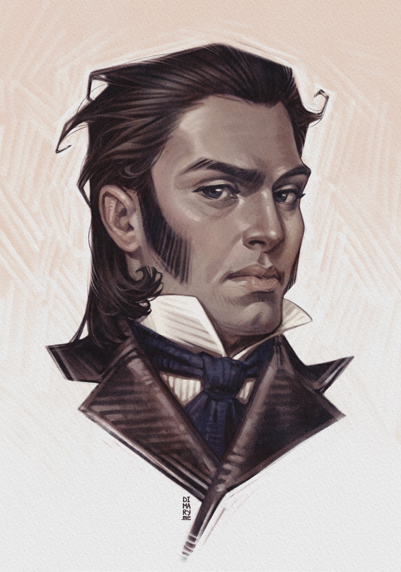
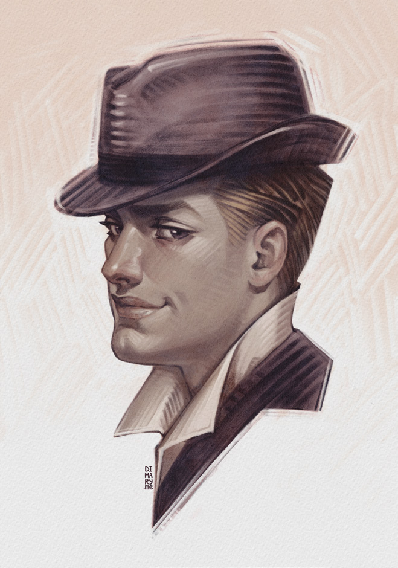
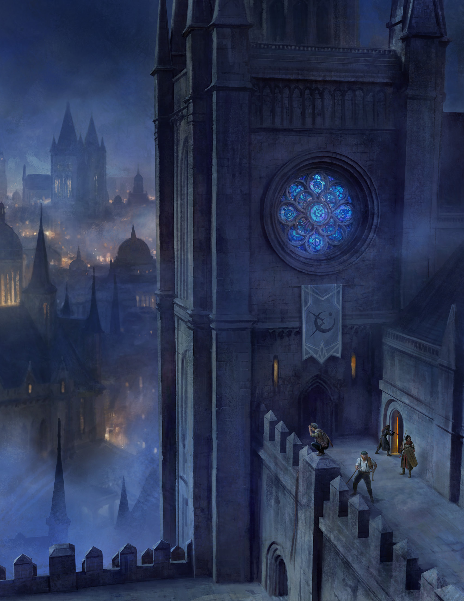

瓦希黎恩．拉德利安（Waxillium Ladrian）是依藍戴拉德利安家族第十六任大領主（Sixteenth High Lord of House Ladrian of Elendel），也曾是個離家出走、夢想成為英雄的人。他在蠻橫區（the Roughs）當了二十年的受雇執法者（Lawkeeper），培養出各式各樣的興趣，從哲學、冶金學（Metallurgy）到槍械運用和調查都有涉獵。他和副手韋恩（Wayne）結下了一生的友誼，見下一節〈韋恩〉。瓦（Wax）也結識了同為執法者的蕾希（Lessie），兩人結為夫妻。後來，蕾希被揭露是替和諧（Harmony）效力的坎得拉（kandra）密探。妻子和神明的背叛，加上接連發生的悲劇，重創了瓦身為道徒（Pathian）的信仰。

瓦骨子裡就愛跟人唱反調。他討厭別人告訴他該做什麼、該成為怎樣的人，卻毫不介意利用別人對他的成見。執法生涯的事蹟和經歷早已成為他的一部分，但近來家族職責、日益壯大的家庭，以及他與和諧之間的爭執，都讓瓦無法繼續親自打擊犯罪。然而，姊姊黛兒欣（Telsin）在「組織」（the Set）的所作所為，依然是他心中揮之不去的陰影。

### 曉擊（Dawnshot）

瓦在蠻橫區磨練金屬技藝（Metallic Arts），也闖出了名聲。起先人們覺得他是個講究打扮的公子哥，後來都知道他是個經驗老到、緊咬不放的行家。他的事蹟傳回依藍戴（Elendel）後，讓他得了「曉擊瓦希黎恩（Waxillium Dawnshot）」的綽號，不過瓦回到城裡才知道這回事。

瓦是雙生師（Twinborn），同時是鋼迷霧人（steel Misting），俗稱射幣（Coinshot），也是鐵單藏金術師（iron Ferring），俗稱掠影（Skimmer）。他尤其擅長鋼推（Steelpushing）。他常藉由泰瑞司（Terris）血統帶來的能力，將部分體重儲存（Store）起來，讓自己更輕，動作也更安靜。瓦也常用另一位好友拉奈特（Ranette）送他的實驗彈，見本章前面的〈拉奈特〉。這些子彈能配合瓦的鎔金術（Allomancy）能力，讓他推動射出的子彈，打出看似不可能的一槍。

### 家庭與責任

在依藍戴辦過幾起備受矚目的案件，又與「組織」交鋒爭奪悼環（Bands of Mourning）後，瓦開始專心投入依藍戴的政務。他在議會（Senate）取得的進展比預期還多，或許正是因為他有獨到的觀點，也倚重妻子史特芮絲（Steris），見前一節〈史特芮絲．拉德利安（Steris Ladrian）〉。瓦的舉止有時還是有些粗率，但如今已能勝任領袖的角色。

兩人原本打算依契約結婚，史特芮絲和瓦後來卻真的愛上了彼此。初為人父母的兩人，如今得兼顧工作、家庭，還要追蹤冶金學的新發現。

為了好好展開人生的新篇章，瓦舉家搬進 Ahlstrom塔（Ahlstrom Tower）的頂樓住宅。他把第四區（Fourth Octant）的拉德利安宅邸（Ladrian Mansion）留給盟友居住，也用作私人實驗室。

瓦希黎恩．拉德利安自認只是個普通的執法者，但他同時是偵探、科學家、大領主，身分還遠不止於此。

對頁：瓦和史特芮絲享受傍晚飛行的時光。

對頁：CYNTHIA SHEPPARD。右圖：MARIA DIMOVA。

第 5 章：盟友與組織 151

### 短期目標與獎勵

如果你的戰役（Campaign）有瓦登場，個別 PC 可以為他完成短期目標（goal），有機會讓他成為自己的贊助者（Patron），並獲得他提供的贊助者的好處（Patron Benefit）。

#### 贊助者目標（Patron Goals）

瓦可能提出下列目標。

**老友與宿敵（Old Friends and Foes）。** 幫瓦的執法者同僚在蠻橫區追捕幾個宿敵。

**取回武器（Weapon Retrieval）。** 找回並歸還拉奈特借給瓦的槍。他在槍戰中把它掉了，而且又不是頭一回。

#### 贊助者的好處：瓦希黎恩．拉德利安

除了在拉德利安家族的各處產業和蠻橫區提供贊助者待遇，瓦的贊助在整個北司卡德利亞（Northern Scadrial）都派得上用場。你可以藉此在各種檢定（Test）中獲得優勢（Advantage），如瓦的贊助者優勢（Wax Patron Advantages）表所示。然而，當你搬出瓦希黎恩．「曉擊」．拉德利安（Waxillium “Dawnshot” Ladrian）的名號時，提高賭注（Raise the Stakes）。GM 可能花費這次檢定產生的 [變故] 來引入各種挑戰，因為瓦這些年來樹敵不少，從罪犯和條子（conners）到政客和貴族都有。

##### 瓦的贊助者優勢

| 階層（Tier） | 檢定 | 加成 |
| --- | --- | --- |
| 1 | 威嚇（Intimidation） | 一個優勢 |
| 2 | 威嚇、領導（Leadership） | 一個優勢 |
| 3 | 威嚇、領導、說服（Persuasion） | 兩個優勢 |
| 4+ | 洞察（Insight）、威嚇、領導、說服 | 兩個優勢 |

此外，瓦可以在休整期（Downtime）訓練你，內容涵蓋多種領域，見《迷霧之子玩家手冊》（Mistborn Handbook）第 9 章〈休整期〉。他可以當你的鋼鎔金術（Steel Allomancy）或鐵藏金術（Iron Feruchemy）導師（Mentor），見本章開頭的〈贊助者與導師〉。你也可以獲得任一種火器（Firearm）的專長（Expertise），包括特殊火器，或獲得冶金學實用專長（utility expertise）。

## 韋恩（第二時代）

韋恩老愛惡作劇，也老愛說笑，後來人們也稱他為 Wayne Terrisborn。他既討人喜歡，又叫人惱火，有時還讓人完全摸不著頭緒。他能在一句話裡讓人覺得深刻、粗俗、可怕，卻又讓人安心。他談起抽象的事像個詩人，也有從蛛絲馬跡推知內情的天分。只憑一個人的幾個細節，韋恩就能做出準確得驚人的判斷。瓦希黎恩．拉德利安曾把年少的韋恩從絞索下救了回來，給他重新做人的機會，見前面的〈瓦希黎恩．拉德利安〉。此後，韋恩成了這位執法者可靠的副手。

韋恩很少談起年少時的事，但很清楚蠻橫區的人怎麼過日子，也了解礦業公司在當地的影響力。他的雙親分別在兩起礦災中喪生。成為孤兒後，韋恩在 Tinweight Settlement 長大。他接連做了幾個糟糕的決定，最後搶劫並殺害了一名男子。他一直努力彌補這件事，也始終覺得自己不配得到原諒。

韋恩最近和 MeLaan 從打情罵俏發展成戀人，見本章前面的〈MeLaan〉。

### 滑行與金藏金術（Sliding in Gold）

韋恩是雙生師，能使用彎管合金鎔金術（Bendalloy Allomancy）和金藏金術（Gold Feruchemy）。身為滑行（Slider）和制血者（Bloodmaker），他能創造速度圈（speed bubbles），加快自己和附近的人經歷的時間流速，也能利用金意識（goldminds）快速療傷。

韋恩把消賊（Vanishers）一案拿到的獎金投入剛起步的電力市場，悄悄累積了一大筆財富。有了這筆巨款，他又投資了不少看似鬧著玩的項目，其中大多也賺得盆滿缽滿。

### 口袋和帽子

韋恩總是在「借」東西或拿東西來「換」，說穿了就是扒竊和偷竊。他的朋友和熟人通常把這當成他的怪癖。韋恩有種不可思議的本事，總會無意間在恰當的時候，把恰當的東西交給恰當的人。

韋恩也擅長假扮他人。他對口音的細微差別極為敏銳，聊不到一分鐘就能學會一種新的說話方式。再搭配合適的衣服，尤其是帽子，韋恩就能輕鬆混進一個地方，讓人光看他的模樣、聽他說話，就覺得他本來就該在那裡。

第 5 章：盟友與組織 152

### 短期目標與獎勵

如果你的戰役有韋恩登場，個別 PC 可以為他完成短期目標，有機會讓他成為自己的贊助者，並獲得他提供的贊助者的好處。

#### 贊助者目標

韋恩可能提出下列目標。

**製造騷動（Create Distraction）。** 搞點破壞、打一架，或弄出其他熱鬧場面，幫韋恩引開眾人的注意力。這樣一來，誰也不知道韋恩搞了什麼名堂，連你也不知道。

**阻撓「刺客」（Foil the “Assassins.”）。** 別讓韋恩最怕的兩個會計 Call 和 Daring 靠近。他這個維持太平的要是自己都不得安寧，大夥兒哪來的太平日子！

#### 贊助者的好處：韋恩

韋恩有錢得不像話，卻選擇不準備通常的贊助者待遇（amenities）。不過，他有個不可思議的本事，總能「換」到你需要的東西……或是他覺得你會需要的東西。每天一次，你與韋恩見面時，可以說出一件你想要的東西，再擲一顆劇情骰（Plot Die）。與 GM 一起從你身上選出一件小巧有趣的物品。韋恩會把它「換」走，也就是從你身上偷走，再放上一件他覺得同等價值的物品。韋恩認定的價值和物品的價格一點關係也沒有。你換到什麼取決於劇情骰的結果。
- 擲出[變故]時，你拿到一件莫名其妙、毫無用處的東西，幾乎一文不值，例如一份吃到一半的三明治。
- 擲出空白（Blank）時，你拿到一件與你開口要的東西相近的物品，市價也和韋恩拿走的東西差不多。這兩點都由 GM 裁定。
- 擲出[機遇]時，你拿到的東西不知怎地比你開口要的東西更適合眼下的處境，而且好上太多，只是你一開始可能不明白原因。

此外，韋恩可以擔任你的彎管合金鎔金術或金藏金術導師，見本章開頭的〈贊助者與導師〉。如果韋恩指導你彎管合金鎔金術，而你的階層是 2 或更高，再為他多完成一個贊助者目標後，他就會成為你的彎管合金供應來源，見《迷霧之子玩家手冊》第 8 章〈稀有金屬持續供應（Recurring Supplies of Rare Metals）〉。

> 「瓦，說到懂牛，誰也比不過屠夫啦。」

韋恩說話粗俗又沒個正經，偏偏每到緊要關頭，他總能幫上忙。

MARIA DIMOVA

第 5 章：盟友與組織 153

