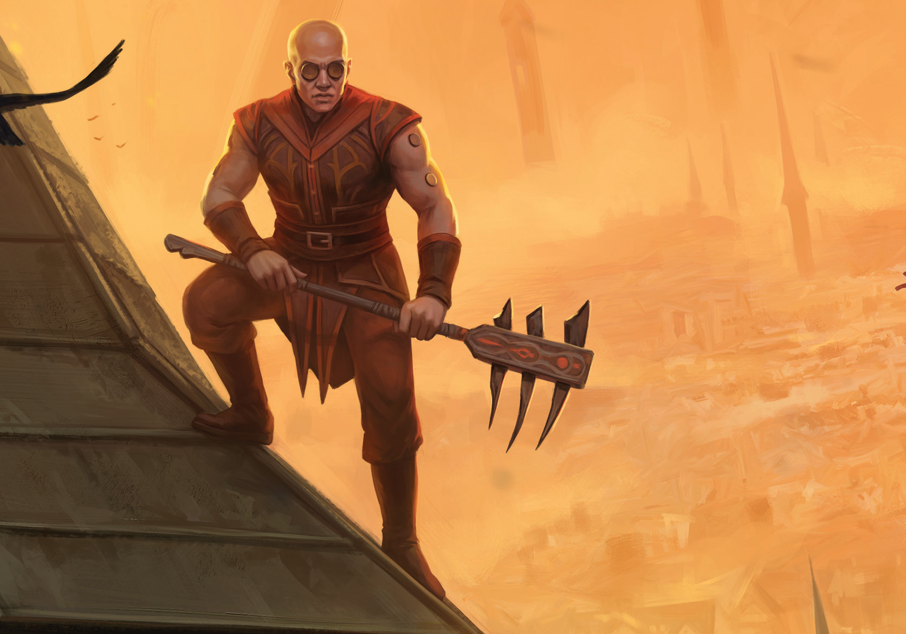

## 永遠還有另一個祕密！

布蘭登．山德森（Brandon Sanderson）的暢銷小說《迷霧之子®》系列，講述一個由神力與出人意料的英雄共同塑造的世界。這本指南帶你認識司卡德利亞（Scadrial）的歷史與文化，也是本系列第一本官方畫冊！無論你初次踏進這個世界，還是早已是多年的讀者，都能在插圖精美的《迷霧之子世界指南》（Mistborn World Guide）中，找到這個世界前兩個時代的設定資料。

本書也是《寰宇®角色扮演遊戲》的重要資源。搭配《迷霧之子玩家手冊》（Mistborn Handbook），你就能備齊展開旅程所需的一切，踏入一個迷霧籠罩、處處有祕密、劫案與反抗的世界！

COSMERE® ROLEPLAYING GAME

COSMERERPG.COM

DRAGONSTEEL

BROTHERWISE GAMES

$59.9

ISBN 978-1-966528-07-4

55999>

9 781966 528074

生產批號：LongPack.XXXXXX

