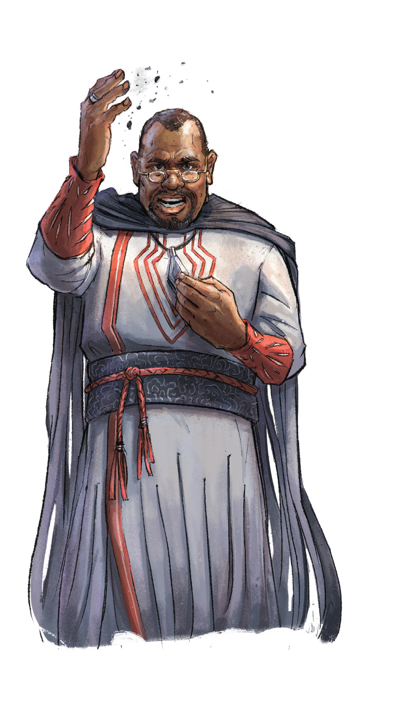
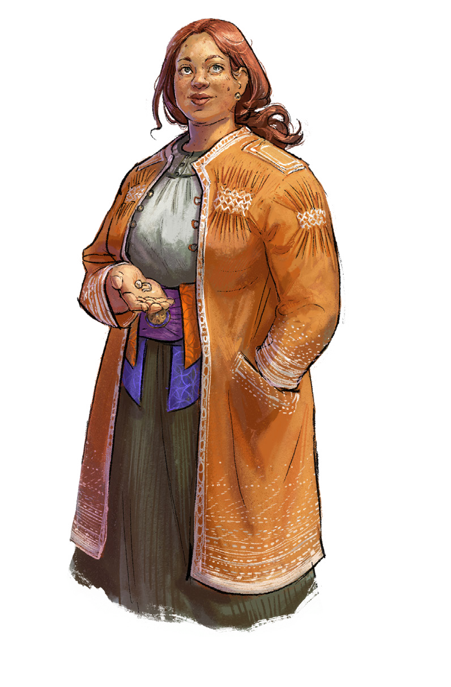
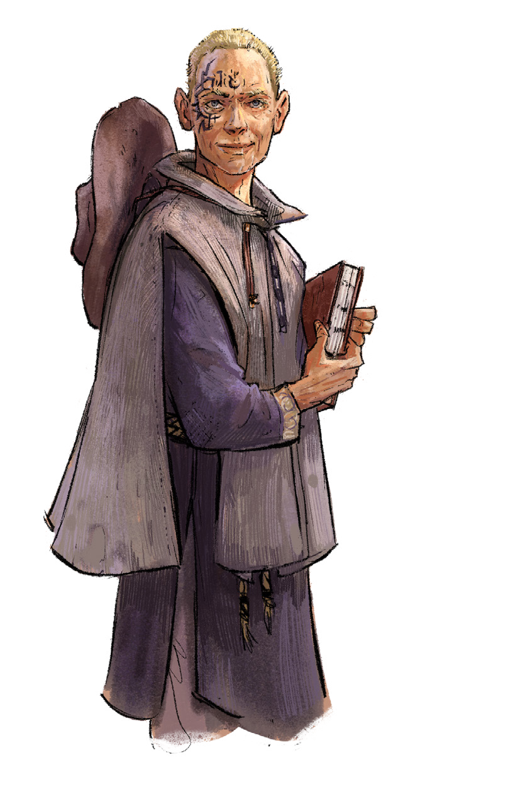
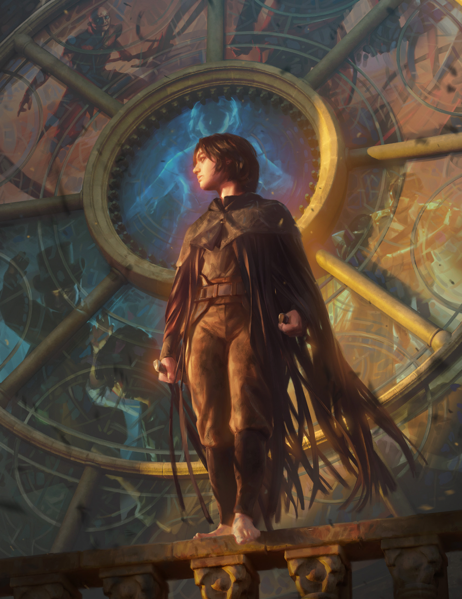

### 主要宗教

司卡德利亞（Scadrial）有數百種各具特色的宗教，歷史豐富，習俗也各不相同。以下各節介紹最後帝國（Final Empire）時期與落灰之終（Catacendre）後的宗教樣貌，並說明這些宗教如何創立，以及如何隨時間發展。

### 古代與古典宗教

世界尚未被灰燼覆蓋時，各地的人們從數百種信仰中尋得希望，其中包括Dadradah、珈教（Jaism）與Trelagism。「古典時期的司卡德利亞宗教」表概述幾種古典宗教的信念。許多早期宗教都以某種形式提及滅絕（Ruin）與存留（Preservation）。南司卡德利亞（Southern Scadrial）的文化崇拜Jaggenmire，其由名為Herr與Frue的力量組成。古代泰瑞司（Terris）宗教包含對滅絕的警告，而信奉這個宗教的人自認屬於存留。

### 第一時代的宗教

儘管統御主（Lord Ruler）與鋼鐵教廷（Steel Ministry）摧毀了許多宗教，泰瑞司守護者（Keepers）仍記錄並傳承了部分信仰的習俗與信念。隨著卡西爾（Kelsier）成為司卡（skaa）反抗運動的象徵，最後帝國的覆亡催生了倖存者教會（Church of the Survivor）。而坎得拉（kandra）所記得的泰瑞司宗教，也成了擊敗滅絕的關鍵。（鋼鐵教廷的更多資訊見第5章。）

### 第二時代的宗教

落灰之終後，倖存者教會又稱倖存者教（Survivorism），煥發了新的生命。它逐漸成為世界上居主導地位的宗教，尊崇卡西爾、紋（Vin）與迷霧之子大人（Lord Mistborn）。其他主要宗教包括以存留為核心的新泰瑞司信仰，以及尊崇統御主與其力量繼承者的碎刺教（Sliverism）。規模較小的宗教也陸續出現，例如簡樸且強調自主決定的道教（the Path），以及崇拜碎力（Shard）自主（Autonomy）的Trellism。

### 古典時期的司卡德利亞宗教

| 文化與信仰 | 信念 |
| --- | --- |
| 阿司塔西（Astalsi） | 每個人出生時，都帶著有限的厄運。不幸的遭遇被視為祝福，因為經歷這種事後，人生只會愈來愈好。不同顏色代表不同種類的運氣。 |
| 卡西（Cazzi） | 人死後，必須吟唱死亡之歌來喚醒亡者的靈魂。藉由這首歌，靈魂便能擺脫肉身，回到靈魂之山。 |
| Dadradah | 神只有一位，正確的崇拜方式也只有一種。成為藝術家是世上最崇高的志業，甚至高於成為祭司。 |
| 哈達教（HaDah） | 關注農業、土地與生長的事物。哈達教的亡者儀式包括禱告，以及取自樹木的墓標。 |
| 珈教 | 愈虔誠，就能得到愈多幸福。公開表明信仰會獲得獎賞。許多珈教人（Jaists）會在句尾加上「讚美珈（Ja）」。 |
| 拉司達教（Larstaism） | 人生在於尋求神聖。藝術讓我們更接近對神性的理解。偉大的藝術作品能提升每一位接觸它的人。由於並非人人都能把時間投入藝術，支持藝術家對社會有益。拉司達（Larsta）人捐款，資助創作詩歌、繪畫與雕塑的僧侶。 |
| 班內特之實言（Truths of the Bennet） | 探索與知識是最崇高的崇拜形式。當世上的一切都已被認識、理解並編目，就能達成和平與和諧。繪製地圖是一項虔敬的職責。班內特（Bennet）人是航海民族，因此將宗教設計成能在船上實踐的形式。 |

第3章：宇宙學與宗教 92

### 倖存者教會

倖存者教會是第一時代末年與整個第二時代中，司卡德利亞最具影響力的宗教之一，起源可追溯至最後帝國崩潰時。早期信徒宣稱，迷霧之主（Lord of Mists）卡西爾超越了死亡。卡西爾為受貴族壓迫的人們帶來希望，卻遭統御主當眾殺害，成了殉道者。他帶來的希望留在司卡心中。許多人宣稱，在他死後的幾年裡，曾見過他漫步於陸沙德（Luthadel）迷霧籠罩的街頭。《創始之書》（Words of Founding）揭露真相後，教會的信仰得到了證實。和諧（Harmony）揭示，卡西爾死後仍然存續，並保護存留的力量，直到紋承接這些力量，擊敗滅絕。

### 核心教義

倖存者（the Survivor）拒絕權威的傳說，使倖存者教特別吸引認為獨立與個人自主是美德的人，包括遊走法律之外，甚至與法律對抗的人。受這種信仰吸引的人，往往希望走出自己的道路，並質疑權威人物與政權的力量。然而，隨著歲月流逝，教會本身卻愈來愈保守，往往更重視早期教會成員的言論與教義，而非每位信徒的獨特性。雖然這個宗教大多圍繞著「活下去」的命令，倖存者教信徒（Survivorists）也相信，倖存者的昇華（Ascension）是為了保護司卡德利亞人民。教會教導，昇華戰士（Ascendant Warrior）昇華後便與迷霧合而為一，讓自己的本質與迷霧交融，守護夜間走入迷霧的人。

### 宗教實踐

落灰之終後，倖存者教會遍布依藍戴盆地（Elendel Basin）。每間教會通常由一位祭司主持，由教會侍者（conventicalists）照料。教會侍者臉上塗著儀式用的灰燼，可據此辨認。倖存者教會通常有玻璃圓頂，讓人能清楚看見迷霧，並有擺滿木製長椅與金色裝飾的大型中殿，這些都是可供辨認的特色。

> 不論是竊賊、學者、無政府主義者，還是在自家土地上過活的農夫，凡是靠自己活下去，或是獨立思考的人，都是倖存者的追隨者，不論他們自己知不知道。

MARIE SEEBERGER

倖存者教祭司

第3章：宇宙學與宗教 93

倖存者教祭司穿著袖子上帶有縫線的長袍，藉此向倖存者在海司辛深坑（Pits of Hathsin）時留下的傷疤致敬。神職人員主持禮拜，向前來崇拜的人宣講霧曉（mistdawn）佈道，也主持婚禮、喪禮與其他儀式。教會最神聖的日子是Kels月的Survivorday。許多信徒定期參加禮拜，往往穿著正式服裝；也有人抱持懷疑，保持距離。崇拜的形式很多，有些人選擇白天禮拜，許多倖存者教信徒則在黃昏湧入教會，等待迷霧降臨，希望能親眼瞥見倖存者。

### 倖存者教祝禱語

| 祝禱語 | 涵義由來 |
| --- | --- |
| 願迷霧指引你。 | 用來表達對迷霧之主卡西爾的崇敬。 |
| 倖存者正注視著。 | 指卡西爾對司卡的引導，也提醒信徒必須彼此照應。 |
| 願喜悅點亮火炬。 | 鼓勵人以決心與反抗之志面對逆境。 |
| 不沾灰燼地前行。 | 鼓勵人擺脫阻礙自己前進的束縛。 |
| 莫讓傲慢將你刺穿。 | 指刺穿統御主、預示他敗亡的那兩柄平凡長矛。 |
| 露出你的傷疤。 | 邀請對方尋求建議或指引。 |
| 願你在繼承者貴女（Lady Heir）眼中蒙福。第一時代 | 用來表達對卡西爾繼承人紋的崇敬。 |
| 願昇華戰士垂顧你。第二時代 | 用來表達對卡西爾繼承人紋的崇敬。 |
| 活下去！ | 倖存者的訓諭。 |

### 道教 第二時代

道教在落灰之終後創立，是一種簡樸的宗教、哲學與生活方式。它重視信徒與其神祇和諧之間的個人連結，並鼓勵每個人自行尋求真理。

### 核心教義

道教最主要的誡命很簡單：所行之善要多於所造成的傷害。除了這項核心信念，道徒（Pathians）也研習和諧在《創始之書》中記錄的數百種古典時期司卡德利亞宗教，從那些道德準則中學習。道徒在自身良知的引導下，詮釋各個宗教與準則，因此道教信徒的實踐方式與觀點差異極大。不過，仍有一些共同信念，例如不追求沒有承諾的情慾，以及看見一切缺點中的長處。許多道徒也認為，付出應該多於索取。

MARIE SEEBERGER

道教傳教士（Pathian missionary）

第3章：宇宙學與宗教 94

### 宗教實踐

道教鼓勵奉行信仰的道徒每天冥想或禱告十五分鐘，與和諧分享自己的思想與經歷。然而，道教並不鼓勵直接崇拜和諧，而是要以行動展現信仰，行善就是他們的崇拜。道徒禱告時，通常會戴上一枚金屬耳環，耳環往往帶有代表其信仰的十個相扣圓環。有些耳環由重新利用的血金術尖刺（Hemalurgic spikes）製成，讓虔誠的道徒能直接與和諧交流。道教聖所是小型建築，八面各有一道寬大的門口，模樣類似舊泰瑞司（Old Terris）的小屋，遍布依藍戴盆地。聖所通常空無一物，只有兩張椅子，一張給道徒，一張給和諧。道教的神職人員稱為道教傳教士（Pathian missionaries），穿著紫、白、藍三色長袍，會向任何好奇發問的人分享信仰。道教沒有正式的祭司制度，傳教士也沒有正式職責，只須在有人需要時能與對方交談。道教沒有儀式、聚會或禮拜，是一種彈性很大的宗教，在依藍戴盆地有許多信徒。旁人或許覺得難以理解，信徒卻能從中感到自在，得到慰藉。

> 從某種角度來說，道教正因為如此簡單，才更難遵循。它把詮釋的責任交給了每個人自己的良知。

### 碎刺教 第二時代

碎刺教由前聖務官（obligators）在落灰之終後創立，是從鋼鐵教廷教義演變而來的宗教。碎刺教信徒（Sliverists）教導，統御主是一位嚴厲卻願意守護的領袖，是防止世界落入滅絕手中的捍衛者。他是無限殘體（Sliver of Infinity），是全知全在之神的一個獨立且活躍的部分。碎刺教信徒雖然承認這位神的存在，崇拜的卻是統御主及相關力量。他們相信，統御主死後碎裂（Splintered）成更小的殘體（Slivers），繼續存活於最後一位審判者（Inquisitor）鐵眼（Ironeyes）等強大存在，以及寰宇（cosmere）的其他存在之中。教會經過數代發展，神職人員改編了許多原本屬於鋼鐵教廷的儀式與習俗。他們逐漸遠離教廷以往的威權控制，轉而更重視會眾的靈性健康。

碎刺教祭司

MARIE SEEBERGER

第3章：宇宙學與宗教 95

### 核心教義

碎刺教的核心信念是，在滅絕、存留與和諧等碎力之上，還有一位更高的神。他們也相信，有些獨特的存在掌握了這位神的一部分力量，因而獲得神授的統治權。碎刺教祭司主張，統御主才是真正的永世英雄（Hero of Ages）：一個掌握了神力的普通人，阻止了滅絕，而不是釋放祂或與祂結合。他們也教導，一個人所能做的最神聖之事，就是為大眾福祉服務。這是個利他的教會，許多信徒與祭司都為弱勢者奔走。

### 宗教實踐

碎刺教信徒每月十六日會聚集在小禮拜堂中崇拜。祭司先佈道，接著會眾應依各自的天賦與能力參與公共服務。信徒每年四次聚集於Doriel或Faleast山脈（Faleast Range）昔日灰山（Ashmounts）的遺址附近，祝頌統御主讓世界免於毀滅，獲得一千年的喘息。All Slivers’ Night是紀念統御主之死的節日，從Marsh月最後一天的日落開始，一直持續到Doxil月第一天的黎明。連許多沒有宗教信仰的人也喜愛這個節日，人們會戴上審判者面具，徹夜慶祝。

### 祭司教團

碎刺教鼓勵祭司廣泛學習，但也要專精於一門領域。三種專業分別對應昔日的聖務廷（Cantons）：財務教團（Order of Finance）、資源教團（Order of Resource）與教義教團（Order of Orthodoxy）。財務祭司管理社區中的各項計畫，資源祭司負責公共建設與工程，教義祭司則研究哲學，並向信徒傳道。

> 統御主在昇華之井（Well of Ascension）觸及神性。這在他身上烙下了無限殘體，也賦予他超凡推論的權能（Right of Inference）。

傳聞碎刺教還有祕密的第四種專業，也就是審判教團（Order of Inquisition）。據說，這個祕密團體專門研究謀殺與暗殺的技藝，藉此服務大眾福祉。然而，這個團體是否存在，始終未獲證實。所有教團的祭司都穿著白色滾邊的高領黑色祭服，但與前人不同，他們不必剃光頭。祭司在專業領域上有所進展時，會以眼周繁複的刺青表彰其成就。

### 泰瑞司宗教

泰瑞司宗教是世界上最古老的信仰之一，也是泰瑞司人祖傳的信仰體系。

### 古代泰瑞司人的宗教

最後帝國建立之前，早期泰瑞司人尊崇碎力。關於眾神創造世界的記述，以教義與宗教教導的形式流傳，其中也包含未來的預言。這些預言稱為Anticipation，由泰瑞司世界引領者（Worldbringers）保存，預見了永世英雄的到來。這些泰瑞司人害怕滅絕會為自己與世界帶來災難，因此主要崇拜存留。然而，他們並未將存留視為全能之神，而是承認自己的神只是眾多力量之一。他們的教導包括對其他界域、碎力的力量來源，以及司卡德利亞世界之外可能存在何種類似力量的理論。雖然有些相似之處，這些教導與早期歷史，仍與南司卡德利亞對Jaggenmire的崇拜不同。

### 最後帝國時期

雖然一代代泰瑞司守護者努力保存司卡德利亞的古代宗教，他們自己的宗教卻已失傳。統御主決心維持對最後帝國的控制，無法冒險讓泰瑞司信仰中的知識構成威脅。因此，他摧毀了這個宗教，免得新的永世英雄崛起。唯有曾是泰瑞司藏金術師（Feruchemists）的坎得拉初代（First Generation），仍保有對自身信仰的知識。這些坎得拉始終服從，為存留效力，直到泰瑞司宗教中的預言實現，新的永世英雄崛起，承接了兩股碎力。

第3章：宇宙學與宗教 96

> 「金屬是你的生命。」Tellingdwar 在小屋前方說道，接著開始誦念晚間禱文的最後幾段。瓦希黎恩（Waxillium）跪著冥想，聆聽這些話語。他身旁一排排神情平和的泰瑞司人，也同樣恭敬地低著頭，向其信仰中的古老神祇存留獻上讚美。

### 落灰之終後

和諧在落灰之終期間昇華，承接兩股碎力，並將自己對宗教的知識留在《創始之書》中。這幾冊書也收錄了完整的泰瑞司宗教。雖然《創始之書》成了重要的歷史記錄，各信仰將它用作宗教教義的方式卻不同。復興後的泰瑞司宗教信徒，大多仍將存留視為與和諧不同的神，繼續崇拜祂。他們共同禱告、每日誦念教理問答，也以其他方式崇拜。不過，各社群的信仰也有所差異。有些教派視和諧為存留的繼承者，直接崇拜祂。其他群體則認為滅絕的本質腐化了和諧。這些派別只崇拜存留，期待有朝一日，兩股力量能再次分開。

### Trelagism與Trellism

Trelagism是統御主在宗教肅清期間摧毀的信仰之一，在世上消失了千年。只有泰瑞司守護者及其傳授知識的對象，才知道這個宗教曾經存在。落灰之終後，古老的Trelagism被記錄在《創始之書》中，而它與碎力自主的關聯也開始受到探究。

### Trelagism：Nelazan人的宗教

古典時期的司卡德利亞有一個名為Nelazan的民族，居住在遙遠的北方。當地的晝夜週期隨季節改變，會出現極夜與午夜太陽。Nelazan人的信仰以兩位手足神祇為中心：Trell有一千隻眼睛，也就是星辰；納特（Nalt）則只有一隻眼睛，也就是太陽。納特心懷嫉妒，強使自己唯一的眼睛發出比Trell更耀眼的光芒，但Nelazan人相信黑暗中自有美。他們崇拜Trell，相信自己的神時時刻刻都在守望著他們。

### Trellism：自主的宗教 第二時代

「組織」（the Set）是第5章介紹的祕密組織。他們為了尋找能幫助自己實現野心的力量而查閱古代記錄，發現Nelazan人的神Trell其實是自主的化身。「組織」與這股碎力取得聯繫，締結盟約，因而創立Trellism。藉由侍奉自主，「組織」的領導者能隨心所欲地改造司卡德利亞，自主也能讓這個勤奮的世界為自己的目的服務。Trellism沒有祭司、神殿，也沒有宗教教義。起初，只有「組織」的領導階層信奉這個宗教，但隨著歲月流逝，較低階的成員也加入了信徒行列，尤其是「組織」私軍Hidden Guard的成員。Trellism的核心信念是，信徒必須獨立自主、大膽且能幹。光有夢想還不夠，他們必須構思遠大的目標，並付諸實現。

### 統治的預言

預言與應許的勝利對Trellism信徒（Trellists）十分重要，也是他們的經文。自主在其他星球的密探警告，自主的軍隊，也就是所謂的金紅之人，將會來到司卡德利亞，毀滅並統治這個世界。多數Trellism狂熱信徒堅信，只要侍奉自主，自己就能在這個新世界中統治。

### 彼方神

寰宇中幾乎每顆星球，甚至可能所有星球，都有出現在神話中的存在，以及被奉為神祇的力量。然而，有些人相信，彼方神（God Beyond），又稱未知之神（Unknown God），是一種超越這些星球神祇的力量。關於彼方神，人們所知甚少。祂是否與雅多納西（Adonalsium）相關，又是否與人死後靈魂被引往的彼瑞（Beyond）有所關聯，各種信仰的說法也不同。和諧在《創始之書》中曾隱約提及，人死後似乎會去到一處幸福之地，也有些司卡德利亞人會以彼方神之名起誓。

第3章：宇宙學與宗教 97

