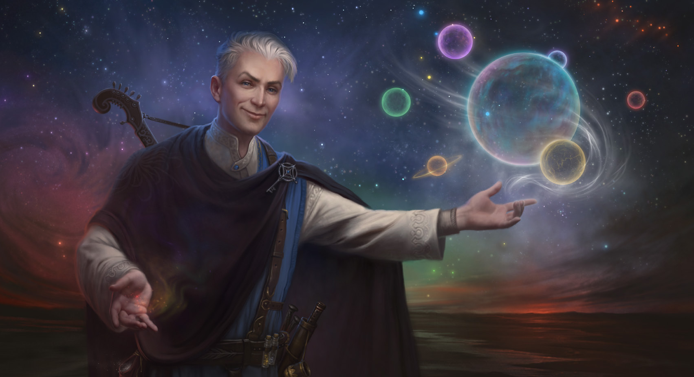

### 其他世界

司卡德利亞（Scadrial）星系之外，寰宇（cosmere）中還有許多行星，包括 Bjendal、Canticle、Dhatri、環日初星（First of the Sun）、Komashi、Lumar、Mythos、納西斯（Nalthis）、歐布羅玳（Obrodai）、羅沙（Roshar）、賽耳（Sel）、泰爾登（Taldain）、輓星（Threnody）、UTol、Vax 與悠倫（Yolen）。其中許多行星都有雅多納西（Adonalsium）的碎力（Shard）居住，影響著當地的授予（Investiture）、歷史與文化。以下各節介紹幾顆最重要的行星，以及居於其上的碎力、祂們的力量，還有祂們與寰宇的關係。

#### 司卡德利亞與躍界者

各顆行星在意識界（Cognitive Realm）緊密相連，因此人們能夠往返不同世界。在世界之間旅行，而且往往也從事貿易的人，被稱為躍界者（worldhoppers）。本書導論中 Khriss 的信，就是由這樣一位躍界者所寫。雖然大多數司卡德利亞人對更廣大的寰宇一無所知，但司卡德利亞與外界往來的歷史相當悠久。在其歷史的大部分時期，躍界者都能經由滅絕（Ruin）的垂裂點（Perpendicularity）來到這個世界。經由存留（Preservation）的垂裂點——昇華之井（Well of Asccension）——通行也可行，但滅絕的存在使這條路充滿危險。然而，就在最後帝國（Final Empire）覆滅前不久，滅絕的垂裂點遭到破壞，經由司卡德利亞進行的貿易一度中斷。落灰之終（Catacendre）之後，和諧（Harmony）的垂裂點在南方形成，司卡德利亞南方人（Southern Scadrians）開始與外世界的個人及組織貿易，例如銀光城（Silverlight），以及被稱為 Ire 的躍界者。在這段期間，鬼血（Ghostbloods）進入探索與招募的階段。鬼血是個強大卻極度隱祕的組織，由卡西爾（Kelsier）創立，目的是不惜一切代價保護司卡德利亞這個世界。組織的密探來自寰宇各地，帶來自身的知識、技術與授予之術（Invested Arts），協助保護這顆行星。許多行星上都有來自司卡德利亞的鬼血成員，推動各種陰謀與計畫；而司卡德利亞上的許多鬼血成員，則出身於寰宇的其他行星。（關於這個組織的更多詳情，請見第 5 章〈鬼血〉。）自主（Autonomy）介入之後，和諧也決定向寰宇伸出觸角。祂不僅想進一步認識其他世界與勢力，也希望建立盟友關係。祂派出數名坎得拉（kandra）密探，包括 MeLaan，前往外世界探尋這些祕密。

### 環日初星

環日初星是 Drominad 星系中的一個世界。居住在家鄉諸島上的人們，與願意冒險進入致命群島 Pantheon 的獵人和設陷阱捕獵者交易。在環日初星的歷史中，許多碎力都曾介入，其中最著名的例子是自主的化身 Patji。環日初星的魔法在自然界中處處可見。許多動物能察覺其他生物的思想，有些植物則能散發其他生物的思想。設陷阱捕獵者利用一種名為 Aviar 的鳥阻隔思想波，保護自己免受掠食者侵害。

### 納西斯

納西斯是納西斯星系中的一個世界。當地的王國包括 Idris 與 Hallandren，後者是遍生染料植物的叢林之國。居於此地的碎力贈與（Endowment），讓人類出生時都擁有一道駐氣（Breath）。人們能透過駐氣，結合色彩與覺醒術（Awakening）命令，賦予物品活力。納西斯人的覺醒技術已傳遍寰宇，他們也正在研究如何運用垂裂點進行貿易。

### 羅沙

早在碎裂（Shattering）發生之前，雅多納西就創造了羅沙星系。在司卡德利亞的第一時代，羅沙這顆行星是個有著碎形生長與無限潛能的世界，與創造的節律相呼應。規模龐大的高風暴挾帶名為颶光（Stormlight）的授予，橫掃這顆行星崎嶇多山的岩石地貌。在這段時期，羅沙受到三道碎力的影響：培養（Cultivation）、榮譽（Honor）與憎惡（Odium）。鬼血（見第 5 章）深深涉入羅沙的各種事件，奉卡西爾之命，尋找在行星之間運送授予與受授予生物的方法。鬼血與遭腐化的靈（spren）建立聯繫、招募有影響力的對象，也與加絲娜．科林（Jasnah Kholin）、榮譽之子（Sons of Honor）和紗藍．科林（Shallan Kholin）等人物與組織衝突。然而，到了司卡德利亞的第二時代，羅沙的高風暴歸於沉寂，強大力量之間的對抗也使羅沙出現時間膨脹。這為世界之間的貿易與通訊帶來挑戰。在那時，培養逃離了這個星系，羅沙則成為報應（Retribution）的居所——祂是榮譽與憎惡合而為一的碎力。

第 3 章：宇宙學與宗教 80

### 賽耳

賽耳是賽耳星系中的一個廣大世界。碎力奉獻（Devotion）與統治（Dominion）在此定居，讓憎惡有了攻擊祂們、將祂們打碎成裂體（Splinter）的藉口，因為碎力彼此干涉違反了持有者（Vessels）的規矩。祂們的殘餘形成多爾（Dor），為賽耳的授予之術提供力量。在賽耳的各個大陸與帝國中，有許多限於特定地區的授予運用方式，包括 AonDor、Bloodsealing、ChayShan、Dakhor 與偽造術（Forgery）。每種方式都以符號或形狀作為「程式碼」，產生魔法效果。人們也會與侍靈（seons）和 skaze 建立聯繫，類似羅沙上的納海聯繫（Nahel bonds）。侍靈與 skaze 分別是奉獻與統治的裂體。

### 泰爾登

泰爾登是泰爾登星系中的一個世界。目前碎力自主居於此地，並使這個世界與寰宇其餘地方隔絕。泰爾登受到潮汐鎖定，一面是永恆黑夜，稱為暗面（Darkside）；另一面則在永恆白晝中酷熱難耐，稱為晝面（Dayside）。暗面的魔法透過類似刺青的星痕運作。晝面蘊含更多授予，其魔法表現為御沙能力，能操控白沙（white sand）。白沙能測量並偵測授予，因此對研究寰宇的躍界者而言相當珍貴。鬼血也曾在其他世界運用白沙。

### 輓星

輓星是輓星星系中的一個世界。憎惡在此重創了野心（Ambition）。雖然野心最後在別處殞落，但那場戰鬥造成的創傷，仍深深影響著輓星。人類蜷居在堡壘城鎮與岌岌可危的農莊中，四周是鬼影出沒的地獄森林（Forests of Hell）。但與陷落世界（Fallen World）相比，即使這些地區也算安全。陷落世界是一整片大陸，由一群被稱為「邪惡」（Evil）的實體掌控。輓星沒有可供人類運用的授予。相反地，在地獄森林中徘徊的陰魂，就是授予的顯現，而對抗牠們的唯一方法是使用銀。

### 悠倫

悠倫位於尤立許（Yolish）星系，是寰宇中最古老的有人居住行星之一，也曾是雅多納西的居所。殺害雅多納西的是尤立許人；碎裂之後，他們成為碎力，離開悠倫，前往其他行星。如今，悠倫剩下的人類、龍與 Sho Del 數量已非常稀少。

霍德（Hoid）等躍界者蒐集著寰宇的祕密。

HOWARD LYON

