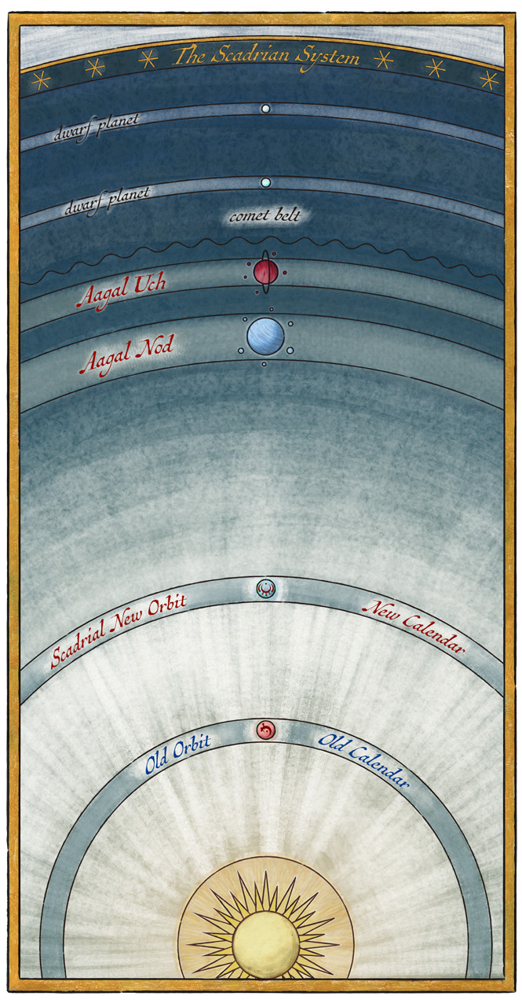

司卡德利亞（Scadrial）是兩股碎力（Shard）創造的世界，曾有數百種信仰，分別代表各個民族與地區。然而，在鋼鐵教廷（Steel Ministry）與統御主（Lord Ruler）大軍的作為之下，這些宗教逐漸消逝，只留在歷史與守護者（Keeper）的記憶之中。落灰之終（Catacendre）過後，以統御主的殞落與和諧（Harmony）的昇華（Ascension）為基礎的新信仰興起，為人們帶來啟發。許多古老信仰雖然依舊沉寂，卻也有一些重獲新生，並得到非比尋常的支持。

本章探討司卡德利亞的強大力量、司卡德利亞星系與宇宙中的其他星系，以及兩個時代中這個世界的主要宗教。

### 秘史

本章介紹寰宇（cosmere）各處的資訊，包含《迷霧之子》系列（Mistborn Saga）以及其他寰宇小說中重大真相與事件的劇透。

### 雅多納西（Adonalsium）

雅多納西的本質究竟為何，至今仍是謎團。無論祂是宇宙中的自然力量，還是具有智慧、甚至神性的存在，雅多納西就是創造之力本身。

雅多納西似乎受到創造生命的渴望驅使，以四道命令（Commands）創造了寰宇、其中的界域（Realm）與力量。這四道命令後來成為晨碎（Dawnshards）。寰宇的許多面向至今仍反映雅多納西的設計，其他特質則能從祂的碎力及其名稱中窺見。

### 雅多納西碎裂（Shattering of Adonalsium）

寰宇歷史最具決定性的一刻，就是雅多納西碎裂。當時，一群密謀者以晨碎對抗雅多納西，將這位寰宇最強大的存在撕裂並殺死。就在那一刻，創造之力分裂成十六股碎力，每股都承載雅多納西本質的一個面向。密謀者隨後奪取這些力量，各自選擇感到契合，或認為自己能夠掌控的碎力。此舉從此改變了寰宇。

那些打碎創造之力的人，各有不同的動機。有些人渴望親自擁有這股力量，有些人則認為雅多納西必須死。無論動機為何，這次碎裂（Shattering）都對寰宇造成難以衡量的影響。人們對碎裂之前的寰宇所知甚少，但這件事影響了寰宇眾多星球的魔法與社會。

### 雅多納西的碎力

碎力是創造之力分裂而成的十六個部分。祂們同時存在於三個界域，但力量集中在意識界（Cognitive Realm）與靈魂界（Spiritual Realm）。每股碎力都有特定的動機，並反映在各自的名字中：野心（Ambition）、自主（Autonomy）、培養（Cultivation）、奉獻（Devotion）、統治（Dominion）、贈與（Endowment）、榮譽（Honor）、創造（Invention）、寬容（Mercy）、憎惡（Odium）、存留（Preservation）、理性（Reason）、滅絕（Ruin）、毅勇（Valor）、技藝（Virtuosity），以及 無常（Whimsy）。

碎力是寰宇已知最強大的存在，相當於寰宇的諸神。起初，每股碎力的力量都同等強大，但許多碎力因衝突而衰弱，其他碎力則將自身的力量授予其他生物與世界。（關於司卡德利亞碎力的詳細資訊，請見本章稍後的「司卡德利亞的碎力」。）

碎力將力量授予世界時，便會使那個世界充滿授予（Investiture），並決定該世界的自然法則。這些法則與該碎力息息相關。碎力也能移動星球、改變生物。

儘管力量無比強大，碎力仍有其限制。祂們傾向依循自身神聖的碎旨（Intent）行動，要反其道而行往往幾乎不可能。碎力若違背任何協議、誓言或規則，自身就會出現可被其他碎力利用的弱點。此外，碎力必須由經歷昇華、成為持有者（Vessel）的智慧生物掌握。

CHRIS RALLIS

對頁：和諧看見司卡德利亞的故事，並塑造它的未來。

第 3 章：宇宙學與宗教 77

### 死亡的碎力與合併的碎力

憎惡殺死了 野心、奉獻、統治 與榮譽這四股碎力。此後，奉獻 與 統治 的殘餘力量在意識界結合，成為名為多爾（Dor）的力量。在司卡德利亞，滅絕與存留結合於同一位持有者之中，形成和諧。在羅沙（Roshar），榮譽與憎惡結合於同一位持有者之中，形成報應（Retribution）。

### 裂體（Splinter）

裂體是碎力的一小部分力量。碎力被殺死時，其力量可能遭到碎裂（Splintered），但碎力也可以自行選擇分出裂體。無論以何種方式誕生，裂體都能獨立行動，並擁有自由意志。司卡德利亞的碎力從未遭到碎裂。

### 持有者與殘體（Sliver）

碎力需要持有者。持有者是來自實體界（Physical Realm）的智慧生物，透過稱為昇華的過程，與碎力交織結合。「雅多納西的碎力」表列出十六股碎力、祂們最初的持有者，以及與各股碎力關係密切的世界。

### 雅多納西的碎力

| 碎力 | 最初的持有者 | 世界 |
| --- | --- | --- |
| 野心* | 烏麗．妲（Uli Da） | 輓星（Threnody） |
| 自主 | 巴伐丁（Bavadin） | 泰爾登（Taldain） |
| 培養 | 寇若維倫．阿瓦斯特（Koravellium Avast） | 羅沙、未知 |
| 奉獻* | 艾歐娜（Aona） | 賽耳（Sel） |
| 統治* | 史凱（Skai） | 賽耳 |
| 贈與 | Edgli | 納西斯（Nalthis） |
| 榮譽† | 坦那伐思特（Tanavast） | 羅沙 |
| 創造 | Chan Ko Sar | 未知 |
| 寬容 | 未知 | 未知 |
| 憎惡† | 雷司（Rayse） | 布雷司（Braize）、羅沙 |
| 存留† | Leras | 司卡德利亞 |
| 理性 | Euridrius | 未知 |
| 滅絕† | 雅提（Ati） | 司卡德利亞 |
| 毅勇 | Medelantorius | 未知 |
| 技藝* | 未知 | Komashi |
| 無常 | 未知 | 未知 |

*已碎裂

†存留與滅絕如今已融合為和諧，榮譽與憎惡如今已融合為報應。

### 昇華

持有者取得碎力時，便會經歷昇華，身體被吸收，心智隨之擴展。持有者會詮釋碎力的力量，並在一定程度上影響它的顯現方式，但碎力終究受其碎旨約束。舉例來說，滅絕最初的持有者雅提原本以善良慷慨聞名，但他的行為最終仍受滅絕終結萬物的天性引導。

碎力的力量維繫持有者的存在，也主導雙方的關係。抗拒碎旨會使持有者與碎力雙雙衰弱，許多持有者的心智也隨時間改變，逐漸與其碎力的碎旨一致。

### 殘體

殘體是曾經持有碎力之力的人，其靈魂因此受到永久的改變。例如，統御主就是存留的殘體。

### 司卡德利亞星系

雅多納西碎裂後，滅絕與存留選擇司卡德利亞星系為家。兩股碎力都無法單獨創造世界，卻合力從無到有創造了司卡德利亞。星系中的其他行星則早已由雅多納西創造。兩股碎力合作創造司卡德利亞後，這個星系包含下列天體：

司卡德利亞。這顆類地行星最接近太陽。在統御主統治期間，大部分地區都不適合居住，人口最多的北極周邊地區則覆滿火山灰。和諧在落灰之終期間改變了司卡德利亞的軌道位置，使它得以遍布茂盛的綠意與花草。司卡德利亞沒有月亮。

Aagal Nod。這顆無人居住的藍色氣體巨行星有六顆大型衛星，是距離太陽第二近的行星，軌道與司卡德利亞相距遙遠。它由古典時期的司卡德利亞（Classical Scadrial）的 Nelazan 人命名，名字意為「近眼（Near Eye）」。

Aagal Uch。這顆無人居住的紅色氣體巨行星有行星環與五顆大型衛星，是距離太陽第三近的行星，位於 Aagal Nod 與彗星帶之間。Nelazan 人稱它為「遠眼（Far Eye）」。

彗星帶。一條活躍的彗星帶將司卡德利亞與兩顆氣體行星，和外側的兩顆矮行星分隔開來。

矮行星。彗星帶之外有兩顆小型行星，皆未命名，也無人居住。

第 3 章：宇宙學與宗教 78

### 司卡德利亞行星

為了創造理想的世界，滅絕與存留將司卡德利亞安置在與太陽距離適中的最佳軌道上。祂們將這顆行星創造成與故鄉悠倫（Yolen）完全相同的大小，但沒有納入所有尤立許（Yolish）生命形式。

由於統御主與和諧的作為，這顆行星的軌道曾兩度改變，每一次都從根本上改變了星球的面貌。

### 第一時代的司卡德利亞

第一時代（Era 1）的司卡德利亞有兩個適居帶，分別集中在星球的兩極附近。最後帝國（Final Empire）位於北方適居帶，當地巨大的灰山（Ashmounts）是火山，形成的雲層，抵擋高溫與輻射。由於司卡德利亞大氣中的火山灰與迷霧，唯有使用增強感官的金屬技藝（Metallic Arts），才能看見星辰。

南極沒有灰山遮蔽，氣候更為嚴苛，但仍有天生適應較高溫度的民族在此居住。

適居區域以外，是遼闊的沙漠與沸騰的海洋，稱為焦土（burnlands）。這些地區涵蓋司卡德利亞大部分地表，完全無法通行。星球位於這條較短的軌道時，司卡德利亞一年有 224 天，每天有 24 小時。

### 第二時代的司卡德利亞

和諧昇華之後重塑了世界，封閉灰山，讓星球重回統御主昇華前的原始軌道。和諧重新創造古典時期的動植物，也重塑了海洋與地景。

和諧雖然讓世界恢復自然狀態，司卡德利亞卻仍地廣人稀。第二時代（Era 2）幾乎所有司卡德利亞北方人（Northern Scadrians），都住在名為依藍戴盆地（Elendel Basin）的肥沃地區，或緊鄰盆地外圍、尚未馴服的蠻橫區（Roughs）。與此同時，和諧帶來的改變使南方諸國陷入低溫，進入稱為冰殲時代（Ice Death）的時期。許多司卡德利亞南方人（Southern Scadrians）未能倖存，南方諸國也苦苦尋求在較寒冷的氣候中建立新生活方式的辦法。隨著星球恢復原本的軌道，司卡德利亞一年有 368 天，每天仍是 24 小時。

### 司卡德利亞與寰宇

司卡德利亞在時間與空間上與寰宇其他地方相連。這些連結不只存在於實體界，也存在於意識界。

在實體界，不同世界之間的距離極為遙遠。其他有居民的星系，大多數司卡德利亞人並不知曉，只能在夜空中以星座的形態看見。不過，第一時代的迷霧與火山灰遮蔽了這些星座。

在意識界，有居民的星系之間，空間大幅壓縮。因此，司卡德利亞子界域（subastral），又稱蒸氣域（Expanse of the Vapors），與羅沙子界域（通往羅沙）、碎天域（Expanse of the Broken Sky，通往泰爾登），以及震動域（Expanse of Vibrance，通往納西斯）的距離都相對接近。密度域（Expanse of the Densities，通往賽耳）則位於羅沙珠海（Sea of Beads）的另一側。

| 地圖標記 |
| --- |
| 司卡德利亞星系 |
| 矮行星 |
| 矮行星 |
| 彗星帶 |
| Aagal Uch |
| Aagal Nod |
| 司卡德利亞新軌道 |
| 新曆 |
| 舊軌道 |
| 舊曆 |

ISAAC STEWART

第 3 章：宇宙學與宗教 79

