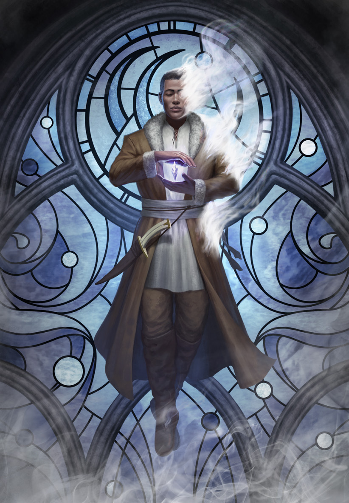
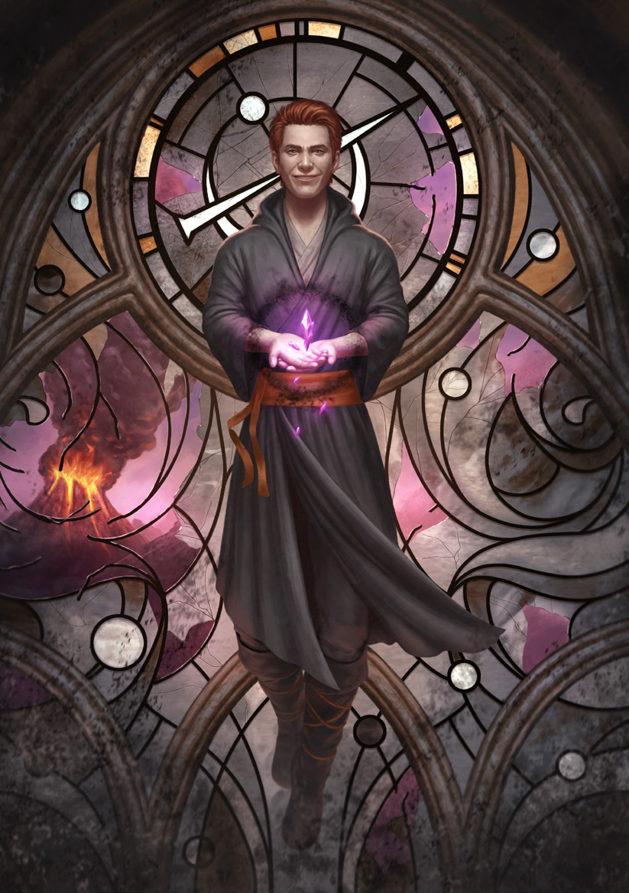
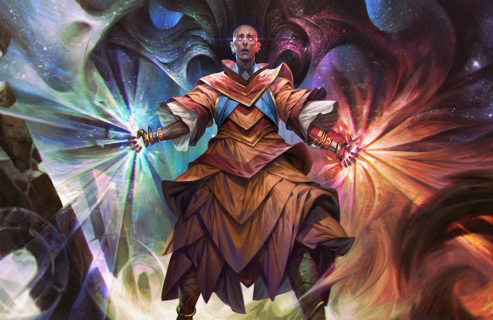
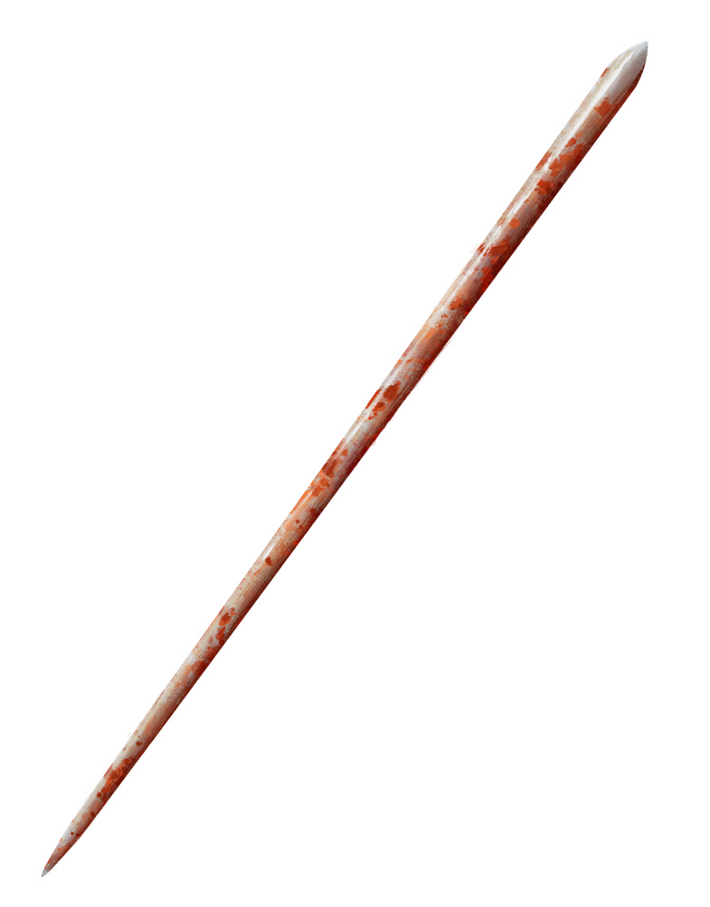
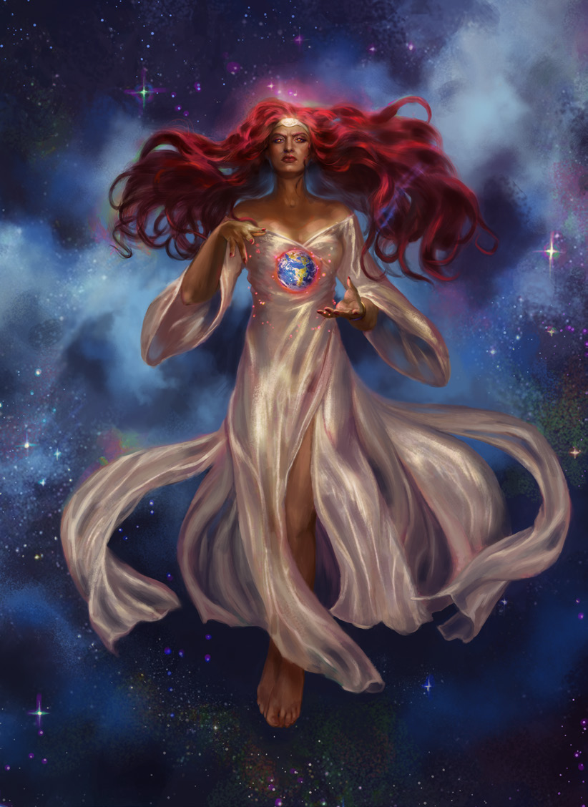

### 司卡德利亞（Scadrial）的碎力（Shards）

在司卡德利亞的大部分歷史中，這個世界受到雅多納西（Adonalsium）的兩股碎力影響：存留（Preservation）與滅絕（Ruin）。十六股碎力雖然曾約定彼此保持距離，這兩股截然相反的力量卻選擇共同尋求均衡。司卡德利亞的宏大故事，正反映了這個根本的平衡問題：由如此對立的碎旨（Intents）塑造的世界，究竟如何存在、運作，更遑論繁榮。兩股碎力的衝突雖然是故事的核心，但最終決定世界命運的，卻是司卡德利亞人民身上展現出的存留與滅絕特質。存留與滅絕的持有者（Vessels）死後，兩股碎力在同一位持有者體內結合為和諧（Harmony），落灰之終（Catacendre）也由此開始。之後，和諧又與雅多納西的另一股碎力——自主（Autonomy）——發生衝突。

### 存留　第一時代

雅多納西碎裂（Shattering of Adonalsium）之際，Leras 取得了存留碎力，成為存留的持有者。在落灰之終與滅絕結合之前，存留是代表穩定與停滯的碎力。

### 持有者

Leras 是存留碎力的第一位持有者。他是個身材矮小、頭髮烏黑的尤立許（Yolish）男子，穿著外套與拖曳至腳邊的長裙，腰帶上掛著一把骨柄小刀。身為存留的持有者，他個性容易興奮，對穩定與秩序滿懷熱情，即使維持這些事物最終會造成傷害也一樣。他特別喜愛統御主（Lord Ruler），欣賞他長存不衰的特質，儘管他並不認同統御主的所作所為。面對變革帶來的混亂時，Leras 的情緒便會從興奮轉為痛苦而反覆無常的憂慮。在這位持有者生命的末期，他的形體開始散成縷縷迷霧，也忘卻了大部分的自我，幾乎完全被碎力的碎旨支配。統御主與紋（Vin）曾以殘體（Slivers）的身分持有存留之力；Leras 死後，卡西爾（Kelsier）與紋則先後以持有者的身分掌握這股力量。

### 神力與事蹟

存留與和他相對的滅絕共同創造了司卡德利亞，以及其中的一切生命。存留希望創造出偉大的事物，能夠自行思考、感受，因此在人類的創造中投入了不成比例的自身力量，儘管他明知這會使自己比滅絕更弱。第一時代時，存留的授予（Investiture）以迷霧呈現氣態，以昇華之井（Well of Ascension）中的力量呈現液態，並以 Lerasium 呈現固態；昇華之井正是存留的垂裂點（Perpendicularity）。存留能透過迷霧賦予鎔金術師（Allomancers）力量，甚至化身霧靈，探訪自己的造物。存留也能聆聽人的心聲，但與滅絕不同，他無法對人的心靈說話。存留創造了鎔金術（Allomancy），也就是迷霧之子（Mistborn）與迷霧人（Mistings）使用的金屬技藝（Metallic Art）。他又與滅絕共同創造了第二種技藝：藏金術（Feruchemy）。藏金術師（Feruchemists）與單藏金術師（Ferrings）能藉此儲存自己的本質與能力，留待日後使用。

NINO VECIA

Leras，存留的持有者。

第 3 章：宇宙學與宗教 82

存留害怕滅絕摧毀他們共同創造的事物，因此違背約定，將滅絕的心智困在昇華之井內。存留以為，這讓滅絕有機會對自己發動致命反擊；但實際上，他只是為了維持牢獄而付出太多心智，因而逐漸消逝。落灰之終前夕，存留將自己的力量散入迷霧，做最後一搏，試圖迫使司卡德利亞人民綻裂（Snap）。隨後 Leras 死去，將存留之力留給下一位持有者。

### 宗教詮釋

統御主打壓泰瑞司（Terris）宗教，也一併壓下了存留的故事。不過，在坎得拉（kandra）保存的最古老泰瑞司宗教記載中，有一位名為 Terr 的神祇。泰瑞司族之名源自這位神祇，而祂的名字譯意為「存留」。對泰瑞司宗教的信徒而言，信仰的一項核心教義就是：存留勝於毀滅。同一時期，司卡（skaa）畏懼迷霧，避免夜間外出。大多數貴族認為，對迷霧的恐懼只是司卡愚蠢的迷信，但其中許多人依然對迷霧感到不安。鎔金術師則是例外，尤其是迷霧之子，他們表示自己對迷霧有種親近感。最後帝國（Final Empire）覆亡至落灰之終之間，迷霧愈來愈盛，有時終日不散，甚至令人染病或死亡。司卡認為，這是統御主遭到背叛後降下的懲罰；但實際上，這是存留的一場布局，目的是讓更多鎔金術師綻裂，並傳遞擊敗滅絕的方法線索。在司卡德利亞南方人（Southern Scadrian）的 Jaggenmire 教誨中，類似存留的力量被人格化為 Frue。

NINO VECIA

雅提（Ati），滅絕的持有者。

### 滅絕　第一時代

雅多納西碎裂之際，雅提取得了滅絕碎力，成為滅絕的持有者。在落灰之終與存留結合之前，滅絕是代表毀滅、熵增與衰敗的碎力。

### 持有者

滅絕的持有者雅提有著火焰般的紅髮，身穿樸素、敞開的長袍，露出部分肌膚。皮膚底下彷彿有昆蟲般的陰影爬行移動，有時甚至從他身上突出，像是企圖逃脫。他原本以仁慈慷慨著稱，被認為最有能力抗拒滅絕的影響，因此是承接滅絕碎力的合適人選。即使背負著毀滅的衝動，他仍有一段時間散發著溫暖的氣息。身為滅絕的持有者，

> 「對立。平衡。我想，你終究會學會痛恨它，雖然存留始終做不到。」
> ——滅絕

第 3 章：宇宙學與宗教 83

他曾試圖讓這股碎力的碎旨遠離徹底毀滅，轉向熵增與衰敗的自然過程。隨著時間流逝，雅提愈來愈容易受碎力的碎旨影響，變得工於操弄而殘酷，時常設法讓他人替自己辦事。

### 神力與事蹟

滅絕與存留共同創造了司卡德利亞世界，以及其中的一切生命。兩者立下約定：凡是他們共同創造的事物，終有一天都會由滅絕摧毀。第一時代時，滅絕的授予以黑霧呈現氣態，以海司辛深坑（Pits of Hathsin）下方的力量呈現液態，並以天金（atium）呈現固態；海司辛深坑正是滅絕的垂裂點。（海司辛深坑中的天金晶洞並不是滅絕神金屬（God Metal）的純粹形態，而是天金與電金（electrum）自然形成的合金。）滅絕能對被血金術尖刺（Hemalurgic spike）刺穿之人的心靈說話，但與存留不同，他無法聽見他們的心聲。滅絕與存留各自付出等量授予，共同創造了藏金術之力。然而，金屬技藝中的血金術（Hemalurgy）完全由滅絕之力驅動，必須破壞並傷害一個生命，才能將力量賦予另一個生命。有時，人們能察覺滅絕的存在或注意，感受到一團旋繞的黑霧。這主要出現在意識界（Cognitive Realm），但在滅絕受囚期間，實體界（Physical Realm）的昇華之井附近也能見到。

### 囚禁

滅絕尚未實現約定中毀滅一切的終局，存留便背叛了他，將他的心智囚禁於昇華之井——存留的垂裂點。為了尋求自由，滅絕持續干預人類。囚禁限制了他的能力，但他耐心十足、深謀遠慮，總在尋找機會，悄悄將最後帝國推向自己選定的方向。在統御主長達千年的統治期間，他一直操弄著統御主，也竄改書面文字，藉此改變預言與宗教。他的計畫終於奏效，昇華戰士（Ascendant Warrior）紋最終在昇華之井釋放了滅絕的心智。

### 滅絕的代理人

滅絕仍缺少一大部分力量。他直接對植有血金術尖刺之人的心靈說話，影響他們的情緒與感知。他常常扮演不同身分，以便更有效地利用目標，假扮成已故的導師、逝去的摯愛，甚至神祇。他暗中挑選某些人，強迫他們植入第一根尖刺；又說服另一些人植入更多尖刺，藉此取得壓制他們意志、強行操控其行動的能力。許多滅絕的代理人並不知道自己受到他的影響，但也有些人直接為他效命，包括鋼鐵審判者（Steel Inquisitors）與克羅司（koloss）。滅絕將世界推向終結的同時，也挑釁、嘲弄著敵人。他指揮鋼鐵審判者與數十萬克羅司展開軍事行動，而每一個克羅司都是由最後帝國的人民製成。他甚至撼動司卡德利亞的地表，引發地震、火山爆發，以及更密集的落灰。他也以更隱密的方式瓦解政府、孤立個人，深信社會一旦崩解，人們便會失去希望。滅絕雖然四處尋找自己的軀體，卻始終未能將其取回。落灰之終前夕，紋承接了存留碎力，最後犧牲自己，以自身心智對抗雅提的心智，將他消滅。

### 宗教詮釋

泰瑞司宗教的古老記載提到，Terr 神有一個未具名的對立存在。這個存在被描述為一股隱約邪惡的力量，宗教學者引述教誨，認為「建造勝於毀滅」。在司卡德利亞南方人的 Jaggenmire 教誨中，類似滅絕的力量被人格化為 Herr。

力量的週期

存留之力每隔 1,024 年就會充滿昇華之井。踏入井中的人便能使用這股力量，短暫地代行存留之能。此人身為存留的殘體，能夠影響存留與其他碎力之間的約定。滅絕便利用這個機會，設計了逃脫計畫。

第 3 章：宇宙學與宗教 84

### 和諧　第二時代

和諧是存留與滅絕結合而成的碎力。第一時代末期，紋犧牲自己的心智，摧毀了滅絕的心智。隨後，沙賽德（Sazed）在最終昇華（Final Ascension）期間承接了存留與滅絕兩股碎力。沙賽德選擇以和諧作為碎力的新名號，成為其持有者，也成為寰宇（cosmere）中授予最為充沛的存在之一。

### 持有者

身為泰瑞司守護者（Keeper），沙賽德一生花了許多時間記錄、編目與分享資訊。他專研宗教，相信古典時期的司卡德利亞（Classical Scadrial）眾多信仰之中，都蘊含著美與真理。沙賽德身形高瘦，穿著侍者長袍，下襬呈層疊的 V 形剪裁。他佩戴臂環、手鐲、戒指與耳環形式的金屬意識庫（metalminds）。身為卡西爾團隊的一員，沙賽德在最後帝國的覆亡中扮演關鍵角色。落灰之終前不久，沙賽德失去了幾位摯愛之人，開始質疑自己對使命的投入，以及信仰的價值。在這番沉痛打擊之後，沙賽德承接了滅絕與存留兩股碎力。他運用自己尚存的世界宗教知識，結合兩股力量，成為和諧，以永世英雄（Hero of Ages）的身分實現泰瑞司預言。如欲進一步了解昇華前的沙賽德，請見第 5 章〈沙賽德〉。和諧掌握兩股碎力的力量，被視為寰宇中最強大的存在之一。儘管如此，兩股力量彼此對立的碎旨，仍常讓他感到束縛，而和諧也認為，只要可能，最好不要介入。以碎力的形貌現身時，和諧看起來與生前相同；不過，披覆在他身上的不再是樸素的泰瑞司長袍，而是永恆與自然景貌的意象。

### 神力與事蹟

昇華之際，和諧運用自己從各宗教學得的知識，重塑了司卡德利亞世界。他將行星軌道移往離太陽更遠之處，封閉灰山（Ashmounts），並讓古典時期的動植物重返世界。詳情請見第 4 章〈和諧的昇華〉。

沙賽德，和諧的持有者。

PETAR PENEV

和諧的授予以迷霧呈現氣態，以南司卡德利亞（Southern Scadrial）的和諧垂裂點中的力量呈現液態，並以 Harmonium（又稱 ettmetal）呈現固態。憑藉兩股碎力的力量，和諧既能聆聽被血金術尖刺刺穿之人的心聲，也能對他們的心靈說話。和諧的垂裂點受到司卡德利亞南方人嚴格管控，是司卡德利亞與其他世界之間最主要的通行途徑。垂裂點周圍地區是 ettmetal 的產地，這種金屬是 Malwish 科技的關鍵材料。

### 和諧的代理人

落灰之終後，和諧是唯一常駐司卡德利亞的碎力，他盡量不直接介入大多數凡人的事務。不過，和諧會與身上植有血金術尖刺的人交流，透過這些中間人引導司卡德利亞的局勢。坎得拉是他主要的代理人，盆地居民稱他們為無面不朽者（Faceless Immortals）。第 5 章介紹了坎得拉，並詳述他手下兩位代理人 MeLaan 與 ReLuur。有些坎得拉不滿和諧暗中操弄他們，例如又稱索血者（Bleeder）的 Paalm。為了擺脫和諧的控制，Paalm 轉而為 Trell 效命；Trell 是自主碎力的化身（見第 4 章〈Trell 的崛起〉）。和諧的其他代理人包括人稱鐵眼（Ironeyes）的前鋼鐵審判者（見第 5 章〈沼澤〉），以及道教（the Path）的信徒（見本章後文〈主要宗教〉）。

### 失和（Discord）

種種跡象顯示，滅絕與存留之間的均衡或許更多只是理想，尚未成為現實；而泰瑞司預言則說，永世英雄的名字「將是失和」。

### 宗教詮釋

落灰之終後的大多數宗教都承認和諧這位神祇。落灰之終前的早期倖存者教（Survivorism）信徒，將凡人沙賽德奉為神聖初代見證人（Holy First Witness）。他昇華後，倖存者教視他為神，卻不崇拜他。道徒（Pathians）直接追隨和諧，但也遵從他的指示，不崇拜他。他們改而研讀《創始之書》（Words of Founding）記載的古典宗教，尋求自己的真理。許多道教信徒會佩戴道徒耳環；其中有些其實是小型血金術尖刺，能讓和諧與佩戴者直接交談。碎刺教（Sliverism）則將和諧視為失敗的永世英雄。他們相信滅絕本來就應該始終受到囚禁，並尊崇統御主，因為他為世界爭取了千年的喘息。Trellism 是建立在歷史宗教 Trelagism 基礎上、崇拜自主碎力的信仰。他們認為和諧施加令人窒息的影響，阻礙進步與獨立。

> Trell 要求僕從證明自己。對抗逆境。對抗社會。對抗我們承擔的身分。當好幾個人都適合同一種人生位置時……嗯，只有最強的人能活下來，得到獎賞。

一根 Trellium 尖刺。

第 3 章：宇宙學與宗教 86

### 自主　第二時代

自主是代表個人主義、自主行動與堅毅不屈的碎力。雅多納西碎裂之際，巴伐丁（Bavadin）取得了自主碎力，成為自主的持有者。

### 持有者

巴伐丁長期致力於滲透或控制其他行星，而她在司卡德利亞的作為表明，她毫不避諱直接對抗其他碎力。

### 神力與事蹟

自主的勢力遍及寰宇。滅絕與存留定居於一顆行星，自主卻不滿足於只有一個家園。她反而設法將影響力擴展至能力所及的其他恆星與星系。自主最初落腳於泰爾登（Taldain），展開自己的追求。在這顆行星上，她的力量以授予之術（Invested Arts）呈現：晝面（Dayside）有御沙術，暗面（Darkside）則有星紋。自主想介入另一顆行星時，往往會挑選一位傑出人物作為化身，承載她的一部分力量。自主的持有者巴伐丁雖然留在泰爾登，但這股碎力的化身已在寰宇許多世界的事件中扮演關鍵角色。自主在司卡德利亞的化身名為 Trell，是古典時期的司卡德利亞的一位古老神祇。落灰之終後，自主將司卡德利亞日益進步的科技發展視為威脅。她開始透過「組織」（the Set，第 5 章有介紹）與新興宗教 Trellism 對付司卡德利亞，並威脅說，除非「組織」能掌控這顆行星，否則她就要摧毀司卡德利亞。

自主的授予與影響力，在司卡德利亞表現為受授予者發光的紅眼，以及固態的 Trellium（又稱 bavadinium）。自主能對被血金術尖刺刺穿之人的心靈說話，卻無法聽見他們的心聲。由於 Trellium 在血金術上的獨特用途，植入 Trellium 尖刺的人也同樣能獲得這種能力，對被血金術尖刺刺穿之人的心靈說話。

### 宗教詮釋

古典時期的司卡德利亞，自主鼓勵 Nelazan 人創立了 Trelagism。這個宗教後來雖被最後帝國摧毀，其習俗仍記錄在和諧的《創始之書》中。落灰之終後，「組織」創立了 Trelagism 的分支 Trellism，藉此爭取一股碎力的庇護。Trelagism 著重於在黑暗中發現美，Trellism 卻教導信徒，Trell 是一位造物主，偏愛那些運用權力達成目的之人。（這些宗教的更多詳情，請見本章後文〈Trelagism 與 Trellism〉。）

巴伐丁，自主的持有者。

ERNANDA SOUZA

