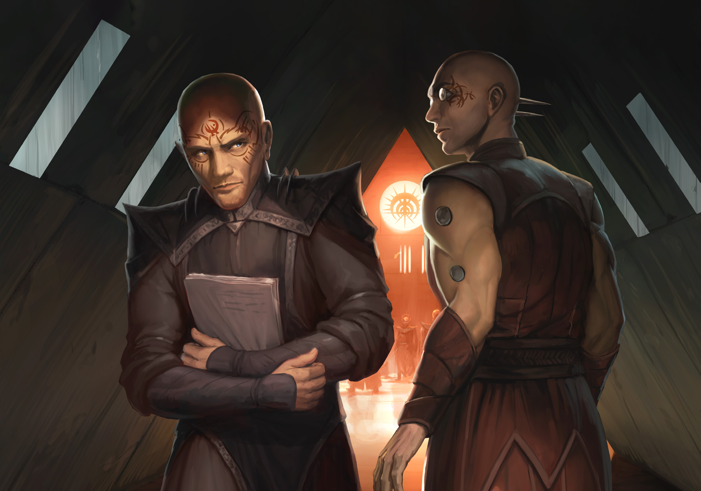

### 第一時代的鋼鐵審判者（Steel Inquisitors Era 1）

鋼鐵審判者是統御主（Lord Ruler）麾下最令人畏懼的工具，擔任鋼鐵教廷（Steel Ministry）的執法者、將軍與劊子手。他們居於審判廷（Canton of Inquisition）的最高層，貴族與司卡（skaa）都只敢在陰暗角落低聲談論他們的力量。每一位鋼鐵審判者的外貌都令人膽寒：身穿飄逸的黑色法衣，原本雙眼所在之處插著尖刺，周圍盤繞著刺青。許多審判者（Inquisitors）守衛著陸沙德（Luthadel）市中心的克雷迪克．霄（Kredik Shaw），但他們也可能駐守其他教廷建築、陪同聖務官（obligators）前往隱密的安撫（Soothing）站，或在帝國各地執行任務。泰瑞司統御區（Terris Dominance）經常可見審判者的身影，他們在當地監督審判廷的育種計畫與侍從官計畫（Steward Program）。必要時，他們甚至會被派去遏止叛亂，或阻擋暴走的克羅司（koloss）大軍。（關於他們在最後帝國（Final Empire）的職責，詳見第 5 章「鋼鐵教廷」。）

### 傳說

鋼鐵審判者聲名可怖，司卡與貴族都認為他們幾乎不能算是人類，而是灌注了統御主本人黑暗意志的生物。鋼鐵審判者與審判廷專注於執行統御主的法律，尤其是針對違禁使用鎔金術（Allomancy）或混合血統的法令。審判者施以駭人的懲罰，暴行之殘酷令人難以想像，往往使整個房間都染滿鮮血。最後帝國的人民相信，審判者根本無法抵抗，更遑論殺死。

### 製造方式

鋼鐵審判者是透過血金術（Hemalurgy）製造出來的。首先，血金術師（Hemalurgist）以金屬尖刺殺死一個人，將受害者的一種鎔金能力（Allomantic power）或藏金能力（Feruchemical power）注入尖刺。接著，再將這根尖刺植入新的審判者體內，賦予他竊取而來的能力。典型的審判者有九根尖刺，賦予他八種鎔金能力：

- 四根鋼（steel）尖刺，雙眼各一根、肋部兩根，賦予鐵（iron）、鋼、錫（tin）與白鑞（pewter）四種實體（physical）鎔金能力。眼中的尖刺也賦予強化的鋼視（steelsight），讓審判者能以藍色鎔金線條勾勒出的輪廓「看見」世界。無論在何種光照條件下，他們都能看得同樣清楚，也能學會辨識顏色。

- 四根青銅（bronze）尖刺，全都位於肋部，賦予鋅（zinc）、黃銅（brass）、紅銅（copper）與青銅四種意志（mental）鎔金能力。

- 最後一根鋼製關鍵尖刺（linchpin）置於肩部，將整組尖刺連結在一起。日後若拔除關鍵尖刺，審判者就會死亡。

### 超自然能力

鋼鐵審判者是可怕的敵人。他們的感官更加敏銳，速度與力量都更強，專注力也驚人，但容易疲倦，需要經常休息。多數審判者都以標準的九根尖刺製成，獲得實體與意志鎔金術，但有些審判者植入的尖刺不同，或有額外的尖刺。例如，有些審判者擁有一根金（gold）尖刺，賦予金藏金術（gold Feruchemy）；許多審判者則有一根天金（atium）尖刺，賦予天金鎔金術（atium Allomancy）。許多青銅迷霧人（Mistings）被招募成為審判者，因為植入青銅尖刺能強化他們原有的鎔金術感知能力。迷霧之子（Mistborn）成為鋼鐵審判者後尤其強大，因為每一根鎔金術尖刺，都會讓他們在燃燒（burning）對應金屬時更加強大。

### 血金術的弱點

在最後帝國時期，統御主控制著審判者。由於每位審判者體內都有許多尖刺，他們的意志會受外力控制，通常是透過硬鋁（duralumin）強化的情緒鎔金術（emotional Allomancy）來達成。

> 據說一位鋼鐵審判者的力量，勝過一千名士兵。

第 3 章：宇宙學與宗教 90

### 知名的鋼鐵審判者

最後帝國末年，鋼鐵審判者約有二十位；本節介紹其中幾位知名人物。有一半留在陸沙德，許多人也曾在泰瑞司統御區活動。

### 班達（Bendal）

班達致力於調查教廷內部的腐敗，希望找出正當理由，罷免至上聖祭司（lord prelan），讓審判者成為教會理所當然的領導者。

### 卡爾（Kar）

卡爾是最年長、地位最高的審判者之一。他曾是士兵，至今仍是令人畏懼的戰士。卡爾既有耐心又善於算計，他認為鋼鐵審判者應是統御主最重要的僕人。

### 沼澤（Marsh）

沼澤是最後帝國時期最後一位被製造出來的審判者，在帝國最後的日子裡扮演關鍵角色。他與其他審判者不同，撐過了落灰之終（Catacendre），成為傳說中的人物（見第 5 章「沼澤」）。

### 最後帝國滅亡之後

統御主死亡的那一夜，最新的鋼鐵審判者沼澤殺死了許多其他審判者。接下來的一年，剩下的審判者成為滅絕（Ruin）的主要代理人，在祂的直接影響下行動。他們聚集於瑟藍集所（Conventical of Seran），擴充人數，準備展開滅絕計畫的最初幾步。審判者隨時間變得更強大、更致命。滅絕解除了統御主對他們施加的少數限制，賜予他們額外的尖刺，讓他們能更肆無忌憚地屠殺與破壞。鋼鐵審判者奪取一支克羅司大軍的指揮權後，便進軍泰瑞司統御區。他們殺害俘虜的守護者（Keepers），製造更多血金術尖刺（Hemalurgic spikes），賦予審判者藏金術（Feruchemy）的力量。滅絕從昇華之井（Well of Ascension）獲釋後，鋼鐵審判者便擔任祂的將軍，直到最後在陸沙德對上紋（Vin），迎來末日。

KEVIN O’NEILL

一位鋼鐵審判者與一位審判廷的聖務官。

