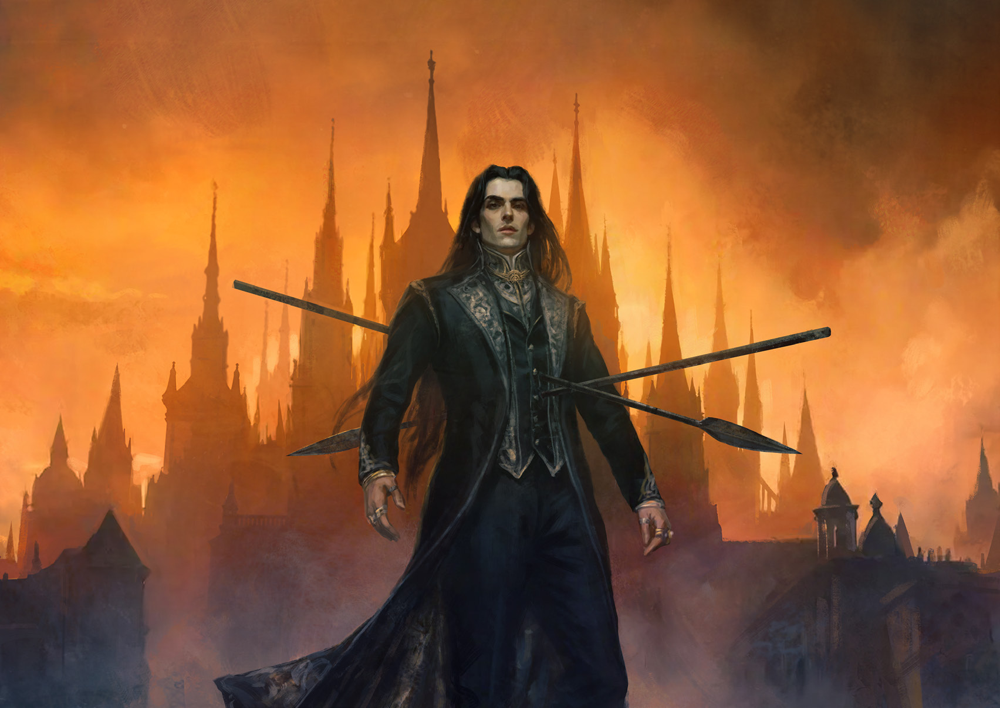

### 統御主：第一時代

統御主（Lord Ruler）是不朽的暴君，擁有深不可測的力量與本領。他塑造了最後帝國（Final Empire），並統治帝國長達一千年。他建立鋼鐵教廷（Steel Ministry），用來奴役人民、治理帝國，並持續灌輸自己是這片土地上唯一神祇的信念。在最後帝國，人人都認識他，以他之名起誓，也畏懼他。儘管年歲早已超出常理，統御主通常仍以英俊青年的面貌示人。他既能牢牢攫住眾人的注意力，又能以強大的情緒鎔金術（Emotional Allomancy）壓抑情緒，因此他的存在既令人感到壓迫，也令人著迷。他平靜而憂鬱，卻也會突然暴怒，或猛烈地流露激情。他的眼界之寬廣，一如他的統治之漫長。統御主征服王國、塑造社會、奴役各族、創立宗教、摧毀叛亂、強加秩序，也焚毀過整座城市。

### 神話

鋼鐵教廷教導人民，在最後帝國建立以前，統御主就已是強大的君主。教廷稱他為無限殘體（Sliver of Infinity）；對最後帝國的大多數人而言，他是他們一生唯一認識的神。宣稱統御主受神意眷顧的說法，建立在兩個故事之上：他擊敗深暗（Deepness），以及他在昇華之井（Well of Ascension）接受神力。

### 他的英雄事蹟

數百年來，鋼鐵教廷編織出深暗的傳說，將它描繪成一頭無形的野獸，貪婪吞噬、帶來混亂。據說統御主擊敗了它，拯救人民，因而贏得他們永遠的忠誠；而為了懲罰人民缺乏信仰，他帶來了灰燼與迷霧。

統御主的情緒鎔金術

統御主持續以壓倒性的安撫（Soothing）籠罩周遭區域。距離他 500 英尺內的其他角色，在與叛逆或正向情緒有關的檢定（Test）中取得劣勢（Disadvantage）。GM 可自行決定，紅銅雲（coppercloud）是否能減輕這種安撫的效果。

統御主被反抗軍的長矛刺穿。

GAL OR

### 世代效忠

鋼鐵教廷也教導人民，統御主大大獎賞了最親近的盟友。那些協助他擊敗深暗的朋友，獲賜鎔金術（Allomancy）；而他們的後代，也就是貴族，則因這份忠誠而獲得地位、權力與自由。

### 真相

事實上，成為統御主的那個人，是名叫拉剎克（Rashek）的泰瑞司（Terris）嚮導兼藏金術師（Feruchemist）。拉剎克奉一位叔舅輩男性親屬之命，背叛並殺害了一名叫艾蘭迪（Alendi）的人。這位親人就是泰瑞司的世界引領者（Worldbringer）關（Kwaan）；艾蘭迪則是一位正在尋找昇華之井的國王。

### Fullborn 的昇華

拉剎克在昇華之井掌握了碎力（Shard）的神力，成為存留（Preservation）的殘體（Sliver）。他用這股力量重塑世界，減輕深暗的影響。深暗其實並非怪物，而是受到滅絕（Ruin）增強的存留迷霧。拉剎克也賦予自己迷霧之子（Mistborn）的能力，成為世上第一位 Fullborn，也就是能運用所有鎔金術與藏金術（Feruchemy）能力的人。他害怕另一位 Fullborn 會威脅自己的統治，因此將幾乎所有在世的藏金術師變成霧魅（mistwraiths）。拉剎克結合兩種金屬技藝（Metallic Arts），還能將自己的力量複合（Compound），大幅倍增其效果。尤其是透過天金（atium）的複合術（Compounding），他以人為方式延長了自己的壽命。

### 支配的教義

拉剎克掌握昇華之井的神力時，得知了滅絕遭囚禁的事，以及井中神力的循環。他知道滅絕一旦獲釋，就會毀滅世界，因此決心打造一個足以抵抗滅絕的統一帝國。拉剎克自認是世界的救主，開始以統御主之名四處征服。他將其他君主與軍閥變成迷霧之子，以此收買他們加入自己的志業，貴族階級也由此誕生。他無情地摧毀一切威脅自身權力的事物，包括軍隊、宗教，乃至自己的泰瑞司族人。最後帝國就此誕生。

### 碎力的影響

統御主年輕時就充滿控制欲與仇恨。統治最後帝國的一千年歲月，加深了那些仇恨，也使他的心愈加冷硬。影響他的碎力也促成了這種逐漸發生的改變：他與存留的親近，助長了他那令人窒息的控制欲；滅絕的低語則鼓動他以追求更大福祉為名，變得更加暴力、更加殘酷。最終，統御主的決心化為憤懣與疲憊。

### 不朽暴政

憑藉軍隊、鋼鐵教廷與高壓奴役，統御主統治了超過一千年。若想進一步了解他如何崛起並掌權統治，請見第 4 章。

### 階級結構

統御主藉由分化人民來維持權力。他將貴族與司卡（skaa）隔離，試圖把鎔金術限制在貴族之中；他也奴役泰瑞司人，企圖根除藏金術。司卡被困在貧窮與絕望中，而貴族則持續維繫統御主與鋼鐵教廷建立的體制，親手妨礙自己的自由。

### 勞作與實業

統御主花了數百年鞏固權力，好讓自己在首次昇華（Ascension）一千年後，能親自重返昇華之井，繼續囚禁滅絕。那口井就藏在他的克雷迪克．霄（Kredik Shaw）宮殿下方。他害怕自己可能失敗，便利用坎得拉（kandra）藏起滅絕的身體，並在帝國各地準備儲藏洞窟，存放糧食與資訊。

### 最後帝國之後

統御主死後，許多司卡不知道失去他那微薄的供給後，該如何生存。部分原因在於他對各統御區（dominances）的嚴密控制。儘管他做了種種預防措施，卻沒有讓人民準備好，在他離去後照顧自己。

你們不知道我為人類做了什麼。即使你們看不出來，我也是你們的神。

第 3 章：宇宙學與宗教 89
