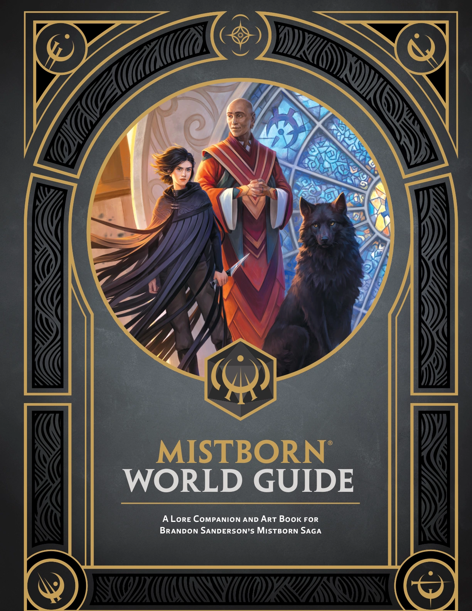
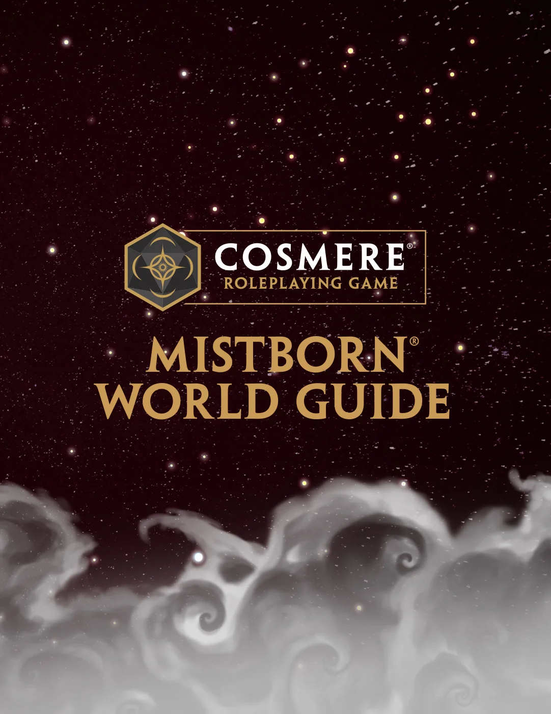
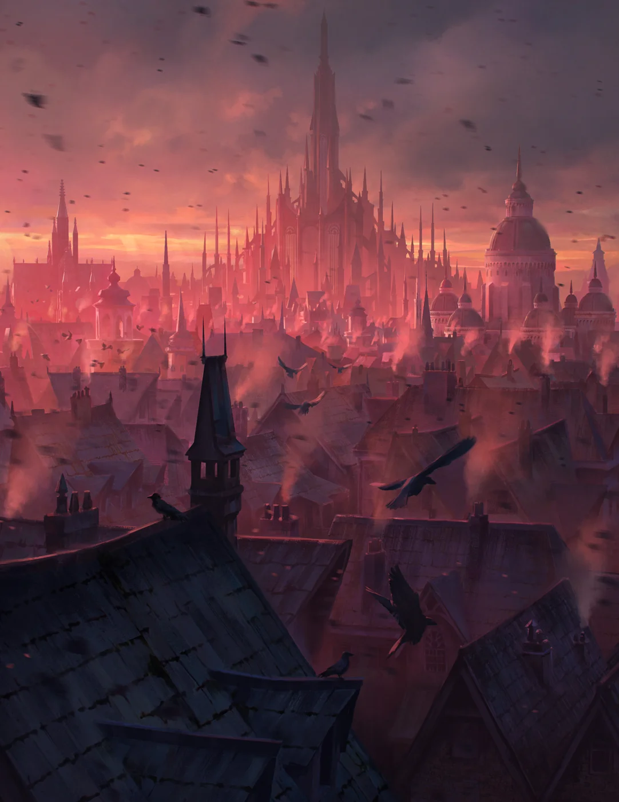

## 《迷霧之子®世界指南》（Mistborn® World Guide）

布蘭登．山德森（Brandon Sanderson）《迷霧之子》系列（Mistborn Saga）的設定導讀與畫集

## 寰宇®角色扮演遊戲（Cosmere® Roleplaying Game）

## 《迷霧之子®世界指南》（Mistborn® World Guide）

## 寰宇®角色扮演遊戲（Cosmere® Roleplaying Game）

寰宇® RPG（Cosmere® RPG）由 Brotherwise Games 與 Dragonsteel Entertainment 共同創作。 

總監製：Brandon Sanderson 

製作人：Isaac Stewart and Dan Wells 

創意總監：Johnny O’Neal 

世界指南首席設計師：Meric Moir and Lydia Suen 

敵手設計負責人：Imogen Gingell 

設計師：ace baldwin, Andrew Fischer, Imogen Gingell, Sen H.H.S., Laura Hirsbrunner, Ross Leiser, Amber Litke, Sadie Lowry, Jessica Marcrum, and Matthew Wiens 

編輯：Laura Hirsbrunner and Eli Scovill 

設定一致性編輯：Karen Ahlstrom 

歌世者（Worldsingers）：David Behrens, Joshua Harkey, Eric Lake, Ben Marrow, Ian McNatt, and Evgeni “Argent” Kirilov 

敏感議題協調：Basil Wright 

敏感議題顧問：Em Carlson, Daniel Delgado, Basheer Ghouse, and quinn b. rodriguez 

無障礙顧問：Chris Hopper 

校對：Jodi T. Black, James Kauffman, and J. Russell Schneider 

品牌與行銷：Adam Horne, Matt Molandes, and Jillian Schumacher

### 寰宇 RPG（Cosmere RPG）核心團隊

首席設計師：Andrew Fischer and Lydia Suen 

首席撰稿人：Meric Moir 

首席編輯：Laura Hirsbrunner 

首席平面設計師：Gordon McAlpin 

專案負責人：Lyla McBeath Fujiwara 

美術總監：Matthew DeMino and Ben McSweeney 

平面設計師：Gordon McAlpin 

概念美術：Marie Seeberger 

封面插畫：Svetlana Kostina 

內頁插畫：Ivana Abbate, Archie Adiartama, David Alunan, Anthony Avon, Cristi Balanescu, Marco Bernardini, Tristan Bideau, Valeria Casale, Guilherme Castro, Joshua Chia, Daniel Correia, Humble Squid Creatives, Carson Daniel, Matt DeMino, Maria Dimova, Pedro Carlos Dutra, Polar Engine, Micah Epstein, Siraj Fakhri, Logan Feliciano, Dave Frasheski, Ana Grigorieva, Huu Ha, Antti Hakosaari, Austin Hartell, Florian Heackh, White Horn, Vladimir Ishelin, Jordan Kerbow, Svetlana Kostina, Romain Kurdi, Peng Lu, Howard Lyon, Erel Matita, Gordon McAlpin, Miranda Meeks, Sydney Mills, Victor Minguez, Artur Mósca, Wilson Nugraha, Kevin O’Neill, Gal Or, Vlad Ovoy, Kimberly Pantoni, Petar Penev, Klaus Pillon, Andrea Piparo, Steve Prescott, Chriss Rallis, Saeed Ramez, Alief Rusdiatama, Sami Rytkönen, Deandra Scicluna, Marie Seeberger, Cynthia Sheppard, Kevin Sidharta, Ernanda Souza, Anna Steinbauer, Isaac Stewart, Darko Stojanovic, Sonderflex Studio, Fernanda Suarez, Brian Taylor, Lucas Torquato, Leon Tuckker, Randy Vargas, Nino Vecia, Anna Verhoog, Mahardika Wahyu, Zuzanna Wuzyk, Botanica Xu, and Kieran Yanner 

Dragonsteel 美術團隊：Shawn Boyles, Rachael Lynn Buchanan, Anna Earley, Hayley Lazo, Jennifer Neal, Ben McSweeney, and Priscilla Spencer

© 2026 Brotherwise Games, LLC。本書改編自 Brandon Sanderson 的《迷霧之子®》系列小說；小說著作權 © 2006、2007、2008、2011、2015、2016、2022 歸 Dragonsteel Entertainment, LLC 所有，並經 Dragonsteel Entertainment, LLC 明確許可使用。

Plotweaver™ 遊戲系統 © 2025 Brotherwise Games, LLC。

ISBN: 978-1-966528-07-4

初版印刷（v1.02）

中國印製

Dragonsteel

Brotherwise Games

## 目錄

| 章節 | 原書印刷頁碼 |
| --- | --- |
| 引言 | 3 |
| 本書使用方式 | 4 |
| 關於寰宇（Cosmere） | 5 |
| 第 1 章：世界 | 7 |
| 司卡德利亞（Scadrial）的各個時代 | 7 |
| 司卡德利亞的文化 | 8 |
| 迷霧 | 8 |
| 金屬技藝（Metallic Arts） | 9 |
| 帝國之前 | 20 |
| 統御主（Lord Ruler）的世界 | 20 |
| 和諧（Harmony）的世界 | 27 |
| 科學與科技 | 29 |
| 第 2 章：地區與文化 | 33 |
| 司卡德利亞的人民 | 33 |
| 第一時代的司卡德利亞各地 | 36 |
| 中央統御區（Central Dominance） | 40 |
| 東方統御區（Eastern Dominance） | 45 |
| 北方統御區（Northern Dominance） | 47 |
| 南方統御區（Southern Dominance） | 49 |
| 西方統御區（Western Dominance） | 50 |
| 外圍統御區（Outer Dominances） | 52 |
| 泰瑞司統御區（Terris Dominance） | 54 |
| 第二時代的司卡德利亞各地 | 57 |
| 依藍戴盆地（Elendel Basin） | 60 |
| 泰瑞司聚居地（Terris Enclaves） | 67 |
| 蠻橫區（The Roughs） | 70 |
| 南司卡德利亞（Southern Scadrial） | 74 |
| 第 3 章：宇宙學與宗教 | 77 |
| 雅多納西（Adonalsium） | 77 |
| 司卡德利亞星系 | 78 |
| 其他世界 | 80 |
| 司卡德利亞的碎力（Shards） | 82 |
| 統御主 | 88 |
| 鋼鐵審判者（Steel Inquisitors） | 90 |
| 主要宗教 | 92 |
| 第 4 章：司卡德利亞歷史 | 99 |
| 虛假歷史 | 99 |
| 古典時期的司卡德利亞（Classical Scadrial） | 99 |
| 第一時代：灰燼世界 | 102 |
| 第二時代：落灰之終（Catacendre）之後 | 109 |
| 第 5 章：盟友與組織 | 115 |
| 本章使用方式 | 115 |
| 依藍德．泛圖爾（Elend Venture） | 116 |
| 塞特家族（House Cett）：灰侯（Ashweather）與奧瑞安妮（Allrianne） | 118 |
| 泛圖爾家族（House Venture）：Straff 與 詹（Zane） | 120 |
| 卡西爾（Kelsier）與他的團隊 | 122 |
| 坎得拉（The Kandra） | 125 |
| 沼澤（Marsh） | 126 |
| 魁利恩（Quellion） | 127 |
| 沙賽德（Sazed） | 128 |
| 鋼鐵教廷（Steel Ministry） | 129 |
| 廷朵（Tindwyl） | 132 |
| 紋（Vin） | 133 |
| 尤門（Yomen） | 135 |
| 依藍戴警署（Elendel Constabulary） | 136 |
| 鬼血（Ghostbloods） | 138 |
| Malwish | 140 |
| 瑪拉席．科姆斯（Marasi Colms） | 141 |
| MeLaan | 143 |
| 拉奈特（Ranette） | 144 |
| ReLuur | 145 |
| 「組織」（The Set） | 146 |
| 史特芮絲．拉德利安（Steris Ladrian） | 149 |
| 瓦希黎恩．拉德利安（Waxillium Ladrian） | 151 |
| 韋恩（Wayne） | 152 |
| 第 6 章：第一時代的重要地點 | 155 |
| 這些地點的使用方式 | 155 |
| 新月荒原（Crescent Wastelands） | 158 |
| 陸沙德（Luthadel） | 162 |
| 海司辛深坑（Pits of Hathsin） | 170 |
| 泰瑞司統御區 | 174 |
| 第 7 章：第二時代的重要地點 | 181 |
| 這些地點的使用方式 | 181 |
| Bilming | 184 |
| Conrad Delta | 189 |
| 依藍戴（Elendel） | 192 |
| New Seran | 201 |
| 北方蠻橫區（The Northern Roughs） | 207 |
| 第 8 章：敵手（Adversaries） | 213 |
| 敵手的使用方式 | 213 |
| 顧問 | 217 |
| 「組織」密探（Agent of the Set） | 218 |
| Trell 的化身 | 220 |
| 保鑣 | 222 |
| 平民（Commoner） | 223 |
| 騙術高手（Con Artist） | 224 |
| 偵探（Detective） | 225 |
| 打手 | 226 |
| 狂熱者 | 227 |
| 藏金術師（Feruchemist） | 228 |
| 駐軍士兵 | 230 |
| 鬼血成員（Ghostblood） | 231 |
| 殺霧者（Hazekiller） | 232 |
| 血金嵌合獸（Hemalurgic Chimera） | 234 |
| 線民 | 236 |
| 鐵眼（Ironeyes） | 238 |
| 坎得拉 | 240 |
| 克羅司（Koloss） | 242 |
| 克羅司混血軍官（Koloss-Blooded Officer） | 246 |
| Malwish 飛行員 | 247 |
| 策劃者（Mastermind） | 248 |
| 商人（Merchant） | 250 |
| 迷霧之子（Mistborn） | 251 |
| 霧魅（Mistwraith） | 254 |
| 聖務官（Obligator） | 255 |
| 執法人員 | 256 |
| 亡命之徒 | 258 |
| 反抗者（Rebel） | 260 |
| 社交名流 | 261 |
| 鋼鐵審判者 | 262 |
| 敵手模組（Adversary Modules） | 264 |
| 血統模組（Ancestry Modules） | 265 |
| 鎔金術模組（Allomancy Modules） | 266 |
| 藏金術模組（Feruchemy Modules） | 272 |
| 血金術尖刺模組（Hemalurgic Spike Modules） | 277 |
| 附錄 A：發音指南 | 279 |
| 附錄 B：資料區塊索引（Stat Block Index） | 281 |
| 附錄 C：術語索引 | 282 |
| 致謝 | 285 |

<!-- 純全頁插畫：克雷迪克．霄（Kredik Shaw）與陸沙德（Luthadel）。圖說與繪者姓名印於 PDF 實體第 6 頁。本頁沒有印刷文字或頁尾。 -->

