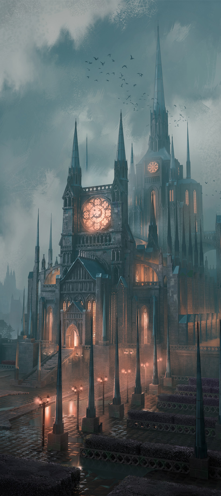
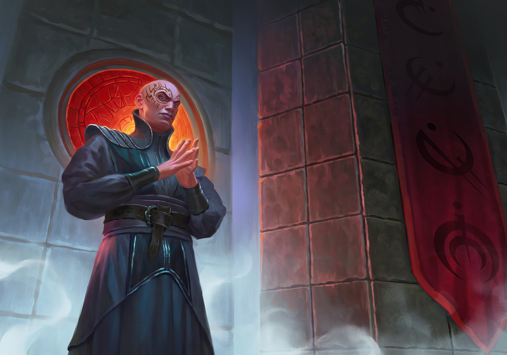
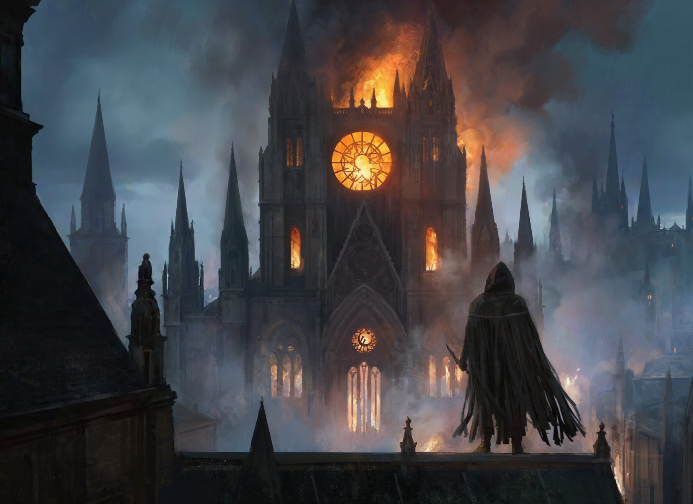
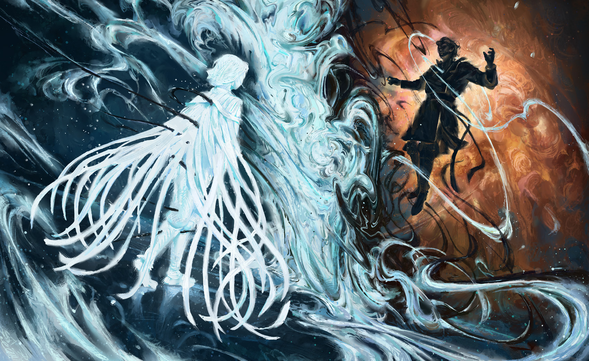

第一時代

### 灰燼世界（World of Ash）

拉剎克（Rashek）運用昇華之井（Well of Ascension）的力量，在統治之初便大幅改造了整顆星球及其居民。他想建立秩序，也想維持囚禁滅絕（Ruin）的牢籠。然而隨著時間流逝，拉剎克終究成了自己一直最痛恨的那種人，把自己的意志強加在整個族群身上的壓迫者。他的統治日益專制，就此走上成為統御主（Lord Ruler）的道路，在接下來的一千年裡犯下種種暴行。第一時代見證了鎔金術（Allomancy）的興起和首批迷霧之子（Mistborn）的誕生，也見證了藏金術（Feruchemy）幾近失傳，以及人們對血金術（Hemalurgy）的探索。統御主建立的最後帝國（Final Empire）延續了一千多年，直到他在一場起義中被推翻。接著是三年的混亂與戰爭。存留（Preservation）的計畫終於實現，存留和滅絕兩股碎力（Shard）融合成和諧（Harmony），為灰燼世界畫下句點。

### 最後帝國的統一

最後帝國最初幾個世紀戰火不斷，統御主也在這段期間逐步建立他心目中完美的政府和社會。他取用其他文化的做法，例如用克雷尼恩（Khlennium）的建築風格打造首都，並沿用卡西（Cazzi）的奴隸制度來管理他新設的司卡（skaa）階級。他壓制技術發展，派克羅司（koloss）軍隊對付敵人，也持續進行血金術實驗。

### 最早的迷霧之子

統御主昇華（Ascension）後接掌艾蘭迪（Alendi）的政府，完成艾蘭迪發起的征服。統御主用存留的神金屬（God Metal）Lerasium 製成的珠子，讓他的對手成為最早的九名迷霧之子。他以此拉攏他們加入自己的陣營，建立了貴族階級。

### 坎得拉間諜

統御主交代坎得拉（kandra）初代（First Generation）收集並保護滅絕的身體，也就是天金（Atium）這種金屬。坎得拉的社會和文化便圍繞著這項使命形成。然而，統御主派坎得拉充當間諜，許多二代（Second Generation）坎得拉因此遭鎔金術師（Allomancer）追殺。為了終止這場種族滅絕，坎得拉與人類訂立契約（Contract），以保障自身安全（見第 2 章〈坎得拉〉）。

陸沙德（Luthadel）的泛圖爾堡（Keep Venture）。

第 4 章　司卡德利亞（Scadrial）的歷史　102

VLADIMIR ISHELIN

### 根深蒂固的官僚體系

統御主以古代 Hallant 人的商貿體系為範本，建立了鋼鐵教廷（Steel Ministry）。教廷的聖務官（obligator）身兼祭司、官僚、法律專家等多種職務。教廷將聖務官分派到各聖務廷（Canton），各廷掌管不同事務，共同壓迫人民並維持最後帝國的統治。

### 消滅宗教

統御主將鋼鐵教廷以外的一切宗教和宗教活動都列為非法，藉此確立自己在帝國中長久不變的神祇地位。為了抹去這些信仰，帝國征戰近五個世紀，迫使各族屈服。統御主的軍隊在這段期間摧毀了數百個宗教，重創無數文化。

### 清剿泰瑞司人

泰瑞司（Terris）人和他們的信仰都威脅到統御主的權力，因此他特別針對這個族群。最後帝國初年，泰瑞司人遭追殺，幾乎滅族。兩個世紀後，泰瑞司宗教遭到摧毀，只有原本信奉這個宗教的初代坎得拉仍保有信仰。泰瑞司人的後代則保存了其他文化傳承，包括藏金術知識（見下文〈守護者教團〉）。

### 最後帝國的鞏固

最後帝國在中期的幾個世紀逐漸發展出不同的統治手段。有些沿用到帝國覆亡，有些則經過修訂或遭到廢除。

### 守護者教團

守護者（Keeper）組成的團體成立於帝國第三世紀，由一群泰瑞司藏金術師（Feruchemist）組成，承襲最初那批泰瑞司世界引領者（Worldbringer）的志業。這個教團在席諾德（Synod）的領導下祕密運作，蒐集古典時期的司卡德利亞（Classical Scadrial）相關知識，躲過最後帝國的清剿和聖務官的監察。

最後帝國的一名聖務官。

VALERIA CASALE

### 統一運動與語言

帝國第五世紀，統御主推動一項計畫，廢除他選定的語言以外的一切語言。他選定的語言由古泰瑞司語演變而來。統御主禁止人民使用祖先的語言，進一步壓制最後帝國的人民。不過，帝國偏遠地區仍有一些語言繼續在口語中使用，守護者的金屬意識庫（Metalmind）也保存了一些語言。

### 總督計畫

政局相對穩定了一段時間後，統御主在帝國第五世紀授權給幾個他信任的貴族家族，讓他們暫任各自地區的總督。這是統御主第一次讓麾下貴族直接指揮他的軍隊，也從此逐漸抽離最後帝國的日常政務。司卡起義和家族戰爭仍然發生，但都很快在血腥衝突中結束。

### 對泰瑞司人的壓迫

帝國第六世紀，新成立的審判廷（Canton of Inquisition）提出兩項計畫，以控制泰瑞司人口。第一項是育種計畫（Breeding Program），追查泰瑞司人血脈中的藏金能力（Feruchemical Power），並把這種能力從族群中淘汰。第二項是侍從官計畫（Steward Program），以古典時期司卡德利亞的 Urtan 人所採行的僕役階級制度為範本。如第 2 章〈泰瑞司統御區〉所述，泰瑞司人在這些限制下受苦了數百年，但統御主始終未能如願徹底控制他們的遺傳和人口。

### 統御區與司卡農莊的興起

總督計畫帶來三百年相對和平的日子，之後資源廷（Canton of Resource）成功將統御區（Dominance）與農莊制度訂成法規。掌權的貴族開始直接管轄自己統御區內的司卡人口，並在一套明確的制度下競逐財富與影響力。這讓貴族有了很大的自由，也讓司卡步入一段更嚴酷、更艱難的歲月。司卡的自由進一步受限，貴族則更加富有。

十大統御區的邊界就此劃定，直到最後帝國覆亡都維持穩定。如第 2 章所述，五個內統御區（Inner Dominances）分別為中央統御區（Central Dominance）、東方統御區、北方統御區（Northern Dominance）、南方統御區和西方統御區（Western Dominance）。五個外圍統御區（Outer Dominances）則包括 Crescent 統御區、Farmost 統御區、Remote 統御區、泰瑞司統御區（Terris Dominance）和南方群島（Southern Islands）。

### 近代的最後帝國

數個世紀過去，最後帝國逐漸固化成一個一成不變的壓迫政權。叛亂愈來愈少，貴族樂於行使支配司卡的權力，鋼鐵教廷和統御主則為昇華之井的下一輪週期做準備。

### 軍力

統御主在位的頭幾個世紀維持了大規模的常備軍。到了帝國末期，軍方改在所有主要城市設立駐軍，並在外圍統御區維持小規模常備軍。不過，最後帝國必要時仍能動員數百萬部隊。克羅司軍隊由鋼鐵審判者（Steel Inquisitor）與地位顯赫的聖務官監督。這些駐軍和部隊大多派往帝國邊境對付成群的反抗者，或投入鎮壓平民的行動。

### 族群隔離

統御主透過鋼鐵教廷在最後帝國施行族群隔離。貴族在遺傳上更可能成為鎔金術師，從小就被教導不用把司卡當人看。有些司卡在嚴格限制下當上熟練的商人或店主，但大多數只能從事卑微的勞役。在城市裡，司卡的竊賊團夥還有機會改善處境。鄉間的司卡則通常注定要進農莊，不論個人有什麼才能。泰瑞司人被隔離在北方的泰瑞司統御區。例外是遭到閹割、被迫成為高等僕役的泰瑞司侍從官（Terris Steward）。

### 天金經濟

統御主政權的最後一根支柱，是他對經濟的操控。他知道天金蘊含滅絕的神金屬，也就是滅絕的授予（Investiture）化為固體的形態，因此嚴密控制天金的生產和分配。

第 4 章　司卡德利亞的歷史　104

天金能用來發動鎔金能力（Allomantic Power），所以在最後帝國分發天金的風險很大。統御主仍願意承擔風險，藉此控制社會。天金產自中央統御區的海司辛深坑（Pits of Hathsin）。其中絕大部分由坎得拉藏起來，少量則由最後帝國的貴族家族用作輔助貨幣。有關天金的詳細資訊，見第 1 章〈金屬技藝（Metallic Arts）〉及第 6 章〈海司辛深坑〉。

### 最後帝國覆亡

歷經一千年的壓迫，統御主終於倒台，最後帝國也走到了盡頭。

### 司卡叛亂

上一場有所成效的司卡叛亂已是幾十年前的事。然而，海司辛倖存者（Survivor of Hathsin）卡西爾（Kelsier）回到陸沙德後，向司卡叛軍首領葉登（Yeden）提出一個大膽的計畫（見第 5 章〈卡西爾與他的團隊〉）。

在一群身手不凡的竊賊和行動人員協助下，卡西爾和葉登祕密招募並武裝了一支軍隊。兩人安排叛軍與卡西爾的團隊聯手出擊，其餘成員則忙著招募人手、鼓舞司卡，並滲透到戰略要地。

### 家族戰爭

卡西爾一夥人從各方面向陸沙德的貴族施壓。暗殺、破壞交易、突襲和煽動性的謠言接連發生，使陸沙德的大家族（Great House）陷入混戰。許多小家族逃出城外，就連大家族也遭遇重挫。

### 叛軍覆滅

葉登在卡西爾不知情的情況下，帶領祕密組建的叛軍夜襲 Holstep 駐軍（Holstep Garrison），使團隊的計畫停擺。葉登雖然突襲得手，卻讓這支軍隊曝光，很快就遭統御主的 Valtroux 駐軍（Valtroux Garrison）屠殺。

海斯丁堡（Keep Hasting）在家族戰爭中燃燒。

GAL OR

### 倖存者的孤注一擲

團隊中大批負責支援的人被捕並判處死刑。卡西爾試圖救出這些死囚，最後在陸沙德的噴泉廣場與統御主正面交鋒。卡西爾燃燒（Burn）了傳說中神祕的第十一金屬（Eleventh Metal），希望藉此找到殺死統御主的辦法。他看見一道脈天金（Malatium）影像，顯示統御主若在人生中做出不同的選擇，可能會成為什麼樣的人。卡西爾仍找不到殺死統御主的方法，最後任由統御主殺了他。臨死前，卡西爾宣告自己就是統御主唯一摧毀不了的東西：希望。他死後，最後一項計畫在他缺席的情況下展開。坎得拉歐瑟（OreSeur）捨棄了團隊成員雷弩大人（Lord Renoux）的骨骸，化成卡西爾的模樣。海司辛倖存者的殉難讓日益壯大的司卡叛軍更加激昂，他的再現則讓司卡有了可以寄託信念的對象。

### 統御主倒台

司卡叛亂的聲勢正盛，紋（Vin）在統御主的堡壘克雷迪克．霄（Kredik Shaw）與他對峙。她使用了卡西爾死前燃燒過的第十一金屬，發現統御主原來就是泰瑞司嚮導拉剎克。憑著這項發現和迷霧的力量，紋扯下統御主的金屬意識庫，利用他的弱點殺了他。失去領袖後，帝國隨之瓦解。隨著司卡叛亂壯大，貴族紛紛逃離城市，也有少數人留下來迎接新時代。在卡西爾舊部的支持下，依藍德．泛圖爾（Elend Venture）在陸沙德建立新政府，成為中央統御區的國王。

### 帝國陷入混亂

統御主死後，最後帝國各地的政府和長期維持的政治均勢都瓦解了。貴族和聖務官奪權，彼此開戰。克羅司在外圍統御區肆虐，難民往帝國內部逃亡。運輸和基礎設施失靈，糧食日益短缺，許多新勢力也開始爭權。

### 新帝國（New Empire）的崛起

以陸沙德為中心的新生國家，在一年的成就與挫折之後遭到圍攻。其他統御區的軍閥帶兵前來，要奪取昔日最後帝國的財富。有些地方的迷霧開始襲擊人。多數遭到襲擊的人只是染上「迷霧病」（mist sickness），但也有人因此喪命。

### 陸沙德圍城（Siege of Luthadel）

史特拉夫．泛圖爾（Straff Venture）鞏固了自己在北方統御區的權力後，來到陸沙德宣示主張，要從依藍德手中奪走這座城市。灰侯．塞特（Ashweather Cett）在哈佛富雷克斯市（Fadrex City）的勢力日漸衰退，也打著同樣的算盤。這兩方與依藍德及他的議會（Assembly）形成三方僵局。加斯提．雷卡（Jastes Lekal）又率領一支強大的克羅司部隊趕來爭奪陸沙德，使局勢更加複雜。依藍德試圖透過政治手段應對這些挑戰，自己的統治卻遭到削弱。議會利用依藍德秉持理想所設立的政府保障制度罷免他，推舉貴族議員費爾森．潘洛德（Ferson Penrod）為國王。

### 陸沙德之戰（Battle of Luthadel）

加斯提．雷卡意外失去對克羅司軍隊的控制，克羅司遂向陸沙德發動攻擊。中央統御區的部隊與克羅司交戰，泛圖爾與塞特的軍隊則仍各自分開。在城中最危急的時刻，紋及時趕到，奪下克羅司的控制權，率領這支新部隊攻打史特拉夫的大軍。紋獲勝後斬下史特拉夫的頭，要求塞特和潘洛德宣誓效忠新帝國的皇帝依藍德。

### 昇華之井

陸沙德暫時恢復了不安的和平，紋、沙賽德（Sazed）與依藍德進入克雷迪克．霄，尋找昇華之井。完整的 1,024 年週期過後，存留的力量已回到井中，可以取用，也可以釋放。存留盡力讓紋做好準備，接受昇華之井的力量，讓滅絕繼續受囚。然而，滅絕冒充存留，布下假線索操弄紋。因此，紋打算先接受力量，再放棄它。她相信拉剎克當年也該這麼做。在意識界（Cognitive Realm），存留和已成為認知之影（Cognitive Shadow）的卡西爾看著紋和依藍德接近昇華之井。卡西爾出手干預，使依藍德受了致命傷，希望紋會

第 4 章　司卡德利亞的歷史　106

用這股力量救依藍德一命，而不會釋放力量，讓滅絕重獲自由。紋起初接受了力量，但她最終的選擇與千年前的拉剎克不同。她放棄了力量，犧牲了依藍德。

### 一顆 Lerasium 珠

紋釋放力量後，無意間讓滅絕重返世間。存留引導她注意到一顆 Lerasium 珠。紋讓依藍德吞下這顆珠子，救了他的命，也讓他成了強大的迷霧之子，如同當年獲得拉剎克賜予力量的最早九人。

### 世界末日

滅絕被囚禁數千年後重返司卡德利亞，開始藉由直接破壞和隱密而複雜的操弄，讓世界分崩離析。與此同時，迷霧出現得更頻繁，也更常在白天滯留，使更多人染上迷霧病。

### 滅絕壯大

克羅司的數量愈來愈多，鋼鐵審判者也在尋求更強的力量。鋼鐵審判者操控克羅司，殘酷地襲擊泰瑞司統御區，殺死了將近四分之一的泰瑞司人。席諾德全體成員與所有守護者都遭到捕殺，他們的藏金能力也被血金術奪走。泰瑞司統御區的難民最後在海司辛深坑定居。滅絕開始著手徹底摧毀司卡德利亞。他操弄各地領袖，加劇灰山（Ashmount）的活動，引發地震，甚至把熔岩推上地表。這些生態災難迫使昔日最後帝國的所有居民做好最壞的打算。

### 鎢都政變

司卡工人聯盟的領袖魁利恩（Quellion）以「公民」（Citizen）的身分在鎢都（Urteau）掌權。起初他被視為替人民挺身而出的鬥士，卻在滅絕的影響下日益腐化。一枚青銅血金術尖刺（Hemalurgic Spike）賦予他搜尋者（Seeker）的能力。他用這股力量找出城裡的貴族並加以處決，對鎢都人民施行極權統治。「公民」的決策分化了城裡的司卡，引發暴動，四處起火，留下一片灰燼。鬼影（Spook）是卡西爾最初的團隊成員之一。他與魁利恩的士兵交戰，被對方留在燃燒的建築裡等死。鬼影卻活了下來，部分原因是交戰時有一枚血金術尖刺刺入他體內，他自己並未察覺。滅絕企圖利用此時已被譽為火焰倖存者（Survivor of the Flames）的鬼影摧毀鎢都，但鬼影抵抗了滅絕，拔掉自己和魁利恩體內的尖刺。滅絕的影響遭到遏止後，鎢都開始化解內部衝突。

### 哈佛富雷克斯市圍城

依藍德．泛圖爾此時已是新帝國皇帝，一心要拿下哈佛富雷克斯市。他打算徵用城中儲藏庫的物資，並爭取麾下將領灰侯．塞特的好感。塞特曾是這座城市的統治者。依藍德和紋率領一支人類軍隊，帶著兩人控制的數千名克羅司來到城外。城裡的統治者是聖務官 Aradan Yomen。他拒絕所有外交提議，也不願在戰爭的威脅下屈服。尤門（Yomen）棋高一著，出兵攻擊新帝國的軍隊，依藍德麾下數千名克羅司在這場攻勢中喪命。滅絕奪取剩餘克羅司部隊的控制權後，尤門才勉強讓人類軍隊入城。滅絕的克羅司逐漸集結，眼看城市就要失守，尤門和依藍德卻發現迷霧病的真正成因：迷霧正在使兩人軍中的士兵綻裂（Snap），成為鎔金術師。兩方意外發現軍中多了許多新的鎔金術師，於是聯手擊退圍城的克羅司。

### 坎得拉的祕密

多年來，卡西爾的團隊、各地軍閥和新帝國都在尋找統御主藏起來的天金。沙賽德和坦迅（TenSoon）前往坎得拉家園（Kandra Homeland）時，這個祕密終於揭開。坦迅是曾為泛圖爾家族（House Venture）效力、如今效忠於紋的坎得拉。最後帝國初年，統御主交代坎得拉小心囤藏天金，因為那是滅絕的實體身軀。這批囤藏的天金稱為囑託（Trust），其中蘊藏了這股碎力相當大的一部分力量。沙賽德與初代坎得拉合力釐清滅絕摻進預言裡的謊言，試圖及早揭穿這股碎力的計畫，趕在一切太遲之前阻止他。

### 陸沙德的腐化

國王費爾森．潘洛德受滅絕影響，使陸沙德陷入混亂。滅絕以統御主的模樣出現在國王面前，潘洛德便下令只讓強者活下去。司卡自相殘殺，貴族再度挑起家族戰爭，城裡大片地區遭火焚毀，但許多難民成功逃到海司辛深坑。

第 4 章　司卡德利亞的歷史　107

### 存留重生

依藍德和尤門防守哈佛富雷克斯市時，紋設法引開滅絕的注意。她的計策奏效了，鋼鐵審判者一路跟著她到了陸沙德。存留的持有者（Vessel）Leras 終於死去，留下無人接掌的力量。滅絕試圖使存留碎裂（Splinter），但身為認知之影的卡西爾使自己與這股力量產生共鳴，成為暫時的持有者。紋與審判者殊死搏鬥時，卡西爾放開力量，紋得以將迷霧吸向自己。她讓授予充滿全身，殺死幾乎所有鋼鐵審判者，昇華成為存留的新持有者。迷霧從此失去保護世界的作用，加快了世界走向末日的速度，倖存的人類只好到地底避難。

### 海司辛之戰

滅絕最後一次瘋狂地向人類進攻，派部隊前往海司辛深坑奪取天金。留在深坑的士兵只剩迷霧病人（mistfallen）。這群士兵受迷霧病折磨最深，卻莫名完全沒有顯露新的鎔金能力。

到了緊要關頭，依藍德發現這些士兵其實是能燃燒天金的迷霧人（Misting）。他們之前接觸不到天金，所以鎔金能力始終未被發現。這支由迷霧病人組成的軍隊把藏起來的天金全數吞下燃燒，擊敗滅絕的大軍，也讓滅絕的實體精華消散到世間。

### 最後的犧牲

此時身為存留的紋給了依藍德力量，讓他迎戰最後一名鋼鐵審判者沼澤（Marsh）。依藍德以硬鋁（Duralumin）增強天金的驟燒（Flare），在一瞬間看清局勢，明白真正結束這場戰鬥的辦法只有一個。依藍德接受了死亡。沼澤斬下他的頭顱。滅絕以為這樣的殘酷行徑會擊垮紋，結果反而讓她下定決心。身為司卡德利亞人，紋的靈魂和成長經歷都留下了存留與滅絕的印記。滅絕的精華讓她得以克服存留的碎旨（Intent），著手摧毀滅絕。她犧牲自己的心智，摧毀滅絕的心智，兩股力量從此都失去了持有者。

紋接掌存留的力量，對抗滅絕。

第 4 章　司卡德利亞的歷史　108

DANIEL CORREIA

