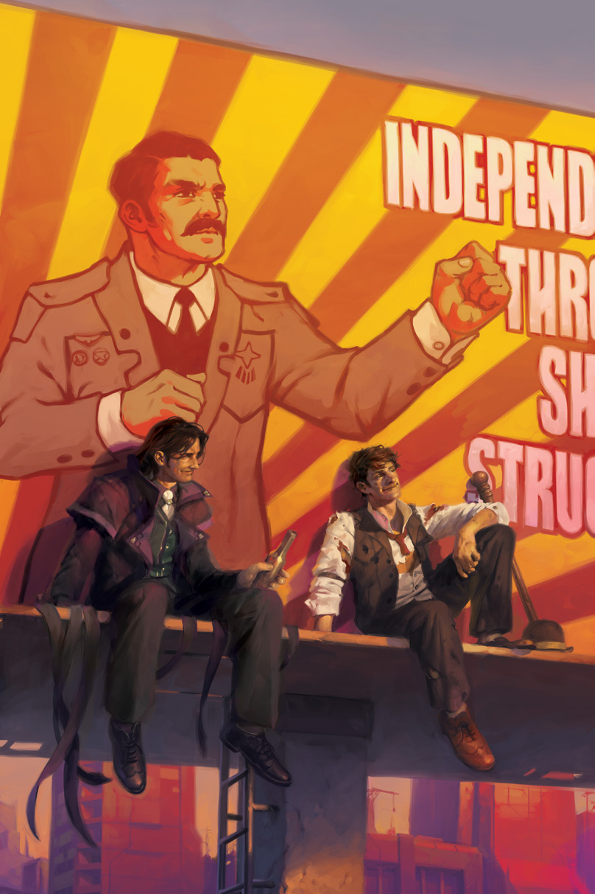
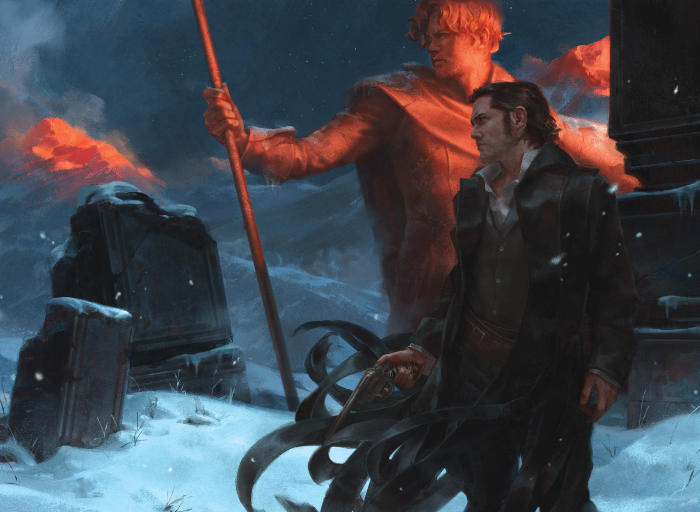
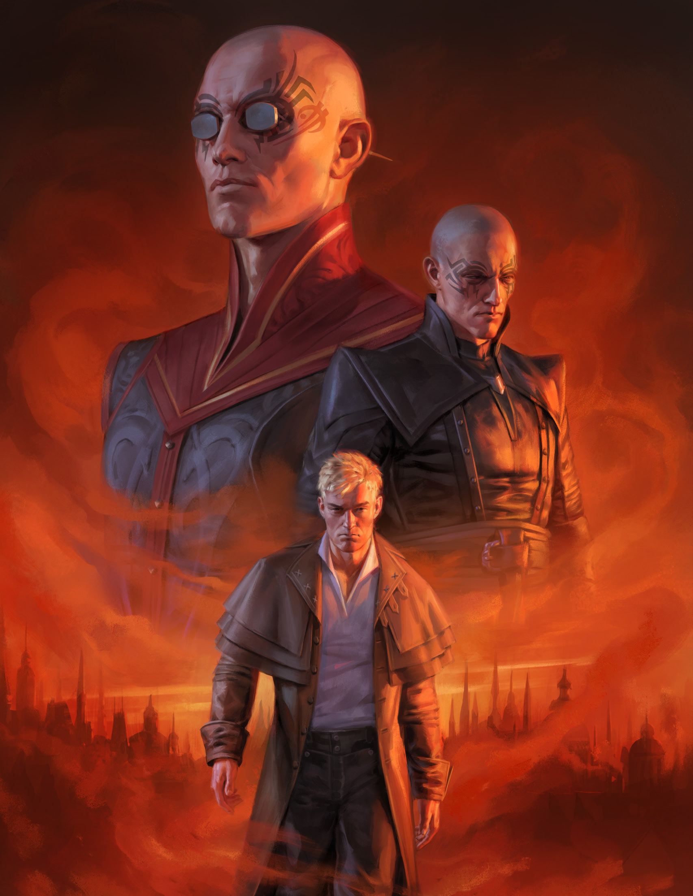

第二時代

### 落灰之終（Catacendre）後

司卡德利亞（Scadrial）開始燃燒。存留（Preservation）與滅絕（Ruin）的持有者（Vessels）死後，世界似乎注定走向末日。然而，這場終結也是新的開始，兩股碎力（Shards）交融，形成了和諧（Harmony）。和諧讓司卡德利亞恢復昔日的地貌與生態，隨後把帝國的倖存者聚集到一處可以安居發展的避風港。這場事件後來稱為落灰之終。第二時代逐步展開，北司卡德利亞（Northern Scadrial）步入工業時代，雖然繁榮，發展卻停滯不前。南司卡德利亞（Southern Scadrial）則運用金屬技藝（Metallic Arts）開發新技術。雙方初次接觸時，這項差距造成了相當大的緊張。碎力自主（Autonomy）也在這個時代介入局勢，而她的計謀最終遭和諧的密探挫敗。

### 和諧的昇華（Harmony’s Ascension）

沙賽德（Sazed）跪在紋（Vin）和依藍德（Elend）的遺體旁，信念逐漸瓦解。他看見兩股碎力的力量正在等待新的持有者。他伸手探向存留與滅絕時，想起了泰瑞司（Terris）的古老預言。他擔心自己會和統御主（Lord Ruler）一樣，無法熟練掌握這股力量。但他擁有統御主所欠缺的一項資源：知識。沙賽德運用守護者（Keepers）累積的知識，接受了自己身為永世英雄（Hero of Ages）的使命。他接下兩股碎力，使它們交融，自己也成了和諧。

### 重塑世界

和諧憑藉儲存在紅銅意識（copperminds）裡的知識，把這顆星球恢復到灰燼世界（World of Ash）形成以前的模樣。曾經消失的島嶼、山脈、河流和海洋重新出現，灰山（Ashmounts）有的退去，有的停止活動。他讓星球回到原本的軌道，使氣溫降到適合居住的範圍。

### 秘史（Secret History）

落灰之終後的頭幾週，一道意識之影（Cognitive Shadow）來拜訪迷霧之子大人（Lord Mistborn）。海司辛倖存者（Survivor of Hathsin）卡西爾（Kelsier）透露了自己的計畫：解開寰宇（cosmere）的種種謎團。

### 恢復生態

一千年前，統御主曾改造司卡德利亞的生物，使其能在灰燼瀰漫的荒涼氣候下生存。和諧逆轉了這些改變。天空、大地、植物和動物都恢復了原本的樣貌與色彩，而這些景象過去只存在於最後帝國（Final Empire）人民的想像中。和諧有意恢復舊貌，也替統御主創造的生物留了容身之處。克羅司（koloss）有了繁衍後代的能力，坎得拉（kandra）得以自行掌握生死，霧魅（mistwraiths）則被和諧聚集起來，藏在隱密之處。

### 形塑文明

修復世界後，和諧著手確保最後帝國的人民能存活下來。他在舊中央統御區（Central Dominance）以南的海岸上造出一座圓形盆地，又把統御主的洞窟與其他地下避難所連在一起，讓倖存者能找到彼此，共享原先儲備的資源。這片洞窟網通向一片綠地，後來人們把這裡稱為重生之野（Field of Rebirth）。和諧在那裡留下《創始之書》（Words of Founding）。這套書有數十冊，記下了他在紅銅意識中累積的知識，也收錄他對這一切的省思。書裡還記載了存留與滅絕的真實歷史，以及卡西爾和紋各自掌握存留力量時所做、卻無人知曉的事。如同存留留下預言一樣，和諧也留下了一套計畫，指引走出洞窟的倖存者。

### 冰殲時代（The Ice Death）

對南司卡德利亞來說，落灰之終是一場差點讓他們滅絕的大災難。幾個世紀以來，他們早已適應世界的酷熱。司卡德利亞重塑後，當地氣候轉冷，人民難以維生，政體也相繼瓦解。司卡德利亞南方人（Southern Scadrians）稱這場末日浩劫為冰殲時代。約十年後，一名男子來到當地相救，以話語鼓舞人心，也贈予他們稱為切割盤（Excisors）的求生器具。有了這項新技術，司卡德利亞南方人就能儲存並分享溫暖。他們尊這位救命恩人為君王（Sovereign）。君王後來離去，卻為他的人民留下一則傳說。名為悼環（Bands of Mourning）的聖物能讓使用者獲得所有藏金術（Feruchemy）和鎔金術（Allomancy）的能力。君王把聖物藏在一座偏遠的神殿裡，許多南方人把這個傳說視為一項挑戰（見下文「尋找悼環」一節）。

第 4 章：司卡德利亞歷史 109

### 依藍戴盆地（Elendel Basin）的建立

最後帝國的倖存者後來稱為初代（Originators）。他們在依藍戴盆地終年肥沃的土地上蓬勃發展，並以已故皇帝之名為盆地命名。紋、沙賽德、卡西爾和團隊的其他成員後來稱為存留者（Preservers）。儘管其中許多人已經離世，他們留下的影響遍及盆地各個層面，從宗教到政治皆然。

### 迷霧之子大人的統治

落灰之終剛結束，便由迷霧之子大人 Lestibournes 掌管依藍戴盆地。他是存留者之一，從前人稱鬼影（Spook）。迷霧之子大人承襲依藍德的做法，成立議會（Senate），作為新社會的代議治理機構。這段期間，盆地居民努力改善社會，也在住居和薪資等方面逐步縮小不平等。

### 政局轉變

灰燼世界遺留下來的一項難題，是新社會依舊有著近似舊時的階級制度。落灰之終後，貴族家族繼續存在，其中許多家族在政界、商界和金融界取得了權勢。貴族把更多爵位授予有勢力的反對者。上流社會吸納了對手，貴族家族的地位也隨之更加穩固。此外，人民仍然渴望一位強而有力的君主，尤其是在迷霧之子大人憑鎔金術數度擊退來犯的克羅司軍閥之後。迷霧之子大人當了一百年的君主，最終退位，把治理權交還給人民。此時政府已能穩定有效地運作，議會選出一名總督（governor）擔任元首，君主制至此正式終結。

### 向外拓展

依藍戴（Elendel）是依藍戴盆地的第一處聚落，從村莊發展為城鎮，最後成為一座繁忙的城市，也因此需要向外拓展。在盆地更廣闊的地區，Bilming、New Seran 和 Rashekin 等聚落的影響力逐漸擴大。後來，甚至有人冒險走出盆地。有些人為了尋找財富，有些則想擺脫令人窒息的社會規範或法律。這些聚落都沒能維持多久，其處境也讓盆地外的地區得了個生動的名字：蠻橫區（the Roughs）。

### 新一代金屬之子（Metalborn）

一代又一代過去，盆地居民與最後帝國的迷霧之子（Mistborn）血緣越來越遠，傳承下來的鎔金能力也逐漸減弱。同樣地，鋼鐵教廷（Steel Ministry）消滅了守護者，使藏金能力也不如以往強大。擁有完整能力的迷霧之子和藏金術師（Feruchemists）越來越少，最後再也沒有人生來具備這些完整能力。在這個新時代，多數金屬之子只會展現一種能力，成為迷霧人（Misting）或單藏金術師（Ferring）。不過，極少數同時具有泰瑞司與貴族血統的人，會各展現一種鎔金能力與一種藏金能力。他們後來稱為雙生師（Twinborn）。

### 「組織」（The Set）

「組織」這個祕密團體，最初由依藍戴一群野心勃勃、利益相通的貴族組成。他們為了實現目標、發揮潛力，向司卡德利亞以外尋求支持。「組織」尤其想擺脫和諧對依藍戴盆地的束縛。他們找到了居於另一個世界的碎力自主，並在她的指引下追求先進技術，也試圖用其他方式壯大自己。他們的長期計畫之一是培育忠於「組織」的新一批鎔金術師。不過，在發現血金術（Hemalurgy）後，「組織」轉而運用這項金屬技藝，更快取得想要的能力。「組織」在依藍戴盆地各地都設立了分部，但大部分勢力都集中在 Bilming。關於他們的起源、成員和其他計畫，見第 5 章「組織」。

### Trell 崛起

落灰之終已過數百年，依藍戴盆地正迅速邁向現代化。灰燼世界中席捲各地的大軍和氣勢磅礴的戰役都已成為歷史。現代的衝突往往在商業談判桌上交鋒，或以槍口相向。然而，司卡德利亞已引起寰宇其他勢力的注意。在「組織」的助力下，司卡德利亞信徒稱為 Trell 的自主把手下派往各處就位，積極介入事態發展。

第 4 章：司卡德利亞歷史 110

### 「組織」的圖謀

工業化期間，「組織」開始付諸行動，推動籌備了數十年的計畫。其中影響最深遠的計畫之一，是設於 Bilming 的 Community（見下一節）。另一項是研發 Harmonium 炸彈。這是「組織」的最終手段，目的是向贊助者證明他們有能力控制司卡德利亞（見下文「Harmonium 武器化」一節）。

### 消賊（Vanishers）與 Community

「組織」招募了心懷不滿、實力極強的雙生師「百命」邁爾斯．達古特（Miles “Hundredlives” Dagouter），要他綁架鎔金血統強大的女性，並以一般偷竊行為掩護綁架。在愛德溫．拉德利安（Edwarn Ladrian）的資助下，邁爾斯和消賊成功暗中擄走這些女性，也讓太齊爾家族（House Tekiel）陷入財務崩潰。被綁架的鎔金術師被送到藏在 Bilming 城下的 Community。居民稱這座地下城鎮為 Wayfarer。這裡實際上是一項優生計畫，最初由愛德溫．拉德利安主持，後來交給 Bilming 的市長 Gave Entrone。Community 旨在培育可供實驗的鎔金術師，也為「組織」提供能力強大的新成員。「組織」為了控制這些俘虜，讓他們相信灰山再度噴發，世界已經毀滅。被囚禁的居民以為自己是讓司卡德利亞恢復人口的最後希望。「組織」用電影膠卷、血金術生物和假冒的倖存者布下重重騙局，維持這個謊言。最後，「曉擊」（Dawnshot）瓦希黎恩．拉德利安（Waxillium Ladrian）、瑪拉席．科姆斯（Marasi Colms）和韋恩（Wayne，後來稱為 Wayne Terrisborn）擊敗並逮捕了邁爾斯與消賊。

### 政治與革命

消賊落網後不久，依藍戴政局受到重創。總督 Replar Innate 的兄弟、議員 Winsting Innate 在自己家中遭到殺害，一同遇害的還有上流社會人士與已知的罪犯。這樁公然暴露的腐敗震驚了早已飽受煎熬的依藍戴居民，促使他們採取行動。抗議與暴動席捲全城。

瓦希黎恩、韋恩和瑪拉席最終查出，整起事件是由一名叫索血者（Bleeder）的叛離坎得拉一手策畫。進一步調查也揭發了總督本人的貪腐行徑。索血者想動搖政府，讓人民擺脫和諧的控制，其中她尤其想解放瓦希黎恩．拉德利安。「組織」提供索血者各種資源，包括鎔金術師和一根 Trellium 尖刺，讓她能在和諧的力量之外行動。索血者最終被捕時，寧可自行了結性命，也不願再受和諧控制。這些事件使總督 Replar Innate 名譽掃地，Claude Aradel 隨後當選，成為盆地第一位毫無貴族血統的總督。

### 依藍戴與外圍城市（Outer Cities）的對立

數十年來，依藍戴和它的議會一直在經濟上剝削外圍城市。這在很大程度上是因為多數運河與鐵路都以依藍戴為中心，外圍城市要運送貨物，就得負擔高得離譜的稅款與費用。

瓦（Wax）和韋恩在 Bilming 一同喝著蠻橫區出產的瓶裝啤酒 Logshine。

VICTOR MINGUEZ

因此，外圍城市爆發了強烈的獨立運動，尤其以 New Seran 和 Bilming 為甚。「組織」在外圍城市設立據點，大舉招募成員，把人們的失望煽成了革命的怒火。

### 干擾和諧

隨著「組織」勢力壯大，他們來自另一個世界的贊助者自主以 Trell 的身分，悄悄遮蔽了和諧的視野。另一股碎力的干擾，使和諧不得不更加仰賴他的坎得拉與凡人密探。

### 尋找悼環

這段期間，坎得拉、「組織」和司卡德利亞南方人等幾股勢力，都在尋找名為悼環的古老聖物。神話說悼環是統御主的護腕，戴上就能獲得他的所有力量。它實際上是一件由多層金屬製成的先進金屬意識庫（metalmind），塑成一枚大型矛頭。

在尋找悼環的過程中，瓦希黎恩、史特芮絲．拉德利安（Steris Ladrian）、瑪拉席、韋恩與坎得拉 MeLaan 潛入一艘由「組織」控制的司卡德利亞南方浮空船（airship）。這艘船墜毀在盆地城鎮 Dulsing。他們在船上救出了 Malwish 船員 Allik Neverfar，也救出了瓦希黎恩的姊妹黛兒欣．拉德利安（Telsin Ladrian）。當時她似乎已遭「組織」囚禁多年。這幾股不同勢力最終查出悼環位於 Seran山脈（Seran Range）最高的幾座山峰之間。調查人員與愛德溫．拉德利安暫時結盟，闖過重重陷阱與險境，最後只找到一座空基座，悼環並不在上面。就在此時，黛兒欣揭露自己是「組織」的一員，並和愛德溫一起用血金術賦予的金屬之子能力發動攻擊。悼環最終被找回，交給坎得拉保管。愛德溫遭到逮捕，黛兒欣則逃走了。

瓦希黎恩．拉德利安在君王的雕像下，準備迎接下一道考驗。

MICAH EPSTEIN

### Malwish聯盟（Malwish Consortium）的成立

接下來幾年，依藍戴盆地與南司卡德利亞各國試著展開貿易，雙方也維持著脆弱的和平。

### 南司卡德利亞統一

雙方的往來大致友善，除了交換貨物、金屬之子和技術，甚至還有觀光客互訪。不過，Malwish 和南司卡德利亞其他國家對北方各國心懷怨懟。他們認為，從統御主昇華到冰殲時代，南方所有問題都源於北方的災禍。此外，「組織」折磨 Brunstell 號的船員，也引發了強烈的不信任。這群 Malwish 人原本在尋找悼環，途中遭遇船難。這些情緒最終促使南方五國合併成一個政治實體，也就是 Malwish聯盟（見第 2 章「南司卡德利亞」）。

### 悼環的歸屬

Malwish聯盟堅稱悼環原是君王之物，理應歸司卡德利亞南方人所有。這項爭議使兩大洲無法擴大往來，也無法加深彼此的關係。

### Harmonium 武器化

爭奪悼環的衝突過去幾年後，「組織」成功實現了開發 Harmonium 炸彈的計畫。在自主的壓力下，「組織」加快了支配世界的進程。

### Trell 的最後通牒

自主對黛兒欣施以授予（Invested），使她成為自己的化身。她在獲得力量的同時也接到命令。她必須控制司卡德利亞的各個政府，掌握實權，否則自主就會派出大軍摧毀這個世界。在世界可能毀滅的威脅下，黛兒欣集中精力研發能摧毀依藍戴的炸彈。她還偽造證據，企圖讓外界相信炸彈是依藍戴議會開發的，而且是議會意外動用了它。

### 分裂 Harmonium

「組織」花了多年研發炸彈。他們以大型基礎建設工程為掩護，在 Bilming 地下隱密的洞窟和隧道裡進行實驗。「組織」最終成功用一塊 Trellium 分裂 Harmonium。反應釋出的能量強大到足以撼動整座城市。

### 武器

Harmonium 炸彈雖已能運作，負責運載它的原型火箭卻無法把搭載的炸彈從 Bilming 一路送到依藍戴。瓦希黎恩．拉德利安和 Wayne Terrisborn 發現這一點後，找到了備用的運載工具。那是 Bilming 引以為傲的白鑞戰艦（Pewternauts）之一，一艘正駛向依藍戴的裝甲船。韋恩結合 Lerasium、硬鋁（duralumin）和彎管合金（bendalloy）的作用，把炸彈的組件分開。他用借來的水壺裡的水點燃不穩定的 Harmonium，避免 Trellium 使這種金屬分裂。這場爆炸沒有摧毀任何城市，但韋恩犧牲了性命，救下數百萬人。

### 依藍戴的災害應變

炸彈雖提前引爆，只發揮了原有破壞力的一小部分，依藍戴市仍遭海嘯襲擊，受到大範圍破壞。幸虧史特芮絲．拉德利安規劃周全、行動迅速，罹難人數大幅減少。

接下來的故事

《迷霧之子玩家手冊》（Mistborn Handbook）和《迷霧之子世界指南》（Mistborn World Guide）涵蓋《迷霧之子》系列小說的前七冊。至於依藍戴盆地與 Malwish聯盟一同走向未來時，還會有哪些故事可說，這兩本書並未揭曉。隨著新小說問世，寰宇 RPG（Cosmere RPG）也會隨之擴展，收錄新的角色選項與世界設定。在那之前，灰燼世界與落灰之終後的世界，都提供了豐富的故事舞台。你也可以借助《颶光典籍玩家手冊》（Stormlight Handbook）、線上補充資料等寰宇 RPG 出版品，把戰役拓展到更廣闊的寰宇。當寰宇在你的角色眼前展開，他們會留在司卡德利亞，見證未來幾十年的變化，還是會跨入意識界（Cognitive Realm），去探索一整個充滿冒險的宇宙？

第 4 章：司卡德利亞歷史 113

