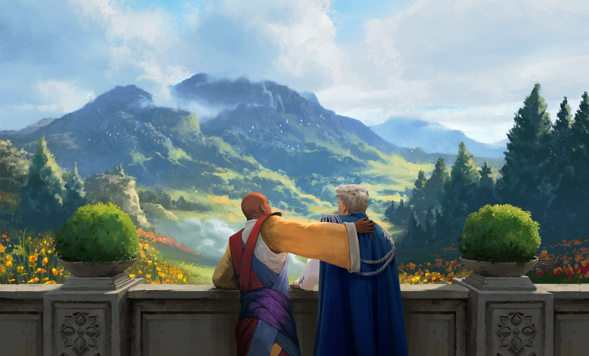

## 第 4 章：司卡德利亞的歷史

司卡德利亞（Scadrial）在碎裂（Shattering）後不久誕生。存留（Preservation）與滅絕（Ruin）彼此對抗的力量，一再塑造、重塑這個世界；長久不變的政權與停滯，終究讓位給激烈的革命與快速的進步。這個世界充滿神話、傳說、行動與深遠的影響。隨著歷史展開，司卡德利亞也引起其他存在的注意。他們思索接下來可能發生什麼事，以及司卡德利亞可能在整個寰宇（cosmere）激起什麼漣漪。如第 1 章「司卡德利亞的時代」所述，歷史學家通常將司卡德利亞的過去分為三個主要時代：古典時期的司卡德利亞（Classical Scadrial）、灰燼世界（World of Ash，第一時代），以及落灰之終（Catacendre）後的世界（第二時代）。本章將追溯各個時代中塑造世界的事件。

### 虛假歷史

統御主（Lord Ruler）為了支配與掌控世界，摧毀了各種文化、宗教、語言與歷史。教義將他神化為世界的救世主，古典時期的司卡德利亞真相則大多失傳。就連最後帝國（Final Empire）的歷史，也在幾個世紀間不斷遭到鋼鐵教廷（Steel Ministry）修改，真相的蛛絲馬跡只能從塵封古籍與傳聞中尋得。部分真相仍留存下來，這些歷史由泰瑞司（Terris）的守護者（Keepers）組織蒐集。語言、宗教、歷史人物、生態、建築等紀錄，都經過仔細蒐羅，儲存在紅銅意識（copperminds）中，一直保存到最後帝國終於倒台。和諧（Harmony）在落灰之終期間昇華（Ascension）後，守護者組織的完整紀錄被彙整為《創始之書》（Words of Founding），這套典籍記載了司卡德利亞的歷史。本章提供的資訊，是落灰之終後已知的歷史真相。不過，標示為「虛假歷史」的段落，則說明最後帝國時期大多數人相信的說法。

### 秘史

本章彙整《迷霧之子》系列（Mistborn Saga）前七部小說揭露的資訊。在最後帝國時期，司卡德利亞的大部分歷史都遭到壓制或遺忘。本章許多事件都是小說中的重要揭露，讀者會隨書中主角一同得知。因此，本章包含這七部小說的重大劇透。

### 古典時期的司卡德利亞

最早期的司卡德利亞與寰宇許多星球相似，其中最值得一提的是，它在許多方面都像悠倫（Yolen）——存留與滅絕的起源世界。古典時期的司卡德利亞，始於這顆星球本身的誕生，其後經歷九千年，孕育出多元文化與穩定進步的文明。在這段期間，存留開始實行擊敗滅絕的計畫；滅絕則展開反擊，操弄世間的預言，為自己獲釋鋪路。這個時代的終點，是一名被尊為永世英雄（Hero of Ages）的男子前往昇華之井（Well of Ascension），卻遭到日後成為統御主的人殺害。

### 創生與契約

存留與滅絕攜手創造了司卡德利亞上的生命。存留放棄了部分力量，讓具有智慧的生命擁有更多他的本質。滅絕同意接受這份失衡，條件是未來必須讓他有機會毀滅司卡德利亞。存留決意阻止這場毀滅，於是犧牲自己的心智，將滅絕囚禁在昇華之井——存留的垂裂點（Perpendicularity）。存留的力量雖然散布於世界各處，仍會每隔 1,024 年重新注滿這口井。

對頁：倖存者繼承人（Heir of the Survivor）紋（Vin），四周映照出她的過去與未來。

RANDY VARGAS

第 4 章：司卡德利亞的歷史 99

### 國家與文化

古代世界的人們發展出不同的族群與文化，建立許多國家、帝國與宗教。克雷尼恩（Khlennium）王國鑽研先進的建築技術、蒸汽引擎與鐘錶機械；鄰國柯玳（Kordel）則致力於藝術與科學。東方諸國以締造和平與探索聞名，西方的土地則飽受帝國主義與連年戰爭摧殘。泰瑞司人也是這些文化之一，他們是居住在北方的牧民。泰瑞司人當中有一群哲學家與教師，被稱為世界引領者（Worldbringers）。這群人日後在新王艾蘭迪（Alendi）的崛起過程中，發揮了關鍵作用。

### 艾蘭迪的崛起

艾蘭迪原本只是一名出身卑微的鐵匠之子，後來成了泰瑞司世界引領者關（Kwaan）的助手。他四處旅行，勢力與影響力日益增長，最後與克雷尼恩王室聯姻，成為國王。他發動戰爭、征服諸國，建立了一個統一的帝國。

### 深暗（Deepness）

昇華之井逐漸注滿力量時，存留試圖讓世界具備對抗滅絕的力量。他帶來了迷霧，那是他的授予（Investiture）的氣態形式，會使最早的一部分鎔金術師（Allomancers）綻裂（Snap），成為迷霧人（Mistings）。不幸的是，滅絕操弄迷霧，使其化為遮天蔽日、令人窒息的力量，造成大範圍的饑荒與死亡。

### 虛假歷史

鋼鐵教廷教導人們，深暗是古代一頭沒有形體的怪物，統御主殺死牠，拯救了世界。這套謊言利用了深暗許多特徵與滅絕相似的事實；滅絕正是統御主在整段統治期間對抗的碎力（Shard）。教廷隱瞞深暗其實就是存留迷霧的真相，並宣稱統御主隨後召來灰燼與迷霧，懲罰那些不相信他能庇護世人的人。

### 永世英雄艾蘭迪

關宣稱艾蘭迪就是永世英雄。這是泰瑞司預言中的人物，也被稱為拉布真（Rabzeen）、永世者（Anamnesor），以及世界的救世主。經歷多年的戰爭與絕望後，世人開始相信這個說法。在這段期間，深暗使艾蘭迪綻裂，讓他成為搜尋者（Seeker），能感知昇華之井的脈動。

### 統御主的昇華

存留的力量在昇華之井匯聚，滅絕的計畫也到了開花結果的時刻。在顧問與泰瑞司世界引領者的敦促下，艾蘭迪啟程前往昇華之井，要拯救世界。

### 預言遭到竄改

滅絕為了重獲自由，悄悄竄改了 Anticipation。這些泰瑞司宗教的預言與信仰，已被古典時期的司卡德利亞各國採納。不過，有些預言原本的內容就很符合他的計謀，例如提及永世英雄身上穿孔的預言，以及英雄會將世界的未來承載於雙臂上的說法；滅絕便讓這些預言保持原樣。關觀察、引導艾蘭迪多年後，察覺了滅絕所做的修改，卻不知道始作俑者是滅絕。他懷疑有人改寫預言，要誘使艾蘭迪釋放某個囚禁在昇華之井的存在。關無法說服世界引領者秘密大會（Conclave of Worldbringers）、國王的顧問，或艾蘭迪本人相信其中的危險，便安排自己的姪輩親屬拉剎克（Rashek），帶領艾蘭迪穿越泰瑞司山脈前往井邊。關交代拉剎克把艾蘭迪引離前往昇華之井的路線，必要時就殺了他。

### 前往井邊的旅程

拉剎克是一名年輕的泰瑞司嚮導，也是一名藏金術師（Feruchemist）。克雷尼恩國王壓迫他的族人，讓他心懷怨恨。拉剎克陪同艾蘭迪前往昇華之井時，與他的一群泰瑞司藏金術師盟友試圖將艾蘭迪引向別處，但國王能感知井的位置。旅途到了終點，拉剎克採取了更激烈的手段：他襲擊並殺死艾蘭迪，接著進入昇華之井。

### 存留的殘體（Sliver）

在昇華之井中，拉剎克將存留的力量據為己有，獲得昇華。存留真正的持有者（Vessel）Leras 雖然仍在，但 Leras 用來束縛滅絕的那股力量已可供他人取用。像艾蘭迪這種願意自我犧牲的英雄，或許會放棄力量；拉剎克卻運用它，試圖拯救世界、建立秩序。他將司卡德利亞移近太陽，想藉此燒盡深暗。這使世界的溫度升高，於是他隆起灰山（Ashmounts），以灰燼遮蔽陽光。接著，他改造世界上的植物、動物與各族人民，讓他們能在這個充滿灰燼的新世界生存。

第 4 章：司卡德利亞的歷史 100

### 重塑人類

拉剎克的改造產生了一個副作用：植物失去了營養價值。他因此改變人類的遺傳特性，讓人類能靠新植物維生，也能在吸入灰山噴出的黑灰後存活。為了留下一批備用人口，他將一群未經改造的人類安置在南極，讓他們自行求生。經過一代又一代，司卡德利亞南方人（Southern Scadrians）適應了星球較溫暖的氣候，變得耐熱，卻不習慣寒冷。

### 改變世界

統御主掌握存留力量的最後幾項作為之一，就是重新安排司卡德利亞的地理。他夷平泰瑞司山脈，將昇華之井藏在日後成為帝國中心的地方。他也在北方造出新的山脈，並稱之為泰瑞司山脈，希望後世誤以為井在那裡，轉而前往那裡尋找。

### 泰瑞司人、坎得拉與霧魅

拉剎克的心智擴展後，明白自己若能在天生的藏金術（Feruchemy）之外，再獲得存留的金屬技藝（Metallic Art）——鎔金術（Allomancy），便能掌控不可思議的力量。他運用昇華之井，讓自己成為強大的迷霧之子（Mistborn），並計畫以鎔金能力（Allomantic powers）賄賂他人，藉此控制他們。然而，他害怕另一名泰瑞司人生來就同時擁有兩種力量，因而有能力挑戰自己。他直接在最親近的朋友們心中開口，也向叔舅輩親屬、世界引領者關如此傳話。他給這些藏金術師一個「選擇」：成為坎得拉（kandra），獲得永生；或是化為沒有智慧的霧魅（mistwraiths），繼續存在。他的朋友們選擇成為坎得拉初代（First Generation），但關拒絕了。拉剎克雖然試圖消滅這位叔舅輩親屬，存留的力量卻不允許他這麼做，關也因此逃走。拉剎克將其他所有活著的藏金術師都變成了霧魅，但他並未抹除其他泰瑞司人身上潛藏的藏金術傳承。

### 虛假歷史

鋼鐵教廷教導人們，貴族與司卡（skaa）在生理與智力上有所差異。他們將這些差異稱為平衡（Balance），但這套教義大多是捏造的。事實上，統御主曾試圖以這種方式改造人類，卻無法創造任何顯著而持久的差異。一千年後，即使曾有些微差異，也再次消失。這兩群人之間的某些差異，雖然看似印證了平衡的說法，實際上卻是文化與營養造成的。

關與艾蘭迪夢想著一個更好的世界。

SIRAJ FAKHRI

