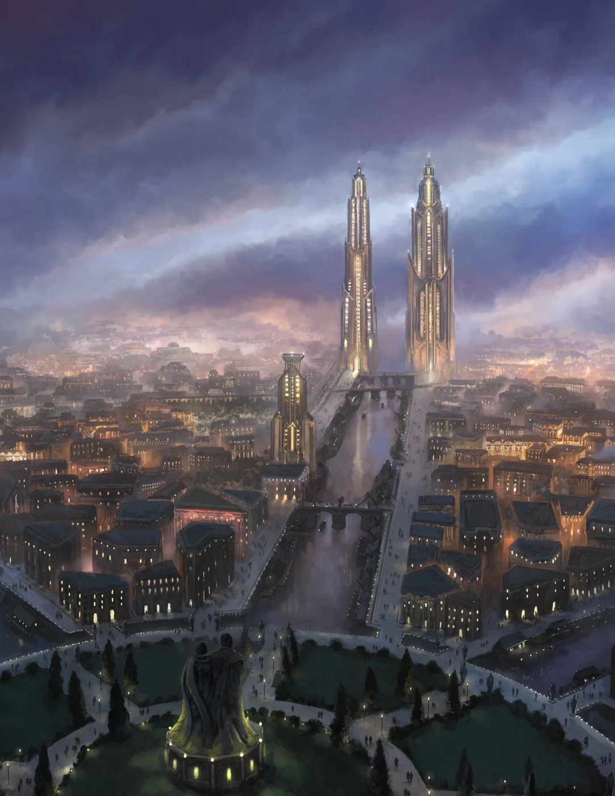

### 關於寰宇（Cosmere）

若要描述寰宇，再多的圖書館也裝不下。不過，既然你正在閱讀這份手稿，想必你的族人對寰宇已經相當了解。簡單來說，寰宇涵蓋一切存在之物。所有世界、界域（realms）、力量與族群，都在寰宇之中各有其所在。（司卡德利亞（Scadrial）在廣大寰宇中的位置，詳見第 3 章。）

### 授予（Investiture）

授予是無法摧毀的能量，充斥於所有世界的一切存在之中。所有授予都源自雅多納西（Adonalsium），也就是創世之力本身（見第 3 章〈雅多納西〉）。授予雖然流經所有生命，但有些生物體內的能量更為集中，因此獲得非凡力量，成為受授予的（Invested）生物。少數受授予的生物甚至能將一部分力量注入物品，使物品也受到授予，獲得獨特性質。有些生物則能運用破壞性的技藝，竊取力量並將其移植到其他生物身上。一個人不必了解授予，甚至不必知道它的存在，也能運用它的力量。授予在各個世界的顯現方式不同，其形態在實體界（Physical Realm）、意識界（Cognitive Realm）與靈魂界（Spiritual Realm）也各不相同。在司卡德利亞這個世界，授予主要以迷霧的形式顯現（見第 1 章〈迷霧〉）。有些司卡德利亞人能透過金屬技藝（Metallic Arts）中的鎔金術（Allomancy）與藏金術（Feruchemy）運用授予，也能透過血金術（Hemalurgy）竊取他人的能力（見第 1 章〈金屬技藝〉）。

### 碎力（Shards）與殘體（Slivers）

在古典時期的司卡德利亞（Classical Scadrial）與灰燼世界（World of Ash），這個世界都由兩道碎力所塑造：存留（Preservation）與滅絕（Ruin）。落灰之終（Catacendre）期間，世界則由單一道碎力重塑：和諧（Harmony）。這些碎力是神性的碎片，多數凡人將祂們視為神。凡人若曾短暫掌握其中一道碎力的力量，就會成為殘體；統御主（Lord Ruler）便是一例。關於碎力與殘體的更多資訊，見第 3 章〈雅多納西的碎力〉。

### 三大界域

所有世界的一切存在，都同時存在於三個界域：實體界、意識界與靈魂界。凡人的心智難以理解這點，不過可以用身體、心智與靈魂來類比：實體界如同身體，意識界如同心智，靈魂界則如同靈魂。

### 實體界

實體界是現實中有形事物所處的界域，粒子、質量與星球都存在於此。凡人最容易將這個界域視為現實。

### 意識界

意識界有時也稱為幽界（Shadesmar），是思想的界域，生物與非生物的意識面向都存在於此。它能讓事物的純粹概念化為有形，甚至包括靈魂界中通常無形的概念。司卡德利亞的居民大多不熟悉意識界。

### 靈魂界

靈魂界是事物本質所在、不受時間影響的界域，身分（Identity）與牽繫（Connection）等概念都存在於此。這個界域雖然超越時空，但一切存在之物都有靈魂面向。無論這些面向在其他界域中如何顯現，在靈魂界都呈現最真實的形態。

### 垂裂點（Perpendicularities）

三大界域通常彼此分離，但仍有可能將它們彎折，使其交會。這通常發生在授予極為充沛的區域，形成能讓人穿梭界域的垂裂點。大多數垂裂點都是由碎力創造的。

彩繪玻璃窗上飾有天金（atium）、Harmonium 與 Lerasium 的鎔金術符號。

AUSTIN HARTELL

引言 5

<!-- Pure full-page artwork: Elendel canal, Ironspine Building and Tekiel Tower. Caption and artist credit are printed on physical page 10. No printed text or footer on this page. -->

