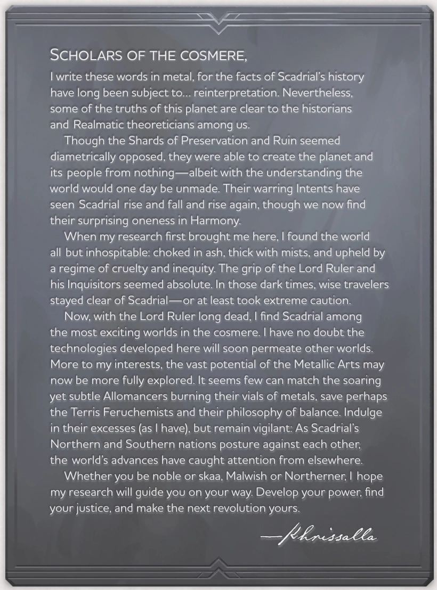

寰宇（cosmere）學者們：

我將這些文字刻在金屬上，因為司卡德利亞（Scadrial）的歷史事實，長久以來總遭到……重新詮釋。儘管如此，關於這顆星球，有些真相對我們之中的歷史學家與界域學（Realmatic）理論學者來說，仍然清楚明白。

存留（Preservation）與滅絕（Ruin）這兩股碎力（Shards）看似截然對立，卻能從無到有，創造這顆星球及其人民——只是雙方都明白，這個世界終有一天會被摧毀。它們彼此交戰的碎旨（Intents），讓司卡德利亞歷經興起、衰亡，再度興起。如今，我們卻在和諧（Harmony）之中，看見它們出人意料地合而為一。

當年，我為了研究初次來到這裡，發現這個世界幾乎無法讓人安居：火山灰令人窒息，迷霧濃重，維繫這一切的則是殘酷而不公的政權。統御主（Lord Ruler）與他麾下的審判者（Inquisitors）似乎牢牢掌控著一切。在那段黑暗歲月裡，明智的旅人都會避開司卡德利亞——至少也會格外謹慎。

如今，統御主早已死去，我認為司卡德利亞已是寰宇中最令人振奮的世界之一。我毫不懷疑，這裡發展出的科技很快就會遍及其他世界。更令我感興趣的是，如今終於能更充分地探索金屬技藝（Metallic Arts）的巨大潛力。鎔金術師（Allomancers）燃燒小瓶裡的金屬，既能縱身高飛，手段又細膩精巧，似乎少有人能與之匹敵。或許只有信奉平衡哲學的泰瑞司（Terris）藏金術師（Feruchemists）能與他們一較高下。不妨像我一樣，也沉浸於他們的恣意放縱之中，但務必保持警覺：司卡德利亞北方與南方的各個國家正相互示威較勁，而這個世界的進步，也已引來其他地方的注意。

無論你是貴族還是司卡（skaa），是 Malwish 人還是北方人（Northerner），我都希望自己的研究能在你的旅途中指引方向。發展你的力量，尋找你心中的正義，讓下一場革命由你作主。

### ——可芮莎拉（Khrissalla）

對頁：克雷迪克．霄（Kredik Shaw）高聳於陸沙德（Luthadel）之上；這座城市是統御主最後帝國（Final Empire）的心臟與首都。

KLAUS PILLON

引言 3

