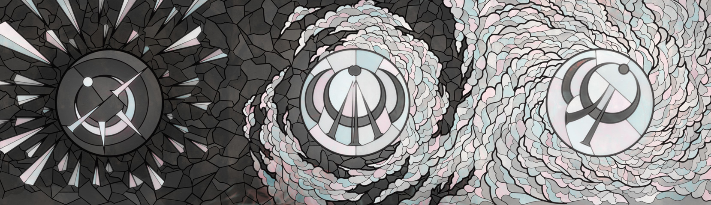

### 本書使用方式

《迷霧之子世界指南》（Mistborn World Guide）是《寰宇 RPG》（Cosmere RPG）之《迷霧之子玩家手冊》（Mistborn Handbook）的配套書籍。如果你是遊戲主持人（game master），可以運用各章資訊，在最後帝國（Final Empire）時期或落灰之終（Catacendre）之後的司卡德利亞（Scadrial）安排遊戲，並以變化多端的敵手（adversaries）挑戰玩家。如果你是玩家，可以運用地區與文化資訊，讓角色的背景故事更有深度，再從歷史事件的記述中訂立短期目標（goals），推動角色持續冒險。即使你目前沒有在玩《寰宇 RPG》，只要是《迷霧之子》（Mistborn）小說的愛好者，都能享受這本插圖豐富的司卡德利亞指南所彙整的設定與全新見解。本書資訊分為以下部分：

引言。概述《迷霧之子世界指南》，並介紹寰宇（cosmere）的幾項基本概念。

第 1 章：世界。深入探討司卡德利亞的生態與魔法，介紹這個世界的動植物、灰山（Ashmounts）與金屬技藝（Metallic Arts）。

第 2 章：地區與文化。介紹司卡德利亞上重要的族群與其領域，包括文化、軍事、經濟與政治的重要面向。

第 3 章：宇宙觀與宗教。說明這個世界的神祇、其他超凡力量的來源，以及宗教組織如何詮釋並崇拜這些存在。

第 4 章：司卡德利亞歷史。詳述從古典時期的司卡德利亞（Classical Scadrial）到「組織」（the Set）在依藍戴盆地（Elendel Basin）活動期間的世界重大事件，也檢視鋼鐵教廷（Steel Ministry）與滅絕（Ruin）長期散布的虛假歷史記述。

第 5 章：盟友與組織。介紹小說中的重要角色，建議如何將他們融入遊戲，以及如何獎勵與他們結盟的玩家角色（player characters）。

第 6 章：第一時代的重要地點。介紹最後帝國時期，司卡德利亞上幾處最適合發展戰役（campaign）的地點，提供地區細節、冒險引子與場景靈感。

第 7 章：第二時代的重要地點。介紹落灰之終後，司卡德利亞上幾處最令人振奮的戰役地點，提供地區細節、冒險引子與場景靈感。

第 8 章：敵手。提供司卡德利亞上許多生物的角色資料（profiles），包括可供遊戲主持人用來挑戰或協助玩家角色的資料區塊（stat blocks）。

附錄 A：發音指南。列出司卡德利亞的重要用語及其發音。

附錄 B：資料區塊索引。依英文字母順序列出資料區塊及其頁碼。

附錄 C：用語索引。提供頁碼，讓你能找到主要用語的重要資訊。

致謝。向本書的 Gamma 校讀者（gamma readers）表達深切謝意。

### 小說中的事件

本書涵蓋前七部《迷霧之子》長篇小說，並含有這些作品的劇透。除非另有說明，各章描述的世界狀態分別以《最後帝國》（The Final Empire）事件發生期間（第一時代），以及《悼環》（The Bands of Mourning）事件結束三年後（第二時代）為準。《昇華之井》（The Well of Ascension）、《永世英雄》（The Hero of Ages）與《The Lost Metal》中的事件，主要在第 4 章及其他章節的側欄中介紹。

### 改編《迷霧之子》

將《迷霧之子》小說改編成桌上角色扮演遊戲時，我們格外謹慎，力求忠於司卡德利亞與寰宇。本書描述的新設定與能力，都是與布蘭登．山德森（Brandon Sanderson）密切合作發展的正典內容。不過，為了符合這種協作遊戲的形式，我們仍做了一些調整。例如，將某些運用方式靈活的金屬技藝訂成具體的規則效果；部分設定則僅作暗示，為初讀小說的人保留驚喜。這款遊戲只是供你延伸發展的基礎，因此，選用適合你的元素就好——現在，你即將在屬於自己的司卡德利亞展開冒險。

引言 4

