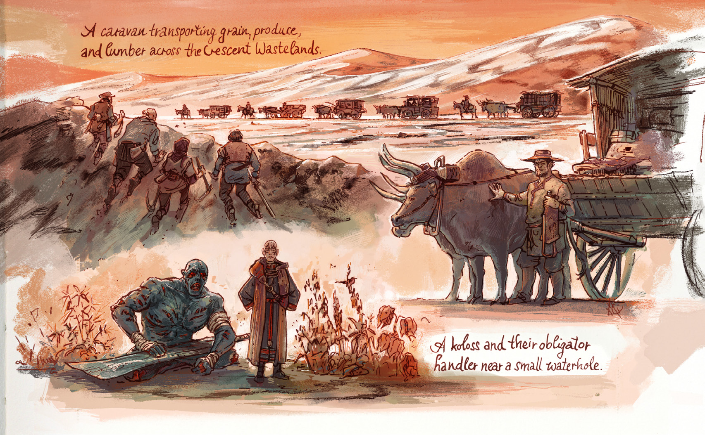
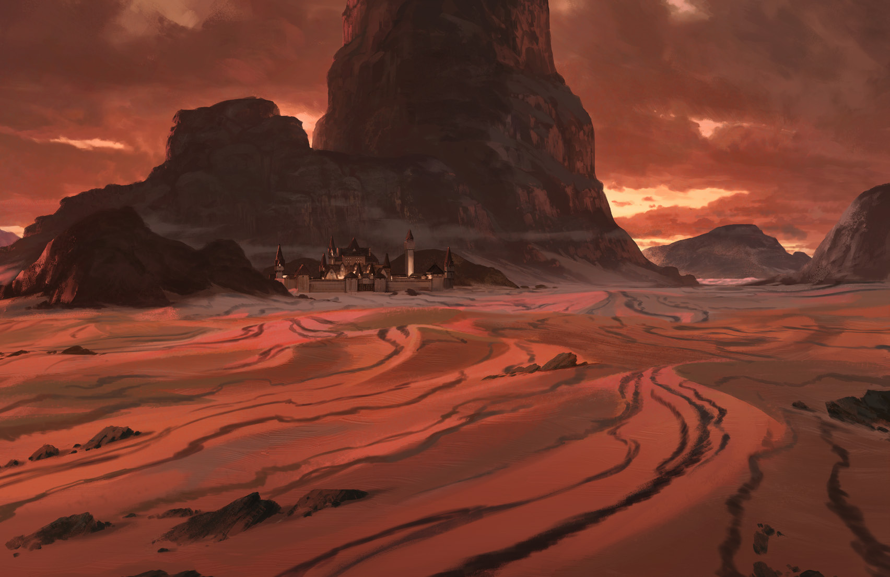

新月統御區（Crescent Dominance）有一片稱為新月荒原（Crescent Wastelands）的地帶。這裡的種植園光禿禿的，風暴永不停歇，挾著砂礫與灰燼吹過。一支支百無聊賴的克羅司（koloss）駐軍在沙丘與山嶺之間巡邏，一路巡到焦土（Burnlands）。統御區內幾乎無人往來，倒是不乏落草為寇的逃兵。傳聞荒原某處有座龐大的迷宮，藏著一個司卡（skaa）聚落，但至今還沒有一支搜索隊能活著找到它。無論是教廷官員、貴族還是司卡，被派往荒原都是嚴厲的懲罰。

### 概覽

在新月荒原設計新冒險時，可以考量以下因素。

#### 治理

新月荒原大部分地方幾乎感受不到統御主（Lord Ruler）的勢力。不過，邊界有十二座軍事要塞，由聖務官（obligators）掌控，裡頭駐滿克羅司，名義上是為了保護內統御區（Inner Dominances），防範劫掠者與焦土人（burnlanders）。這些要塞施行鋼鐵教廷（Steel Ministry）最嚴苛的刑罰，有些地方的僕役只犯了一點小錯，就會被折磨至死。教廷便是靠這種方式，在一片無法無天的土地上維持秩序。帝國的克羅司也以此地最為集中。

在要塞外不遠處，各個小領主以鐵腕管束覆滿灰燼的種植園，時刻提防反抗的司卡滲透。反抗軍經常採取這類行動，大多數種植園的司卡都樂見其成。

出了貴族領地，深入荒原腹地，自由司卡便在最後帝國（Final Empire）的掌控之外生活。有些組成運作有序的聚落，有些四處流動，以劫掠維生。

#### 居民

近五萬名克羅司在聖務官監督下巡邏。這一帶散居著獨立司卡、盜匪和軍中逃兵。這些不同群體統稱焦土人，也就是住在最靠近司卡德利亞（Scadrial）不宜居住地帶的人。

許多投身軍旅的貴族把派駐荒原視為羞辱，後來拒絕返回令他們受辱的故鄉和家族。有些貴族留在要塞，以軍旅為終身職業。有些則逃離部隊，成了盜匪。也有些司卡不願放棄荒原給他們的自由，因而從軍中逃走。

Hoxil洞窟群（Hoxil’s Hollows）的獨立司卡組成了一個自治社群。人人都有發言權，也為安全與共同利益一起努力。這些司卡多半在最後帝國勢力所及之外長大，荒原一直是他們的家。自由司卡只想活下去，最後帝國的人卻把他們和司卡逃兵一併視為叛亂者。

鋼鐵教廷的勢力僅限於邊境幾處戒備森嚴的駐地。住在荒原的貴族寥寥可數，也知道自己在人數上遠居劣勢，因此把礦場和種植園都設在看得見駐地的地方，勉強有個照應。統御區內，每一名貴族或聖務官至少對應一百名司卡。不過，大部分自由司卡都藏得很好，所以實際人數遠比這個估計難以掌握。

#### 文化

荒原居民唯一的共同點，就是日子都很艱苦。任何東西都會改作他用，新鮮蔬果比盒金（boxings）還值錢。

四處遊蕩的焦土人奉行弱肉強食，唯一的規矩就是活下去。

獨立司卡實行共有制。他們認為自私是最嚴重的背叛，尤其是囤積資源。他們躲在統御主耳目所及之外，靠精巧的灌溉和初步的蒸汽動力等技術維持生計。

克羅司是荒原人數最多的群體之一，有些駐守要塞，有些在各處巡邏。鋼鐵教廷以外的人都畏懼克羅司，對他們避之唯恐不及。

### 重要地點

新月荒原炎熱、多沙而危險。在這片不毛之地，令人生畏的當地居民在以下這些地方勉強維生。

#### Vilstadt要塞

靠近東方統御區（Eastern Dominance）的邊界，有座以石材和黑曜石砌成的巨大建築，閃著光澤。這座五層樓高的軍事基地由鋼鐵教廷管理。聖務官負責行政，鋼鐵審判者（Steel Inquisitors）擔任將領，大批克羅司組成軍隊。數千名遭奴役的司卡和少數泰瑞司侍從官（Terris stewards）在這裡為教廷效力。

每座邊境要塞都對居住在裡頭的司卡極為嚴苛，但 Vilstadt 的殘暴尤其惡名昭彰。鋼鐵審判者在頂樓施行血金術（Hemalurgy），慘叫聲隨風傳到數英里外。僕役只要犯錯，就會被

第 6 章：第一紀元的特色地點 158

公開處決。罪行愈重，處決手法就愈駭人、愈令人作嘔。

監管 Vilstadt 的教廷官員掌控的克羅司比任何內統御區官員都多，因此是教廷中權勢最高的一群人。然而，大多數聖務官都害怕被派到這裡。要塞本身冷酷陰沉，周遭又炎熱多塵。派駐 Vilstadt 本身就是一種威脅，甚至比懲罰還嚴重。每個被派到這裡的教廷官員都曾辦事失利，為了調回比較文明的地方，他們什麼都做得出來。

#### Hoxil洞窟群

龐大的地下隧道群住著許多獨立司卡、逃兵和他們的家人。他們想躲開統御主無所不及的耳目，在這裡過日子。這裡原是一片綿延數英里的天然洞穴，居民將它改造成錯綜複雜的地下空間，遍布隧道、蘑菇園、住所和死路。

洞窟群的居民把安全與保密看得比什麼都重要。他們一直在找司卡鎔金術師（Allomancers）守衛隧道入口，尤其需要白鑞臂（Pewterarms）、錫眼（Tineyes）和煙陣（Smokers）。

洞窟群居民長年生活在邊陲，早已習慣半遊牧生活。不過，一旦有遭人發現的風險或其他危險，他們通常寧可再挖一條隧道，也不願徹底放棄這片地方。理由很簡單，他們需要水。洞窟群中心有個巨大的含水層，司卡利用它打造出以蒸汽驅動的淨水、灌溉和降溫系統。不過，洞窟群還無法完全自給自足，所以較擅長戰鬥的居民常會外出劫掠，繞過要塞，穿越新月統御區，深入東方統御區。

#### 吞仇者

吞仇者（Vengeance Eaters）是當年奉命摧毀 Hoxil洞窟群的一群克羅司當中，僅有的倖存者。即使他們使盡全力，獵物還是從隧道逃走了。克羅司試圖拆毀洞窟，卻讓整片洞頂塌在自己頭上，只剩幾十個活下來。

倖存者吃掉死去的同伴，徒手刨出一條路，重見天日。如今他們潛伏在洞窟群附近，伺機向逃過一劫的人下手。任何擋路的人也會遭殃。

對洞窟群的居民來說，吞仇者既是鬼故事，也是實實在在的阻礙。司卡早已改建隧道來避開克羅司，但許多居民信誓旦旦地說，走到某些通道時，能聽見陣陣嚎叫。

> 一支商隊載著穀物、蔬果和木材穿越新月荒原。
>
> 一名克羅司和負責管束他的聖務官站在一處小水窪旁。

MARIE SEEBERGER

第 6 章：第一紀元的特色地點 159

#### 失蹤兵團

一群惡名昭彰的焦土人，其實是來自統御主軍隊的逃兵，其中有貴族也有司卡，人數還在不斷增加。最初這批人受命平息一場叛亂，卻在沙塵暴中迷路。軍方以為他們已經死了，便將他們拋下。他們因遭遺棄而怒不可遏，從此留在新月荒原，成了當地的禍患。

失蹤兵團（The Lost Regiment）四處流竄。任何人要是不幸撞上他們，都可能遭洗劫、殺害，成為他們洩憤的對象。他們活在痛苦與憤怒中，知道自己就算想回去，也再也融不進家鄉的社會。他們認定這都是別人的錯，也要讓其他所有人付出代價。

#### 流沙山

荒原上最接近天然地標的地方，是一座由頁岩和沙子堆成的巨山，名叫流沙山（Shifting Sands Mountain）。由於山體的組成加上沙塵暴不斷，這座山的大小一直在變，幾乎無法用來辨路。司卡相信山頂有一座失落城市的遺跡，但變幻不定的強風讓人無法登山，也沒人能查出山頂的祕密。種植園的司卡則一口咬定，整座山是由成千上萬隻一起湧動的霧魅（mistwraiths）組成的。不論山頂有什麼，只要能爬上去，那裡就是絕佳的瞭望點。

#### 骨林

骨林（Bone Grove）曾是克羅司營地，早已荒廢，如今有四處遊蕩的霧魅出沒。地上積著深達四呎的灰燼，底下卻有寶物，等著膽敢進入骨林或走投無路的拾荒者前來尋找。以金屬、骨頭和木材製成的巨型克羅司武器從地面冒出，活像一座無人打理的花園。

#### Exquelor種植園與礦場

Exquelor家族（Exquelor family）是小貴族，以極省開銷又殘酷的方式經營種植園和砂礦，因此成了劫掠者的首選目標。

種植園有一座主宅，裡面有五間臥房和兩間會客室，另外還有一座砂礦和二十四間司卡棚屋。Exquelor家族不知道，他們的大門外就有一條通往 Hoxil洞窟群的隧道。種植園的司卡經常與反抗的司卡合作，交換食物、消息和醫療用品。

新月荒原的環境嚴酷，容不得一點閃失。

LOGAN FELICIANO

第 6 章：第一紀元的特色地點 160

### 最後帝國覆滅後

統御主死後，克羅司第一次擺脫了他的控制。他們一獲得自由，就在荒原、新月統御區和東方統御區到處橫衝直撞。難民為躲避這些克羅司大軍，開始大批湧入內統御區。

荒原其他地方大致和從前一樣。環境依舊嚴酷，盜匪和逃兵仍是威脅。獨立司卡聽說陸沙德（Luthadel）有了新政府，卻不知該作何感想。也許這又是貴族編的謊話。很少有消息傳到荒原，經營種植園的貴族也巴不得假裝一切照舊。

要塞終究已經空無一人，也不會再有聖務官前來維持秩序。種植園主人愈來愈難瞞住這兩件事。克羅司仍經常毫無預警地攻擊，但教廷已經不再指使他們執行懲罰。最勇敢的司卡帶頭反抗，其他人乾脆離開這一帶。隨著時間一年年過去，氣溫逐步升高，克羅司的劫掠也愈來愈有組織。最後，這片土地落入滅絕（Ruin）和他的大軍手中。

### 冒險引子

你可以用以下點子展開一場以新月荒原為舞台的冒險。

#### 雙重背叛

Axshion Carnoux大人（Lord Axshion Carnoux）是鄉間的小貴族，一心想闖出名聲，東方的補給線卻遭到反抗的司卡劫掠，讓他的美夢落空。引起聖務官注意會讓他的社交地位毀於一旦，因此 Carnoux 正暗中招募一群行事低調的人手，前往新月荒原消除這個麻煩。

他對傳聞中反抗軍掌握的技術尤其感興趣。只要能把那項技術帶回來，他就願意支付高得離譜的額外報酬。只要趕快穿過盜匪橫行的沙漠，繞過克羅司大軍，到 Carnoux種植園跑個來回……這差事其實很簡單。

#### 登高測繪

新加入反抗軍的拾荒者 Sef Cardish 很想測繪更多荒原地區。Sef 的小隊原本主要在滲透 Exquelor種植園，但克羅司近來活動頻繁，打亂了他的計畫。如果反抗軍能從遠處觀察克羅司，並根據推測的行軍路線規劃行動，就能更準確地拿捏小隊出擊的時機。Sef 願意提供貴重裝備，酬謝任何敢冒險攀登流沙山、在山頂架設瞭望站的冒險者。

#### 有遺囑就有辦法

聖務官 Ivegenia Culee 有一則緊急消息要傳給失蹤兵團的貴族成員 Tytos Erontyne。他的父親和幾名兄姊相繼過世，如今 Tytos 已是 Erontyne家族（House Erontyne）的家主。

可惜，冒險者找到失蹤兵團時，就會發現 Tytos 已經死了一段時間。好在有不少焦土人願意頂替他。畢竟，已經好幾年沒人見過 Tytos 了。再說，有了 Erontyne家族撐腰的失蹤兵團，你難道不希望他們成為你的盟友嗎？

#### 其他場景

「新月荒原遭遇」表提供可用於任何戰役的個別場景點子。

##### 新月荒原遭遇

| d6 | 遭遇 |
| --- | --- |
| 1 | 一名泰瑞司侍從官正要前往一座要塞任職，原先的護衛卻不願再深入統御區。他請人護送。只要侍從官抵達要塞，聖務官就會支付原本答應給前一位護衛的全額報酬。 |
| 2 | 沙丘間颳起致命的沙塵暴，一名四處探索的孩子在這時綻裂（Snaps）。孩子急需醫療救助。 |
| 3 | 在聖務官監督下，克羅司士兵在荒原各處操練，隊伍整齊得令人發毛。PC 必須避開他們。 |
| 4 | 一名種植園主人在司卡棚屋區的出入口外發現一條奇怪的隧道。他立刻想雇人進去探索。 |
| 5 | 一群飢腸轆轆、全副武裝的盜匪從沙丘後方殺出。他們索要食物、金屬和工具，對珠寶或盒金毫無興趣。 |
| 6 | 一群怒氣沖沖的克羅司大喊「蒸汽！蒸汽！」，隨即圍住一座異常潮濕的沙丘。他們找到了聚落的跡象。 |

> 「他們大多也不以自己做過的事為榮，」他說。「可他們大多也想有飯吃。這世道不好過啊，葉登。」

第 6 章：第一紀元的特色地點 161
