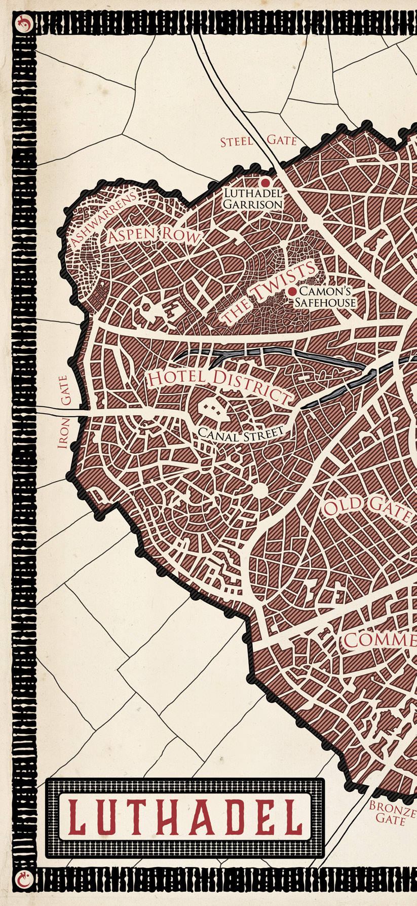
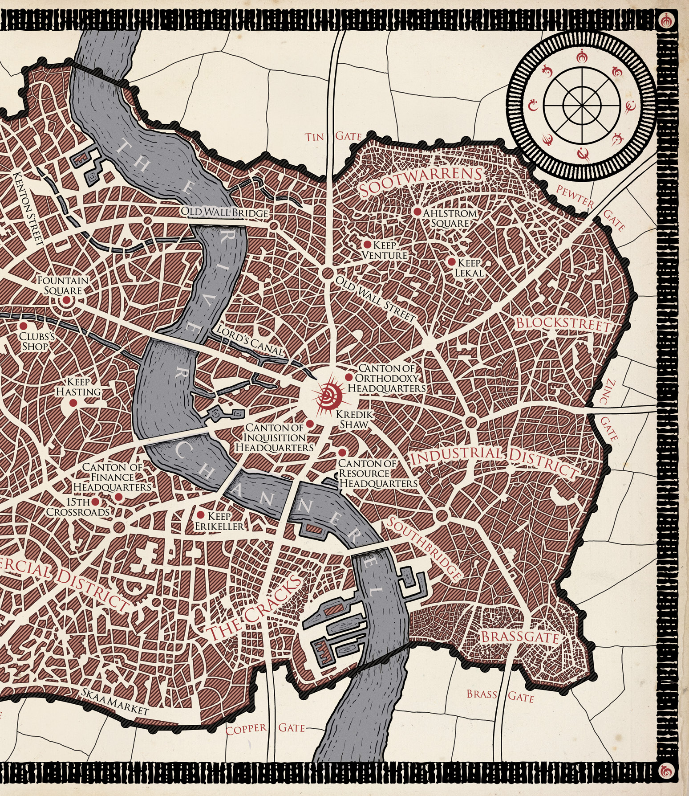
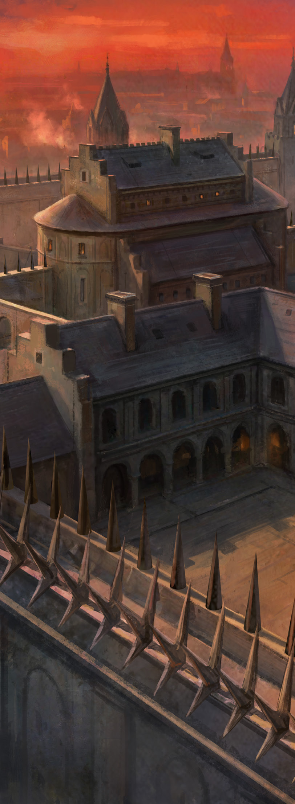
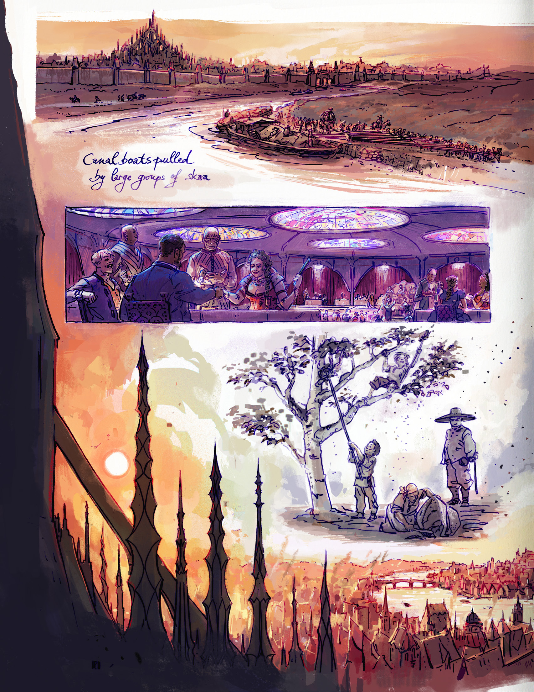
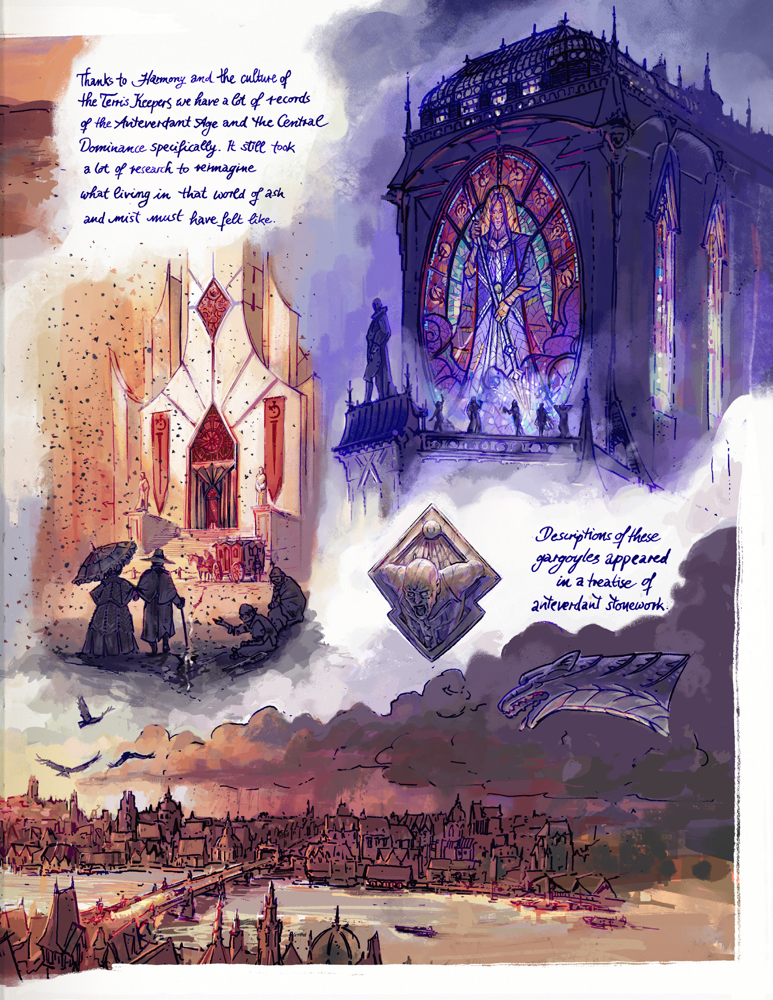
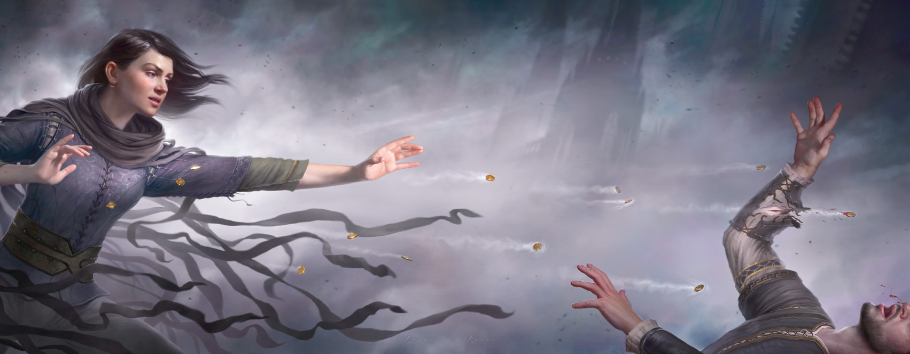

最後帝國（Final Empire）的首都陸沙德（Luthadel）位於中央統御區（Central Dominance），正坐落在司卡德利亞（Scadrial）的地磁北極。香奈瑞河（River Channerel）將這座沾滿灰燼的城市一分為二。運河和黑色卵石路縱橫交錯，城外則圍著高一百呎的石牆。

鐵匠鋪和廚房不斷噴出濃煙與煤灰，讓紅日下的天空染上一層焦橙色。十座巨大的石造堡邸矗立在城中，塔樓直指天際，大片彩繪玻璃窗格外醒目。然而，它們在統御主（Lord Ruler）的居所克雷迪克．霄（Kredik Shaw）面前也相形見絀。這座宮殿占地遼闊，遍布尖塔和塔樓。

夜幕降臨後，迷霧聚攏，盜賊團夥開始行動，鎔金術師（Allomancer）則在暗處追蹤、潛行和刺探。

### 概覽

在陸沙德設計冒險（Adventure）時，可以考量下列因素。

#### 政府

陸沙德由統御主領導。他是最後帝國最高的政教領袖，受人尊崇，稱為無限殘體（Sliver of Infinity）。統御主的鋼鐵教廷（Steel Ministry）透過各個下屬部門監督所有交易與協議。陸沙德駐軍（Luthadel Garrison）維持約兩萬人的常備軍，出入城市都受到嚴格監控。

駐軍負責管制司卡（skaa）貧民區，執行的法律旨在約束司卡，對他們毫無保障。各貴族家族另有自己的衛隊。此外，鋼鐵教廷的審判廷（Canton of Inquisition）在城內設有約四十處祕密安撫（Soothing）站，用來控制居民的情緒，並偵測使用鎔金術（Allomancy）的司卡。

#### 經濟

貴族家族擁有種植園和工廠，進口糧食，也經營運河航運。司卡工匠或商人在陸沙德鮮少獲得聲望，偶爾也有例外。所有體力勞動都由沒有薪資的司卡負責。他們歸統御主所有，由貴族租用並提供食宿。在陸沙德，食品往往以罐裝保存，書籍靠手工裝訂，家家戶戶用油燈和蠟燭照明。

- 陸沙德
- 鋼門（Steel Gate）
- 灰窟區（Ashwarrens）
- 白楊街區（Aspen Row）
- 陸沙德駐軍
- 曲巷區（the Twists）
- 凱蒙的安全屋（Camon’s Safehouse）
- 旅館區（Hotel District）
- 鐵門（Iron Gate）
- 運河街（Canal Street）
- 舊城門區（Old Gate）
- 青銅門（Bronze Gate）

第 6 章：第一紀元的特色地點 162

- 香奈瑞河
- Kenton街（Kenton Street）
- 噴泉廣場（Fountain Square）
- 歪腳的店（Clubs’s Shop）
- 海斯丁堡（Keep Hasting）
- 舊城牆橋（Old Wall Bridge）
- 錫門（Tin Gate）
- 煤灰窟區（Sootwarrens）
- Ahlstrom廣場（Ahlstrom Square）
- 泛圖爾堡（Keep Venture）
- 雷卡堡（Keep Lekal）
- 白鑞門（Pewter Gate）
- 舊城牆街（Old Wall Street）
- 領主運河（Lord’s Canal）
- 方塊街區（Blockstreet）
- 教義廷總部（Canton of Orthodoxy Headquarters）
- 克雷迪克．霄
- 審判廷總部（Canton of Inquisition Headquarters）
- 資源廷總部（Canton of Resource Headquarters）
- 財務廷總部（Canton of Finance Headquarters）
- 第 15 路口（15th Crossroads）
- 艾瑞凱勒堡（Keep Erikeller）
- 工業區（Industrial District）
- 鋅門（Zinc Gate）
- 商業區（Commercial District）
- Southbridge
- 裂隙區（the Cracks）
- 黃銅門區（Brassgate）
- Skaa Market
- 紅銅門（Copper Gate）
- 黃銅門（Brass Gate）

ISAAC STEWART

第 6 章：第一紀元的特色地點 163

#### 文化

陸沙德有些貴族富可敵國，尤其是大家族（Great Houses）的成員，也有些貴族窮困潦倒。上層貴族舉辦奢華的舞會，彼此結盟，也互相尋仇。較窮的貴族則為地位更高的人服務，靠擔任守衛、侍從、表演者和廚師維生。

貴族喜歡色彩鮮豔的衣著，從華麗的禮服，到搭配決鬥杖（dueling cane）的俐落套裝都有。司卡則穿著廉價的罩衫、長褲和襯衫，多半是和灰燼融為一體的暗沉色調。

#### 居民

陸沙德有將近兩百萬居民，其中四分之三是司卡勞工。最後帝國各地許多貴族家族都在陸沙德設有據點。十大大家族各自斥鉅資維護一座雄偉的堡邸，分別是泛圖爾（Venture）、海斯丁（Hasting）、埃拉瑞爾（Elariel）、太齊爾（Tekiel）、雷卡（Lekal）、艾瑞凱勒（Erikeller）、艾瑞凱（Erikell）、浩特（Haught）、兀爾班（Urbain）及布維達（Buvidas）。想進一步了解這些家族，見第 2 章〈中央統御區〉。

上層貴族彼此爭奪財富與地位。統御主的鋼鐵教廷時時監視貴族，因此他們行事都得遵守明確的禮法界線。

下層貴族除了規模較小的貴族家族，也包括具有貴族身分的工人、士兵和僕役。他們仿效大家族，竭力維持自己在陸沙德階級社會裡僅有的地位。

司卡住在擁擠的集合住宅裡。從工廠到運河，各種粗活都由他們負責。在司卡貧民區，刀傷、毆打和挨餓都很常見。然而，有些司卡的真實身分出人意料。

#### 地下勢力

司卡的盜賊團夥行騙、偷竊、搶劫，有時甚至冒充貴族。這些團夥與司卡地下組織合作。這個由反抗統治的司卡組成的網絡祕密運送逃亡者，也庇護盜賊。

另外還有一支規模不大的司卡反抗軍。這群人為自由而戰，夢想有一天能擺脫統御主和他的最後帝國。

陸沙德駐軍維持一支將近兩萬名士兵的常備軍。

GAL OR

### 重要地點

陸沙德分成好幾個街區，從維護得井井有條的貴族街廓，到擁擠的司卡貧民區都有。這些街區包括曲巷區、灰窟區、白楊街區、旅館區、舊城門區、商業區、裂隙區、Southbridge、黃銅門區、工業區、方塊街區、煤灰窟區和穀田區（Grainfield）等。

#### 白楊街區與曲巷區

在貧困的白楊街區和曲巷區，陸沙德駐軍與司卡盜賊團夥成天上演貓捉老鼠的戲碼。

一進陸沙德的鋼門就是駐軍營地。這片廣大的設防區域包括兵營、訓練場和行政建築。這裡約有兩萬名軍人，大多是司卡。許多駐軍住在營區，也在營區受訓，再輪調進城管制司卡。駐軍經常突襲白楊街區和曲巷區一帶的司卡公寓。其中一支名叫怒吼八四隊（Roaring 84s）的隊伍，以放火燒公寓而惡名昭彰。

駐軍尤其忌憚曲巷區。區內到處是盜賊團夥的安全屋、酒館，以及用來掩護見不得光生意的店面。駐軍會公布已知罪犯的名單與懸賞，供有興趣靠通風報信賺幾枚盒金（boxings）的司卡參考。

#### 黃銅門區

即便以司卡貧民區的標準來看，黃銅門區依舊擁擠得驚人，住著許多過勞的司卡工人。大多數居民在工業區的磨坊、工廠和礦石精煉廠辛苦工作，或在香奈瑞河沿岸的碼頭勞動。一小群司卡反抗者在這個街區居住並招募人手。他們混進幾處公共廚房，一邊舀湯，一邊煽動不滿。到目前為止，他們沒招到多少人，也還沒引起聖務官（obligator）的注意。

這裡也是新興盜賊團夥千眼（Thousand Eyes）的據點。千眼組織嚴密，手頭有些資金，由一位失勢的貴族暗中資助。那位貴族著迷於研究一本關於 Trelagism 的禁書。

#### 商業區

商業區是陸沙德最繁華多元的街區。街道還算乾淨，下層貴族和富裕的司卡在這裡比鄰往來。這裡的建築較新，也都用堅固的石材建造。商家與大小體面的獨戶住宅坐落在同一片街廓。區內各處有不少掩護非法生意的店面、銷贓商和條件較好的安全屋，混在合法商家之中，例如人氣麵包店西方統御區美味坊（Western Dominance Delights），以及頗具名氣的落灰服飾配件與男女帽店（Ashfall Haberdashers, Hatters & Milliners）。

商業區每天有數百筆交易成交。一些野心勃勃的下層貴族已開始資助一波低調發展、規模逐漸擴大的組織犯罪。他們近來主要透過運河走私奢侈品，現在已開始把手伸向勒索與血腥鬥毆。多數商業區勞工住在附近的裂隙區貧民窟，不少人心懷不滿，也有自己的野心。

#### 旅館區

旅館區的居民多半是下層貴族。這裡遍布大家族的旁支家族和小型貴族宅邸。受器重的子弟經營家族事業與投資，年紀較輕的孩子則到大家族謀職。和上層貴族一樣，這一區的居民晚上也會飲宴交際。他們通常在餐館、劇院、音樂廳和不入流的地下酒館等休閒場所消磨時間，鮮少出席盛大舞會。

區內有幾處小型商圈，包括 Babinet廣場（Babinet Square）和 Gaffinroux街（Gaffinroux Street），規模都比不上 Kenton街商圈。陸沙德首屈一指的音樂學校 Vederiel音樂學院（Vederiel Academy）也在旅館區。許多下層貴族家庭竭力讓孩子進入 Vederiel 就讀，希望有朝一日能在上層貴族的舞會上表演，為家族爭取聲望。Vederiel 有幾位不認同主流文化的教師，在街區各處的地下酒館偷偷為司卡開設音樂課。

第 6 章：第一紀元的特色地點 165

> 由大群司卡拉行的運河船

> 多虧和諧（Harmony），也多虧泰瑞司守護者（Terris Keepers）的文化傳統，我們有許多前蒼翠時代（Anteverdant Age）的紀錄，尤其是中央統御區的資料。即使如此，我們還是做了大量研究，才重新想像出住在那個灰燼與迷霧交織的世界裡，究竟是什麼感覺。
>
> 這些怪獸滴水嘴的描述，曾見於一篇探討前蒼翠時代的石雕工藝（anteverdant stonework）的論著。

MARIE SEEBERGER

#### 埃拉瑞爾堡（Keep Elariel）

陸沙德的大家族各有一座高牆圍繞的巨大堡邸，埃拉瑞爾堡就是其中之一。它外觀威嚴，內部典雅。富麗堂皇的舞廳裡有下沉式舞池，旁邊分層擺放桌席，方便賓客低聲交談、運作政治。

珊．埃拉瑞爾（Shan Elariel）是家族中最受器重的子弟，也是個本領高強、野心勃勃的危險迷霧之子（Mistborn）。她擅長政治角力和操弄人際關係，多年來四處結盟，也蒐集足以牽制敵友雙方的把柄。珊和她的家族正在招募迷霧人（Mistings），刺探其他大家族並從中破壞。密探如果證明自己有本事，珊也會交派暗殺任務。

#### 泛圖爾堡

泛圖爾堡的防禦牆內有精緻的建築裝飾、溫室花園和令人驚豔的彩繪玻璃窗。泛圖爾家族（House Venture）是規模最大的大家族，維持一支由數百名士兵組成的家族衛隊，另有十二名殺霧者（hazekillers）。

家族有大約二十四名迷霧人，從本地的家族貴族中招募而來，也至少與一名坎得拉（kandra）密探訂有契約（Contract）。泛圖爾家族祕密管理海司辛深坑（Pits of Hathsin），因此極為富有，財富也分散在許多不同的商業和產業之中。為了領先其他大家族，泛圖爾家族在城內資助多項計畫，包括間諜活動、綁架，以及研發毒藥和解毒劑的實驗室。

#### Kenton街

Kenton街是個高級商圈，貴族和僕役會來這裡買衣服、書籍、珠寶和禮物等。許多店家都在替貴族家族當間諜，例如金針裁縫店（Golden Stitch）與亮漆精品家具店（Varnished and Valued Furniture）的店主，有些甚至同時替好幾個家族效力。因此，這一帶的會客室、私人餐廳和沙龍經常藏有小隔間，讓間諜記下談話和會議的內容。街區也有不少餐館、賭場，以及提供安撫者（Soothers）和煽動者（Rioters）服務的店家。

當地的貴族家族之一 Phiviax家族（House Phiviax），一直在向附近商家施壓，要求對方把店面賣給他們。Phiviax 是極為富有的上層貴族家族，打算建造全城第十一座堡邸，成為新的大家族。

#### 克雷迪克．霄

克雷迪克．霄在古泰瑞司語（Ancient Terris）中意為千塔之山（Hill of a Thousand Spires），是統御主的宮殿。它比城內任何一處貴族莊園都大上好幾倍，由數十座高矮粗細各異的蜿蜒尖塔與宏偉塔樓組成。宮殿沒有圍牆，統御主則有數百名士兵組成的私人宮廷衛隊。

貴族、司卡、聖務官、鋼鐵審判者（Steel Inquisitors）和坎得拉都在宮殿裡當差。鋼鐵教廷各部門在宮內合辦公務，其中的刺探與政治角力比大家族之間更加隱密。宮殿深處由審判者看管囚室，並進行駭人的血金術（Hemalurgy）實驗。

在陸沙德霧氣籠罩的街道上，紋（Vin）以鋼推（Steelpush）射出硬幣，威力致命。

HOWARD LYON

第 6 章：第一紀元的特色地點 168

囚室下方還藏著克雷迪克．霄廣大的地道網。裡面有食物和水的儲藏庫、統御主的避難所，以及昇華之井（Well of Ascension）。

只要統御主身在克雷迪克．霄，他那強大得令人難以招架的安撫就會籠罩整座宮殿。效果見第 3 章的側欄〈統御主的情緒鎔金術（Emotional Allomancy）〉。

### 最後帝國之後

統御主死後，依藍德．泛圖爾（Elend Venture）加冕為陸沙德的國王，並建立新政府。各大家族逃離城市，退往其他統御區的莊園。司卡獲宣告成為自由公民，許多重獲自由的泰瑞司人也來到陸沙德。

Kenton街迅速變成多元的市集，向陸沙德的所有居民敞開大門。過去拒絕接待司卡的商家一下子多出大批新顧客。許多司卡接管了貴族的堡邸與莊園，在貴族留下的華麗居所共同生活。

倖存者教會（Church of the Survivor）成立後，教士們傳講卡西爾（Kelsier）超越了死亡，紋則是倖存者的女繼承人（Lady Heir of the Survivor）。

統御主死後一年，三支軍隊前來圍攻陸沙德，分別由史特拉夫．泛圖爾（Straff Venture）、灰侯．塞特（Ashweather Cett）和加斯提．雷卡（Jastes Lekal）領軍。

### 冒險引子

你可以用下列點子開展一場以陸沙德為舞臺的冒險。

#### 無面之懼（Faceless Fears）

下層貴族家族的家主 Relise Canrae夫人（Lady Relise Canrae）正在尋找調查員，想揪出她認為混進家中僕役的間諜。她推測此人受對頭 Gensler家族（House Gensler）指使。實情卻是，她心懷嫉妒的兄弟 Arlain 已讓一名坎得拉密探取代了家中的管家！

#### shelldry大劫案（The Great Shelldry Heist）

十六支由兩名貴族組成的隊伍報名參加 shelldry 錦標賽。賽事在 Kenton街上的豪華俱樂部統御之手（Ruler’s Hand）舉辦。預計總獎金將超過 10,000 枚盒金，足以讓野心勃勃的盜賊團夥心動。賽事由聖務官擔任裁判，警備人員包括迷霧人和殺霧者。

#### 新血（New Blood）

年輕貴族 Zo Mallette 帶著一大筆遺產來到陸沙德，打算在當地社交圈轟動登場。Zo 行事莽撞又沒什麼閱歷，只要有團夥願意下重注，就有機會用精心設計的騙局讓 Zo 上鉤。

#### 教廷追蹤（The Ministry Follows）

審判廷查出一名司卡竊賊的身分，聖務官正在追捕此人。如果角色能躲開鋼鐵教廷的追兵，把竊賊祕密送出陸沙德，竊賊會為了報恩，把自己安全屋的位置告訴角色。角色可以用它作為新的行動據點。

#### 逃離駐軍營地（Escape From the Garrison）

一位摯友或重要聯絡人被陸沙德駐軍逮捕了。角色必須趁對方還沒害角色暴露之前把人救出來。問題在於，此人被關在陸沙德戒備最森嚴的地點之一。角色能請誰還人情？他們有本事完成這場驚險的潛入與逃脫嗎？

#### 其他場景

陸沙德遭遇（Luthadel Encounters）表提供一些單獨的場景點子，你可以用在任何戰役（Campaign）中。

##### 陸沙德遭遇

| d6 | 遭遇（Encounter） |
| --- | --- |
| 1 | 一名戴著特高帽子的貴族，拿決鬥杖威脅一戶司卡人家。 |
| 2 | 灰燼堵塞運河，導致一處貴族街區淹水。隨之而來的混亂，正好能替想趁亂洗劫的人引開注意力。 |
| 3 | 兩名迷霧之子在夜裡越過一座座屋頂交手。其中一人受傷跌落街頭，另一人消失在迷霧裡。 |
| 4 | 兩名聖務官要求查看一家店過去三年的文書紀錄。慌了神的店主堅稱帳本最近才被偷走。 |
| 5 | 一名攤販想賣掉一塊有刻痕的鋼板，聲稱它可追溯到最後帝國建立以前。 |
| 6 | 一名貴族出價 1,000 枚盒金，請人幫忙躲避一名鋼鐵審判者。那名審判者打算以反抗政權的行為為由將此人逮捕。 |

第 6 章：第一紀元的特色地點 169
