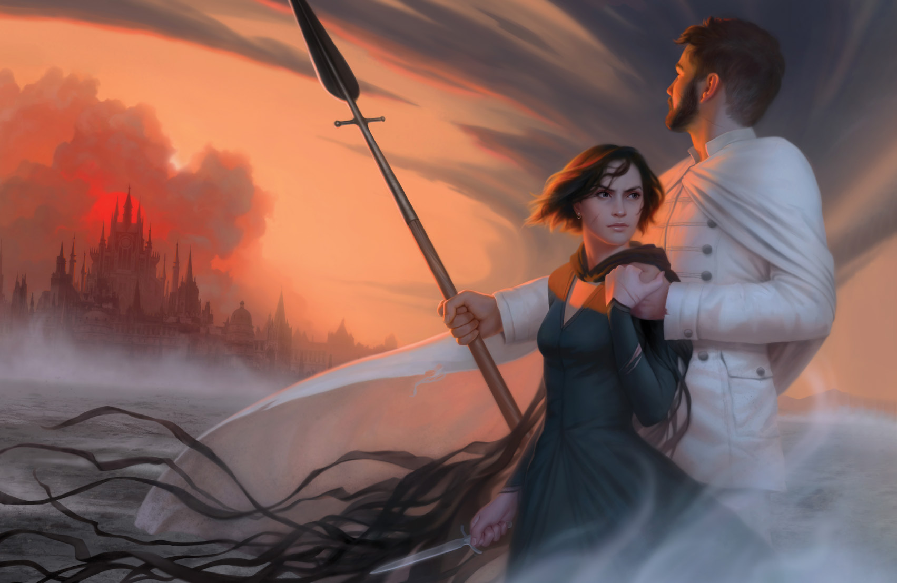

最後帝國（Final Empire）時期的司卡德利亞（Scadrial）是個危險的世界，由專制的教會與長生不死的神皇共同掌管。變革終將到來。面對統御主（Lord Ruler）的暴政，抗命的人越來越多，連公然起來革命的行動也日漸增多。

在本章介紹的場景裡，司卡（skaa）角色可以組成一支竊賊團，與鋼鐵教廷（Steel Ministry）和貴族鬥智鬥技。角色也可以本身就是貴族，打理家族財產，在危機四伏的社交圈中周旋，挫敗狡猾對手的算計。

### 如何運用這些地點

本章介紹司卡德利亞第一時代的四處代表性地點，並提供冒險（Adventure）引子，讓你從中發展新的故事。

**新月荒原（Crescent Wastelands）。** 新月荒原是最後帝國邊陲一片處境艱難的土地，處處可見起而反抗的司卡、四處遊蕩的克羅司（koloss）群，以及以武力鎮壓當地的軍隊。

**陸沙德（Luthadel）。** 這座城市是統御主在最後帝國的權力中心，既富裕奢華，又冷酷殘忍。在這裡，一場叛亂也可能演變為革命。司卡竊賊團在迷霧中行動，貴族則在華麗的舞會與安靜的客廳裡運籌算計。

**海司辛深坑（Pits of Hathsin）。** 這座駭人的監獄兼勞動營，是最後帝國取得神金屬（God Metal）天金（atium）的祕密產地。遠在監工與天金晶洞下方的地底深處，坎得拉（kandra）在遠離人類世界的坎得拉家園（kandra Homeland）找到一處安靜的避難所。

**泰瑞司統御區（Terris Dominance）。** 這片寒冷的山區位於最後帝國邊緣，泰瑞司（Terris）人在審判廷（Canton of Inquisition）的極權統治下生活。守護者（Keeper）祕密行動，泰瑞司人也竭力保留自己的文化與生活中的樂趣。

第 7 章介紹司卡德利亞第二時代的特色地點。

### 情緒與劇情

在寰宇（cosmere）中，場景與敘事緊密相連。司卡德利亞第一時代，機敏多謀的鎔金術師（Allomancer）、貴族與竊賊穿梭在迷霧籠罩的街頭，追尋財富、變革與冒險。

《迷霧之子》（Mistborn）系列中的地點既能加深情緒，也能推展劇情。每處場景都能為故事增添層次，也藏著可供角色探查的祕密或情節發展。

#### 加深情緒

在最後帝國，陸沙德這類城市讓人感到壓抑，也讓人覺得一切永遠都會如此。富裕貴族的尖塔沾滿灰燼，天空掛著紅日，灰山（Ashmount）不斷噴發。這些景象襯托出故事中渺茫的勝算與難以想像的挑戰。

#### 推展劇情

讓實際地點配合戰役（Campaign）的故事發展，可以突顯主題。把事件與特定地點連結起來，也能讓戰役的敘事更有力，前後更緊密。

> 關於最後帝國的消息一向令人起疑，所以這些文字刻在鋼上。
>
> 以下彙整各處地點、各族人民與諸多事件的紀錄，盡可能如實呈現當時的面貌。即使鋼鐵教廷、統御主與碎力（Shard）從中干預，這些紀錄依然真實完整。

Gal Or

第 6 章：第一紀元的特色地點 155

### 第一時代的故事

最後帝國充斥著絕望，也有人審慎地策劃反抗。無論是來自種植園的司卡、泰瑞司侍從官（Terris Steward），還是權勢顯赫的大家族（Great House）族長，每個角色都多少感到前景無望。他們一步一步走下去，處處碰上看似無法克服的難關。第 5 章詳述本節提到的人物。

#### 司卡的困境

《迷霧之子》小說從首都陸沙德寫起。這座灰燼覆蓋的城市濃縮了最後帝國的一切，讓人看見司卡過著何等絕望的生活。統御主的權勢如神一般不可動搖，就和他與貴族居住的城堡一樣堅固長存。在最後帝國，信仰遭到扭曲，也容不得任何質疑。

灰山不斷落下令人窒息的灰燼，讓陸沙德始終又髒又暗。這景象象徵帝國看似永遠不變，也映照出司卡的絕望。

#### 無所不在的腐敗

卡西爾（Kelsier）的團隊聚在一起後，逐漸發現人生還可以追求活命以外的事。希望就此萌芽。

然而，紋（Vin）以法蕾特．雷弩（Valette Renoux）的身分混進貴族圈後，始終無法把上流社會的光鮮亮麗與最後帝國的陰暗面調和在一起。體面的表象逐漸剝落，紋看見貴族習以為常的殘暴、不把旁人放在眼裡的傲慢，以及貴族迷霧之子動輒殺人的傾向。

#### 面對難以接受的真相

紋努力思索「真的有善良的貴族嗎？」這類道德難題。另一方面，反抗運動日益壯大，卡西爾也得設法兼顧運動與自己的復仇心願。他的動機有多少出於解放司卡的願望？又有多少是想殺死貴族、讓統御主受苦？這個區別重要嗎？

紋與依藍德（Elend）努力維持新帝國（New Empire）的團結。

Miranda Meeks

第 6 章：第一紀元的特色地點 156

陸沙德的奢華與陰暗、無所不在的鋼鐵教廷，以及盤根錯節的腐敗與反抗，讓絕望、希望、憤怒、信仰和恐懼等主題一一浮現。統御主權勢最盛時，誰要是說他會落敗，聽起來簡直可笑。即便如此，角色仍抱持希望，也仍然笑得出來。

#### 後果與悔恨

紋殺死統御主後，故事轉向如何收拾局面。團隊必須組建政府，保護陸沙德免受各貴族家族侵害。陸沙德曾是壓迫的象徵，如今卻成了希望的所在，吸引昔日最後帝國各地的人前來。

但挑戰接踵而至，讓人難以招架。大家都怕自己力有未逮。紋不知道自己能否成為世界需要的那個人，依藍德被自己想推動的龐大變革壓得喘不過氣，團隊成員也因分頭處理帝國各處的事務而日益孤立。這時，又有一道謎題等著他們。昇華之井（Well of Ascension）蘊藏的是什麼力量？井又在哪裡？

#### 妥協與擴張

陸沙德圍城（Siege of Luthadel）和克羅司的攻擊過後，故事的重心從陸沙德擴及整個最後帝國。滅絕（Ruin）試圖藉由灰山、審判者（Inquisitor）和克羅司摧毀司卡德利亞。團隊爭分奪秒，想弄清統御主留下了哪些準備。依藍德與紋則得面對自己當初為拯救陸沙德所做的妥協，以及如今為了盡可能救更多人而一再做出的妥協。

隨著更多真相浮現，角色得知海司辛深坑中有一處坎得拉家園，也不得不反問自己當初挺身反抗統御主是否正確。尤門（Yomen）和沼澤（Marsh）體現了這份自我懷疑與愧疚，沙賽德（Sazed）為廷朵（Tindwyl）之死而悲痛，也傳達出同樣的情緒。這些感受迫使角色全心接受自己的信念。

#### 啟示與犧牲

沙賽德終於在坎得拉家園解開泰瑞司失傳信仰之謎。災難從四面八方逼近，他仍死命抓著最後一絲寄錯了地方的希望，也就是他對紋的信任。

故事的格局再度擴大。紋的心智在意識界（Cognitive Realm）拓展，從存留（Preservation）的力量中得到神祕的啟示，得知滅絕、存留與統御主的歷史。最後，紋與依藍德犧牲自己，沙賽德在卡西爾當初崛起的地方成為新的英雄。他接受了和諧（Harmony）的身分，為最後帝國的最後一場革命劃下句點。

### 選擇故事場景

為最後帝國的戰役或冒險挑選場景時，先想好故事的主題、重要情節與發展走向。以竊賊團為主角的戰役可以從陸沙德開始，再讓任務沿著運河向外延伸。以貴族為主角的戰役則可以安排舞會與諜報活動，讓角色尋找提升家族社會地位的機會，甚至與鋼鐵教廷進行政治角力。

你可以深入這個時代處處受限的社會，也可以描寫為更好的未來而戰的司卡反抗者。故事可以安排在統御主倒台前的任何時期，也可以設在他死後。一場戰役可以從偏遠的新月統御區（Crescent Dominance）開始，也在那裡結束，探索中央政府倒台後，當地社會如何瓦解或轉變。戰役也可以聚焦於陸沙德圍城。

#### 決定你要說的故事

最後帝國各地都感受得到統御主的暴政。從陸沙德的街道到帝國邊境的村莊，任何地方都可以講述反抗的故事。舉例來說，一群司卡迷霧人（Misting）得知一名鋼鐵審判者（Steel Inquisitor）正在進行駭人的血金術（Hemalurgy）實驗。這段劇情就可以圍繞如何救出俘虜，以及如何對抗審判者造出的扭曲生物。

你可以自由安排劇情和場景的發展，跳出小說所描繪的走向。司卡德利亞有無數適合你的戰役的故事場景，例如接下來介紹的這些第一時代地點。

第 6 章：第一紀元的特色地點 157
