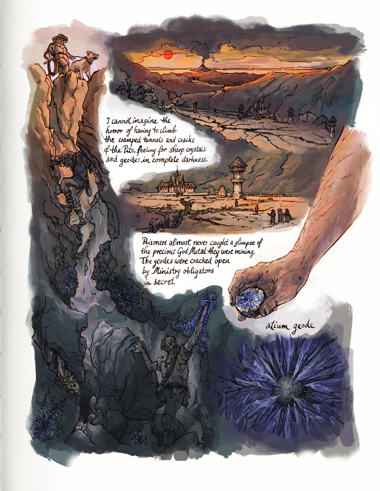
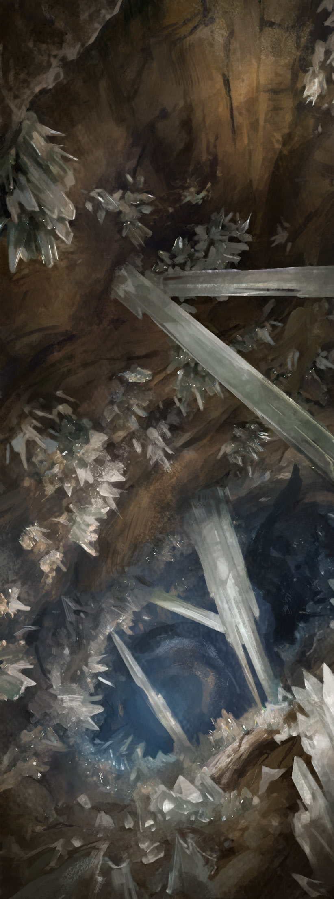

海司辛深坑（Pits of Hathsin）是一片傳說中的洞穴群，與司卡德利亞（Scadrial）的歷史密不可分。存留（Preservation）為了藏起從滅絕（Ruin）身上偷來的一部分而開闢這片洞穴。山谷裡有一座殘酷的監獄營地，營地的囚犯為深坑中的祕密採礦作業提供勞力。大多數人只知道深坑是座採礦勞改營。然而，洞穴深處連通著隱密而與世隔絕的坎得拉家園（kandra Homeland），坎得拉就在那裡祕密替統御主（Lord Ruler）辦事。

### 概覽

在海司辛深坑設計新冒險（Adventure）時，可以考量下列因素。

#### 政府

泛圖爾家族（House Venture）管理勞改營，並在聖務官（obligator）的協助下，確保天金（atium）得以持續祕密開採，見下方〈經濟〉。在坎得拉家園，二代（Second Generation）與其領袖坎帕（KanPaar）負責日常管理，並向古老的初代（First Generation）負責。

#### 居民

海司辛深坑的監獄營地關押著數百名遭奴役的人，也定期有新囚犯送來。監獄由數百名士兵和幾位資源廷（Canton of Resource）的聖務官管理。

家園裡住著十一代坎得拉（kandra）。除了初代、二代和三代（Third Generation）人數較少，多數世代各約有一百名坎得拉。在最後帝國（Final Empire）時期，十一代（Eleventh Generation）坎得拉還是天真無邪、身形像一團軟泥的孩子。

#### 經濟

天金是統御主財富的重要支柱。這種珍貴的鎔金金屬（Allomantic Metal）只有海司辛深坑才有。深坑裡遭奴役的人每週都必須交出一顆天金晶石（atium geode）。任何囚犯沒達到配額，都會被泛圖爾家族的士兵殺死。

除了鋼鐵教廷（Steel Ministry）內部極少數關鍵人物，沒有人知道大部分天金從未離開海司辛深坑。聖務官在內壁覆有金屬的房間裡敲開天金晶石，讓滅絕無法察覺這道程序。天金取出後，不知情的泛圖爾家族再把空晶石運往陸沙德（Luthadel）。少量開採出的天金被混入教廷的款項，由聖務官的車隊偷偷送往克雷迪克．霄（Kredik Shaw）。其餘絕大部分則送往坎得拉家園。這套安排讓統御主得以控制這種珍貴金屬，同時讓貴族只分到少量天金，繼續仰賴他。

#### 文化

絕望與壓迫籠罩著海司辛深坑。囚犯順著凹凸尖銳的地縫往下爬，把手伸進長滿尖銳晶體的石穴裡，摸索能換來一週性命的晶石。這裡的環境處處意在摧折囚犯的意志，讓他們只能顧及最基本的生存需求。冷酷的士兵與聖務官刻意破壞囚犯和他人的聯繫。違規者會被處死，囚犯之間也鮮少能建立信任或合作。

在家園裡，坎得拉耐性十足，對外界漠不關心。他們的社會規矩森嚴，行事被動，年輕世代對年長世代極為敬重。住在家園時，坎得拉專注於工藝和藝術，也自在展現自己的本貌。他們有半透明的皮膚，並使用精心打造的真體（True Bodies），也就是以鋼、玻璃、石頭或木材製成的人造骨骼。

### 重要地點

海司辛深坑涵蓋好幾處截然不同的地點，從可怕的司卡（skaa）監獄與勞改營，到隱密的坎得拉家園。

#### 深坑

深坑地底散落著數百具屍體，甚至可能多達數千具，還有一堆堆白骨。這些都是統御主數百年來奴役司卡留下的痕跡。囚犯得擠進地面上的裂縫，往下爬數百呎才能進入深坑。他們要找的天金晶石長在岩石的孔穴裡，周圍都是尖銳的晶體。海司辛囚犯手臂上那種一看就知道是海司辛囚犯的傷疤，就源於此。

對頁：海司辛監獄營地（Hathsin prison camp）。

MARIE SEEBERGER

第 6 章：第一紀元的特色地點 170

> 我無法想像，得在深坑狹窄的隧道與裂縫裡攀爬，還要在一片漆黑中摸索尖銳的晶體和晶石，會有多可怕。
>
> 囚犯幾乎從沒見過自己開採的珍貴神金屬（God Metal）。教廷的聖務官都在暗中敲開晶石。
>
> 天金晶石

#### 監獄營地

海司辛營區有人不間斷地巡邏，外圍設有瞭望塔，還有受過訓練的狗。守衛帶著登記表與皮鞭，記錄每名囚犯交出的晶石數量。山谷裡淡水充足，有數十間囚犯小屋、幾座舒適的監工營房，以及一棟近乎奢華的行政大樓。大樓裡有客房、大型廚房、戒備森嚴的信使馬廄，還有一間內壁覆有金屬的密室，供聖務官處理天金。客房陳設講究，隨時準備接待可能前來視察的泛圖爾貴族。

囚犯住的小屋陰暗又不衛生，硬地板上排著一列列簡陋的睡墊，充作床鋪。囚犯每天可在中央食堂吃兩餐，進深坑前一次，回來後一次，食物的營養只夠勉強維持身體機能。死在營地裡的囚犯會直接下葬，沒有儀式，也沒有裝飾。死在深坑的人則被留在原地。

#### 坎得拉家園

遠離囚犯摸索天金晶石的裂縫，栽培的苔蘚在坎得拉家園廣闊古老的洞窟中散發柔光。這座隱密的家園裡沒有建築，較小的洞窟以裝飾性布簾隔開，保有隱私。有需要時，坎得拉會在最神聖的場所囑託洞窟（Trustwarren）集會。那裡也是「囑託」（Trust）的所在地，也就是統御主的祕密天金儲藏庫。在囑託洞窟，初代從高臺上昏暗的壁龕裡漠然旁觀，任由二代策畫、治理和進行政治角力。活了數百年的工匠一面磨練自己的手藝，一面教導年輕世代藝術、間諜技巧與模仿。不過，許多坎得拉不滿契約（Contract）要求他們屈從於人類。甚至有一群年輕的激進異議者，討論過向二代請願，爭取在未受契約約束時離開家園的權利。

#### 滅絕垂裂點（Ruin’s Perpendicularity）

海司辛深坑下方深處有一連串洞窟，離坎得拉家園有段距離，其中藏著一潭靜止的黑水。這裡是旅人往來實體界（Physical Realm）與意識界（Cognitive Realm）的交會點。躍界者（Worldhoppers）利用滅絕垂裂點在司卡德利亞各地經商和研究。從司卡德利亞地表通往垂裂點的隧道，一向是個守得很緊的祕密，主要只有躍界者知道。不過，最近有一群走投無路的司卡強盜占了上層隧道，向旅人索取通行費。拒付的人得自行應付這幫強盜設下的陷阱，還得避開誤導人的路徑。

### 最後帝國之後

最後帝國覆亡前僅僅幾天，卡西爾（Kelsier）摧毀了海司辛深坑。他擊碎產出天金的晶體，殺死數十名監獄守衛，並解放了奴隸。

一年多後，大約四萬名泰瑞司（Terris）難民在此定居。他們接管原有的建築，也蓋起新建築，建成一片田園村落。

卡西爾的行動意外損壞滅絕垂裂點，使跨星球貿易暫時中斷。至於坎得拉，他們的生活一如往常，直到沙賽德（Sazed）在《永世英雄》（The Hero of Ages）中來到家園。

> 其中一片洞穴群就是坎得拉家園。它緊鄰海司辛深坑，實際上，坎得拉有好幾條通道都通到深坑，必須一直封閉，以免深坑裡的勞工找到通往家園的路。

第 6 章：第一紀元的特色地點 172

### 冒險引子

你可以用下列點子開展一場以海司辛深坑為舞臺的冒險。

#### 不可能的越獄（The Impossible Escape）

角色被判送往海司辛深坑。他們沒有盟友、資源或金屬，必須互相扶持，活得夠久，才能策畫並完成越獄。

#### 讓聖務官噤聲（To Silence an Obligator）

貪腐的聖務官 Rielle 曾收受貴族家族和司卡地下組織的賄賂，如今已淪為海司辛深坑的囚犯。幾位有權勢的金主擔心 Rielle 會洩露他們的祕密，正尋找一支隊伍潛入這座傳說中的監獄營地，把她救出來，或將她暗殺。

#### 不朽間諜（Immortal Spies）

一件對角色很重要的東西被坎得拉帶回家園。那可能是關鍵證據、無價的傳家寶，或一件罕見的歷史遺物。角色必須趁坎得拉舉辦兩百週年慶典時潛入洞窟，在無人察覺的情況下取回物品。

#### 其他場景

海司辛深坑遭遇（Pits of Hathsin Encounters）表提供一些單獨的場景點子，你可以用在任何戰役（Campaign）中。

##### 海司辛深坑遭遇

| d6 | 遭遇（Encounter） |
| --- | --- |
| 1 | 聖務官在家園附近調查一處地陷時，遭坍方困住。 |
| 2 | 士兵鬥毆，造成其中一人死亡。角色後來發現，死去的士兵原來是一名坎得拉，現在得另找一個身分。 |
| 3 | 一名聖務官在視察時偷偷塞給一名角色一張紙。紙上指示該角色在午夜過後放一把火。 |
| 4 | 一名囚犯把一袋金屬瓶（Metal Vial）交給一名角色，要對方在一小時後把袋子送到馬廄。 |
| 5 | 一名健忘的坎得拉忘了把自己珍愛的一截玉製指關節放在哪裡。 |
| 6 | 一群十一代坎得拉孩童跑進了深坑。必須把這群孩子帶回來。 |

尖銳的晶體讓人在海司辛尋找晶石時既痛苦又危險。

GAL OR

