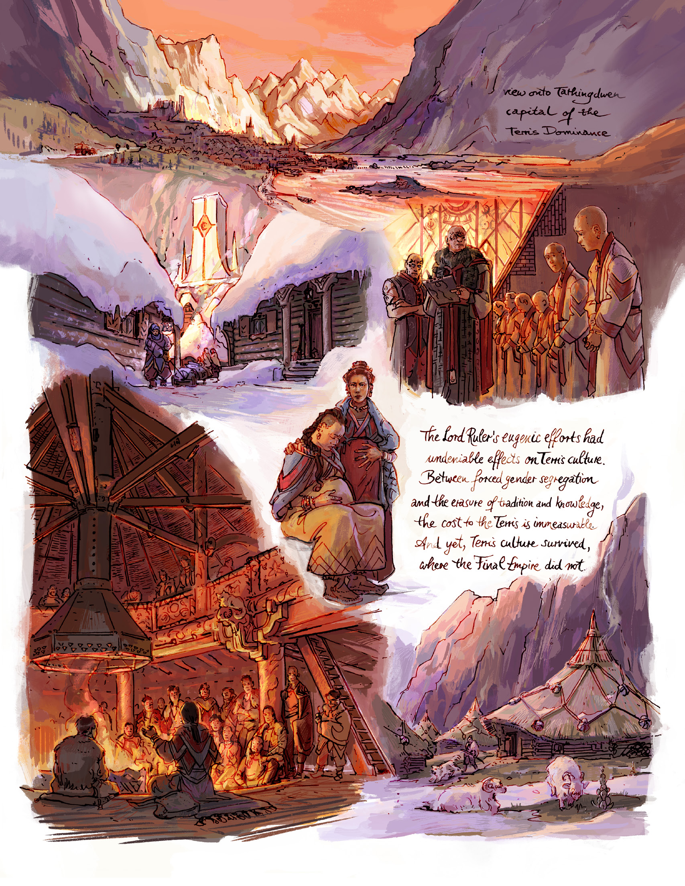

泰瑞司統御區（Terris Dominance）位於遙遠北方的皇家運河（Imperial Canal）盡頭。這片荒瘠的土地上有覆雪的凍原、高山和小型牧村。鋼鐵教廷（Steel Ministry）在統御區首府塔辛文（Tathingdwen）監督育種計畫（Breeding Program）和侍從官計畫（Steward Program）。這兩套帝國強制推行的制度，對泰瑞司人口施加了鉅細靡遺的管控。

即使在這片令人絕望的土地上，反抗勢力也在壯大。審判廷（Canton of Inquisition）相信藏金術師（Feruchemist）已幾乎遭到剷除，因而放鬆了戒備，讓祕密活動的守護者（Keeper）小組更容易取得遭禁的資料，並向泰瑞司民眾傳授歷史、科學與哲學。

以下各節著重介紹本區與當地居民。如需進一步了解統御區的歷史與教廷的活動，請見第 2 章。

### 概覽

在泰瑞司統御區設計新冒險時，可考量下列因素。

#### 政府

審判廷的 Savrian上聖祭司（High Prelan Savrian）掌管泰瑞司統御區的一切事務，包括育種計畫與侍從官計畫、道路巡邏、碼頭與倉庫管理，以及採礦作業。在這個統御區，通常由其他聖務廷負責的行政職務都由審判廷掌管，即便是 Savrian上聖祭司也得看鋼鐵審判者的意思行事。

Rosaire駐軍要塞（Rosaire Garrison）負責監視與維護邊境，兵力包括五千名司卡（skaa）士兵和三百名克羅司（koloss）。士兵奉命拘留任何企圖離開統御區而遭逮到的泰瑞司人。

#### 居民

泰瑞司統御區約有六萬名泰瑞司人，多數住在塔辛文。聖務官（obligator）會把每十名男嬰中的約九名編入侍從官計畫，並把每五十名少女中的約一名編入育種計畫。

任何時候都有三、四名鋼鐵審判者駐守塔辛文或在統御區內巡邏，不過他們會定期輪調至最後帝國的其他地區。

約有兩萬名審判廷的聖務官常住在統御區內。他們在塔辛文從事行政和研究工作，在內側村落巡邏，並在外圍村落擔任監管人。少數幸運的聖務官能爭取到統御區內競爭最激烈的差事，接待來訪、打算聘用泰瑞司侍從官的貴族。

#### 聚落

整個統御區的傳統泰瑞司建築都講求精工而簡樸。多層的八角屋有尖頂茅草屋頂，屋中央設有供炊煮與聚會使用的火坑。屋外的灰燼定期刷洗乾淨，露出灰黃色的屋身。相較之下，教廷建築以石材與鋼鐵構成，屋頂高聳而稜角分明，線條威嚴。室內裝潢奢華，刻意仿照最富裕貴族的堡壘。

首府之外有幾座受監管較少的小牧村。當地泰瑞司人慶祝自己的傳統，日常生活也少了兩項計畫無時無刻的監視與要求。離首府更遠的荒僻外圍村落只住著男性，村民在嚴酷的環境中靠放牧、採礦和少量耕作勉強維生。

#### 經濟

從營造到醫療，統御區大多數行業都由塔辛文與內側村落的泰瑞司女性承擔。統御區的主要輸出是侍從官計畫培養的泰瑞司人，當地也出產金屬礦石與毛皮。這些毛皮在北方統御區和西方統御區是時興的外套襯裡。

教廷院區與侍從官學校仰賴大量進口物資，才能訓練泰瑞司侍從官熟悉貴族社會的傳統與排場。因此，皇家運河上總是擠滿從最後帝國各地載運貨物的駁船，所有貨物都經由陸沙德轉運。

對頁為泰瑞司統御區及其居民。

MARIE SEEBERGER

第 6 章：第一紀元的特色地點 174

> 眺望泰瑞司統御區首府塔辛文
>
> 統御主推行的優生措施對泰瑞司文化造成了無可否認的影響。強制按性別隔離，抹去傳統與知識，讓泰瑞司人付出了無法估量的代價。然而，最後帝國已經覆滅，泰瑞司文化卻存續了下來。

#### 文化

泰瑞司侍從官以耐心與堅毅著稱，很大一部分是因為他們從小就被灌輸無論何時都要表現得沉著平和。侍從官往往事事追求完美。泰瑞司女性在進入青少年時期前也受到程度相近的思想灌輸與審查，此後多半在塔辛文及各村落從事勞動或服務工作。

侍從官在被貴族買下之前都得繼續受訓。育種計畫以外的女性只要不離開統御區，就可以自行安排生活。這些女性奉行平等理念，組成大家族群體，承認性別認同可以流動，並設立照顧身心健康的社區互助計畫。

未擔任侍從官的男性被限制在偏遠、人煙稀少的村落，受嚴苛而暴力的聖務官監視，但他們仍重視社群中的緊密關係。說故事與彼此扶持是他們文化的核心，讓不同世代得以建立共同的情感連結。由於與其他泰瑞司人嚴格隔離，這些偏遠村落更像勞改營。不過，侍從官教師獲准來訪，其中有些人也成了這些群體與其他泰瑞司人之間的文化橋梁。

大多數泰瑞司人都十分敬重學問與研習。守護者遍布泰瑞司社會各階層，有些最危險的工作就在侍從官計畫和育種計畫中祕密進行。這些密探設法找出年輕的藏金術師，教他們如何向聖務官隱瞞自身能力。

### 重要地點

審判廷在泰瑞司統御區有絕對的權力，也負責管理撫育所有泰瑞司人的計畫。計畫之外，塔辛文和內側村落的泰瑞司社群，能有多少表達自由就盡量把握。外圍村落人口稀少，更像監獄營地。

#### 塔辛文

塔辛文建於平緩的山麓間，是統御區首府，住有將近五萬名泰瑞司人。審判廷在當地的總部、侍從官計畫與育種計畫的院區，以及泰瑞司席諾德的祕密所在地，都在這座城裡。

城中多數建築是大小不一的圓屋，分布於三角形的街區，令人想起泰瑞司長袍上相互交疊的圖樣。傳統民居環繞公共空間而建，例如公園、醫者的診所、工坊、舞廳、牧場與市集。冷峻而壓迫的教廷建築以石材和鋼鐵構成，高聳在堅固而歷經歲月的泰瑞司建築之上。

白天，聖務官在街上來回巡視，強迫泰瑞司人服從、守規矩。夜裡，泰瑞司人圍著熊熊爐火互相說故事，也在舒適的泰瑞司小屋裡接待守護者教師。

#### 審判廷總部

塔辛文的教廷總部是一大片威嚴、沾滿灰燼的建築群，內有華麗的餐廳、陳設齊備的聖祭司住處、供聖務官與侍徒居住的狹窄房舍，以及一棟獨立而陰森的鋼鐵審判者大樓。此外，還有一座奉祀統御主的宏偉大教堂，以及一座規模龐大的圖書館。圖書館禁止泰瑞司人進入，裡頭收藏泰瑞司人的族譜紀錄與來自最後帝國各地的典籍。

聖務官的住處之間藏有鎔金術師的訓練場，教廷在此訓練侍徒運用鎔金術能力。聖務官為了地位與名望激烈爭鬥，在學術成就、鎔金術天分與宗教熱忱上彼此較勁。

> 守護者最想找回的，是自己宗教的知識，也就是泰瑞司人民的信仰。統御主昇華後的破壞與混亂，使這些信仰被人遺忘。然而，儘管守護者努力了幾個世紀，始終未能找回這份最珍貴的知識。

第 6 章：第一紀元的特色地點 176

#### 皇家運河

高山上的冰河為皇家運河供水。運河是出入統御區的主要路線，經過塔辛文，穿過 Rosaire駐軍要塞，一路通往陸沙德。塔辛文的碼頭和倉庫總是一片忙碌，駁船在這裡卸下送往 Richeliard學院的高級貨品、供給泰瑞司人的糧食，以及其他必需的交易品。

聖務官嚴密監控港區，鋼鐵審判者也偶爾前來巡視，以確保司卡人無法進入塔辛文，泰瑞司人也不能擅自離開統御區。儘管如此，泰瑞司碼頭工人很擅長將書信與書籍走私通過教廷的檢查哨，為守護者網絡持續提供追尋知識所需的資料。

#### Axendwel礦場

Axendwel 是一座偏遠的北方村落，主要以銅礦聞名，目前由心懷不滿的聖務官 Kester聖祭司監管。Kester 在聖務廷總部侮辱了來訪的貴族，因而遭放逐至 Axendwel。她對礦場管理相當敷衍，使地下作業的安全問題遲遲未獲處理。

鎮上的金屬工匠 Herrinew 私下為伴侶打造紅銅意識。他的伴侶 Vedzan 是一位脾氣火爆的守護者侍從官。Axendwel 的數百名泰瑞司男性表面上很順從，這個小社群卻十分著迷於 Vedzan 所講述的帝國建立前的歷史與各個民族。

#### Myrshek村

Myrshek 是一座熱鬧的內側漁村，離塔辛文夠近，被視為已開墾的地區，卻又遠得讓聖務官很少造訪。再加上村中泰瑞司小屋下方有一連串祕密洞穴與隧道，Myrshek 成了守護者的重要活動地點。如果席諾德需要在塔辛文以外的地方集會，Myrshek 是最安全的地點之一。村裡一千名居民約有三分之一是侍從官，其餘是曾為人母者，或未被送去參加育種計畫的泰瑞司人。

Myrshek 除了以魚產和親切的居民聞名，在泰瑞司人之間也以仲夏湖畔節慶著稱。慶典上有游泳、詩歌朗誦和賽跑等競賽，也會設宴享用以泥土包裹烘烤的魚。

#### Richeliard學院

Richeliard學院以一位在第六世紀提出侍從官計畫的審判廷聖務官命名，又被稱為「學校」，是塔辛文一處由廣闊建築群構成的大型院區。所有泰瑞司兒童都在 Richeliard 的宿舍與教室長大，並按所屬計畫嚴格隔離。審判廷對這些孩子進行思想灌輸，其中包括由資深侍從官傳授侍從官計畫的課程，以及由聖務官教授宗教教義。

年輕侍從官接受鉅細靡遺的教育，涵蓋貴族文化、禮節與侍奉的各個面向。其他泰瑞司孩子的教育著重實用技能與紀律，聖務官會從青少年中挑出具備教廷想要的特質與性情者，讓他們加入育種計畫。守護者一直努力滲透 Richeliard，並祕密辨認及招募年輕的藏金術師。

年事已高的計畫主管 Adrien聖祭司即將退休，接任的 Claudine聖祭司預計會訂下更加嚴格的標準與限制。

Myrshek村的泰瑞司女性。

DAVID ALUNAN

#### Rosaire駐軍要塞

這座要塞位於泰瑞司統御區最南端，雄偉的石造建築橫跨皇家運河。駁船必須通過 Rosaire 有守衛把關的入口，才能進入泰瑞司統御區。駐軍的主要職責是管制運河與巡邏邊境，確保沒有泰瑞司人離開統御區。少數聖務官監管這支三百名克羅司組成的部隊。這支部隊會在要塞北方一天路程外的稀疏林地巡邏。

Rosaire駐軍要塞被視為一份苦差事，沒有升遷或立功的機會。五千名司卡士兵紀律渙散，鋼鐵審判者定期監督，迫使他們保持忠誠，至少也不敢違抗。即使如此，仍有一些較腐敗的士兵開始向開往塔辛文的駁船船長勒索錢財，好中飽私囊。

#### Vwafandach村

Vwafandach 是一座山間聚落，在塔辛文以東僅數小時路程。全村約五百名侍從官都投入 Tathingwatch溫泉的維護工作。當重要貴族造訪統御區，想添置一名侍從官時，聖務官會在溫泉款待貴族，讓他們享受奢華的體驗。受過最佳訓練、最受青睞的侍從官會擔任僕役，照料來訪貴族的一切需求，從準備豪華餐點到展示自己的教學能力。溫泉沒有接待賓客時，Vwafandach 的侍從官會在區內一些要求最高、脾氣最差的聖務官監督下，不停磨練技藝。

### 最後帝國覆滅後

最後帝國覆滅時，席諾德走出藏身之處，公開治理族人。然而，這個新文明只維持了幾個月，塔辛文就遭鋼鐵審判者與一支克羅司軍隊摧毀。倖存的泰瑞司人在海司辛深坑避難，直到落灰之終。這些事件的詳情請見第 2 章的「泰瑞司統御區」。

Rosaire駐軍要塞高聳於塔辛文河之上。

LOGAN FELICIANO

### 冒險引子

你可以用下列構想發展一場以泰瑞司統御區為舞台的冒險。

#### 行俠的風險

年輕的守護者 Rindel 用藏金術救了一名溺水的青少年，鋼鐵審判者隨後前來調查。角色必須將 Rindel 的金屬意識庫偷偷運出村子。

#### 寓言節

為期四晚的寓言節期間，泰瑞司人會講故事、演戲並背誦歷史。最後會選出兩名優勝者，在這一年分別獲得守火者與暖爐者的稱號。個性開朗的 Deryaze 和她尖刻的雙胞胎姊妹 Yedlyzan 幾乎篤定會贏。

#### 藏金術的極限

一名旅行中的守護者已比預定抵達的時間晚了三天，角色因此受命前往調查。這名守護者跌進荒野中的一道裂隙，可用的熱量即將耗盡。

#### Teniert大人非死不可

人見人厭的貴族 Teniert大人，其前任侍從官離奇死亡。如今他來到泰瑞司統御區，要找一名新的侍從官。他打算走訪各村與 Tathingwatch溫泉，讓角色有機會趁他遠離平日的權力中心時接近他。

#### 山路上的威脅

一頭從山裡來的野獸襲擊了其中一座外圍村落，聖務官正在招募志願者組成獵隊。

#### 聖務官的祕密

某個濃霧瀰漫的夜晚，學校的學生發現一名人見人厭的聖務官教師在交易違禁品。沒人相信他們的指控，所以他們轉而向角色求助。

#### 其他場景

「泰瑞司統御區遭遇」表提供可用於任何戰役的個別場景構想。

##### 泰瑞司統御區遭遇

| d6 | 遭遇 |
| --- | --- |
| 1 | 兩名克羅司抵達。 |
| 2 | 一場猛烈的暴風雨即將來襲，幾名泰瑞司長者的房屋需要加固。 |
| 3 | 一艘運河駁船在塔辛文擱淺，奢侈品散落水中。聖務官命令所有人跳下水打撈。 |
| 4 | 一名知名侍從官因閱讀禁書被逮到，聖務官打算拿他殺雞儆猴。 |
| 5 | 一名垂死的守護者懇求角色保護一本記載走私活動的帳冊。 |
| 6 | 一名鋼鐵審判者前來逮捕一名創作顛覆性藝術的女性。 |

> 「我倒想知道，要是他知道有個守護者就在陸沙德，」卡西爾說，「離宮殿只要走一小段路，他會怎麼想？」

第 6 章：第一紀元的特色地點 179

