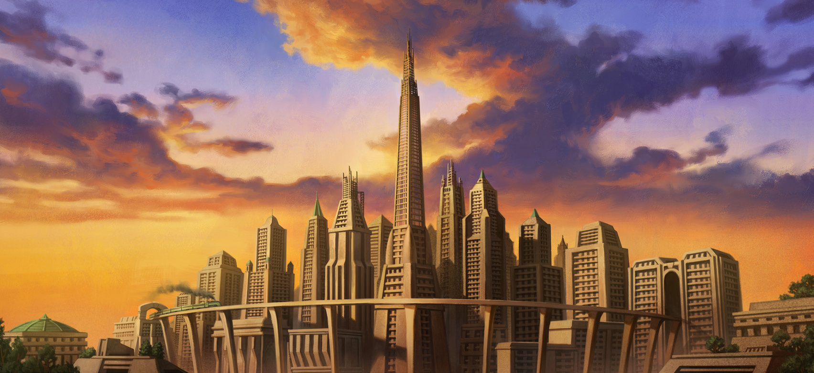
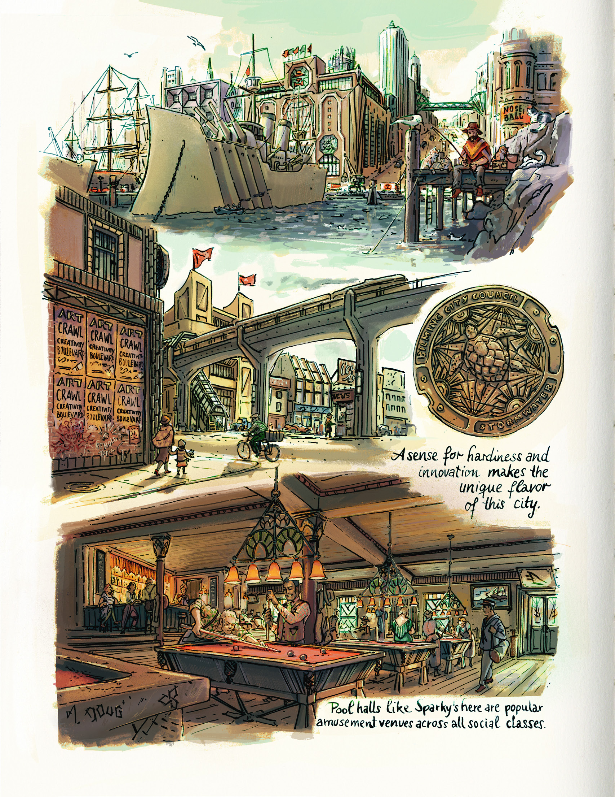

港都 Bilming 是盆地人口第二多的地區，坐落在 Sea of Yomend 風狂浪急的海岸上。這座蓬勃發展的大都會向外延伸出郊區，整座城市的發展由一股強烈的進取心推動。克羅司混血商人購買 Bilming 製造的汽車，穿著吉祥物戲服的人替當地店家發傳單，泰瑞司青少年搭乘高架鐵路，Malwish 遊客則乘帆船出遊。

然而，這一切現代化與工業發展，都暗暗指向同一個目標，就是抵制依藍戴貪婪的擴權。

### 概覽

在 Bilming 設計新冒險時，可考量下列因素。

#### 政府

Bilming 由市長 Bastien Severington 領導。他是個精明的政治人物，走訪盆地各地，試圖聯合外圍城市對抗依藍戴。隨著 Bilming 成為反依藍戴情緒的中心，Severington 黨內一位新秀也逐漸崛起。Gave Entrone 是「組織」的高層成員，自認會是 Bilming 的下一任市長。

市長辦公室與由各黨代表組成的市議會共同治理這座城市。最有影響力的三個政黨，是 Severington 的 Bilming獨立黨、Elliwyn Terindwyx 的改革聯盟，以及 Pielle Fromed 的西部聯合黨。

Bilming 有一支規模不大但盡忠職守的軍隊，另有三艘氣勢十足的白鑞戰艦（Pewternaut）。這些戰艦有鋼製船身，搭載威力強大的火炮與引擎。市政府雇用約兩千名警員，但警署與政府日益腐敗。隨著「組織」逐步掌控全市，警員與政治人物也越來越常對大報及商家施壓，要他們照自己的意思行事。他們希望很快就能放手讓批評者與反對者消失。

#### 居民

Bilming 市區和鄰近郊區約有兩百萬居民。多數人屬於勞工階層，但薪資比依藍戴與其他城市的同階層居民更高，享有的基礎設施也更完善。城裡有不少貴族，也有許多靠工業致富的企業主，主要從事鐵、鋼和汽車產業。精明的 Bilming 人也在新發明上投入了大量資金。

#### 經濟

市內高架鐵路設有軟墊座椅與私人包廂。這種方便且價格實惠的大眾運輸，讓中產階級勞動人口得以靈活往返各地，因應不同的工作需求。中央快速公路等多車道公路進一步串連全市。許多勞工家庭買得起一輛家用汽車，也逐漸形成在黃銅日出門一日遊的風氣。這一天，大人和小孩通常都有空。

Bilming 受益於與南司卡德利亞日益頻繁的貿易，也與盆地其他城市維持長久的貿易往來，尤其是沿岸各城。作為加工燃料的主要產地，Bilming 的財富和影響力不斷增加，工業化也突飛猛進。

#### 文化

Bilming 人總是行色匆匆，忙著追求下一項發現或造出下一樣東西。大多數宗教活動都被視為老派。隨著「組織」的基層成員融入勞工階層，Trellism 在 Bilming 日漸興盛，但這類聚會規模依然很小，也沒有嚴密的組織。

整體而言，Bilming 的文化著重於表面的個性。即使只有一點不同，也會受到推崇。居民穿著鮮豔而往往俗麗的服飾，總是搶著收藏、消費或欣賞下一齣熱門戲劇、下一件藝術裝置或下一場精采展覽。

穿制服的水手和士兵自信地昂首走過市中心與碼頭一帶，高聲談論 Bilming 即將到來的榮耀。全市各處的看板也呼應這股情緒，常可見到「共同奮鬥，爭取獨立」一類的標語。

#### 建築

Bilming 的現代建築採用盆地其他地方所沒有的風格。它們刻意做出種種差異，呈現出大量生產的個性。這是因為近期的開發深受「組織」成員及其來自其他世界的贊助者自主（Autonomy）的影響。

獨立塔（Independence Tower）是 Bilming 的建築焦點，也是全市最高的建築。這座大膽的尖塔被譽為現代工程的奇蹟。

第 7 章：第二紀元的特色地點 184

#### 「組織」

Bilming 人力推創新，對依藍戴的不滿也逐漸化為敵意，讓這座城市成了「組織」理想的行動基地。反過來，「組織」對城市的控制也越來越深，開始主導公共規劃，並對政府和社會風氣施加相當大的影響力。「組織」以獨立塔為總部，著手建造訓練與實驗用的掩體，逐步逼近最終目標，造出一枚能運作的 Harmonium炸彈。

### 重要地點

這座海濱城市在過去幾年間迅速成長，許多行政區、街區和郊區都已由公路和高架鐵路串連起來。「組織」的勢力正在擴大，但還沒有掌控整座城市及其各個機構。

#### 創意大道

創意大道外表華麗，對藝術和文化的欣賞卻流於表面。沿街盡是畫廊與藝術裝置，無不追逐最新風潮。每個街角都有可安裝金屬雕塑的基座，上面的作品會定期換成新設計。幾座博物館展示最後帝國的遺物，並雇用出身上流社會的冒險者，從私人收藏或落灰之終以前的遺跡中尋找新的文物。

最受追捧的娛樂場所是 Lenora雷卡劇院，演出往往提前數月就已滿座。區內名流包括 Zimone．泛圖爾、Dominic．雷卡和 Alixianne Conrad。這些貴族與其他許多人藉由贊助畫廊、舉辦晚宴和扶植新銳藝術家來爭取文化聲望。他們全都富有而且人脈廣闊，不過，泛圖爾家族最近和 Gave Entrone 做了幾筆獲利豐厚的生意，出手比以往更闊綽。

#### Bilming港

Bilming港是服務其他港口城市、依藍戴及司卡德利亞南方人的多用途航運樞紐，也是整個盆地最繁忙的地區之一。最近建成的繫泊塔和起重機高聳在倉庫、遊艇碼頭和商家上方，負責裝卸 Malwish 浮空船的貨物。港務機關計畫拆除一座老舊的倖存者教教堂，好騰出空間擴建貨運設施。這讓當地社群深感不安，反對計畫的抗議日益激烈，局勢也越來越緊張。

Bilming港也以熱鬧的夜生活聞名，區內有酒吧、酒館、音樂廳與餐廳，也有幾家老式酒館。其中最有名的是 Ironsides，只接待 Bilming 軍人。Erwan 和 Celeste Dugas 這對手足掌管 Dugas家族，主導區內的組織犯罪。他們對貴族的厭惡人盡皆知。兩人在區內各處經營幾家見不得光的安撫沙龍和造船廠，主要從事走私。

Bilming，獨立與進步之城。

LUCAS TORQUATO

第 7 章：第二紀元的特色地點 185

> 堅韌與創新，成就了這座城市獨有的風貌。

> 像這間 Sparky’s 一樣的撞球館，各個階層的人都愛來消遣。

> 藝術巡遊／創意大道

> Bilming市議會／雨水排放

#### 明水海岸

明水海岸是 Bilming 最富裕的街區之一，位於城市東側，是一處豪華住宅區。年輕富有的貴族住在玻璃帷幕高樓裡，俯瞰維護得宜的海灘。這裡的遊艇碼頭跟依藍戴最頂級的旅館一樣昂貴，也同樣只接待少數人。高級宴會廳裡的派對與活動接連不斷，狂歡往往一路延續到私人遊艇上。

明水一帶的警員加班掩蓋醜聞與輕微犯罪，經常和私人保全或不在場的貴族父母雇來的調查員起衝突。近來，隨著海斯丁摩托車這種兩輪汽車問世，特技駕駛和競速風靡全區。

明水海岸也多了一個讓全市居民都想去的新去處。南方贈禮是一家由 Malwish 人經營的咖啡與巧克力店，大家更常簡稱它為「南方」。這家店在當地富裕居民之間非常受歡迎。

#### Bilming市中心

Bilming市中心有 Bilming市檔案研究大樓、市長官邸銀邸、中央警署大樓等重要地點，以及許多其他行政機關。

這個繁忙的地區正一步步走向腐敗。Pielle Fromed 的西部聯合黨要求警署與 Bilming獨立黨負起責任，藉此抵制腐敗。Elliwyn Terindwyx 的改革聯盟則著手起草法案，試圖限制 Bilming 的快速軍事化。Bilming 的輿論逐漸倒向反對西部聯合黨和改革聯盟的一方，因為「組織」成員一直暗中把他們描繪成好一點是不懂民情的學究，壞一點就是依藍戴的走狗。破壞政黨辦公室、威嚇兩黨成員的事件日益增多。

#### 花崗岩街

花崗岩街是市中心一條龍蛇混雜的街道，住著許多克羅司混血居民，也以喧鬧的派對聞名。Bilming 最好的酒吧和撞球館都在這裡。受人喜愛的場所包括 Tables，一家舉辦撞球賽、聚集全市頂尖球手的簡陋酒吧，以及 Landed Clipper，一間舞廳，後頭有走私客常去的私密撞球室。

幾個穿皮衣的街頭幫派都聲稱這些場所是自己的地盤。錫蛇幫、Bordeaux街悍徒和紅色金屬之子等幫派不斷爭奪影響力與地盤。各個年齡和身分的貴族常打扮成平民，來花崗岩街尋樂，腐敗或臥底的警員也經常光顧這些場所。訪客只要知道何時該離開，當地人通常會容許他們出入。

#### 獨立塔

獨立塔有一部分多年來作為自主與「組織」在司卡德利亞的堅固基地，是一項令人讚嘆的建築成就。這座摩天大樓也叫「霄」，取名自統御主數世紀前的宮殿克雷迪克．霄，本身就是一座非凡的建築。它高逾七十層，遠比 Bilming 任何其他建築高大。霄內有會議室、宴會廳、保全團隊、實驗室、華麗的埃拉瑞爾歌劇廳，以及數十家企業，其中只有一部分與「組織」有關。

獨立塔的日常運作由「組織」的行政人員 Guilford Flink 管理，他的階級是 Array。Flink 負責監督大樓員工，以及兩百名 Hidden Guard 成員。Hidden Guard 是「組織」旗下裝備精良、訓練有素的武裝部隊。

商業間諜活動在 Bilming 很普遍，獨立塔內許多企業都雇用煙陣與搜尋者來防範金屬之子間諜。最明目張膽竊取智慧財產的是電氣裝置製造商 Axindar工業，也就是 Tarcsel電氣的競爭對手。

#### Knightbridge區

Knightbridge 以住宅為主，過去幾年經歷了大規模的再開發。這裡原本多是成排的三、四層獨戶住宅，門前有石階。不過，由光明前景協會主導的 Knightbridge再開發計畫，引進了一批方盒形的連棟住宅，每一戶的外形、顏色與草坪裝飾都略有不同。

對頁為 Bilming，盆地主要的創新與文化中心之一。

MARIE SEEBERGER

第 7 章：第二紀元的特色地點 187

光明前景協會的主管法蕾特．Lorielle 向「組織」內的黛兒欣．拉德利安報告。Lorielle 正在為協會下一個再開發計畫取得房地產。據傳她為了促成交易，不惜賄賂、威脅或勒索。Knightbridge 各地的居民正在尋找願意對抗 Lorielle 與其爪牙的人，幫助 Knightbridge 保有自己的特色。

幾名鬼血成員以 Knightbridge 的一處安全屋為據點，其中包括 Moonlight、Codenames Are Stupid、TwinSoul 和 Darkwater。他們謹慎地盯著 Lorielle 與光明前景協會的動向。

#### 泰瑞司鎮

泰瑞司鎮是經由 Doxonar 快速公路與 Bilming 相連的郊區，也是一處由民選席諾德管理的泰瑞司聚居地。泰瑞司鎮席諾德倡導他們所謂的進步泰瑞司價值觀，並抱怨泰瑞司村的依藍戴席諾德與現代社會脫節。依藍戴的泰瑞司人傾向與外界隔絕，泰瑞司鎮的居民則受到鼓勵，要融入 Bilming 社會，與他人分享泰瑞司傳統中順從、謙和與敬人自重的價值觀。

泰瑞司鎮對雙生師也有不同的態度，認為泰瑞司村的席諾德太過畏懼不同能力混合。隨著 Bilming 的反依藍戴言論越來越多，泰瑞司鎮居民也越來越反對 Bilming 的政治立場，與該市菁英的關係日益緊繃。泰瑞司學生已發起幾場和平抗議，Bilming 警員也總能找到更多理由來泰瑞司鎮巡邏。

郊區內有一所聲望卓著的大學廷朵學院，學生來自泰瑞司鎮、Bilming 和鄰近城市。學生背景多元，將近一半沒有泰瑞司血統。泰瑞司鎮也以美麗而未經開墾的森林、山谷和水道聞名。居民喜歡沿著自然步道散步，或在供人練習正念的公共空間靜坐。

### 冒險引子

你可以用下列構想發展一場以 Bilming 為舞台的冒險。

#### 雙重麻煩

Basile．塞特大人愛跑派對的兩個孩子 Jade 和 Jaten．塞特，被發現陳屍於停在明水海岸外的自家遊艇上。塞特大人雇用角色調查並找出凶手。線索指向一名腐敗的警員、幾個摩托車幫派，以及販賣古董的走私客。

#### 這下你看見我了

鬼血密探 Darkwater 雇用角色引開警員，好讓她執行潛入犯罪現場的任務。這是一場試探。若玩家角色表現出色，Darkwater 可能會再交給他們其他任務。

#### 滿紙謊言

大報《雙季報》刊出一篇揭發泰瑞司鎮席諾德可疑往來的報導，聲稱他們密謀竊取企業專有的設計圖並送往依藍戴。Siskodin長老懇切否認這些指控，並雇用角色找出真正的間諜，洗清泰瑞司席諾德的名聲。

#### 存留我的間諜

脾氣暴躁的二代坎得拉 ParGean 與手下失去了聯絡。他們是一群派往 Bilming 為和諧蒐集情報的十代坎得拉。他們花了幾個月滲透 Dugas家族在港區的走私事業，卻全都錯過了約定的聯絡時間。ParGean 需要有人幫忙找到他們。

#### 蒙塵的懸賞

來自 Conrad三角洲、惡名昭彰的克羅司混血走私客 Cortland Du Maine船長，最近被人目擊出現在花崗岩街。據傳，他進城是為了敲定和錫蛇幫的交易。膽子大到敢找上 Du Maine 的人，可以把他交給 Bilming海軍，領取 10,000 盒金的懸賞。

#### 其他場景

「Bilming遭遇」表提供可用於任何戰役的個別場景構想。

##### Bilming遭遇

| d6 | 遭遇 |
| --- | --- |
| 1 | 一場反對依藍戴擴權的集會，堵住了角色必須造訪的一處場所。 |
| 2 | 警員在追捕一名射幣（Coinshot）時，誤以為角色是共犯。 |
| 3 | 一群身穿一塵不染的紅色制服的士兵逮捕了一名金髮女性，沒有給出任何理由。 |
| 4 | 一本名為《煽動我的心》的火辣新小說開始販售，有人願意出離譜的高價請角色帶一本給他。如果有簽名，價碼加倍。 |
| 5 | 一名神祕女性交給角色一枚未封存紅銅意識硬幣（unsealed coppermind coin），裡面存著一份名單，上頭全是有影響力的貴族。這是間諜名單，還是目標名單？ |
| 6 | 一名穿著俐落西裝的克羅司混血男子需要有人幫忙處理他的汽車。 |

第 7 章：第二紀元的特色地點 188
