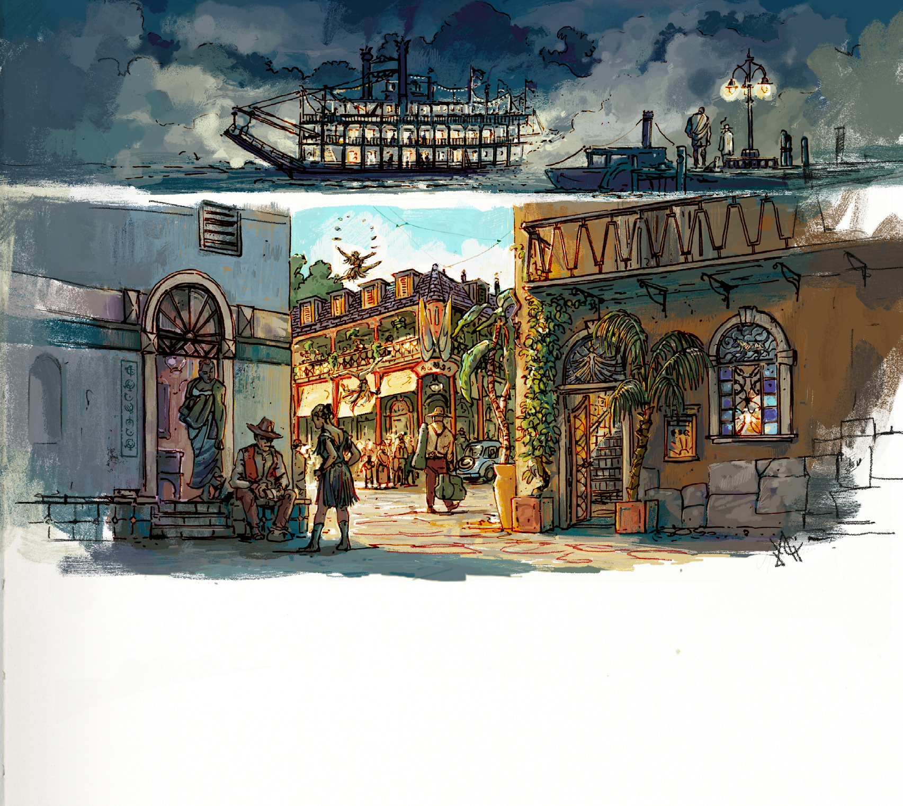
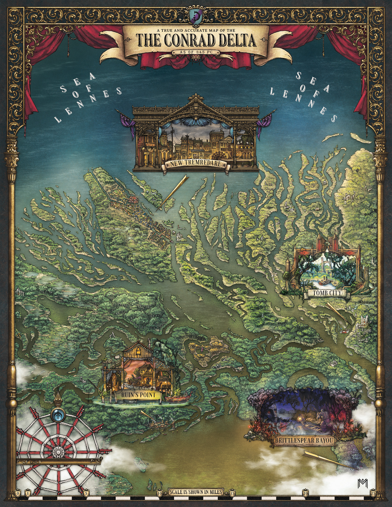
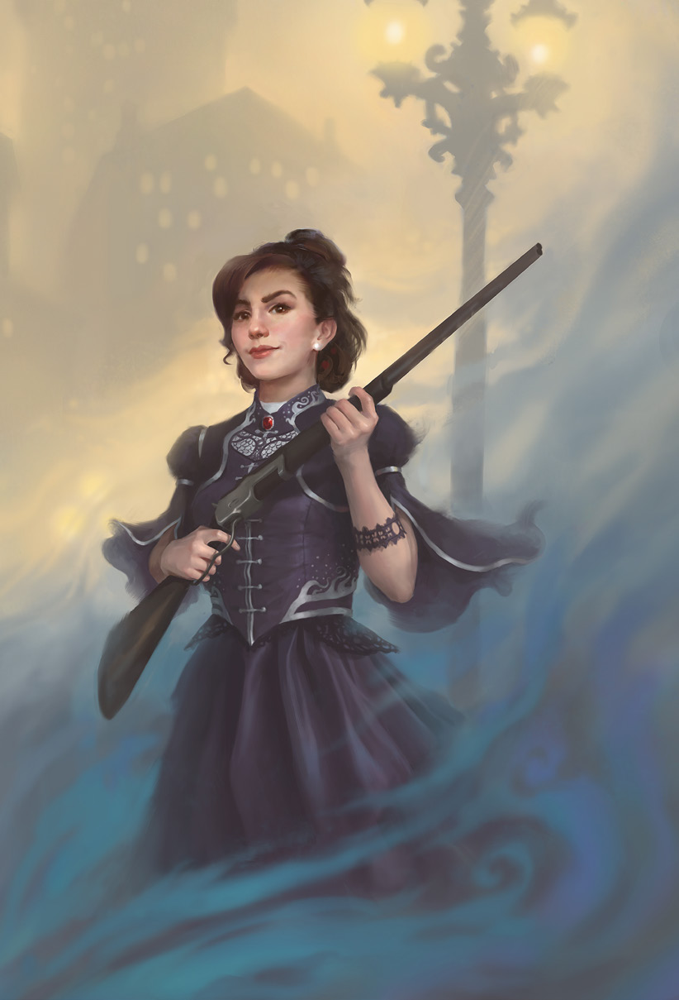
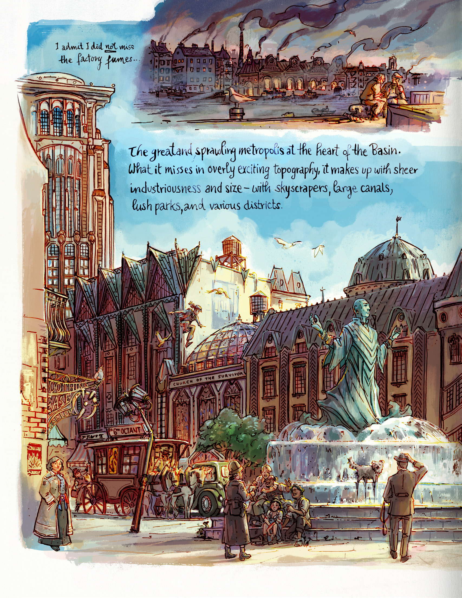
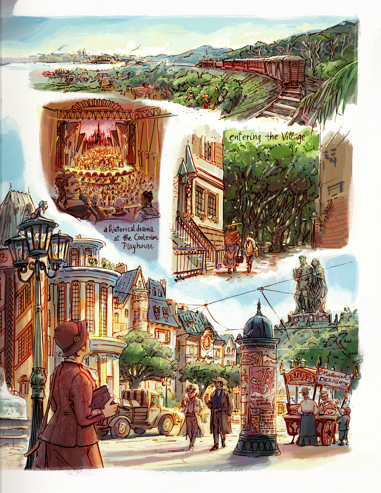
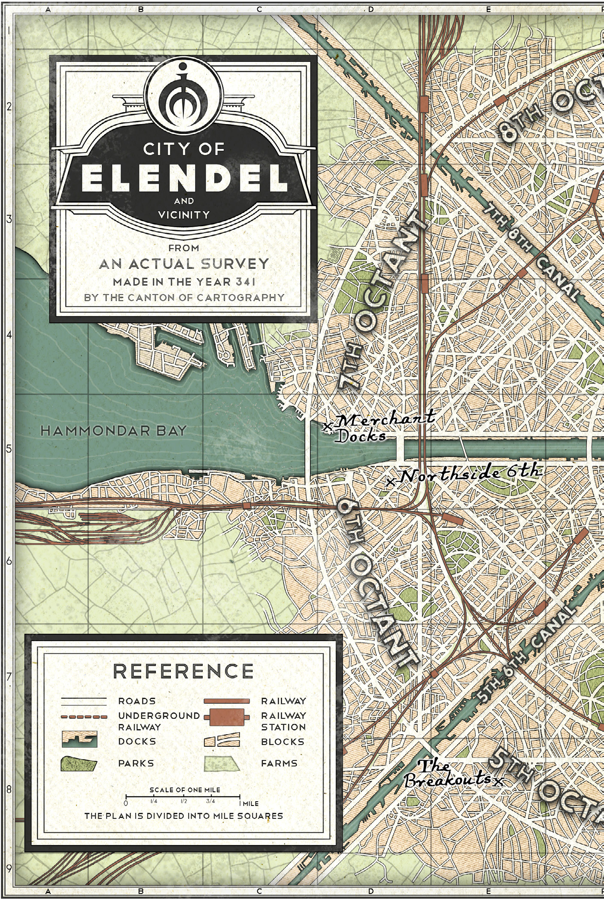
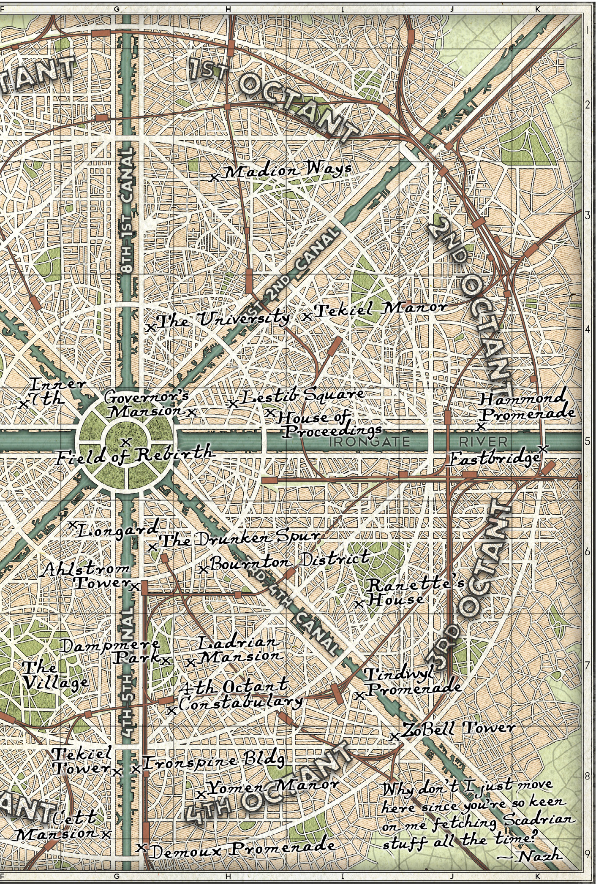

周遭群山流下的淡水與 Lennes海（Sea of Lennes）的鹹水在 Conrad三角洲（Conrad Delta）交會，使這裡的水半鹹半淡。這裡逐漸成為文化勝地，是盆地罪犯的避風港，也是一片充滿機會的土地。五十年前，上流社會的冒險家 Avery Conrad 勘測了這片地區，並為它命名。近來，遭依藍戴（Elendel）放逐的貴族 Ashwinna．太齊爾夫人（Lady Ashwinna Tekiel）建立了 New Tremredare 聚落，這裡才聲名大噪。

三角洲的沼澤遍布最後帝國（Final Empire）南方統御區（Southern Dominance）的遺跡。Seran山脈（Seran Range）的君王神殿（Sovereign’s Temple）被發現後，太齊爾夫人付錢請自己在盆地的熟人宣傳 Conrad三角洲的考古奇觀。如今，盆地各地的上流冒險家、收藏家和遊客蜂擁來到河灣探險。文物、奇珍和足以亂真的贗品也因此有了利潤豐厚的市場。

### 概覽

在 Conrad三角洲設計新冒險（Adventure）時，可以考量下列因素。

#### 政府

在有「慶典之城（Festival City）」之稱的 New Tremredare，貴族有自己的私人保全，犯罪勢力也會保護自己的生意和金主。必要時，太齊爾夫人會雇用 Enola Scarborough 和她的幫派等傭兵維持治安。依藍戴海軍（Elendel Navy）的 Charls「鷺鳥」．海斯丁艦長（Captain Charls “Heron” Hasting）努力讓 New Tremredare「文明化」，並將這座城市與依藍戴連結起來。同時，新月資源公司（Crescent Resources）的 Estrien Powell 奉「組織」（the Set）之命阻撓海斯丁，企圖讓 New Tremredare 改與 Bilming 或 New Seran 接軌。

New Tremredare 以頻繁舉辦慶典和節日活動聞名。

MARIE SEEBERGER

第 7 章：第二紀元的特色地點 189

- 實測詳圖
- Conrad三角洲
- 截至落灰之終（Catacendre）後 345 年
- Lennes海
- New Tremredare
- 墓城（Tomb City）
- 滅絕角（Ruin’s Point）
- Brittlespear河灣（Brittlespear Bayou）
- 比例尺以英里為單位
- 0, 1, 5, 10, 15, 20, 25

#### 文化

New Tremredare 的文化很像太齊爾夫人昔日涉足的依藍戴犯罪圈，表面講究體面，骨子裡卻是犯罪生意的冷酷與務實。這裡的時尚多半仿效依藍戴，但 New Seran 的輕薄布料和鮮豔衣著也愈來愈受歡迎。走出 New Tremredare，三角洲居民看重的是冒險精神、積極的抱負和富有創意的眼光。

#### 經濟

除了賭博、觀光和尋寶，Conrad三角洲還靠販售本地盛產、外地稀缺的貨物發展出興旺的經濟。這裡的貝類、鱷魚皮和特有藥物廣受好評，例如止痛用的沉柳藥膏（sunken willow salve），以及退燒用的焦柏茶（burned cypress tea）。

來自 New Seran 的新月資源公司是一家礦業公司，已成為當地舉足輕重的商業勢力。公司打算勘測、規劃並修建一條從 New Seran 通往 New Tremredare 的鐵路，進而壟斷整個地區的資源。

#### 居民

Conrad三角洲人煙稀少，居民約兩萬人，大多住在 New Tremredare，另外還有兩支主要的克羅司（koloss）氏族。Kovlair 一族偏好沉思，在東部山麓有幾處永久聚落。Dramal 一族則擅長在水路上辨認方向。他們四處遊走於沼澤中，樂於與遇上的任何人較量武藝。

### 重要地點

從港都 New Tremredare 到 Brittlespear河灣蜿蜒的水道，Conrad三角洲到處都有神祕的地點與驚險的危機。

#### New Tremredare

在太齊爾夫人的領導下，New Tremredare 日益繁榮。城市收入主要來自停泊稅、船隻維修、補給，以及食品和藥品的出口稅。太齊爾利用這些收入整修公共空間，在廣大而積水的街區之間建造永久橋梁，甚至開始興建一座歌劇院。

城裡最混亂的地方是 Grindings。當地黑幫頭目 Wainright「帥班」Bennrile（Wainright “Handsome Ben” Bennrile）掌控此地，暴力事件頻傳，賭窟林立。柳樹高地（Willow Heights）和溪畔區（Brookside）等街區則逐漸成為文化中心，主打音樂、美食與大膽的商業交易。旅客一到 New Tremredare，往往很快就有餐廳上前招攬，以精緻料理吸引他們，或有人帶他們搭上遊船，保證沿途有異國景致、美酒和一流的娛樂。

New Tremredare 經常舉辦節慶和嘉年華。贊助者多半是來訪的貴族或商家老闆，想藉機討好太齊爾夫人及其他地方權勢人物。

#### 墓城

上流冒險家 Goldie Glitterhollow 為新月資源公司勘測時，在 New Tremredare 以東約三十英里處發現一座最後帝國遺跡。她聲明對遺址的開發權，並創立 Glitterhollow探險公司（Glitterhollow Expeditions）。這家冒險旅遊公司很受盆地貴族歡迎。

Glitterhollow 和她的員工帶團走訪考古遺址，收費不菲。旅客可以帶走任何自己發現的文物，但大多數文物都是公司員工事先放好的精巧贗品。行程中最吸引人的景點是一座幾乎完好無損的聖務廷（Canton）建築。另一處熱門景點是重建的貴族堡邸，裡面還裝有挖掘出土並修復的彩繪玻璃窗。Glitterhollow 有幾名員工會把所有發現祕密通報給 New Tremredare 的鬼血（Ghostblood）密探。

#### 滅絕角

以盆地的標準來說，滅絕角只是個小鎮，卻已是 Conrad三角洲第二大的聚落。這裡只有幾千名居民，人稱滅絕角居民（Pointers）。他們過著重視集體的生活，也以能用民主方式作出共同決定為榮。大多數居民都是克羅司混血（koloss-blooded），與 Kovlair 及 Dramal 克羅司氏族時常往來。最近，不少年輕居民到 Glitterhollow探險公司工作，引起鎮上碎刺教信徒（Sliverist）的不滿。這些信徒反對 Glitterhollow 靠歷史牟利。

#### Brittlespear河灣

Brittlespear河灣遍布茂密的植被、悶熱的沼澤、隱密的島嶼和失落的遺跡。這裡以飢餓凶猛的掠食動物、毒蛇、充滿敵意的居民，以及錯綜複雜、讓大意的人困在其中的無盡水道聞名。

對考古學家和人類學家來說，Brittlespear河灣是一片等待探索的邊疆。他們循著傳聞尋找古典時期的司卡德利亞（Classical Scadrial）的遺跡、藏匿的霧魅（mistwraith）和豐富的天然氣礦藏。甚至有傳說指向早已失落的 Conventical of Tetrath，那是鋼鐵審判者（Steel Inquisitors）最後的堡壘之一。

MARCO BERNARDINI

第 7 章：第二紀元的特色地點 191

### 冒險引子

你可以用下列點子開展一場以 Conrad三角洲為舞臺的冒險。

#### 沼澤深處（In the Heart of the Swamp）

上流冒險家 Verner Hammondess 失蹤了！Verner 的雙胞胎姊妹 Mari Hammondess議員（Senator Mari Hammondess）雇用角色展開調查。角色發現 Verner 的日誌暗示有一處失落的天金（atium）藏匿點，必須在 Brittlespear河灣找到那個地點。角色穿過淹在水下、被柏樹覆蓋的遺跡，終於找到 Verner。嚮導背叛了 Verner，讓 Verner 受困於一棟正在下沉的建築裡，還得和沼澤裡的掠食動物搏鬥！

#### 還Mollie餐館一個公道（Making Good at Mollie’s）

克羅司混血廚師 Mollie Kovlair 快保不住自己心愛的 Mollie餐館（Mollie’s）了。這棟建築在過去一個月裡遭人破壞了好幾次。動手的是 Talvira Tyrden夫人（Lady Talvira Tyrden）的私人保全。她在 Mollie餐館用餐後食物中毒，認定是 Kovlair 的錯。真相是 Davin．雷卡大人（Lord Davin Lekal）曾企圖暗殺 Tyrden。

#### 追查鋼手（The Search for Steelhand）

凶狠的射幣（Coinshot）強盜鋼手Savrian（Steelhand Savrian）率眾在夜間大膽突襲依藍戴海軍的一艘軍艦，搶奪艦上的軍火。Savrian 和手下帶著武器逃走了。依藍戴海軍的 Charls「鷺鳥」．海斯丁艦長已懸賞 2,000 枚盒金（boxings），要追回軍火，將這幫強盜繩之以法。

#### 其他場景

Conrad三角洲遭遇（Conrad Delta Encounters）表提供一些單獨的場景點子，你可以用在任何戰役（Campaign）中。

##### Conrad三角洲遭遇

| d6 | 遭遇（Encounter） |
| --- | --- |
| 1 | 一艘遊船和貨船相撞，乘客與貴重貨物都掉進沼澤。 |
| 2 | 一艘小型 Malwish 浮空船（airship）在一處以局部積聚天然氣聞名的地方墜毀並起火。 |
| 3 | 一整批食品全都腐壞了。一群出口商聲稱是一名克羅司混血的年輕人故意弄壞的。 |
| 4 | 一名倖存者教信徒（Survivorist）和一名碎刺教信徒激烈辯論神學，眼看就要動起手來。 |
| 5 | 泰瑞司席諾德（Terris Synod）的三名成員想帶回一名泰瑞司青年。據說這名青年是能感應命運絲線的鉻單藏金術師（chromium Ferring），卻強烈堅持自己必須在滅絕角定居。 |
| 6 | 「組織」的密探從一艘遊船上綁走一名年輕貴族。 |

## 依藍戴

依藍戴的居民叫它「城裡（the City）」，外圍城市（Outer Cities）的人則叫它「阿戴（the ’Del）」。這座煙霧與鋼鐵交織的大都會，是由和諧（Harmony）親自奠下基礎的。依藍戴是落灰之終後文明的搖籃，城市以重生之野（Field of Rebirth）為中心。和諧重整世界後，最終昇華（Final Ascension）的倖存者正是在此走出地下避難所。

在依藍戴，貴族舉辦奢華的派對，也會觀賞場面盛大的戲劇演出。工人階級則在工廠、加工廠和工地長時間勞動。和諧與存留者（Preservers）曾承諾打造一個有別於最後帝國的世界，但許多依藍戴人認為，那不過是享有特權的領袖再次許下的空頭承諾。

以下各節著重介紹這座現代城市與居民。若想進一步了解城市歷史，請見第 2 章。

### 概覽

在依藍戴設計新冒險時，可以考量下列因素。

#### 政府

依藍戴的法律管轄權涵蓋整個依藍戴盆地（Elendel Basin），但外圍城市愈來愈公開反對依藍戴的政治統治。依藍戴政府的權力分由世襲和民選議員、司法系統，以及總督（Governor）領導的行政機關行使。此外，每個分區（octant）都有自己的警署，約有六百名警員。依藍戴政府架構的詳情，見第 2 章〈依藍戴盆地〉。

#### 社會變遷

城市努力實踐末代皇帝（Last Emperor）、迷霧之子大人（Lord Mistborn）和其他存留者的理想，但階級與財富的不平等依舊根深柢固。近來，依藍戴歷經數次社會動盪，包括 Replar Innate總督（Governor Replar Innate）的貪腐案、數個產業的工會罷工，以及前總警監 Claude Aradel（Constable-General Claude Aradel）當選首位沒有貴族血統的總督。

第 7 章：第二紀元的特色地點 192

#### 居民

依藍戴估計有約五百萬人，每個分區各有數十萬居民。盆地絕大多數的貴族，尤其是上層貴族，都住在依藍戴和近郊。市郊與外圍莊園合計占地比市區還廣，人口卻較少。

#### 現代化

隨著北司卡德利亞（Northern Scadrial）的工業革命加速，依藍戴到處是工廠和加工設施的氣味，偶爾有從 Hammondar灣（Hammondar Bay）及 Sea of Yomend 吹來的鹹風。摩天大樓點亮夜空，穿透不時出現的迷霧，汽車的引擎聲則響遍各區。城裡處處在施工，新建築一棟棟蓋起，現代路面也逐漸取代卵石街道。地面鐵路載著通勤者穿梭城中，新建的地下鐵也在地底提供相同的服務。

#### 經濟

依藍戴以航運、製造和加工為主。這些產業大多由貴族擁有並掌控，但各行業公會的勢力也在逐漸壯大。煤和石油的精煉業同樣興旺，大量鋼鐵廠則為建築與交通提供支援。

許多金屬之子（Metalborn）靠出租自己的能力謀生。安撫者（Soothers）和煽動者（Rioters）在沙龍工作，射幣和扯手（Lurchers）擔任信差與送貨員，白鑞臂（Pewterarms）和錫眼（Tineyes）則組成保全隊伍。

依藍戴也是整個盆地的交通和航運樞紐，每條運河沿岸都有營運中的碼頭和倉庫。第七區（Seventh Octant）外的大型碼頭處理了與其他港口城市往來的大部分貿易。鐵路從城市向各個方向延伸，其中有兩座主要車站。第六區（Sixth Octant）外的西線（West Line）服務鐵門河（Irongate River）以南，第八區（Eighth Octant）北方的鋼奔線（Steelrunner Line）則服務河以北的地區。

#### 文化

上層貴族憑藉世襲頭銜與多樣的事業，直接掌管全城約三分之一。工人階級可以透過加入公會提升社會地位，各公會有自己的組織架構、入會條件及不同程度的政治影響力。依藍戴財富充足，除了上層階級的生活，下層階級的休閒文化也看得出這份富裕。

各個社會階層都有酒館、餐廳、音樂廳和劇院可去。許多場所專門招待富人，較小的場館則以工人階級為主要客群。近來愈來愈多人熱衷於逛嘉年華和觀看汽車比賽。

兒童必須接受初等教育。成年人也能免費修讀大學課程，但聲望最高的課程收費不菲。穿著是地位與成就的重要象徵，依藍戴人偏愛深色服裝，再搭配別出心裁的點綴。依藍戴教育與時尚的詳情，見第 2 章〈依藍戴盆地〉。

瑪拉席（Marasi）望向依藍戴的未來。

DAN WATSON

> 我得承認，我一點也不懷念工廠的煙……
>
> 這座幅員遼闊的大都市，位在盆地的中心。地形雖然平淡，光靠繁忙的產業和龐大的規模就足以彌補。這裡有摩天大樓、寬闊的運河、綠意盎然的公園和各式各樣的街區。
>
> 倖存者教會（Church of the Survivor）
>
> 第六區

> 進入泰瑞司村（the Village）
>
> Coolerim劇院（Coolerim Playhouse）上演的歷史劇
>
> Malwish美味
>
> 號外！號外！

MARIE SEEBERGER

### 重要地點

依藍戴的市中心分為八個分區，以運河相隔。住宅、工業、金融、商業和教育設施混合分布在各區，住宅區也沒有集中在特定分區。

出了市中心，主要就是由連棟住宅和規模不大的莊園構成的市郊，商家和公寓都比較少。再往外是外圍莊園，有大片貴族宅邸和廣闊的農地。這裡的農產從糧食、紡織原料到咖啡和茶都有。

#### 重生之野與中央樞紐

來自依藍戴盆地各地的運河流入城市，在中央樞紐（the Hub）匯流。這裡既是市中心的一個街區，也是一座整年開滿 Marewill 花的公園。公園本身又叫重生之野。落灰之終的倖存者當年就在這片受人敬重的土地上走出地下避難所。重生之野有一座紀念初代（Originators）的博物館，也有一座紀念末代皇帝和昇華戰士（Ascendant Warrior）的陵墓。

#### 第一區（First Octant）

第一區是全市最富裕的分區，依藍戴大學（University of Elendel）、First Central Bank 和 Madion商區（Madion Ways）都在這裡。依藍戴大學以多元的課程、頂尖的研究實驗室和優雅的 Marehope植物園（Marehope Botanical Gardens）聞名。Madion商區是全市的金融區，銀行、會計師和各行各業的公司進駐這裡整潔的辦公空間。

除了充斥金錢與腐敗的 Madion商區和有圍牆環繞的大學校園，第一區還有 Edgard大廳（Edgard Hall），那是一座附有豪華舞廳的大劇院。區內也有重現迷霧之子大人原木宅邸的迷霧之子莊園（Mistborn Manor）、由 Jennivere．海斯丁夫人（Lady Jennivere Hasting）管理的海斯丁音樂學院（Hasting Conservatory）、Galivan紀念醫院（Galivan Memorial Hospital），以及幾間專供富豪與權貴使用的私人俱樂部。其中一間叫銀色旅人（The Silver Voyager），已成了上流冒險家的代名詞。依藍戴探險家聯盟（Elendel Explorers’ League）每週在此聚會。

在第一區外圍寧靜而奢華的地段，有一座古典風格的宅邸，庭園修剪得整整齊齊，窗戶裝著彩繪玻璃。這裡是卡西爾（Kelsier）的鬼血總部。建築沒有標誌，高牆內的鬼血成員在此訓練，也在此籌畫各種祕密行動。

#### 第二區（Second Octant）

第二區集中了許多政府機關，包括總督官邸（Governor’s Mansion）、國家檔案館（National Archives）、議事院（House of Proceedings）和 First Insurance Bank。議員在議事院開會，對攸關整個盆地的議題投票。國家檔案館的職員則管理著全世界最龐大的知識庫。

組織犯罪也在第二區深深扎根。區內有兩股主要勢力，一是掌控鐵門河沿岸地盤的玻璃街集團（Glass Street Syndicate），另一股是在太齊爾莊園（Tekiel Manor）以東活動的 Morgenthax家族（Morgenthax family）。兩方都曾找上陷入困境的太齊爾家族（House Tekiel）洽談合作，願意幫他們走出與消賊（Vanishers）一案有關的困境。倘若 Lysarra．太齊爾夫人（Lady Lysarra Tekiel）把家族的基礎設施與正當名分交給其中一方運用，她的選擇將對整個分區造成深遠的影響。

和諧創造了別具特色的 Marewill 花，紀念梅兒（Mare）、卡西爾和其他逝去的朋友。

DAN WATSON

第 7 章：第二紀元的特色地點 196

#### 第三區（Third Octant）

從同時上演喜劇與音樂表演、頗有聲望的 Coolerim劇院，到舊展場上的 Carmine Feltry賽車場（Carmine Feltry’s Racing Circuit），第三區處處熱鬧，居民和訪客也形形色色。

貨船沿第三至第四區運河（Third-Fourth canal）往上游走時，經常停靠微光角碼頭（Glimmering Point Docks），卸下不想讓海關看見的貨物。在分區的其他地方，Rochon精品工坊（Rochon’s Fineworks）之類的獨立商家享有大量人流，顧客也來自各處。東南方有個叫 Knobs 的貧民區，裡頭有一座頗具影響力的碎刺教教堂。教堂照顧窮困居民的需求，也保護他們免受小幫派騷擾。雖然很少有貴族家族在第三區設置莊園，這一帶仍有一群頗具實力的中上階層居民，主要是公會成員和企業家。

#### 鐵脊大樓與太齊爾塔

第四區（Fourth Octant）的鐵脊大樓（Ironspine Building）和第五區（Fifth Octant）的太齊爾塔（Tekiel Tower）都高逾五十層樓，競逐全市最高摩天大樓的地位。外人不知道，鐵脊大樓其實為「組織」所有，也曾在一樁保險詐欺案中扮演重要角色。這起騙局讓太齊爾家族的財務陷入一片混亂，差點放棄太齊爾塔。後來，一名神祕的富有金主投資這項建案，家族出人意料地繼續施工。

鐵脊大樓有昂貴的住宅與商業樓層，也將辦公空間租給依藍戴各家公司。太齊爾塔的用途相近，但較偏向公會和企業家經營的商家，貴族租戶也較少。太齊爾塔的六、七、八樓是氏族住宅區（Clan Estates），居民多半是克羅司混血。按照與太齊爾家族簽訂的租金管制協議，這幾層樓較富有的克羅司混血家庭會補貼其他家庭的租金。

#### Warren Tresting社交俱樂部（Warren Tresting’s Social Club）

Warren Tresting社交俱樂部位於第四區，沿著醉馬刺酒館（the Drunken Spur）所在的街道走不遠就到。這裡看起來和其他上流人士的休憩場所一樣，窗上裝有百葉窗，室內裝潢典雅，有美酒和舒適的座椅。它其實是囑託洞窟（Trustwarren）的掩護。這是一間祕密的坎得拉（kandra）酒吧，坎得拉能在朋友面前以真體（True Bodies）放鬆。坎得拉若需要有人幫忙處理假扮凡人時遇到的難題，可以向囑託洞窟求助，例如假造凡人的死亡、轉移遺產，或只是偽造證件。

囑託洞窟的坎得拉互相交換人情、稀有物品、技術和有意思的知識。極少數深受信賴的同伴或知己即使是外族，也可能獲邀進入俱樂部。

#### 泰瑞司村

泰瑞司村是泰瑞司人的社區，占了第五區相當大的一片土地。這裡任由草木自然生長，綠意未經人工修整。社區由席諾德（Synod）管理，成員是一群自願服務的長老，獨立於城市政府。泰瑞司人自行治理，也自行維護治安。泰瑞司村的席諾德認為自己是依藍戴盆地內泰瑞司文化的最高權威，但其他泰瑞司聚居地未必認同。

近幾個月，香奈瑞山脈（Channerel Range）的泰瑞司原教旨派遣代表多次造訪泰瑞司村，希望尋求共識並建立正式關係。依藍戴最近流行泰瑞司料理，末代皇帝麵館（Last Emperor’s Noodles）、三紅椒泰瑞司料理（Three Red Peppers Terris Cuisine）及 Alexyndrin’s 等多間供應傳統料理和精緻餐點的泰瑞司餐廳隆重開張。然而，餐廳之間的競爭已讓席諾德開始擔憂，因為這類競爭與泰瑞司文化和教義不合。

#### 第八區

自從 Peterus大人（Lord Peterus）卸任總警監後，第八區接連遇到領導無力和貪腐醜聞。這些問題催生了一股行事極端的犯罪風氣。有些罪犯是金屬之子，有些則沒有金屬能力。他們競相證明自己是第八區犯罪圈裡最厲害、最聰明的人。他們搶劫馬車、倉庫、銀行和住家，策畫複雜的詭計、荒唐的追逐和大膽的逃亡。有些罪犯為了名聲和金錢犯案，也有人專門揭發冷酷貪婪的商家、貴族和警員，再把搶來的錢財分給貧民區的居民。

區內知名地點包括 Razzy Gillespie嘉年華（Razzy Gillespie Carnival）的場地，那裡有遊樂設施，也有冷凍香蕉和來自 Bilming 的芻塔（chouta）等平價點心。另一處是灰門監獄（Ashgate Penitentiary），監獄的守衛受過對付鎔金術師（Allomancers）的訓練。

第 7 章：第二紀元的特色地點 197

- 依藍戴市及周邊
- 依製圖廷（Canton of Cartography）於 341 年實地測量的結果繪製
- Hammondar灣
- 第七區
- 第八區
- 第六區
- 第五區
- 第七至第八區運河
- 第五至第六區運河
- 商船碼頭（Merchant Docks）
- 第六區北側（Northside 6th）
- The Breakouts
- 圖例
- 道路
- 地下鐵路
- 碼頭
- 公園
- 鐵路
- 火車站
- 街廓
- 農地
- 一英里比例尺
- 0、¼、½、¾、1 英里
- 圖上每格為一平方英里

198

- 第一區
- 第二區
- 第三區
- 第四區
- 第八至第一區運河
- 第一至第二區運河
- 第三至第四區運河
- 第四至第五區運河
- 鐵門河
- Madion商區
- 依藍戴大學
- 太齊爾莊園
- 第七區內側（Inner 7th）
- 總督官邸
- Lestib廣場（Lestib Square）
- 議事院
- 哈姆德大道（Hammond Promenade）
- 重生之野
- Eastbridge
- Longard
- 醉馬刺酒館
- Bournton區（Bournton District）
- Ahlstrom塔（Ahlstrom Tower）
- 拉奈特的住家（Ranette’s House）
- Dampmere公園（Dampmere Park）
- 拉德利安宅邸（Ladrian Mansion）
- 泰瑞司村
- 第四分區警局（4th Octant Constabulary）
- 廷朵大道（Tindwyl Promenade）
- ZoBell塔（ZoBell Tower）
- 太齊爾塔
- 鐵脊大樓
- 尤門莊園（Yomen Manor）
- 塞特宅邸（Cett Mansion）
- 德穆大道（Demoux Promenade）
- 你這麼愛叫我來拿司卡德利亞（Scadrial）的東西，我乾脆搬來住算了？——納哲（Nazh）

ISAAC STEWART

199

#### Greenbriar莊園區（Greenbriar Estates）

Greenbriar莊園區位於第五區南方，是一片遠離依藍戴市區工業喧囂的田園農地。許多富裕家庭在這裡有鄉間別墅，並交由管事照料眾多農場與世代相傳的宅地。

不過，Greenbriar莊園區最終還是由擁有當地大部分土地的浩特家族（House Haught）負責。農業勞工愈來愈不滿薪資，讓浩特家族陷入困境，農民工會已公開談論罷工的可能。浩特家族的掌權者還不知道，年輕子弟 Taradel．浩特（Taradel Haught）已站在工會一方，暗中破壞自家生意，打算一直做到家族接受工會的要求為止。

### 冒險引子

你可以用下列點子開展一場以依藍戴為舞臺的冒險。

#### 燒胎（Burn Rubber）

角色遭遇重大挫折後，只剩一個機會能還清債務。他們必須參加一場從中央樞紐出發、一路穿過第三區的街頭汽車賽，並拿下冠軍。然而，比賽已遭人動手腳，有參賽者雇用金屬之子，要在賽道的關鍵地點干擾比賽。

#### 成為Shewrman的重要性（The Importance of Being Shewrman）

Shewrman大人（Lord Shewrman）的老管家 Barstingweth 帶著一個危險的祕密來找角色。Shewrman大人失蹤了！如果角色答應去找他，調查會把他們帶向一件比一件離奇的事，包括假造的家具、一齣講蠻橫區長頸馬卻讓人看不懂的戲、一個陰森的 Trellism信徒（Trellist）教派，以及一座有數百年歷史的葡萄酒莊。

#### Dean的幸運日（Lucky Day Dean）

一位只自稱「Dean」的化學家，也是鬼血的一員，雇用角色去第一區的一間私人實驗室取得稀有材料。這場劫案必須規劃得天衣無縫，因為實驗室戒備森嚴，守衛必要時會下殺手。

#### 麵店愁雲（Noodle Shop Blues）

藍街麵館（Bluestreet Noodle Shop）位於泰瑞司村外圍，是間泰瑞司餐館。名叫 Pins 的街頭幫派盯上這裡，想收取保護費。經營餐館的夫妻 Teslydin 和 Ethladel 向警署求助，卻發現貪腐的警員也收了好處。兩位廚師於是來找角色幫忙解決問題。

#### 遺物獵人（Relic Hunters）

第三區頭號走私犯 Chip Erikell 死後，手足 Dedrus 急需一大筆資金。Dedrus 想資助一支遠征隊前往蠻橫區外的荒野，尋找無價的遺物，賣給富有的貴族收藏家。Dedrus 手上有一份整理好的資料，包含地圖、傳聞和蛛絲馬跡，並堅稱只要角色願意加入，就能靠這些資料找到極具價值的寶物。

#### 其他場景

依藍戴遭遇（Elendel Encounters）表提供一些單獨的場景點子，你可以用在任何戰役中。

##### 依藍戴遭遇

| d6 | 遭遇 |
| --- | --- |
| 1 | 一名滑行（Slider）和一名扯手打了起來，滑行裝著彎管合金（bendalloy）的袋子掉到角色腳邊。 |
| 2 | 金色飛人Tony（Tony the Golden Jet）執教的一支 noseball 球隊，有好幾名球員在酒館鬥毆中受傷，現在需要新球員。 |
| 3 | 名聞盆地的演員 Trevva．塞特–泛圖爾（Trevva Cett-Venture）和 Penelope Portreau 正在公開場合大鬧。 |
| 4 | 一直有傳聞說，一個綠眼鬼魂在威嚇某個街區的居民。一名笨手笨腳的超自然現象偵探（paranatural detective）正在調查。 |
| 5 | 一名來自泰瑞司村的泰瑞司蠻力（Terris Brute）前來逮捕角色的盟友，理由是此人涉嫌蓄意破壞財物。 |
| 6 | 一名駁船工人兜售幾小條 Invarian steel。 |

第 7 章：第二紀元的特色地點 200

