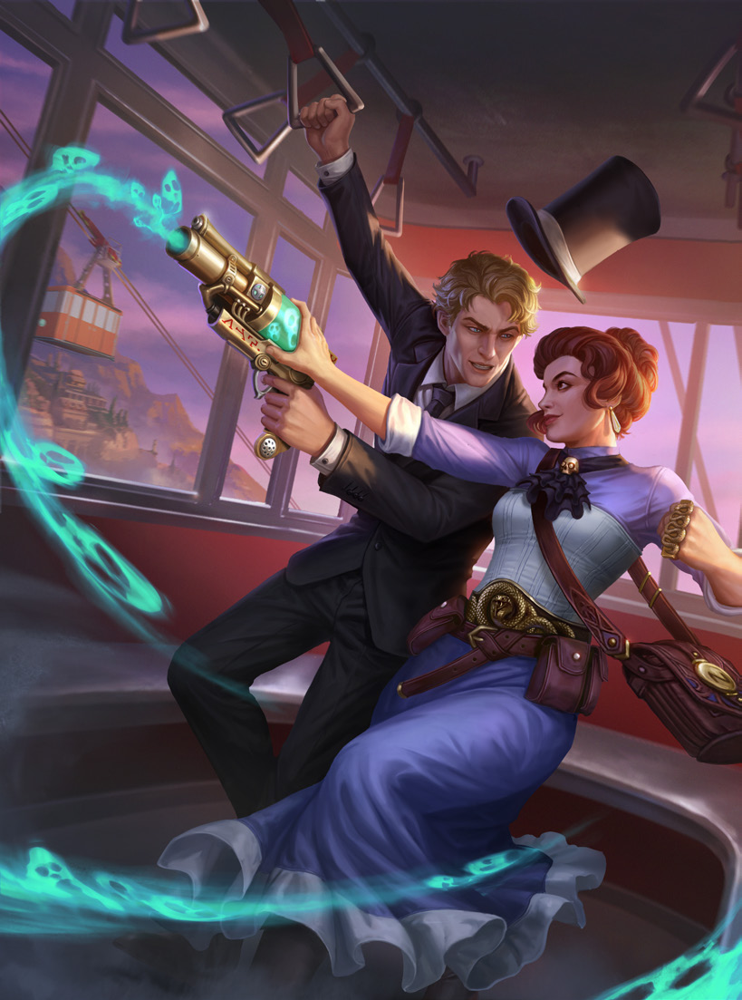
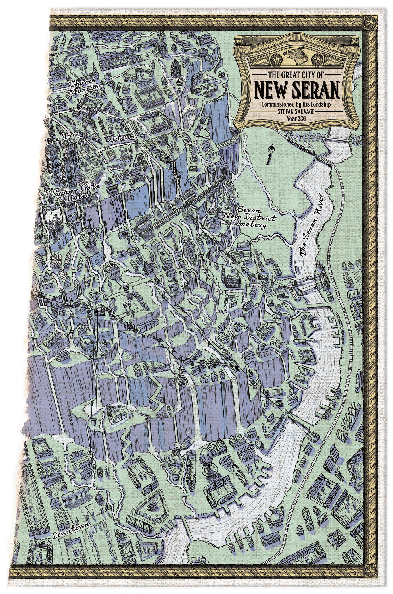
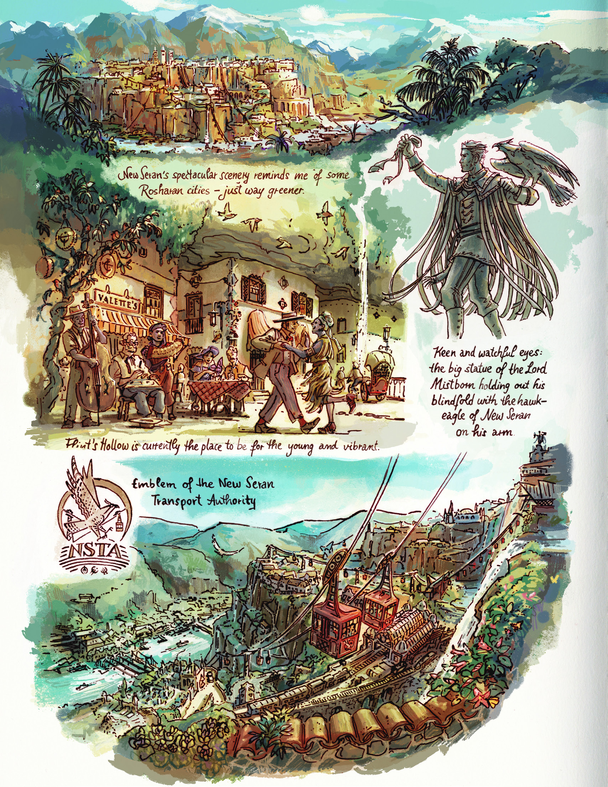

有噴泉之城（City of Fountains）之稱的 New Seran，坐落在依藍戴盆地（Elendel Basin）東南角，依傍從山間流回依藍戴（Elendel）的 Seran河（Seran River）。城市建在一層層頂部平坦的岩石臺地上。溪流穿過各層臺地，分流到城中各處，最後從峭壁奔落，形成數百道瀑布。這座城市綠意盎然，草木沿著臺地生長，也為仿古典聖務廷風格的宅邸添上一抹綠色。高聳的 Seran山脈積雪覆頂，俯瞰全城。

城裡待客熱情，生活舒適，財富驚人，居民也熱愛挑戰、渴望冒險。反依藍戴的聲浪與工人的不滿一同高漲。貴族家族靠蠻橫區（the Roughs）的採礦權和伐木權累積財富，學者則在依藍戴政府機關監管範圍之外，進行種種異想天開的科學實驗。

### 概覽

在 New Seran 設計新冒險（Adventure）時，可以考量下列因素。

#### 政府

New Seran 的政治由貴族主導。市長與四名市議員都從最富有、最有影響力的貴族中選出。現任市長 Festria Orielle 已任職三年，公開反對依藍戴。她與在 New Seran 長大、後來移居 Bilming 的政治人物 Gave Entrone 結盟。New Seran 的警署分成上城區（Uptown）、中城區（Midtown）和下城區（Downtown）三個轄區，每區約有一百名警員。市政府另有一支百人民兵，負責監看通往南方蠻橫區（Southern Roughs）的路線。

#### 居民

New Seran 約有二十萬名居民，多數在航運與製造業工作。城裡的貴族也為數不少。對財力雄厚、欣賞最後帝國（Final Empire）價值觀及奢華生活的貴族家族來說，這座城市很有吸引力。由於鄰近南方蠻橫區，New Seran 的克羅司混血（koloss-blooded）文化也相當興盛，主要集中在 Flint窪地（Flint’s Hollow）。

#### 經濟

New Seran 以空中纜車以及作為航運樞紐而聞名。纜車由 New Seran運輸協會（New Seran Transport Association，NSTA）維護。南方蠻橫區叢林產出的礦物和木材都會經過 New Seran。即使大部分財富都流向依藍戴，New Seran 的收益仍相當可觀。人們常以獅子攻擊代表 New Seran 的鷹鵰（hawk-eagle），象徵依藍戴的經濟霸權。New Seran 能取得南方蠻橫區的原料，以在本市製造優質產品為榮。這些產品從來不必繳稅給阿戴（the ’Del）。

#### 文化

New Seran 的貴族文化講究放鬆、休閒，以及上流社會（High Society）的禮節，尤其重視款待客人。對貴族而言，能在精心維護、綠意盎然的城中與險峻的山間享受生活，最能顯示財富與地位。即使街上人多，步調也很悠閒。居民漫步公園，走過一座座橋。富人品嚐最好的葡萄酒，收藏罕見的奇珍，也熱衷尋找最有意思的新裝置或古老遺物。

納哲（Nazh）和 Nicki Savage 在 New Seran 的一輛纜車裡扭打。

SONDERFLEX STUDIO

- 偉大的New Seran城（The Great City of New Seran）
- 由 Stefan Sauvage 大人委託繪製
- 336 年
- Shores宅邸（Shores Mansion）
- 三塔區（The Trio）
- 上城區
- 紅銅門旅館（Copper Gate Hotel）
- 中城區
- Seran新區墓園（Seran New District Cemetery）
- Seran河
- 下城區

ISAAC STEWART

202

New Seran大學（University of New Seran）以富有想像力的師生聞名，其中包括作家兼劇作家 B. Sablerfils 教授，以及聲名掃地的發明家 Yennev Hanlanaze 教授。工人階級長期抗議財富分配不公，如今正籌組工會。與此同時，市內的政治菁英試圖把這股怒火從自己身上引向依藍戴，煽動民眾走向獨立運動，避開社會主義訴求。

New Seran 流行色彩鮮豔的鐵路條紋西裝與平頂草帽，也流行粉彩洋裝和蕾絲寬簷帽。工人階級穿著有扣子的襯衫，外面常套吊帶工作褲或長圍裙，再配上報童帽、繫帶帽或蠻橫區風格的有簷帽。許多工人家庭以留有一套體面衣服為榮，去教堂、過節或遇到其他特殊場合就會穿上。

#### 「組織」

警署近來調查 Kelesina Shores夫人（Lady Kelesina Shores）的死因後，「組織」（the Set）放慢了在 New Seran 的行動。許多當地盟友仍在推動各種計畫，想重新得到「組織」的青睞，但「組織」已把大部分資源轉往 Bilming。

### 重要地點

New Seran 橫跨多層不同高度的臺地，主要分為上城區、中城區和下城區。城外的農莊與牧場遍布穿過 Seran山脈（Seran Range）的谷地。

在上城區，貴族莊園大多集中在 Waterman區（Waterman District）和三塔區。三塔區也有一片商業區（Commercial District）。

中城區包括新區（New District）、供客運列車停靠的 Tinview車站（Tinview Station），以及泰瑞司（Terris）聚居地 Reaches街區（The Reaches）。

下城區涵蓋城內最低的幾層臺地，有倉庫、工廠和各式商家，也有 Flint窪地、木蘭花園區（Magnolia Gardens）等住宅區。

#### 上城區

上城區有政府行政大樓和許多貴族莊園。這裡十分富裕，居民教育程度高，街區也維護得很好。值得注意的人物包括煽動反依藍戴情緒的 Festria Orielle 市長，以及反對「組織」、德高望重的年長貴族 Sharlot Farthing夫人（Lady Sharlot Farthing）。

Orielle市長（Mayor Orielle）常接待盆地其他城市的政治人物，帶他們到滑雪小屋和精心維護的公園遊玩。她為了爭取商機，犧牲居民的利益，再以煽動性的言論把民眾對她與其所作所為的不滿轉向依藍戴。

Farthing夫人則在花開大道（Blossom Way）的 Farthing宅邸（Farthing Mansion）接待各方人士。這座三層樓的石造宅邸十分氣派。她的子孫眾多，每一位都捲入了她精心策畫的某項計畫。

上城區也有幾座碎刺教信徒（Sliverist）的教堂，以及 New Seran大學。大學的研究人員與教授住在校內宿舍，成天待在講堂、實驗室和附近的酒館，興奮地討論最新的實驗，也熱切地投入研究。

#### 三塔區

全市僅有的三座摩天大樓稱為三塔，分別是 Seran塔（Seran Tower）、泛圖爾塔（Venture Tower）和 Statlin-Ostlin塔（Statlin-Ostlin Tower），矗立在繁榮的商業區中心。許多來自其他外圍城市（Outer Cities）的貴族家族在三塔區設有據點，管理他們在南方蠻橫區的事業。這處商業中心有各式各樣的本地商品、高級餐廳和娛樂場所。上城三塔劇院（Uptown Trio Theater）的舞臺劇頗受好評，聲勢卻一直比不上中城區的 Gaudet交響音樂廳（Gaudet Symphony）。

近來，爭取公平薪資的人在 Seran塔的辦公區示威。Orielle市長讓警員記下示威者的具體訴求與聯絡資料，沒有驅散他們。她打算利用這些資料替「組織」招募人手。泛圖爾塔的主人是古怪的 Hortense．塞特－泛圖爾（Hortense Cett-Venture）。這位鉻單藏金術師（chromium Ferring）也是上流社會的冒險家（gentlefolk adventurer），會率領遠征隊前往南方蠻橫區和 Conrad三角洲（Conrad Delta），在落灰之終（Catacendre）前的遺跡中搜尋珍貴的歷史文物。

對頁：New Seran 地圖。

第 7 章：第二紀元的特色地點 203

> New Seran 的壯麗景色讓我想起羅沙（Roshar）的某些城市，只是這裡綠得多。
>
> 銳利而警醒的目光。迷霧之子大人（Lord Mistborn）的巨像一手伸出，拿著自己的眼罩，另一隻手臂上停著 New Seran 的鷹鵰。
>
> Flint窪地如今是年輕人最愛去的熱鬧地方。
>
> New Seran運輸管理局（New Seran Transport Authority）的徽章
>
> NSTA
>
> 法蕾特的店（VALETTE’S）

#### 中城區

中城區比上城區粗獷熱鬧，有公共空間、交通樞紐和各種娛樂。Tinview車站有客運列車，上城區和下城區也都有纜車通到這裡，因此各地來的人與文化在此交會。盆地比爾的老派酒館與劇院（Basin Bill’s Old Time Pub & Playhouse）招待上流社會的冒險家、傭兵和玩票的貴族，也會為好奇的來客舉辦活動、講故事。店裡的嚮導與騙徒販售地圖、傳聞和小玩意，引著客人往蠻橫區或更遠的地方去，尋找魔法文物、財富和名聲。這座喧鬧的地標坐落在中城區中心，上方有一座老舊的倖存者教信徒（Survivorist）的教堂。貴族會在這裡與形形色色的冒險家混在一起。

中城區北側幾乎到了上城區的地方，坐落著 Gaudet交響音樂廳。這座首屈一指的音樂表演場館及其樂團，曾獲兩任依藍戴總督（Governor）表揚。現任指揮兼作曲家 Ashlake．布維達（Ashlake Buvidas）是個性格古怪的天才，喜歡在盆地各地尋找新的表演者、樂器與靈感。布維達尤其熱愛最後帝國時期的歌劇，願意出高價收購失落的手稿。

#### Reaches街區

兩個世代以前，Reaches街區是中城區西南部一處小型泰瑞司聚居地（Terris Enclave）。後來，席諾德（Synod）爆出醜聞，長老和他們的理念失去支持。Reaches街區就此成了城裡的普通街區，只是泰瑞司居民特別多。近來，這裡成了時髦的去處。非泰瑞司居民大量遷入，開始改變當地的文化組成。

Reaches街區正成為熱鬧的玩樂去處，到處都有餐廳、音樂廳和酒吧。但隨著街區逐漸高檔化，泰瑞司文化的象徵也從一條條街上消失。一群自稱紅銅意識團（Copperminds）、心懷不滿的單藏金術師（Ferring）採取愈來愈激烈的手段表達不滿，從破壞財物和當眾叫罵，逐步升高到偷竊與襲擊。

#### 下城區

下城區的工業中心分布在貨箱區（Crate District）、劈石區（Stonesplitter District）和鐵路調車場區（Trainyard District）。這片臺地有倉庫、碼頭、修理廠、馬廄、鋸木廠、礦石精煉廠、鍛造廠及各式各樣的商家。

在南方蠻橫區經營事業的公司都在這裡設有辦事處。貨運場每天處理數十班往來的列車、駁船和驛站馬車。近來貨物接連失竊，當地警員正在追查貪腐的貨運人員，卻還沒發現真正的犯人是蠻橫區的一個幫派。這群人由惡名昭彰的亡命之徒 Snakehand Gill 帶領，藏在貨箱區的一座廢棄倉庫裡。鑽岩航運公司（Diamond Rock Shipping Company）出錢資助 Snakehand Gill，指使他對付頭號競爭對手新月資源公司（Crescent Resources）。

#### Flint窪地

Flint窪地是個舒適宜人的街區，到處都是維護良好的平房，居民大多是克羅司混血。鄰里關係緊密，家家戶戶每晚都在戶外用餐、演奏音樂，有時熱鬧得足以蓋過城中從不停歇的瀑布聲。每戶人家都有一面縫製的旗幟，上面繡著家庭成員所屬的各個克羅司氏族標誌。大多數旗幟都飽經風雨，上面有許多符號，顯出克羅司文化各氏族之間的緊密連結。

過去一年，依藍戴的 noseball 運動在 Flint窪地扎根，現在有四支成人隊伍，孩子們幾乎天天自發打球。每月都有一場名叫 Flint盃（Flint Cup）的錦標賽，其他街區的球員也開始參加。甚至傳出盆地比爾酒館（Basin Bill’s）可能贊助其中一支球隊。

#### 坎得拉骨骸圖書館（Kandra Bone Library）

中城區一座瀑布後方有條密道，通往一連串洞窟。骨骸圖書館（Bone Library）就在裡面，館藏包括人類與動物的骨骼，由七代（Seventh Generation）坎得拉（kandra）InVur 和 MaPaag 管理。兩人除了收藏骨骼，也用木材、石頭、金屬、水晶和其他更奇特的材料打造真體（True Bodies）。館藏包括多種品種的狗和馬，以及蛇、大猩猩、美洲豹等罕見動物。

對頁：New Seran 是座依山而建、色彩繽紛且綠意盎然的城市。

MARIE SEEBERGER

第 7 章：第二紀元的特色地點 205

來訪 New Seran 的坎得拉可以在洞窟裡私下試用各種骨骼。比較大膽的訪客還會穿著這些骨骼外出，在 New Seran 周遭的鄉間漫遊。InVur 和 MaPaag 也接單製作客製真體，並接受人類與克羅司混血家庭捐贈骨骼。在少數情況下，坎得拉也會找上知名人士，提出預付費用，等對方死後再來取走骨骼。

#### Seran谷地（Seran Valley）

New Seran 城外的谷地草木茂盛，有豐富的農地、植被、溪流和湖泊。Hopperwill 和 Derring 等鄉村仰賴 New Seran 的小型民兵部隊保護，居民過著田園生活。往高處的臺地和峭壁走，有小型季節性聚落和舒適的旅舍，供人健行和滑雪。人們搭乘纜車上下往返。

Farthing家族（House Farthing）正在為一條規模宏大的山區鐵路勘測路線，希望開放新的山坡供人使用和開發。最講究身分的滑雪俱樂部是和諧花園（Harmony’s Garden）。這處豪華度假地有壯麗的景觀和眾多溫泉。不過，New Seran 一帶大多數人更喜歡去價格親民許多的土撥鼠湖度假村（Marmot Lake Resort）消磨閒暇。

### 冒險引子

你可以用下列點子開展一場以 New Seran 為舞臺的冒險。

#### 突破封鎖（Blockade Run）

總部設在 Doriel 的鐵路工人501工會（Rail Workers 501）封鎖從 New Seran 通往依藍戴的鐵路後，Orielle市長開始尋找信差。她請角色搭驛站馬車帶一件包裹穿過封鎖線，低調送到 Bilming 的 Gave Entrone 手上。她警告角色，工會工人埋了地雷，也設下埋伏。會面後，一名打扮成鐵路工人的女子態度堅定地走向角色。她只自稱工頭（Foreman），並提出條件。只要角色讓她單獨保管包裹一小時，她就會讓角色安全通過封鎖線。

#### Seran群峰的挑戰（Challenge of the Seran Peaks）

古怪的百萬富翁 Hortense．塞特－泛圖爾需要人幫忙保護一件名為失落Doriel之心（Heart of Lost Doriel）的遺物。行事神祕的 Wraith 正在南方蠻橫區尋找一座極具價值的神殿。Wraith的密探（Agents of Wraith）一路追著塞特－泛圖爾和角色，追過土撥鼠湖滑雪度假地的山坡與纜車。

#### 缺席的賓客（Guests Indisposed）

Ashlake．布維達要在 Gaudet交響音樂廳演出改編自 B. Sablerfils 輕歌劇《萬世英雄》（A Hero for All Ages）的作品，想邀請 Sablerfils 教授和他的大學同事觀賞首演，教授們卻都不見蹤影。角色必須在 New Seran 各處找出這些教授，沿途還得應付醉酒狂歡、不滿的樂迷、一名神祕的外地冒險家，以及一夥笨手笨腳的依藍戴走私犯。

#### 凡人不該知曉的科學（Science Not Meant for Mortal Minds）

聲名掃地的 Yennev Hanlanaze 教授招募角色，請他們取得對手 Jessi Nulien 教授的發明。角色潛入 Nulien 的私人實驗室時，發現了駭人的血金術（Hemalurgy）實驗。

#### 試探風向（Testing the Air）

幾年前，Edwina Airs夫人（Lady Edwina Airs）的叔伯輩親屬，也就是惡名昭彰的間諜 Devlin Airs，離開了 New Seran。Edwina夫人於是著手接管家族事業。她需要線人，想讓角色先參加一場 Farthing家族的派對，試著替她蒐集有用的情報，看看他們是否適任。

#### 其他場景

New Seran遭遇（New Seran Encounters）表提供一些獨立場景的點子，你可以用在任何戰役（Campaign）中。

##### New Seran遭遇

| d6 | 遭遇（Encounter） |
| --- | --- |
| 1 | 一位大學教授展示新發明的超強磁鐵（ultra-magnet）。發明損壞一輛纜車，危及乘客。 |
| 2 | 一名倖存者教祭司在抗議活動中遭鐵路工人攻擊。奇怪的是，攻擊者的鞋子比其他示威者的乾淨得多，也昂貴得多。 |
| 3 | 一輛從蠻橫區載運囚犯的驛站馬車剛進入下城區便遭人縱火，罪犯趁機逃入城中。 |
| 4 | 盆地比爾酒館正在舉辦飛鏢錦標賽，優勝者可獲得 500 枚盒金（boxings）的店內額度，用來購買裝備。 |
| 5 | Farthing家族的士兵追捕一名克羅司混血女子。她戴著一條項鍊，上面掛著一名 Farthing家族年輕子弟的印戒。 |
| 6 | 坎得拉 MaPaag 請角色把一隻藪貓（serval）從 Orielle市長私人動物園的玻璃圍欄裡偷救出來。 |

第 7 章：第二紀元的特色地點 206
