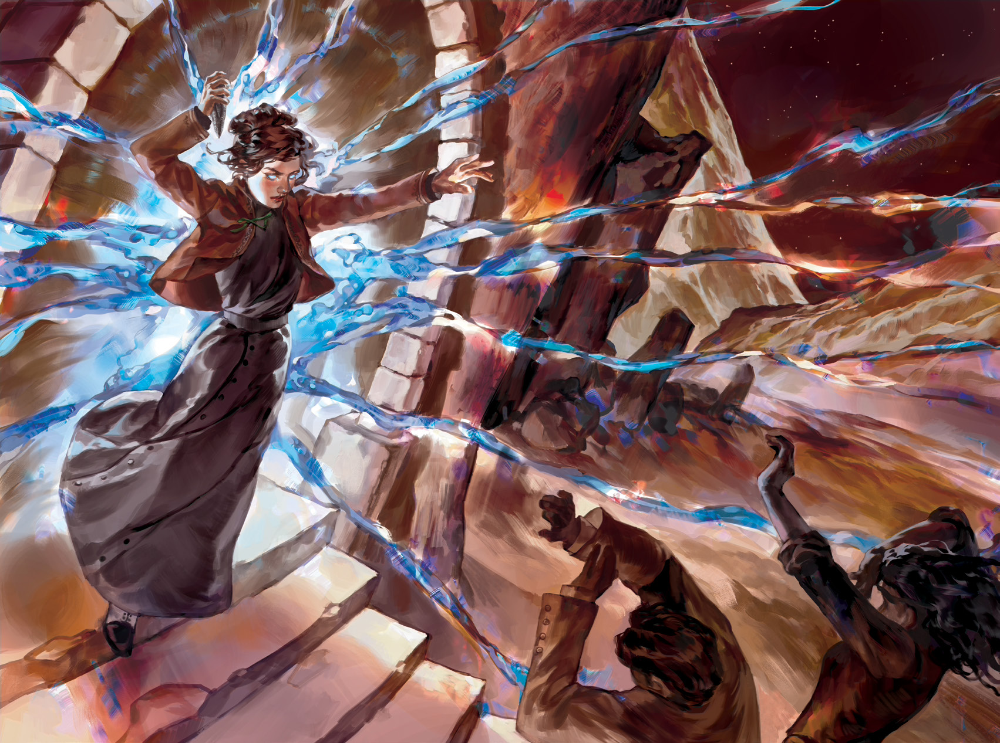

落灰之終（Catacendre）後，司卡德利亞（Scadrial）是個不斷創新與變化的世界。技術進步、政治角力，以及意想不到的敵人，為這裡的人們帶來新的壓力。

在本章介紹的地點中，角色可能捲入依藍戴（Elendel）這座大城裡罪犯與警員之間無休止的較量。隊伍也可以由貴族或富有的企業家組成，穿梭於俱樂部與宅邸之間，談成交易、累積權勢。無論是探索新邊疆、揭開失落的知識，還是策畫驚心動魄的劫案，司卡德利亞都有豐富的冒險（Adventure）機會。

### 如何運用這些地點

本章介紹司卡德利亞第二紀元的五個代表性地點，並提供冒險引子，供你發展新的故事。

**Bilming。** Bilming 是依藍戴盆地（Elendel Basin）一座繁忙的外圍城市（Outer City）。這座城市不斷創新，核心卻日益腐敗。隨著時間推移，「組織」（the Set）的勢力在城中愈發強大，根基也愈扎愈深。

**Conrad三角洲（Conrad Delta）。** 南方蠻橫區（Southern Roughs）的一片新邊疆，這裡有龍蛇混雜的港都 New Tremredare、令人望而卻步的 Brittlespear河灣（Brittlespear Bayou），以及失落的最後帝國（Final Empire）遺跡。

**依藍戴。** 依藍戴建在最終昇華（Final Ascension）發生的地點，是落灰之終後北方文明的發源地。縱橫交錯的街道和運河裡，藏著祕密、機會和危險。

**New Seran。** New Seran 的懸崖是和諧（Harmony）打造的奇觀。數百道瀑布從崖上傾瀉而下，蔚為壯觀。這裡是愛冒險的人嚮往的地方，也是外圍城市不滿情緒匯聚之處。

**北方蠻橫區（The Northern Roughs）。** 北方蠻橫區塵土飛揚、荒涼偏僻，日子並不好過。礦業公司提供工作，也制定法律。強盜和執法者（Lawkeeper）之間的鬥爭永無休止。

第 6 章介紹司卡德利亞第一紀元的特色地點。

### 情緒與劇情

在寰宇（cosmere），場景與敘事密不可分。在第二紀元的司卡德利亞，發明家、執法者和學者會遠赴各地冒險，也得面對在自己身邊滋長的腐敗。

《迷霧之子》（Mistborn）系列裡的地點能加強情緒，也能推進情節。每處地點都能為故事增添層次，還藏有祕密或值得角色追查的劇情線索。

#### 加深情緒

落灰之終後，依藍戴的豐饒綠意與乾燥多塵的北方蠻橫區形成鮮明對比。盆地裡光鮮的高塔，把進步與發明的主題和社會停滯及腐敗交織在一起。蠻橫區則沒有集中化的社會體制，讓人有餘地自主選擇，自由行事。

#### 推展劇情

讓具體的地點配合戰役（Campaign）的故事脈絡，可以強化主題。把事件與特定地點連結起來，也能讓戰役的敘事更有力、更連貫。

對頁：瓦（Wax）和韋恩（Wayne）登上獨立塔（Independence Tower）。

CRISTI BALANESCU

第 7 章：第二紀元的特色地點 181

### 第二紀元的故事

落灰之終三百年後，依藍戴盆地、蠻橫區（the Roughs）和更遠的土地，都讓人有機會自主行事，親手選擇自己的命運。本節提到的角色詳見第 5 章。

#### 單純的日子

蠻橫區荒涼而人煙稀少，遠離依藍戴社會僵化的體制。在這裡，人們可以決定自己的命運，哪怕他們同時也在逃避責任。瓦希黎恩．拉德利安（Waxillium Ladrian）原本可以去盆地的小鎮，或前往一座外圍城市。他卻選擇去了蠻橫區，因為那裡能讓他覺得自己是個英雄。有一段時間，他確實如願了。

妻子死後，悲傷的瓦回到貴族身分，把自己埋進一套與最後帝國極為相似、一路延續至今的階級制度裡。他並不認為扮演這個角色合乎正道或公義，卻因悲痛而多年無法承認這一點。

#### 醞釀變革

習慣了蠻橫區的自由之後，依藍戴讓人處處感到受限，這座城市本身也充滿矛盾。從社會、政治、科技到建築，城市各方面都比最後帝國時期更進步，但有幾項明顯的例外。階級歧視、懸殊的貧富差距和腐敗依舊無處不在。

瑪拉席．科姆斯（Marasi Colms）相信改變能讓依藍戴變得更好，但她的抱負經常遭依藍戴文化中保守、倒退的一面阻撓。與此同時，瑪拉席同父異母的姊姊史特芮絲（Steris）也努力在社會中找到自己的位置，周遭的人卻覺得她嚴厲又古怪。

在這種社會期待處處設限的環境裡，角色必須學會拿捏哪些事該擺在前面。他們願意多大程度地遵從社會規範？又想花多少心力照顧自己的需求與渴望，或是讓事情有所改善？

#### 選擇決定我們成為誰

瓦與「百命」邁爾斯．達古特（Miles “Hundredlives” Dagouter）正面對決，故事也來到高潮。兩人都是執法者，都受蠻橫區的環境塑造，也都對世道如何運作深感失望。如果當初有幾個決定做得不一樣，瓦會不會成為消賊（Vanishers）的領袖？面對這種可能性之後，瓦更確定自己想成為怎樣的人。

等到角色接受自己在依藍戴的身分，並開始走出自己的路，故事的焦點就能向外拓展。

#### 更成熟的眼光

與外圍城市開戰的威脅日益迫近。角色開始察覺依藍戴處於多麼優越的地位，也意識到，即使他們努力改善這座城市，自己仍享有這些優勢。這讓他們更能理解，為何「組織」與外圍城市能讓各自的人堅定效忠。

探索盆地的其他地點，讓史特芮絲有機會展現自己的能力，以及她對團隊的價值。截然不同的政治環境挑戰了瓦原先的看法，也讓瑪拉席和韋恩在換了環境之後，成為更有默契的工作夥伴。

#### 接受考驗

遠征隊先前往 Dulsing，再到神殿，一路探索信任、英雄氣概和希望，卻以背叛收場。瑪拉席發現了悼環（Bands of Mourning），卻選擇救瓦的性命，放棄掌握那股力量的機會。瀕死之際，瓦有機會親自做出選擇。他可以接受和諧為他安排的角色，也可以將這一切拋在身後。

就像蠻橫區一樣，地處偏遠的神殿也讓角色能表明自己想成為怎樣的人。依藍戴錯綜複雜的政治和別人的期望都碰不到這裡，他們只需面對自己對自己的期望。

> 在那超凡的一瞬間，她感到自己正在改變、擴展。統御主（Lord Ruler）本人的力量就儲存在悼環裡，儲存在她緊握於指間的矛頭中。那力量湧過她全身，她覺得自己就要脹裂了。彷彿一整片光的海洋突然被灌進她的動脈與靜脈。

第 7 章：第二紀元的特色地點 182

#### 更大的舞臺

最後，故事的範圍再度擴大。南方大陸（Southern Continent）有人居住的消息曝光後，依藍戴盆地幾百年來第一次不得不把目光投向外界。盆地與 Malwish 的關係開始緊張，而自主（Autonomy）正是自主決定自身命運這一概念的化身，也趁機介入。

瓦擊敗了姊姊黛兒欣（Telsin），但最後是韋恩做出了拯救全依藍戴的選擇。

### 選擇故事場景

為落灰之終後的戰役或冒險挑選地點時，先確定故事的主題、情節轉折及發展方向。政治戰役可以從依藍戴開始，但角色也可能接到任務，被派往 Bilming 或 New Seran。出身上流社會的冒險家也許會先在 New Tremredare 碰面，再循著傳聞去找失落的寶藏。

以依藍戴為舞臺的戰役可以安排調查與謎團，讓線索指向「組織」。也可以由一群殺霧者（hazekillers）追捕危險的鎔金術師（Allomancers）。故事可以聚焦蠻橫區，描寫人們如何努力在盆地之外站穩腳跟，也可以圍繞新技術的發展，探索人為了錢願意做到哪一步，或者他們是否有任何底線。

#### 決定你要說的故事

第二紀元有許多機會讓執法或祕密組織成為戰役的一部分，你也可以把故事的重心放在其他題材上。例如，戰役可以帶領角色探索新邊疆和古代遺跡，或研究授予（Investiture）及寰宇的本質。

你可以跳脫小說既定的情節與世界發展，自由安排自己的故事。司卡德利亞有數不清的地方，能用來講述符合你的戰役的故事。本章接下來介紹的第二紀元特色地點，就是其中幾個例子。

瑪拉席運用悼環的力量。

SYDNEY MILLS

